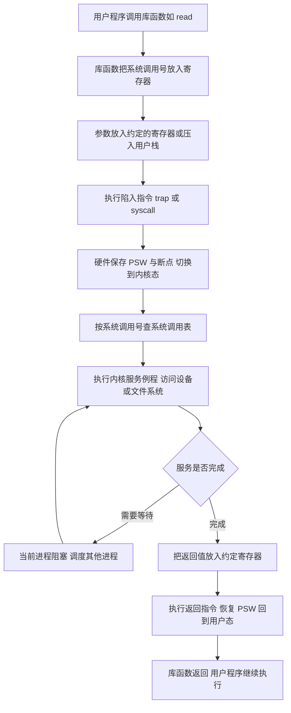
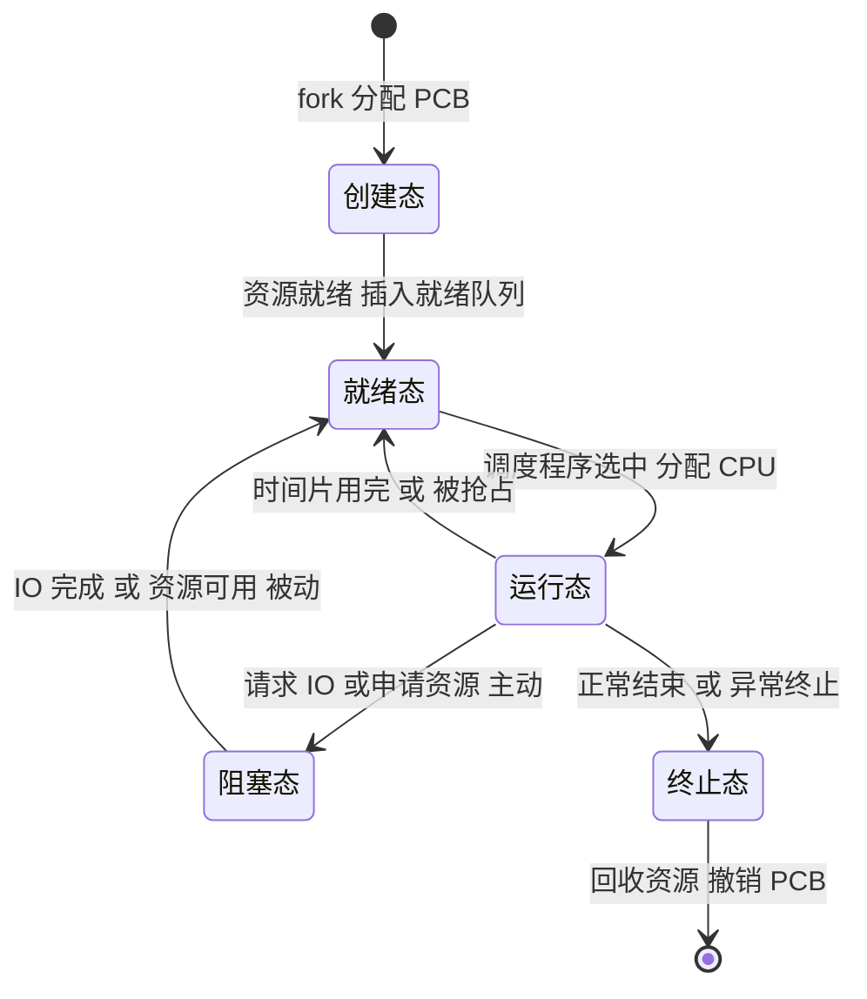
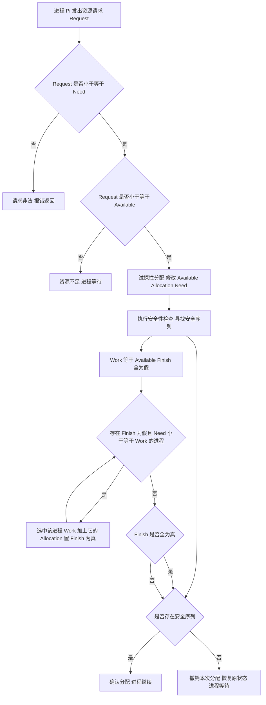
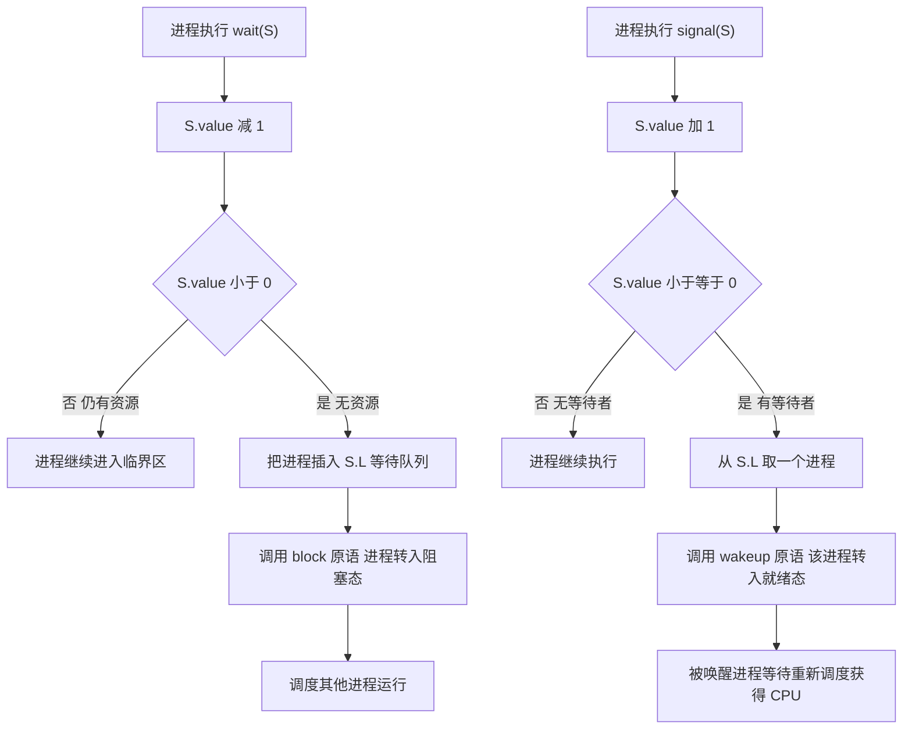
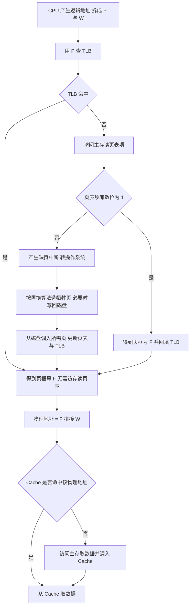
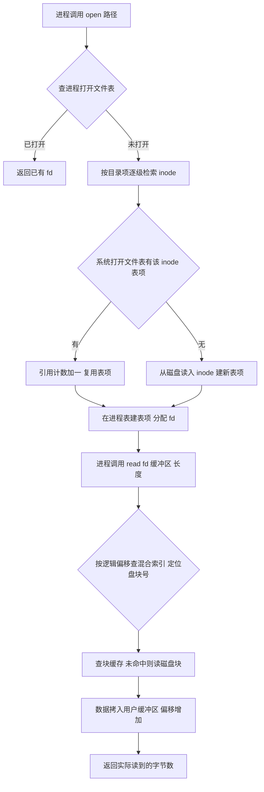
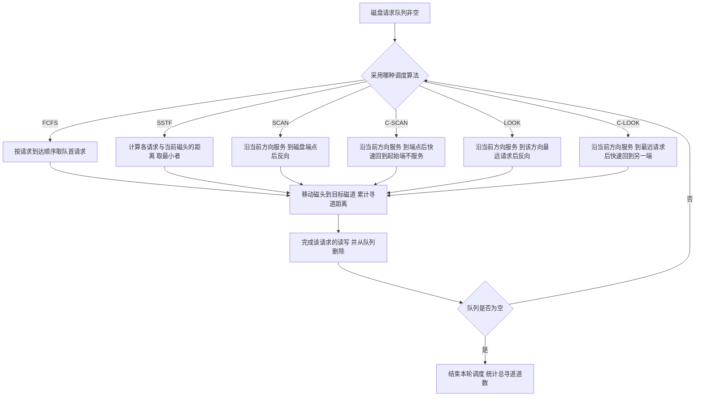

# 操作系统 · 408 速成复习资料

**科目分值**：35 分 / 150 分　|　**章节数**：7　|　**统计区间**：2009—2025 年 408 统考真题（17 套）

## 本科目章节索引

| # | 知识点 | 考察次数 | 分值占比 | 高频 |
| --- | --- | --- | --- | --- |
| 1 | [操作系统概述与运行机制](01-操作系统概述与运行机制.md) | 16 次 | 约 10% | **是** |
| 2 | [进程与线程](02-进程与线程.md) | 26 次 | 约 18% | **是** |
| 3 | [处理机调度与死锁](03-处理机调度与死锁.md) | 22 次 | 约 16% | **是** |
| 4 | [同步与互斥](04-同步与互斥.md) | 20 次 | 约 20% | **是** |
| 5 | [内存管理](05-内存管理.md) | 28 次 | 约 26% | **是** |
| 6 | [文件管理](06-文件管理.md) | 20 次 | 约 16% | **是** |
| 7 | [输入输出管理](07-输入输出管理.md) | 14 次 | 约 8% | **是** |

## 本科目在 408 中的位置

| 项目 | 内容 |
| --- | --- |
| 分值 | **35 分 / 150 分**（占 23.3%） |
| 单选题 | 第 23—32 题（单选，每题 2 分，共 20 分） |
| 综合应用题 | 第 45 题（约 7 分）、第 46 题（约 8 分），共 15 分 |
| 命题特点 | 45 题几乎固定为 **PV 操作（同步互斥）**；46 题常为 **页表/地址翻译/页面置换 + 文件系统容量计算**；选择题重概念辨析与小型计算 |

**复习优先级**：内存管理 → 同步与互斥 → 进程与线程 → 处理机调度与死锁 → 文件管理 → 输入输出管理 → 概述。
**内存管理 + 同步互斥两章合计约 16 分**，且大题命中率最高，必须做到"闭卷可推导"。

## 使用说明（30 秒读完）

1. **先看 `[高频]` 标记**：每节标题带 `[高频]` 的是历年反复命题的考点，时间紧张时只看这些。
2. **每节固定五段式**：考频统计 → 核心讲解 → 示意图 → 易错点 → 真题示例，可直接跳跃到你缺的那一段。
3. **图形约定**：`text` 代码块为 **ASCII 图**（用于结构布局、位域划分、地址格式）；`mermaid` 代码块为 **流程图/状态机**（用于算法流程、协议交互、状态转换）。
4. **考频口径**：统计区间 2009—2025 年共 17 套真题；"考察次数"按题次计，一道综合题串联多个考点时各自计 1 次。
5. **自检方式**：本资料由脚本生成，`python3 scripts/validate.py` 会校验模板完整性、考频数字一致性、ASCII 图对齐与真题年份合法性。

> 本资料为速成复习用途：**考频数据为基于 2009—2025 年真题的公开考频表统计整理，非官方发布**，
> 用于确定复习优先级，不作为命题预测。数据口径与来源见 `README.md`。

## 操作系统概述与运行机制 [高频]

**考频统计**：考察次数 16 次；涉及年份：2009、2011、2013、2015、2017、2019、2021、2023、2024；分数占比约 10%；主要题型：选择题为主（内核态/用户态、系统调用、中断与异常）。

**核心讲解**：

操作系统是管理计算机硬件的系统软件，其四个基本特征是**并发、共享、虚拟、异步**，其中**并发与共享互为存在条件**（没有并发就无需共享，没有共享则并发程序无法推进）；虚拟建立在离散分配与多次性之上，异步是"程序走走停停、以不可预知的速度推进"。CPU 的执行状态分为**内核态（管态）**与**用户态（目态）**：只有内核态才能执行**特权指令**（如开关中断、设置时钟、清主存、修改 `PSW`、`I/O` 指令）并访问全部寄存器与存储空间；用户态只能执行非特权指令。**`PSW` 中的状态位**标识当前处于哪一态，而**由用户态进入内核态的唯一途径是中断或异常**（系统调用本质上是通过**陷入指令 `trap`** 触发的一次特殊异常）。

注意 `trap` 指令本身**不是特权指令**——它需要在用户态执行才能完成"进入内核态"的动作。**中断（外中断）**来自 CPU 外部的事件（时钟中断、`I/O` 完成中断、控制台中断），**异常（内中断）**由当前执行的指令引起，分为故障 `fault`（如缺页、除零，可能被修复后重新执行该指令）、自陷 `trap`（如系统调用、断点，处理后返回到下一条指令）、终止 `abort`（如硬件故障，不返回）。**系统调用**的过程是：用户程序传递参数 → 执行陷入指令（`trap`/`syscall`，硬件将 `PSW` 改为内核态并转入内核入口）→ 内核按系统调用号查表执行服务例程 → 返回用户态。

操作系统内核通常包含**时钟管理、中断处理、原语、进程管理、存储管理、设备管理**等功能，**原语**是"执行期间不可中断"的原子操作，靠**关中断**实现。体系结构上，**宏内核**把所有功能放在内核态、效率高但可靠性差；**微内核**只把最基本的功能（进程调度、中断处理、消息传递）留在内核，其余移出为用户态服务进程，可靠性高但频繁的消息传递带来开销。

**关键结论速记**：

- `四个特征：并发、共享、虚拟、异步` —— 并发与共享互为存在条件，是最常考的相互关系。
- `特权指令只能在核心态执行；trap 指令是唯一能在用户态执行并进入核心态的指令` —— 把 `trap` 说成特权指令即为错误。
- `中断（外中断）来自 CPU 外部，异常（内中断）由当前指令引起` —— 时钟、`I/O` 完成属中断；缺页、除零、系统调用属异常。
- `fault 返回当前指令重新执行，trap 返回下一条指令，abort 不返回` —— 异常三分类的返回行为必须区分。
- `系统调用 = 传参 + 陷入指令 + 内核服务例程 + 返回用户态` —— 库函数不一定发生系统调用，系统调用一定进内核。
- `原语的原子性靠关中断保证` —— 关中断/开中断是特权指令，故原语只能在核心态运行。

**示意图**：

**用户态与内核态的地址空间与切换路径**：用户程序只能通过中断/异常这道"门"进入内核，内核通过修改 `PSW` 回到用户态。

```text
process address space and the user/kernel boundary

   high address
   +-----------------------------------+
   |          kernel space             |   only in kernel mode
   |  (kernel code, kernel stack,      |   privileged instructions allowed
   |   page tables, device drivers)    |   can access all memory
   +-----------------------------------+
   |     <-- boundary is enforced by hardware mode bit in PSW -->
   +-----------------------------------+
   |          user space               |   only in user mode
   |  stack  (grows downward)          |   non-privileged instructions
   |  ...                              |   cannot touch kernel space
   |  heap   (grows upward)            |
   |  data / bss                       |
   |  code (text)                      |
   +-----------------------------------+
   low address

mode switch paths

   user mode  --(1) system call via trap-->  kernel mode
   user mode  --(2) external interrupt   -->  kernel mode
   user mode  --(3) exception (page fault, divide by zero) --> kernel mode
   kernel mode --(4) return from trap/interrupt: restore PSW --> user mode
                 (returning to user mode is NOT a privileged-only act;
                  the OS does it by executing the return-from-trap instruction)
```

**一次系统调用的完整流转**：参数通过寄存器或栈传递，`trap` 指令切换状态并跳转到内核固定的入口地址。



**易错点**：

- 把 `trap`（陷入）指令当成特权指令：`trap` 必须**在用户态执行**才能完成"请求进入内核"的功能，因此它是非特权指令；真正只能在核心态执行的是开关中断、`I/O`、修改 `PSW` 等特权指令。
- 混淆中断与异常的分类归属：时钟中断、`I/O` 完成中断来自 CPU 外部，属**中断**；而缺页、除零、系统调用、断点由当前指令引起，属**异常**；把缺页说成"中断"是最常见的概念错误。
- 认为系统调用与库函数等价：库函数可能只是用户态的一段代码（如 `printf` 的格式化部分），只有其中真正需要内核服务的环节才触发系统调用，二者不是一一对应。
- 把"用户态到内核态"的途径扩大化：除中断与异常外，用户程序**没有任何其他合法途径**进入内核态；也不能通过跳转指令直接跳进内核代码（硬件会因特权级检查而拒绝）。

**真题示例**：

**2011 年 408 第 23 题（单项选择题，2 分）**

下列选项中，在用户态执行的是（ ）。

A. 命令解释程序　B. 缺页处理程序　C. 进程调度程序　D. 时钟中断处理程序

> 解析：逐项判定所处的运行状态。**缺页处理程序**属于内存管理的内核功能，需访问页表与磁盘，必须在核心态（B 错）。**进程调度程序**要操作就绪队列与 `PCB`、修改 `PSW`，属内核功能，必须在核心态（C 错）。**时钟中断处理程序**是中断服务程序，由硬件中断触发、运行在核心态（D 错）。**命令解释程序**（`shell`）只是接收用户命令并创建子进程去执行，其自身运行在用户态，因此用户态可以执行（A 对）。答案选 **A**。**判分依据是"该程序是否需要访问内核数据结构或执行特权指令"，不需要即可在用户态运行。**

---

## 进程与线程 [高频]

**考频统计**：考察次数 26 次；涉及年份：2009—2025 年高频，2010、2012、2015、2017、2019、2020、2022、2024 年为典型年份；分数占比约 18%；主要题型：选择题 + 综合应用题（进程状态、PCB、线程共享、调度）。

**核心讲解**：

**进程**是程序在一个数据集合上的一次运行过程，是系统进行**资源分配**的基本单位；**线程**是进程内的一个执行流，是**处理机调度**的基本单位。进程由**程序段、数据段、`PCB`** 三部分组成，其中 **`PCB` 是进程存在的唯一标志**，内容包括进程标识符、处理机现场信息（各寄存器与 `PC` 的值）、进程控制信息（状态、优先级、队列指针、资源清单）。

**进程映像**在内存中的布局自低到高为：代码段、数据段（含已初始化的 `data` 与未初始化的 `bss`）、堆（向上增长，`malloc` 分配）、栈（向下增长，存放函数调用帧与局部变量）。进程有**五种基本状态**：创建态、就绪态、运行态、阻塞态、终止态。状态转换的**唯一主动转换**是"运行 → 阻塞"（进程自己请求 `I/O` 或申请资源），其余都是被动的：**就绪 → 运行**由调度程序选中引起，**运行 → 就绪**由时间片用完或更高优先级抢占引起，**阻塞 → 就绪**由 `I/O` 完成或资源可用引起。

**阻塞态不能直接转为运行态**，必须先回到就绪态。**进程控制**由原语完成：创建（分配 `PCB` 与资源、置为就绪）、终止（回收资源、撤销 `PCB`）、阻塞与唤醒、挂起与激活。**进程通信**有共享存储、消息传递、管道通信三种方式（信号 `signal` 也可视为一种通知机制）。**线程**与进程的本质差别是：**同一进程内的各线程共享该进程的资源**（代码段、数据段、堆、打开的文件、地址空间），只**私有栈、寄存器现场与线程控制块 `TCB`**；因此线程切换不需要切换地址空间，开销远小于进程切换。**用户级线程**由用户库函数管理，内核不感知，故**一个线程阻塞会导致整个进程阻塞**、且**无法利用多核并行**；**内核级线程**由内核管理，可被独立调度到不同处理机，但切换需陷入内核、开销较大。

**关键结论速记**：

- `PCB 是进程存在的唯一标志`；进程 = 程序段 + 数据段 + `PCB`。
- `进程是资源分配单位，线程是调度单位` —— 线程只私有栈与寄存器现场，其余与同进程内其他线程共享。
- `运行 -> 阻塞 是唯一主动转换，阻塞 -> 就绪 是被动转换，阻塞不能直接到运行` —— 五状态转换的核心结论。
- `进程映像布局（低到高）：代码段 -> 数据段 -> 堆 -> 栈`；堆向上增长、栈向下增长，二者相向生长。
- `用户级线程阻塞则整个进程阻塞、不能并行于多核；内核级线程可独立调度` —— 两类线程的本质差异。
- `线程切换不切换地址空间，进程切换要换页表并刷新 TLB` —— 这是线程切换开销更小的根本原因。

**示意图**：

**进程映像的内存布局**：堆与栈相向增长，中间是尚未分配的空闲区；多个线程共享代码段、数据段与堆，但各自有独立的栈。

```text
process image layout in virtual address space

   high address
   +-----------------------------+
   |  argv / env (from kernel)   |
   +-----------------------------+
   |  stack of thread 3          |  grows DOWN
   |  stack of thread 2          |
   |  stack of thread 1 (main)   |  local vars, return addr
   + - - - - - - - - - - - - - - +
   |            free             |
   + - - - - - - - - - - - - - - +
   |  heap                       |  grows UP, malloc/new
   +-----------------------------+
   |  bss   (uninitialized data) |  shared by all threads
   +-----------------------------+
   |  data  (initialized data)   |
   +-----------------------------+
   |  text  (code)               |  read-only
   +-----------------------------+
   low address

   per-thread private: stack, registers, PC, TCB
   shared by threads of one process: text, data, bss, heap,
                                    open files, address space
```

**进程五状态转换图**：箭头旁标注引起转换的原因，注意"阻塞 → 运行"这条边不存在。



**易错点**：

- 认为阻塞态可以直接转为运行态：进程被唤醒后只能进入**就绪态**排队等 `CPU`，必须再经调度才能运行；画状态图时多画一条"阻塞 → 运行"是最典型的失分点。
- 把进程与线程的资源拥有关系搞反：线程**不拥有**资源（除栈与寄存器等私有部分），资源属于进程；因此"线程是资源分配单位"的说法是错误的。
- 混淆挂起状态与阻塞状态：**挂起**是把进程映像换出到外存（不占内存，属"静止"状态），**阻塞**是等待事件（仍在内存）；挂起态与阻塞态是两个不同维度，可组合为"就绪挂起""阻塞挂起"。
- 认为用户级线程能被内核独立调度：用户级线程对内核不可见，内核只认识进程，因此**一个用户级线程执行阻塞系统调用会导致整个进程阻塞**，也无法在多核上真正并行。

**真题示例**：

**2020 年真题改编（单项选择题，2 分）**

下列关于进程与线程的叙述中，正确的是（ ）。

A. 进程是处理机调度的基本单位，线程是资源分配的基本单位
B. 同一进程内的多个线程共享该进程的地址空间
C. 线程切换时一定伴随进程切换
D. 用户级线程的阻塞不会导致其所属进程被阻塞

> 解析：逐项辨析。**A 反了**——进程是**资源分配**的基本单位、线程是**处理机调度**的基本单位。**B 正确**——同一进程内所有线程共享该进程的地址空间（代码段、数据段、堆、打开文件等），只各自拥有独立栈与寄存器现场。**C 错**——同一进程内的线程切换不需要切换地址空间，因而不伴随进程切换；只有切换到另一进程的线程时才发生进程切换。**D 错**——用户级线程由用户库管理，内核只看到进程；一个用户级线程执行阻塞系统调用会使内核阻塞整个进程，从而**整个进程**被阻塞。答案选 **B**。**判分依据是"资源分配 vs 调度"与"线程共享地址空间"这两条最基本的结论。**

---

## 处理机调度与死锁 [高频]

**考频统计**：考察次数 22 次；涉及年份：2010、2012、2014、2016、2018、2020、2021、2023、2025；分数占比约 16%；主要题型：选择题 + 综合应用题（调度算法计算、银行家算法）。

**核心讲解**：

**处理机调度**分三级：**高级调度（作业调度）**决定哪些作业从外存进入内存并建立进程，**中级调度（内存调度）**决定挂起的进程何时重新调入内存（对应"就绪挂起 → 就绪"），**低级调度（进程调度）**从就绪队列中选一个进程分配 `CPU`，是频率最高、必须高效的一级；若系统有**中级调度**就说明采用了**虚拟内存**。评价指标中，**周转时间 = 完成时间 - 到达时间**，**带权周转时间 = 周转时间 / 服务时间**（`>= 1`，越接近 1 越好），**等待时间**是进程在就绪队列中排队的时间之和（不含执行与 `I/O` 时间），**响应时间**是从提交请求到首次响应的时间。

**`FCFS`（先来先服务）**按到达顺序调度，非抢占、对长作业有利而对短作业不利，且对 `I/O` 繁忙型作业不利。**`SJF`/`SPF`（短作业优先）**平均周转时间与平均带权周转时间最短，但必须预知运行时间，且对长作业可能造成**饥饿**。**`HRRN`（高响应比优先）**用 `响应比 = (等待时间 + 服务时间) / 服务时间`，兼顾等待时间与服务时间，是非抢占式的折中方案。**时间片轮转 `RR`** 只用于进程调度、按 `FCFS` 排队并轮流执行一个时间片：时间片过大会退化为 `FCFS`，过小则切换开销过大；

它对**响应时间**有利但不保证周转时间。**优先级调度**分抢占式与非抢占式，就绪队列可用**静态/动态优先级**。**多级反馈队列**设置多个优先级递减、时间片递增的队列，新进程进最高级队列，用完时间片未完成则降级，只有高优先级队列为空才调度低优先级队列，因而能较好的满足各类进程需要，是通用性最强的算法。**死锁**是多个进程因竞争资源而互相等待、无外力干预都无法推进的局面，产生死锁的**四个必要条件**是**互斥、不可剥夺、请求并保持、循环等待**，四者同时成立才可能死锁。**死锁预防**通过破坏某个必要条件实现；**死锁避免**在分配前用**银行家算法**判断系统是否处于**安全状态**（存在一个安全序列使所有进程都能完成）；**死锁检测与解除**允许死锁发生，用资源分配图化简（可完全化简则无死锁）检测，再用资源剥夺、撤销进程或进程回退来解除。

**关键结论速记**：

- `周转时间 = 完成 - 到达`，`带权周转时间 = 周转 / 服务时间` —— 带权周转时间必须除以服务时间，忘除是最常见错误。
- `SJF 平均周转时间最短，但需预知运行时间且长作业可能饥饿` —— 这是"理论最优但工程上受限"的经典结论。
- `RR 的时间片过大退化为 FCFS，过小则上下文切换开销剧增` —— 时间片选择是 RR 的核心权衡。
- `多级反馈队列：优先级递减 + 时间片递增 + 只有高优先级队列空才调度低优先级` —— 综合性能最好。
- `死锁四个必要条件：互斥、不可剥夺、请求并保持、循环等待` —— 缺一不可，破坏任一即可预防。
- `银行家算法：Need = Max - Allocation，找 Need <= Available 的进程并回收其资源` —— 找得到完整序列则处于安全状态。

**示意图**：

**三种调度算法的甘特图对比**：同一组作业（到达时间与服务时间相同）在不同算法下的完成顺序与平均周转时间不同。

```text
jobs:  A(arrive 0, service 7)  B(arrive 2, service 4)
       C(arrive 4, service 1)  D(arrive 5, service 4)

FCFS (non-preemptive, by arrival order)

   time  0    2         7   9  10  11        15
         +----+---------+---+---+---+---------+
         |    A          | B | C |     D       |
         +----+---------+---+---+---+---------+
   finish: A=7  B=11  C=12  D=16
   turnaround: A=7  B=9   C=8   D=11   average = 8.75

SJF (non-preemptive, shortest service first among arrived)

   time  0         7   8   9        13        20
         +---------+---+---+---------+---------+
         |    A    | C | B |    D    |  (idle) |
         +---------+---+---+---------+---------+
   at time 7 arrived: B(4), C(1), D(4) -> pick C, then tie B/D by arrival
   finish: A=7  C=8  B=12  D=16
   turnaround: A=7  C=4  B=10  D=11   average = 8.0

RR (time slice q = 4)

   time  0    4    8   9   12        16
         +----+----+---+---+---------+
         | A  | B  | C | A |    D    |
         +----+----+---+---+---------+
   order: A(0-4) B(4-8) C(8-9) A(9-12) D(12-16)
   finish: B=8  C=9  A=12  D=16
   turnaround: A=12  B=6  C=5  D=11   average = 8.5
   note: RR improves response time (C finished at 9 instead of 12)
         but its average turnaround may be worse than SJF
```

**银行家算法的安全性检查流程**：每次试探性分配后都要重新判断是否存在安全序列，不存在则撤销本次分配。



**易错点**：

- 带权周转时间忘记除以服务时间：`带权周转时间 = 周转时间 / 服务时间`，量纲是"倍数"且必然 `>= 1`；只算周转时间就答题会整题失分。
- 认为 `SJF` 一定优于其他算法：`SJF` 的"平均周转时间最短"是在**所有作业同时到达**的前提下证明的；若到达时间不同，抢占式 `SRTN` 才更优，且 `SJF` 会造成长作业**饥饿**。
- 把死锁避免与死锁预防混为一谈：**预防**是破坏四个必要条件之一（静态、保守），**避免**是用银行家算法在每次分配前动态判断安全性（允许必要条件存在但保证不进死锁），**检测与解除**则是允许死锁发生后再处理。
- 银行家算法中 `Need` 计算错误或判断条件写反：`Need = Max - Allocation` 必须先算对；寻找安全序列时判据是 `Need <= Available`（当前可用量），把 `Available` 误用成 `Max` 或 `Allocation` 都会得到错误结论。

**真题示例**：

**2016 年 408 第 45 题（综合应用题，7 分）**

某系统中有 5 个进程 `P0 ~ P4`，3 类资源 `A、B、C`，当前时刻的资源分配情况为 `Available = (3, 3, 2)`，各进程的 `Max` 与 `Allocation` 如下表（`Need = Max - Allocation`）：`P0: Max(7,5,3) Alloc(0,1,0)`、`P1: Max(3,2,2) Alloc(2,0,0)`、`P2: Max(9,0,2) Alloc(3,0,2)`、`P3: Max(2,2,2) Alloc(2,1,1)`、`P4: Max(4,3,3) Alloc(0,0,2)`。要求：计算各进程的 `Need`；判断当前系统是否处于安全状态，若是则给出一个安全序列。

> 解析：第一步求 `Need = Max - Allocation`：`P0 = (7,4,3)`、`P1 = (1,2,2)`、`P2 = (6,0,0)`、`P3 = (0,1,1)`、`P4 = (4,3,1)`。第二步令 `Work = Available = (3,3,2)` 并逐个尝试：`P1` 的 `Need (1,2,2) <= (3,3,2)` 成立，分配后 `P1` 完成并释放，`Work = (3,3,2) + (2,0,0) = (5,3,2)`；`P3` 的 `Need (0,1,1) <= (5,3,2)` 成立，`Work = (5,3,2) + (2,1,1) = (7,4,3)`；`P4` 的 `Need (4,3,1) <= (7,4,3)` 成立，`Work = (7,4,3) + (0,0,2) = (7,4,5)`；`P0` 的 `Need (7,4,3) <= (7,4,5)` 成立，`Work = (7,4,5) + (0,1,0) = (7,5,5)`；`P2` 的 `Need (6,0,0) <= (7,5,5)` 成立，`Work = (7,5,5) + (3,0,2) = (10,5,7)`。全部进程都能完成，故系统**处于安全状态**，一个安全序列为 **`P1 → P3 → P4 → P0 → P2`**（安全序列不唯一）。**判分点是 `Need` 表算对、每次回收后 `Work` 的更新正确、并明确给出"存在安全序列故安全"的结论。**

---

## 同步与互斥 [高频]

**考频统计**：考察次数 20 次；涉及年份：2010、2013、2015、2017、2018、2020、2022、2023、2025；分数占比约 20%；主要题型：综合应用题为主（45 题几乎固定考 PV 操作）。

**核心讲解**：

**临界区**是进程中访问临界资源的那段代码，实现互斥必须满足四条准则：**空闲让进、忙则等待、有限等待、让权等待**（前两条必须满足，后两条尽量避免"饥饿"与"忙等"）。软件方案中 **`Peterson` 算法**用 `flag[]` 与 `turn` 两个变量实现两个进程的互斥，满足空闲让进、忙则等待与有限等待，但**不满足让权等待**（等待时仍占用 `CPU` 空转）；硬件方案中**中断屏蔽**最简单但只适用于单处理机且风险高，**`TestAndSet`（`TS`）与 `Swap` 指令**是原子的，但同样属于忙等。**信号量机制**是 408 的核心考点：**整型信号量**的 `wait(S)` 是 `while (S <= 0); S--;`，属于**忙等**；

**记录型信号量**用 `value` 与等待队列 `L` 描述，`wait(S)` 为 `S.value--; if (S.value < 0) block(S.L);`，`signal(S)` 为 `S.value++; if (S.value <= 0) wakeup(S.L);`。注意 `value` 的**物理意义**：`value > 0` 表示当前可用资源数，`value < 0` 表示**在该信号量队列上阻塞的进程数**；因此 `wait` 是"先减后判"、`signal` 是"先加后判"，判据是 `< 0` 与 `<= 0`。用信号量实现互斥时初值为 `1`，实现同步时初值为"可用资源数"（如缓冲区空位数），而"前驱关系"则用初值为 `0` 的信号量让后继进程先 `wait` 前驱进程的 `signal`。

**生产者-消费者**问题需要**两个同步信号量 `empty`（初值 `n`）与 `full`（初值 `0`）加一个互斥信号量 `mutex`（初值 `1`）**，且**必须先对同步信号量 `wait` 再对 `mutex` 进行 `wait`**，否则当缓冲区满/空时进程会抱着互斥锁睡眠，导致另一进程无法推进而死锁。**读者-写者**问题中"读者优先"方案用一个 `count` 统计读者数并配 `mutex` 保护 `count`，第一个读者进入时对 `rw` 加锁、最后一个读者离开时释放 `rw`，从而允许读者并发。

**哲学家进餐**问题的死锁根源是"每个人都先拿左筷再等右筷"形成循环等待，解决办法包括：至多允许 4 人同时取筷（用初值 `4` 的信号量）、奇数号先拿左偶数号先拿右（破坏循环等待）、或用 `AND` 型信号量一次性申请两只筷子。**管程**把共享变量与操作封装在一起，同一时刻只允许一个进程在管程内活动，用**条件变量**的 `wait`/`signal` 实现等待与唤醒，把同步的复杂性交给编译器处理。

**关键结论速记**：

- `记录型信号量：wait 先减后判 value < 0 则阻塞，signal 先加后判 value <= 0 则唤醒` —— 判据符号写反是最常见错误。
- `信号量 value 的物理意义：正值 = 可用资源数，负值绝对值 = 阻塞进程数` —— 由此可反推被阻塞的进程个数。
- `互斥信号量初值 1，同步信号量初值 = 资源数，前驱关系信号量初值 0` —— 三种用途的初值必须分清。
- `生产者-消费者：empty 初值 n、full 初值 0、mutex 初值 1；先 wait 同步再 wait 互斥` —— 顺序颠倒会死锁。
- `读者优先：第一个读者锁 rw，最后一个读者解锁 rw，中间读者只改 count` —— 只要有读者在读，写者就一直等待。
- `哲学家进餐的三种解法都指向破坏循环等待或限制并发数` —— 单独"先左后右"必然可能死锁。

**示意图**：

**生产者-消费者模型的缓冲区与信号量协作**：`empty` 与 `full` 是一对"互补计数"，任何时刻 `empty + full = n`，`mutex` 只保护对缓冲区的实际读写。

```text
circular buffer with 3 semaphores (n = 4 slots)

   empty (initial 4)            full (initial 0)
   counts free slots            counts filled slots
        |                              |
        v                              v
   +----+----+----+----+          +----+----+----+
   | 4  | 3  | 2  | 1  |  ...     | 0  | 1  | 2  | ...
   +----+----+----+----+          +----+----+----+
   invariant: empty + full = n = 4

   buffer (n = 4 slots), in = producer position, out = consumer position

   +------+------+------+------+
   | d0   | d1   |      |      |
   +------+------+------+------+
      ^           ^
      |           |
     out         in        filled = 2, empty = 2

producer                          consumer
  wait(empty)     -- may block     wait(full)     -- may block
  wait(mutex)     -- enter CS      wait(mutex)    -- enter CS
  buffer[in] = item                item = buffer[out]
  in = (in+1) mod n                out = (out+1) mod n
  signal(mutex)   -- leave CS      signal(mutex)  -- leave CS
  signal(full)                     signal(empty)

  KEY: wait(empty) BEFORE wait(mutex).
  If reversed, a producer holding mutex may block on empty,
  and the consumer can never enter the CS to free a slot => deadlock.
```

**`wait`/`signal` 在记录型信号量上的状态转换**：只有 `value` 减到负数才阻塞，只有加回非正数才需要唤醒。



**易错点**：

- `wait`/`signal` 的判据符号写反：记录型信号量中 `wait` 里判 `value < 0`（减 1 之后），`signal` 里判 `value <= 0`（加 1 之后）；写成 `<= 0` 与 `< 0` 会导致阻塞/唤醒时机整体错位。
- 生产者-消费者中先 `wait(mutex)` 再 `wait(empty)`：这样当缓冲区满时生产者会**持有互斥锁**进入睡眠，消费者无法进入临界区取走数据，双方互相等待形成**死锁**；必须"先同步后互斥"。
- 混淆同步信号量与互斥信号量的初值：互斥信号量初值恒为 `1`（表示"临界区可用"），同步信号量初值等于可用资源数（生产者-消费者的 `empty` 为 `n`、`full` 为 `0`）；把 `full` 也设成 `n` 会让消费者一开始就去读空缓冲区。
- 认为读者-写者问题中读者与写者可以同时进入：只要存在读者在读，写者就必须等待（`rw` 被第一个读者锁住）；"读者优先"方案中写者甚至可能**饥饿**，若题目要求"写者优先"必须额外增加信号量。

**真题示例**：

**2014 年 408 第 45 题（综合应用题，7 分）**

某生产者-消费者问题中，有一个可以存放 `1000` 个数据的环形缓冲区，生产者进程 `P` 与消费者进程 `C` 共享该缓冲区。请用信号量的 `wait`、`signal` 操作描述 `P` 与 `C` 的同步与互斥关系（只需给出进程的算法描述，不必写出完整的程序）。

> 解析：设 `empty` 表示空单元数（初值 `1000`）、`full` 表示已放数据个数（初值 `0`）、`mutex` 用于互斥访问缓冲区（初值 `1`）。生产者 `P` 的循环体为：`wait(empty)` → `wait(mutex)` → 把数据放入缓冲区 → `signal(mutex)` → `signal(full)`，随后循环继续生产。消费者 `C` 的循环体为：`wait(full)` → `wait(mutex)` → 从缓冲区取数据 → `signal(mutex)` → `signal(empty)`，随后循环继续消费。**判分点有三处：一是三个信号量的初值必须写对（`empty = 1000`、`full = 0`、`mutex = 1`）；二是 `wait(empty)`/`wait(full)` 必须排在 `wait(mutex)` 之前，否则会产生死锁；三是 `signal` 的顺序中释放互斥锁在唤醒对方之前，保证被唤醒者能顺利进入临界区。**

---

## 内存管理 [高频]

**考频统计**：考察次数 28 次；涉及年份：2009—2025 年几乎年年出现，2011、2014、2016、2018、2019、2021、2022、2024 年为典型年份；分数占比约 26%；主要题型：选择题 + 综合应用题（46 题常考分页/分段/地址翻译/页面置换）。

**核心讲解**：

**内存管理**要解决四个问题：内存空间的分配与回收、地址转换、扩充、保护。程序的装入有三种方式：**绝对装入**（编译时确定物理地址，只适合单道）、**静态重定位**（装入时一次性修改所有地址，运行期间不能再移动）、**动态重定位**（运行时由**重定位寄存器**加逻辑地址得到物理地址，允许程序在内存中移动）。

**连续分配**中的**动态分区分配**有四种算法：**首次适应**（按地址递增查找第一个满足的空闲分区，性能通常最好、但低地址区被反复分割）、**最佳适应**（按容量递增，选最小满足的分区，会留下大量难以利用的外部碎片）、**最坏适应**（选最大分区，容易把大分区耗尽）、**邻近适应**（从上次结束处继续查找，使高地址大分区也被分割）。**分页存储管理**把逻辑地址空间分成大小相等的**页**、内存分成同样大小的**页框（物理块）**，逻辑地址结构为 `页号 P + 页内偏移 W`；

页表存放"页号 → 页框号"的映射，**页表项大小与页框大小、页表项数目共同决定页表长度**，做题时要注意页表项是否按字节取整。**两级页表**把页号再拆成"一级页号 + 二级页号"，使页表本身也可以离散存放、不必连续占用大块内存；其地址结构位数拆分的依据是"每页能放多少个页表项"。**分段存储管理**按程序的逻辑单位（主程序段、子程序段、数据段）划分，逻辑地址为 `段号 S + 段内偏移 W`，段表项含段长与基址；

**段是逻辑单位、对用户可见，页是物理单位、对用户透明**，因此分页是一维的（只需一个地址），分段是二维的（必须给出段名与段内地址）。**段页式**先分段再分页，地址为 `段号 + 页号 + 页内偏移`，需要访问三次主存（段表、页表、数据），可用快表减少。**虚拟内存**的三个前提是**多次性、对换性、离散分配**；**请求分页**在访问的页不在内存时产生**缺页中断（属异常/内中断）**，由操作系统调页。

**页面置换算法**：**最佳置换 `OPT`**（置换未来最久不用的页，不可实现，作为性能上界）、**先进先出 `FIFO`**（实现简单，但可能出现 **`Belady` 异常**——分配的页框越多缺页次数反而增加）、**最近最久未使用 `LRU`**（性能接近 `OPT`，但需硬件支持、开销大）、**时钟 `CLOCK`（简单时钟）**（用访问位循环扫描，访问位为 1 则清 0 继续，为 0 则置换）、**改进型 `CLOCK`**（同时考虑访问位 `A` 与修改位 `M`，优先淘汰 `A = 0 且 M = 0`，其次 `A = 0 且 M = 1`，从而减少写回磁盘的开销）。**有效访问时间**必须按题意枚举命中组合，若 `TLB` 未命中要额外访问一次主存读页表项，若缺页还要加上缺页处理时间。

**关键结论速记**：

- `逻辑地址 = 页号 P + 页内偏移 W`；`页号位数 = log2(页数)`、`页内偏移位数 = log2(页大小)`。
- `两级页表的位数拆分依据"每页可放 2^(页内偏移位数) / 页表项大小 个页表项"` —— 页表项大小要向上取整到字节。
- `分页一维、对用户透明；分段二维、对用户可见`；分段便于共享与保护，分页便于内存分配。
- `缺页中断属内中断（异常），在指令执行期间产生，处理后可重新执行该指令`。
- `FIFO 可能出现 Belady 异常；LRU 与 OPT 不会（属堆栈类算法）` —— 这是判断缺页次数随页框数变化的依据。
- `改进型 CLOCK 的优先淘汰次序：A=0,M=0 > A=0,M=1 > A=1,M=0 > A=1,M=1` —— `M=0` 优先是为了避免写回。

**示意图**：

**三种离散分配方式的地址结构与内存布局对比**：分页的页框大小固定、页可离散存放；分段的段长可变、按逻辑划分；段页式是二者结合。

```text
(1) paging: logical address = page number P | offset W

     logical:  +-----------+------------+
               |     P     |     W      |
               +-----------+------------+
                              |
                              v
     page table (indexed by P)
       +--------+--------+
       | page P | frame  |
       +--------+--------+
       |   0    |   5    |
       |   1    |   2    |
       |   2    |   9    |
       +--------+--------+
     physical = frame * page_size + W

     physical memory    +------+------+------+------+------+
                        | fr 0 | fr 1 | fr 2 | ...  | fr 9 |
                        +------+------+------+------+------+
     pages of a process may be scattered: fr5, fr2, fr9 ...
     internal fragmentation on the LAST page only

(2) segmentation: logical address = segment S | offset W

     logical:  +-----------+------------+
               |     S     |     W      |
               +-----------+------------+
     segment table
       +--------+---------+--------+
       | seg S  |  base   | length |
       +--------+---------+--------+
       |   0    |  1000   |  400   |   code
       |   1    |  2400   |  800   |   data
       +--------+---------+--------+
     check W < length first, then physical = base + W
     external fragmentation; segments are visible to the user

(3) segment + paging: S | P | W  -> needs segment table then page table
     three memory accesses without TLB: seg table, page table, data
```

**一次访存的地址翻译流程（含 `TLB` 与缺页）**：`TLB` 命中可省去读页表项的一次访存，缺页则要进入操作系统调页。



**易错点**：

- 页表项大小与页表占用页数计算错误：页表项大小要**向上取整到字节**（如 `20` 位需占 `3` 字节而不是 `2.5` 字节），页表本身占用页数 `= 页表总字节数 / 页大小` 需向上取整；忽略这两处取整会得到偏小的答案。
- 有效访问时间漏算 `TLB` 未命中时的访存：`TLB` 命中时只需一次访存取数据，未命中时要**先访问主存读页表项、再访问主存取数据**共两次；若还缺页则需再加缺页处理时间，必须按题意逐项列出。
- 认为 `FIFO` 一定不会出现 `Belady` 异常：`FIFO` 是**唯一**会出现 `Belady` 异常的常用算法（页框增多而缺页次数反而增加）；`LRU` 与 `OPT` 属堆栈类算法，不会出现该异常。
- 改进型 `CLOCK` 的淘汰次序写反：优先淘汰 `A = 0 且 M = 0`（既没被访问也没被修改，淘汰代价最小），最后才考虑 `A = 1 且 M = 1`；把"优先淘汰被修改过的页"当成规则会与减少磁盘写回的设计目标相悖。

**真题示例**：

**2016 年 408 第 46 题（综合应用题，8 分）**

某 32 位系统采用二级页表的分页存储管理，按字节编址，页大小为 `4 KB`，页表项大小为 `4 B`。要求：给出一级页号、二级页号与页内偏移各占多少位；若某进程的代码段大小为 `8 MB` 且从逻辑地址 `0` 开始连续存放，求该代码段需要多少个二级页表。

> 解析：第一步确定位数。页大小 `4 KB = 2^12 B`，故**页内偏移 `W = 12` 位**。每个页面能容纳的页表项数 `= 4 KB / 4 B = 1024 = 2^10`，故**二级页号占 `10` 位**（一个二级页表恰好占一页）；剩下的位数给一级页号：`32 - 12 - 10 = 10` 位，即**一级页号占 `10` 位**。第二步算二级页表个数。代码段大小 `8 MB = 2^23 B`，需要的页数 `= 2^23 / 2^12 = 2^11 = 2048` 页；每个二级页表覆盖 `2^10 = 1024` 个页，故需要 `2048 / 1024 = 2` 个二级页表。**判分点是"页表项数由页大小除以页表项大小决定"这一拆分依据，以及页数向上取整的处理（本题恰好整除）。**

---

## 文件管理 [高频]

**考频统计**：考察次数 20 次；涉及年份：2010、2012、2014、2016、2018、2020、2022、2023、2024；分数占比约 16%；主要题型：选择题 + 综合应用题（文件物理结构、目录、磁盘空间）。

**核心讲解**：

文件管理把磁盘上的物理块抽象为按名访问的逻辑文件：文件逻辑结构分无结构流式（顺序文件）与有结构记录式（顺序、索引、索引顺序、散列），物理结构分连续、链接（隐式/显式 FAT）、索引（单级/多级/混合），其中 UNIX 混合索引的最大文件长度 = `D*a + I*a + I^2*a + I^3*a`，`D`、`I` 为直接与一级间接地址项个数，`a` 为盘块大小，逐项相加不得漏掉直接项。目录本质是文件名到 FCB 的映射表，采用索引结点（inode）后把文件名与除名字外的属性分离，目录项只留`文件名 + inode 号`，使检索时一个盘块能容纳更多目录项、显著减少 I/O 次数。文件共享靠硬链接（多个目录项指向同一 inode，`count` 计数，删除只减计数，为 0 才真正回收）与软链接（新建一个存放路径名的文件，删除原文件后软链接失效成为悬空链接）。

磁盘空间管理常用位示图、空闲链表、成组链接法；位示图的字号 `i`、位号 `j` 与块号换算按从 1 开始编号时为 `块号 = (i-1)*n + j`（`n` 为每字位数），从 0 开始编号时 `块号 = i*n + j`，两者必须与题设口径统一。进程访问文件先查进程打开文件表（含文件描述符、读写偏移、访问权限），表项指向系统打开文件表的全局表项（含 inode 指针、引用计数），再由 inode 逐级查目录与磁盘，最终由页/块缓存完成 `read`。

**关键结论速记**：

- `最大文件长度 = D*a + I*a + I^2*a + I^3*a` —— 直接、一级、二级、三级间接地址项逐项求和，`a` 为盘块大小，物理块号还需占用地址项宽度（如 4B）。
- `一级间接可指块数 = a / 地址项字节数` —— 索引块本身占一个盘块，能放的指针个数由此决定，再逐级平方或立方。
- `inode 把文件名与属性分离` —— 目录项只存`文件名 + inode 号`，检索路径名时目录占块少、命中率高，一个文件可被多个目录项共享。
- `硬链接 = 共享同一 inode + count++`；`软链接 = 新建文件存原路径` —— 删原文件后硬链接仍可访问数据，软链接变为悬空链接。
- `位示图 n 位/字` —— 从 1 开始编号 `块号 = (i-1)*n + j`；从 0 开始编号 `块号 = i*n + j`，`j` 为字内位号。
- `打开文件表两级` —— 进程表项（fd、读写位置、权限）唯一指向系统打开文件表项（inode 指针、引用计数），`read` 只改进程表项的偏移。

**示意图**：

```text
hybrid-index inode layout  (a = block size, w = address width, k = a / w)

 inode
 +-----------------+
 | file attributes |
 +-----------------+
 | direct  addr0   |----> data block
 | direct  addr1   |----> data block
 | ...             |
 | direct  addr9   |----> data block
 +-----------------+
 | 1-level ptr     |----> index block ---+--> data block
 +-----------------+                     +--> data block
 | 2-level ptr     |----> index -> index -> data block
 +-----------------+
 | 3-level ptr     |----> index -> index -> index -> data block
 +-----------------+

 k = a / w = 256 when a = 1024 B and w = 4 B

 level        index depth   data blocks reachable
 ---------    -----------   ---------------------
 direct       0             10
 1-level      1             256
 2-level      2             256 * 256
 3-level      3             256 * 256 * 256
```



**易错点**：

- 算最大文件长度时漏掉直接地址项或漏乘盘块大小：正确做法是`直接项数*a + 一级间接项数*a + k*a + k^2*a + k^3*a`，`k` 由盘块大小除以地址项字节数得到，每一项都要乘 `a`。
- 把软链接说成共享索引结点：软链接是新建的独立文件，自身有 inode，内容只是原文件路径名；只有硬链接才共享同一 inode 并靠引用计数决定回收时机。
- 位示图块号与字号位号换算搞错起始编号：题设从 1 开始时`块号 = (i-1)*n + j`，从 0 开始时`块号 = i*n + j`，且同一题内字号、位号、块号必须同口径。
- 混淆两级打开文件表：进程打开文件表存 fd、读写偏移与权限，系统打开文件表存 inode 指针与引用计数；`read` 改变的是进程表项的偏移，`fork` 后父子可共享该偏移。

**真题示例**：

**2010 年 408 第 46 题（综合应用题，8 分）**

某文件系统采用混合索引分配方式，inode 中有 10 个直接地址项、1 个一级间接地址项、1 个二级间接地址项、1 个三级间接地址项，每个地址项占 4B，磁盘块大小 4KB，则单个文件的最大长度是多少字节，约合多少 GB？

> 解析：每块可放指针数 `k = 4096 / 4 = 1024`。直接项可寻址 `10 * 4KB`；一级间接 `1024 * 4KB`；二级间接 `1024^2 * 4KB`；三级间接 `1024^3 * 4KB`。总和 = `(10 + 1024 + 1024^2 + 1024^3) * 4KB = (10 + 1024 + 1048576 + 1073741824) * 4096B ≈ 4.0001 * 10^12 B`，即约 `4TB`（若按 `1GB = 2^30 B` 计，约 `3725GB`；按 `10^9 B` 计约 `4000GB`）。结论：最大文件长度约 `4 * 10^12` 字节，数量级远大于按块号宽度直接相乘的粗算值，关键是三级间接项的高次幂且每项都乘盘块大小。

---

## 输入输出管理 [高频]

**考频统计**：考察次数 14 次；涉及年份：2011、2013、2015、2017、2019、2021、2023、2025；分数占比约 8%；主要题型：选择题为主（IO 控制方式、缓冲、假脱机、磁盘调度）。

**核心讲解**：

`I/O` 软件按层次自下而上分为四层：**中断处理程序**（处理设备中断、唤醒等待进程）、**设备驱动程序**（把上层抽象命令翻译为对设备寄存器的具体操作，与硬件密切相关）、**设备独立性软件**（又称设备无关软件，负责逻辑设备名到物理设备名的映射、缓冲、设备分配与保护、差错处理，向用户提供统一的系统调用接口）、**用户层 `I/O` 软件**（如库函数 `printf`、`scanf`）。这四层中，**设备独立性软件是"与设备无关"的部分，设备驱动程序是"与设备相关"的部分**，这是分层的判据。

**缓冲技术**的作用是缓和 `CPU` 与 `I/O` 设备的速度差异、减少中断次数、解决数据粒度不匹配问题。**单缓冲**下处理一块数据的时间为 `T = max(C, T_io) + M`（`C` 为 `CPU` 处理时间、`T_io` 为输入时间、`M` 为数据传送时间），**双缓冲**下为 `T = max(C + M, T_io)`，因此双缓冲比单缓冲显著提高并行度；

当 `T_io > C + M` 时双缓冲能把设备与 `CPU` 的并行发挥到最大。**设备分配**中引入**逻辑设备名**是为了实现设备无关性：用户程序使用逻辑设备名，系统查**逻辑设备表 `LUT`** 得到物理设备；设备分配的数据结构包括**设备控制表 `DCT`、控制器控制表 `COCT`、通道控制表 `CHCT` 与系统设备表 `SDT`**。**`SPOOLing`（假脱机）技术**用**输入井与输出井**（磁盘上的缓冲区）、**输入进程与输出进程**以及**井管理程序**，把独占设备（如打印机）改造成可被多个进程"共享"的设备：进程的打印请求被写成输出井中的文件并排队，由输出进程按序真正输出，因此进程不必等待打印机空闲。

**磁盘调度算法**决定多个磁盘请求的服务顺序，以**总寻道时间最短**为目标：**`FCFS`** 公平但平均寻道时间长；**`SSTF`（最短寻道时间优先）**每次选离当前磁头最近的请求，性能较好但可能导致远端请求**饥饿**；**`SCAN`（电梯算法）**沿一个方向服务到底再反向，避免饥饿且性能较好；**`C-SCAN`（循环扫描）**只在一个方向服务，返程直接快速回到起始端而不服务请求，使各磁道等待时间更均匀；**`LOOK` 与 `C-LOOK`** 是 `SCAN`、`C-SCAN` 的改进——到达该方向上**最远的请求**就折返，不必移动到磁盘末端。**磁盘管理**还包括低级格式化（划分扇区）、分区、逻辑格式化（建立文件系统）、引导块与坏块处理。

**关键结论速记**：

- `I/O 软件四层（底到顶）：中断处理程序 -> 设备驱动程序 -> 设备独立性软件 -> 用户层软件` —— 与设备相关的是驱动层。
- `单缓冲 T = max(C, T_io) + M，双缓冲 T = max(C + M, T_io)` —— 双缓冲的关键是 `C + M` 与 `T_io` 取较大者。
- `SPOOLing 用共享设备（磁盘）模拟独占设备` —— 输入井/输出井在磁盘上，靠排队与守护进程实现"虚拟设备"。
- `SSTF 可能饥饿，SCAN 不会，C-SCAN 使等待时间更均匀` —— 这是三种算法优劣的固定结论。
- `SCAN 服务到磁盘端点才折返；LOOK 到该方向最远请求就折返` —— 计算移臂道数时两者的折返点不同。
- `逻辑设备名 -> LUT -> 物理设备` —— 引入逻辑设备名的目的是实现设备无关性。

**示意图**：

**`I/O` 软件的层次结构与一次读请求的上下穿越**：请求自顶向下逐层转换，数据与中断自底向上逐层返回。

```text
I/O software layers and a read request path

  +---------------------------------------------------------------+
  | user-level I/O software        printf / scanf / write library  |
  +---------------------------------------------------------------+
                | system call interface (trap into kernel)
                v
  +---------------------------------------------------------------+
  | device-independent software    naming, protection, buffering,  |
  |                                allocation, error reporting,    |
  |                                logical -> physical device (LUT)|
  +---------------------------------------------------------------+
                | generic command (read block N)
                v
  +---------------------------------------------------------------+
  | device driver                  translates to device register   |
  |                                operations, sets up DMA        |
  +---------------------------------------------------------------+
                | writes device registers / starts controller
                v
  +---------------------------------------------------------------+
  | interrupt handler              handles completion, wakes up    |
  +---------------------------------------------------------------+
                ^
                | hardware interrupt on completion
  +---------------------------------------------------------------+
  | device controller + device     (hardware, not software)        |
  +---------------------------------------------------------------+
```

**磁盘调度算法的移臂过程对比**：磁头当前位置与请求队列给定后，不同算法的服务顺序与服务道数总和不同。

```text
request queue: 98, 183, 37, 122, 14, 124, 65, 67
head starts at 53, disk tracks 0 .. 199

(1) FCFS: serve in arrival order
    53 -> 98 -> 183 -> 37 -> 122 -> 14 -> 124 -> 65 -> 67
    travel = 45+85+146+85+108+110+59+2 = 640 tracks

(2) SSTF: always the nearest request from the current head
    53 -> 65 -> 67 -> 37 -> 14 -> 98 -> 122 -> 124 -> 183
    travel = 12+2+30+23+84+24+2+59 = 236 tracks
    risk: far requests (e.g. 183) may starve if new near ones keep coming

(3) SCAN (elevator), moving toward larger track numbers first
    53 -> 65 -> 67 -> 98 -> 122 -> 124 -> 183 -> 199(end) -> 37 -> 14
    travel = (199-53) + (199-14) = 146 + 185 = 331 tracks
    note: it goes all the way to the disk end at 199 even if nothing waits

(4) LOOK, moving toward larger tracks first, turns at last request
    53 -> 65 -> 67 -> 98 -> 122 -> 124 -> 183 -> 37 -> 14
    travel = (183-53) + (183-14) = 130 + 169 = 299 tracks
    difference from SCAN: turn at 183 instead of 199
```



**易错点**：

- 双缓冲时间公式写成求和：双缓冲处理一块数据的时间是 `max(C + M, T_io)`，而不是 `C + M + T_io`；用求和会把并行度算没，结果远大于正确值。
- 混淆 `SCAN` 与 `LOOK` 的折返点：`SCAN`（电梯算法）必须移动到**磁盘端点**（如 `0` 或 `199`）才折返，`LOOK` 到达**该方向上最远的请求**即折返；计算移臂道数时两者结果不同。
- 把 `SPOOLing` 的输入井与输出井位置搞错：输入井与输出井都在**磁盘**上（共享设备模拟独占设备），不是内存缓冲区；把 `SPOOLing` 说成"在内存中开辟缓冲区"是概念错误。
- 认为设备驱动程序与设备无关：**设备驱动程序与硬件密切相关**（要操作具体设备的寄存器、时序与命令格式），真正"与设备无关"的是其上层的设备独立性软件；分层归属写反是常见失分点。

**真题示例**：

**2019 年 408 第 30 题（单项选择题，2 分）**

某磁盘的磁头当前位于 `100` 号磁道，磁头正向磁道号增加的方向移动。现有如下磁盘请求序列：`55, 58, 39, 18, 90, 160, 150, 38, 184`。若采用 `SCAN`（电梯）调度算法且磁道号范围为 `0 ~ 199`，则磁头移动的总道数为（ ）。

> 解析：磁头当前在 `100` 且向磁道号增加方向移动，故先服务所有大于 `100` 的请求，按从小到大排序为 `150、160、184`，并继续移动到磁盘端点 `199` 才能折返（这是 `SCAN` 与 `LOOK` 的关键差别）。然后反向（磁道号减小方向）服务剩余请求，按从大到小为 `90、58、55、39、38、18`，最后停在 `18`（若题目未要求移动到 `0`，则不必到端点）。总移动道数 `= (199 - 100) + (199 - 18) = 99 + 181 = 280` 道。**判分点是 `SCAN` 必须先移动到端点 `199` 折返，以及反向服务时按从大到小排序；把它当成 `LOOK` 会算成 `(184 - 100) + (184 - 18) = 84 + 166 = 250` 道而选错。**

---
