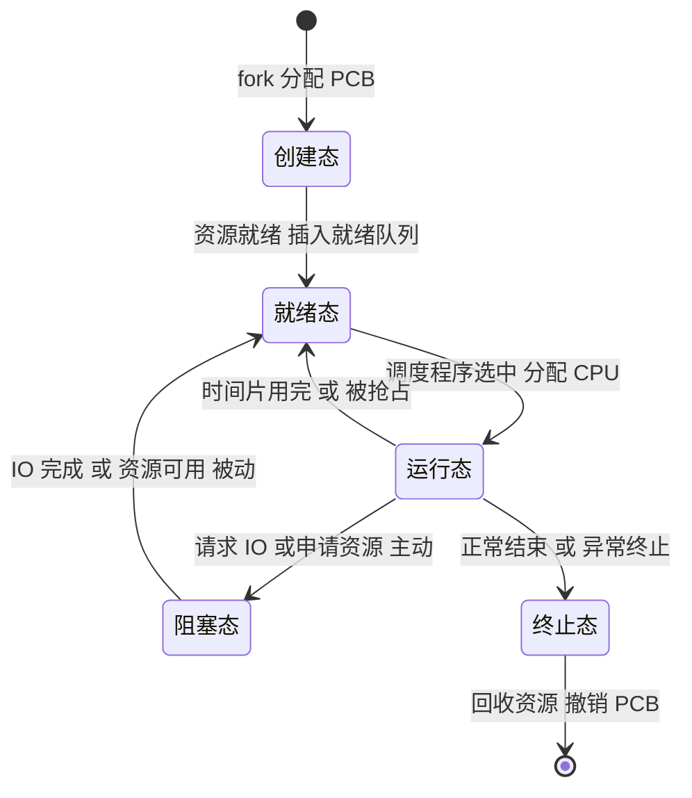

# 操作系统 · 进程与线程

## 进程与线程 [高频]

**考频统计**：考察次数 26 次；涉及年份：2009—2025 年高频，2010、2012、2015、2017、2019、2020、2022、2024 年为典型年份；分数占比约 18%；主要题型：选择题 + 综合应用题（进程状态、PCB、线程共享、调度）。

**核心讲解**：

**进程**是程序在一个数据集合上的一次运行过程，是系统进行**资源分配**的基本单位；**线程**是进程内的一个执行流，是**处理机调度**的基本单位；进程由**程序段、数据段、`PCB`** 三部分组成，其中 **`PCB` 是进程存在的唯一标志**，内容包括进程标识符、处理机现场信息（各寄存器与 `PC` 的值）、进程控制信息（状态、优先级、队列指针、资源清单）。

**进程映像**在内存中的布局自低到高为：代码段、数据段（含已初始化的 `data` 与未初始化的 `bss`）、堆（向上增长，`malloc` 分配）、栈（向下增长，存放函数调用帧与局部变量）。进程有**五种基本状态**：创建态、就绪态、运行态、阻塞态、终止态。状态转换的**唯一主动转换**是"运行 → 阻塞"（进程自己请求 `I/O` 或申请资源），其余都是被动的：**就绪 → 运行**由调度程序选中引起，**运行 → 就绪**由时间片用完或更高优先级抢占引起，**阻塞 → 就绪**由 `I/O` 完成或资源可用引起；**阻塞态不能直接转为运行态**，必须先回到就绪态。

**进程控制**由原语完成：创建（分配 `PCB` 与资源、置为就绪）、终止（回收资源、撤销 `PCB`）、阻塞与唤醒、挂起与激活。**进程间通信**的常用机制各有取舍：**共享内存**由内核在进程的地址空间之间建立共享区、双方直接读写，速度最快，但**必须自己用信号量等方式实现同步互斥**；**消息传递**（`send`/`receive`）把消息经内核缓冲区投递，天然同步、可跨机，适合数据量小或松耦合的进程；**管道**是一段固定大小的内核缓冲区，按字节流半双工传送，读空或写满都会阻塞，适合有亲缘关系的进程按先进先出传送数据流；**信号**只传一个信号编号、用于异步事件通知（如 `SIGINT`），不能承载大量数据，由信号处理函数或默认动作响应。

**线程**与进程的本质差别是：**同一进程内的各线程共享该进程的资源**（代码段、数据段、堆、打开的文件、地址空间），只**私有栈、寄存器现场与线程控制块 `TCB`**；因此线程切换不需要切换地址空间，开销远小于进程切换。**用户级线程**由用户库函数创建与管理、内核并不感知，线程的创建、切换与调度都在用户态完成、无需陷入内核，代价小，但**一个线程执行阻塞系统调用就会让整个进程阻塞**、也无法把同进程的线程真正并行到多核上；**内核级线程**由内核为每个线程维护 `TCB` 并单独调度，一个线程阻塞时同进程的其他线程仍可运行、也能并行到多核，代价是每次切换都要**陷入内核**（用户态→内核态→用户态两次模式切换）并由内核调度程序完成。

**关键结论速记**：

- `PCB 是进程存在的唯一标志`；进程 = 程序段 + 数据段 + `PCB`。
- `进程是资源分配单位，线程是调度单位` —— 线程只私有栈与寄存器现场，其余与同进程内其他线程共享。
- `运行 -> 阻塞 是唯一主动转换，阻塞 -> 就绪 是被动转换，阻塞不能直接到运行` —— 五状态转换的核心结论。
- `进程映像布局（低到高）：代码段 -> 数据段 -> 堆 -> 栈`；堆向上增长、栈向下增长，二者相向生长。
- `用户级线程：切换在用户态完成、不陷入内核、代价小` —— 但内核只看到进程，一个线程阻塞系统调用会让整个进程阻塞，也不能多核并行。
- `内核级线程：每线程有 TCB、可被独立调度到多核` —— 一个线程阻塞不影响同进程其他线程，代价是切换要陷入内核（两次模式切换）。
- `线程切换不切换地址空间，进程切换要换页表并刷新 TLB` —— 这是线程切换开销更小的根本原因。
- `共享内存最快但要自己同步；消息传递天然同步；管道半双工；信号只传编号` —— 按"是否传数据、是否跨机"选 IPC：共享内存适合大数据高频交换，信号只做异步通知。

**示意图**：

**进程映像的内存布局**：堆与栈相向增长，中间是尚未分配的空闲区；多个线程共享代码段、数据段与堆，但各自有独立的栈。

```text
process image layout in virtual address space

   high address
   +-----------------------------+
   |  argv / env (from kernel)   |
   +-----------------------------+
   |  stack of thread 3          |  grows DOWN
   |  stack of thread 2          |
   |  stack of thread 1 (main)   |  local vars, return addr
   + - - - - - - - - - - - - - - +
   |            free             |
   + - - - - - - - - - - - - - - +
   |  heap                       |  grows UP, malloc/new
   +-----------------------------+
   |  bss   (uninitialized data) |  shared by all threads
   +-----------------------------+
   |  data  (initialized data)   |
   +-----------------------------+
   |  text  (code)               |  read-only
   +-----------------------------+
   low address

   per-thread private: stack, registers, PC, TCB
   shared by threads of one process: text, data, bss, heap,
                                    open files, address space
```

**两类线程的实现方式与阻塞代价**：用户级线程的调度由内核之上的一层用户库完成、内核按进程调度；内核级线程由内核直接调度，可分散到多个处理机。

```text
thread models: who schedules, and what a block costs

  (1) many-to-one: user-level threads, managed by a user library

      process: T1  T2  T3        created and switched in user mode
      the kernel sees only ONE thread for the whole process
      -> runs on ONE CPU core
      -> a blocking system call by any thread blocks THE WHOLE PROCESS

  (2) one-to-one: kernel-level threads, one TCB per thread

      process: T1  T2  T3
      the kernel has one thread (K1, K2, K3) for each user thread
      -> they can run on SEVERAL cores in parallel
      -> a blocked thread does NOT stop the other threads of the process
```

**进程五状态转换图**：箭头旁标注引起转换的原因，注意"阻塞 → 运行"这条边不存在。



**易错点**：

- 认为阻塞态可以直接转为运行态：进程被唤醒后只能进入**就绪态**排队等 `CPU`，必须再经调度才能运行；画状态图时多画一条"阻塞 → 运行"是最典型的失分点。
- 把进程与线程的资源/调度关系搞反，并误判用户级线程的阻塞影响：线程**不拥有**资源（除栈与寄存器现场），进程才是资源分配单位；内核不认识用户级线程，一个用户级线程执行阻塞系统调用会让**整个进程**阻塞。
- 混淆挂起状态与阻塞状态：**挂起**是把进程映像换出到外存（不占内存，属"静止"状态），**阻塞**是等待事件（仍在内存）；挂起态与阻塞态是两个不同维度，可组合为"就绪挂起""阻塞挂起"。
- 把四种 IPC 的特性记混：共享内存最快但**必须自己同步**（内核不替你互斥）；管道是**半双工**字节流、读空或写满都会阻塞；消息传递要经内核复制、天然同步但开销大；信号只传编号、用于**异步通知**，不能当数据通道。

**真题示例**：

**2020 年真题改编（单项选择题，2 分）**

下列关于进程与线程的叙述中，正确的是（ ）。

A. 进程是处理机调度的基本单位，线程是资源分配的基本单位
B. 同一进程内的多个线程共享该进程的地址空间
C. 线程切换时一定伴随进程切换
D. 用户级线程的阻塞不会导致其所属进程被阻塞

> 解析：逐项辨析。**A 反了**——进程是**资源分配**的基本单位、线程是**处理机调度**的基本单位。**B 正确**——同一进程内所有线程共享该进程的地址空间（代码段、数据段、堆、打开文件等），只各自拥有独立栈与寄存器现场。**C 错**——同一进程内的线程切换不需要切换地址空间，因而不伴随进程切换；只有切换到另一进程的线程时才发生进程切换。**D 错**——用户级线程由用户库管理，内核只看到进程；一个用户级线程执行阻塞系统调用会使内核阻塞整个进程，从而**整个进程**被阻塞。答案选 **B**。**判分依据是"资源分配 vs 调度"与"线程共享地址空间"这两条最基本的结论。**

---
