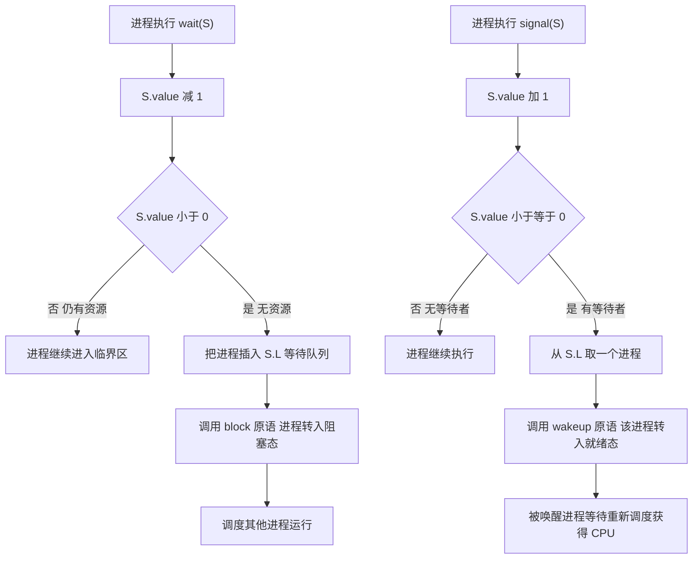

# 操作系统 · 同步与互斥

## 同步与互斥 [高频]

**考频统计**：考察次数 20 次；涉及年份：2010、2013、2015、2017、2018、2020、2022、2023、2025；分数占比约 20%；主要题型：综合应用题为主（45 题几乎固定考 PV 操作）。

**核心讲解**：

**临界区**是进程中访问临界资源的那段代码，实现互斥必须满足四条准则：**空闲让进、忙则等待、有限等待、让权等待**（前两条必须满足，后两条尽量避免"饥饿"与"忙等"）。软件方案中 **`Peterson` 算法**用 `flag[]` 与 `turn` 两个变量实现两个进程的互斥，满足空闲让进、忙则等待与有限等待，但**不满足让权等待**（等待时仍占用 `CPU` 空转）；硬件方案中**中断屏蔽**最简单但只适用于单处理机且风险高，**`TestAndSet`（`TS`）与 `Swap` 指令**是原子的，但同样属于忙等。**信号量机制**是 408 的核心考点：**整型信号量**的 `wait(S)` 是 `while (S <= 0); S--;`，属于**忙等**；

**记录型信号量**用 `value` 与等待队列 `L` 描述，`wait(S)` 为 `S.value--; if (S.value < 0) block(S.L);`，`signal(S)` 为 `S.value++; if (S.value <= 0) wakeup(S.L);`。注意 `value` 的**物理意义**：`value > 0` 表示当前可用资源数，`value < 0` 表示**在该信号量队列上阻塞的进程数**；因此 `wait` 是"先减后判"、`signal` 是"先加后判"，判据是 `< 0` 与 `<= 0`。用信号量实现互斥时初值为 `1`，实现同步时初值为"可用资源数"（如缓冲区空位数），而"前驱关系"则用初值为 `0` 的信号量让后继进程先 `wait` 前驱进程的 `signal`。

**生产者-消费者**问题需要**两个同步信号量 `empty`（初值 `n`）与 `full`（初值 `0`）加一个互斥信号量 `mutex`（初值 `1`）**，且**必须先对同步信号量 `wait` 再对 `mutex` 进行 `wait`**，否则当缓冲区满/空时进程会抱着互斥锁睡眠，导致另一进程无法推进而死锁。**读者-写者**问题中"读者优先"方案用一个 `count` 统计读者数并配 `mutex` 保护 `count`，第一个读者进入时对 `rw` 加锁、最后一个读者离开时释放 `rw`，从而允许读者并发。

**哲学家进餐**问题的死锁根源是"每个人都先拿左筷再等右筷"形成循环等待，解决办法包括：至多允许 4 人同时取筷（用初值 `4` 的信号量）、奇数号先拿左偶数号先拿右（破坏循环等待）、或用 `AND` 型信号量一次性申请两只筷子。**管程**把共享变量与操作封装在一起，同一时刻只允许一个进程在管程内活动，用**条件变量**的 `wait`/`signal` 实现等待与唤醒，把同步的复杂性交给编译器处理。

**关键结论速记**：

- `记录型信号量：wait 先减后判 value < 0 则阻塞，signal 先加后判 value <= 0 则唤醒` —— 判据符号写反是最常见错误。
- `信号量 value 的物理意义：正值 = 可用资源数，负值绝对值 = 阻塞进程数` —— 由此可反推被阻塞的进程个数。
- `互斥信号量初值 1，同步信号量初值 = 资源数，前驱关系信号量初值 0` —— 三种用途的初值必须分清。
- `生产者-消费者：empty 初值 n、full 初值 0、mutex 初值 1；先 wait 同步再 wait 互斥` —— 顺序颠倒会死锁。
- `读者优先：第一个读者锁 rw，最后一个读者解锁 rw，中间读者只改 count` —— 只要有读者在读，写者就一直等待。
- `哲学家进餐的三种解法都指向破坏循环等待或限制并发数` —— 单独"先左后右"必然可能死锁。

**示意图**：

**生产者-消费者模型的缓冲区与信号量协作**：`empty` 与 `full` 是一对"互补计数"，任何时刻 `empty + full = n`，`mutex` 只保护对缓冲区的实际读写。

```text
circular buffer with 3 semaphores (n = 4 slots)

   empty (initial 4)            full (initial 0)
   counts free slots            counts filled slots
        |                              |
        v                              v
   +----+----+----+----+          +----+----+----+
   | 4  | 3  | 2  | 1  |  ...     | 0  | 1  | 2  | ...
   +----+----+----+----+          +----+----+----+
   invariant: empty + full = n = 4

   buffer (n = 4 slots), in = producer position, out = consumer position

   +------+------+------+------+
   | d0   | d1   |      |      |
   +------+------+------+------+
      ^           ^
      |           |
     out         in        filled = 2, empty = 2

producer                          consumer
  wait(empty)     -- may block     wait(full)     -- may block
  wait(mutex)     -- enter CS      wait(mutex)    -- enter CS
  buffer[in] = item                item = buffer[out]
  in = (in+1) mod n                out = (out+1) mod n
  signal(mutex)   -- leave CS      signal(mutex)  -- leave CS
  signal(full)                     signal(empty)

  KEY: wait(empty) BEFORE wait(mutex).
  If reversed, a producer holding mutex may block on empty,
  and the consumer can never enter the CS to free a slot => deadlock.
```

**`wait`/`signal` 在记录型信号量上的状态转换**：只有 `value` 减到负数才阻塞，只有加回非正数才需要唤醒。



**易错点**：

- `wait`/`signal` 的判据符号写反：记录型信号量中 `wait` 里判 `value < 0`（减 1 之后），`signal` 里判 `value <= 0`（加 1 之后）；写成 `<= 0` 与 `< 0` 会导致阻塞/唤醒时机整体错位。
- 生产者-消费者中先 `wait(mutex)` 再 `wait(empty)`：这样当缓冲区满时生产者会**持有互斥锁**进入睡眠，消费者无法进入临界区取走数据，双方互相等待形成**死锁**；必须"先同步后互斥"。
- 混淆同步信号量与互斥信号量的初值：互斥信号量初值恒为 `1`（表示"临界区可用"），同步信号量初值等于可用资源数（生产者-消费者的 `empty` 为 `n`、`full` 为 `0`）；把 `full` 也设成 `n` 会让消费者一开始就去读空缓冲区。
- 认为读者-写者问题中读者与写者可以同时进入：只要存在读者在读，写者就必须等待（`rw` 被第一个读者锁住）；"读者优先"方案中写者甚至可能**饥饿**，若题目要求"写者优先"必须额外增加信号量。

**真题示例**：

**2014 年 408 第 45 题（综合应用题，7 分）**

某生产者-消费者问题中，有一个可以存放 `1000` 个数据的环形缓冲区，生产者进程 `P` 与消费者进程 `C` 共享该缓冲区。请用信号量的 `wait`、`signal` 操作描述 `P` 与 `C` 的同步与互斥关系（只需给出进程的算法描述，不必写出完整的程序）。

> 解析：设 `empty` 表示空单元数（初值 `1000`）、`full` 表示已放数据个数（初值 `0`）、`mutex` 用于互斥访问缓冲区（初值 `1`）。生产者 `P` 的循环体为：`wait(empty)` → `wait(mutex)` → 把数据放入缓冲区 → `signal(mutex)` → `signal(full)`，随后循环继续生产。消费者 `C` 的循环体为：`wait(full)` → `wait(mutex)` → 从缓冲区取数据 → `signal(mutex)` → `signal(empty)`，随后循环继续消费。**判分点有三处：一是三个信号量的初值必须写对（`empty = 1000`、`full = 0`、`mutex = 1`）；二是 `wait(empty)`/`wait(full)` 必须排在 `wait(mutex)` 之前，否则会产生死锁；三是 `signal` 的顺序中释放互斥锁在唤醒对方之前，保证被唤醒者能顺利进入临界区。**

---
