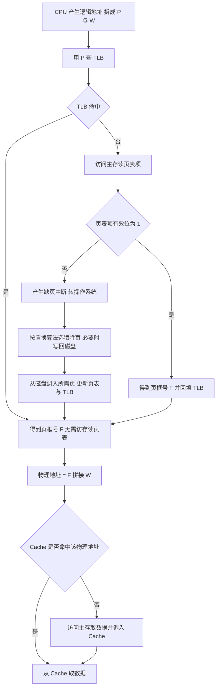

# 操作系统 · 内存管理

## 内存管理 [高频]

**考频统计**：考察次数 28 次；涉及年份：2009—2025 年几乎年年出现，2011、2014、2016、2018、2019、2021、2022、2024 年为典型年份；分数占比约 26%；主要题型：选择题 + 综合应用题（46 题常考分页/分段/地址翻译/页面置换）。

**核心讲解**：

**内存管理**要解决四个问题：内存空间的分配与回收、地址转换、扩充与保护；**程序的链接**有三种时机——**静态链接**在运行前把所有目标模块与库函数合并成一个完整的可执行文件，**装入时动态链接**在装入内存时边装入边链接（便于修改目标模块、便于共享库），**运行时动态链接**推迟到程序真正调用某模块时才链接并装入，未用到的模块根本不进内存。

程序的**装入**也有三种方式：**绝对装入**在编译时就确定物理地址、只适合单道环境；**可重定位装入**（静态重定位）在装入时一次性把逻辑地址改为物理地址、要求连续存放且运行期间不能移动；**动态运行时装入**（动态重定位）把地址转换推迟到运行时、由**重定位寄存器**加逻辑地址得到物理地址并允许程序移动；装入后进程的**运行时内存映像**自低到高为代码段、数据段（含 `data` 与 `bss`）、堆（向上增长）、栈（向下增长），逻辑地址空间从 `0` 连续编址、由 MMU 映射到物理地址空间。

**连续分配**中的**动态分区分配**有四种算法：**首次适应**按地址递增查找第一个满足的空闲分区（性能通常最好，但低地址区被反复分割），**最佳适应**按容量递增选最小满足的分区（会留下大量难以利用的外部碎片），**最坏适应**选最大分区（容易把大分区耗尽），**邻近适应**从上次结束处继续查找（使高地址大分区也被分割）。

**分页存储管理**把逻辑地址空间分成大小相等的**页**、内存分成同样大小的**页框**（物理块），逻辑地址结构为 `页号 P + 页内偏移 W`，页表存放页号到页框号的映射，**页表项大小要向上取整到字节**、页表占用的页数由页表项数与页框大小共同决定；**两级页表**把页号再拆成一级页号与二级页号，使页表本身也能离散存放，其位数拆分依据是**一个页面能放多少个页表项**。

**分段存储管理**按程序的逻辑单位（主程序段、子程序段、数据段）划分、逻辑地址为 `段号 S + 段内偏移 W`，段表项含段长与基址，**段是逻辑单位、对用户可见，页是物理单位、对用户透明**，因此分页是一维的（只需一个地址）、分段是二维的（必须给出段名与段内地址）；**段页式**先分段再分页、地址为 `段号 + 页号 + 页内偏移`，不命中快表时要访问三次主存（段表、页表、数据）。

**虚拟内存**的三个前提是**多次性、对换性、离散分配**；**请求分页**在访问的页不在内存时产生**缺页中断（属异常/内中断）**，由操作系统调页；

**页面置换算法**：**最佳置换 `OPT`**（置换未来最久不用的页，不可实现，作为性能上界）、**先进先出 `FIFO`**（实现简单，但可能出现 **`Belady` 异常**——分配的页框越多缺页次数反而增加）、**最近最久未使用 `LRU`**（性能接近 `OPT`，但需硬件支持、开销大）、**时钟 `CLOCK`（简单时钟）**（用访问位循环扫描，访问位为 1 则清 0 继续，为 0 则置换）、**改进型 `CLOCK`**（同时考虑访问位 `A` 与修改位 `M`，优先淘汰 `A = 0 且 M = 0`，其次 `A = 0 且 M = 1`，从而减少写回磁盘的开销）；**有效访问时间**必须按题意枚举命中组合，若 `TLB` 未命中要额外访问一次主存读页表项，若缺页还要加上缺页处理时间。

**页框分配**有**固定分配**与**可变分配**两种策略、置换范围有**局部置换**（只换本进程的页）与**全局置换**（可换其他进程的页框）两种，二者组合出固定分配局部置换、可变分配全局置换与可变分配局部置换，**驻留集**就是分配给进程的那组页框；**工作集** `W(t, Δ)` 是时刻 `t` 之前长度为 `Δ` 的时间窗口内进程实际访问过的页面集合，分配的页框数若小于工作集大小就会**抖动**（缺页率剧增、`CPU` 利用率骤降），对策是按工作集**给足页框**（或挂起部分进程、降低多道程度）。

**内存映射文件**（`mmap`）把文件的一段直接映射到进程的虚拟地址空间并返回映射区首址，此后访问该区间就像访问内存：所访问的页不在内存时产生缺页、由操作系统从文件调入，写回由页缓存与 `msync`/`munmap` 完成，多个进程映射同一文件即可共享数据。

**关键结论速记**：

- `逻辑地址 = 页号 P + 页内偏移 W`；`页号位数 = log2(页数)`、`页内偏移位数 = log2(页大小)`。
- `两级页表的位数拆分依据"每页可放 2^(页内偏移位数) / 页表项大小 个页表项"` —— 页表项大小要向上取整到字节。
- `分页一维、对用户透明；分段二维、对用户可见`；分段便于共享与保护，分页便于内存分配。
- `缺页中断属内中断（异常），在指令执行期间产生，处理后可重新执行该指令`。
- `FIFO 可能出现 Belady 异常；LRU 与 OPT 不会（属堆栈类算法）` —— 这是判断缺页次数随页框数变化的依据。
- `改进型 CLOCK 的优先淘汰次序：A=0,M=0 > A=0,M=1 > A=1,M=0 > A=1,M=1` —— `M=0` 优先是为了避免写回。
- `链接：静态 / 装入时动态 / 运行时动态；装入：绝对 / 可重定位 / 动态运行时` —— 只有动态运行时装入允许程序在内存中移动，运行时动态链接的模块"用到才装入"。
- `工作集 W(t, Δ) = 时间窗口 Δ 内访问过的页集合` —— 页框数给不到工作集大小就抖动，对策是按工作集给足页框（固定/可变分配 × 局部/全局置换是分配策略的组合）。

**示意图**：

**三种离散分配方式的地址结构与内存布局对比**：分页的页框大小固定、页可离散存放；分段的段长可变、按逻辑划分；段页式是二者结合。

```text
(1) paging: logical address = page number P | offset W

     logical:  +-----------+------------+
               |     P     |     W      |
               +-----------+------------+
                              |
                              v
     page table (indexed by P)
       +--------+--------+
       | page P | frame  |
       +--------+--------+
       |   0    |   5    |
       |   1    |   2    |
       |   2    |   9    |
       +--------+--------+
     physical = frame * page_size + W

     physical memory    +------+------+------+------+------+
                        | fr 0 | fr 1 | fr 2 | ...  | fr 9 |
                        +------+------+------+------+------+
     pages of a process may be scattered: fr5, fr2, fr9 ...
     internal fragmentation on the LAST page only

(2) segmentation: logical address = segment S | offset W

     logical:  +-----------+------------+
               |     S     |     W      |
               +-----------+------------+
     segment table
       +--------+---------+--------+
       | seg S  |  base   | length |
       +--------+---------+--------+
       |   0    |  1000   |  400   |   code
       |   1    |  2400   |  800   |   data
       +--------+---------+--------+
     check W < length first, then physical = base + W
     external fragmentation; segments are visible to the user

(3) segment + paging: S | P | W  -> needs segment table then page table
     three memory accesses without TLB: seg table, page table, data
```

**进程的运行时内存映像与两种重定位**：代码段只读，堆与栈相向增长；静态重定位在装入时把地址定死，动态运行时装入靠重定位寄存器在每次访存时换算。

```text
runtime memory image of a process (low address to high address)

   +-->  text      code, read-only, shared
   |     data      initialized data + bss (globals, statics)
   |     heap      grows UP, malloc / new
   |     ...       free space
   |     stack     grows DOWN, call frames and locals
   +-->  argv/env  pushed by the kernel

   static relocation:  physical address fixed at load time, cannot move
   dynamic relocation: physical = relocation register + logical address,
                       so the process can be moved while it runs
```

**一次访存的地址翻译流程（含 `TLB` 与缺页）**：`TLB` 命中可省去读页表项的一次访存，缺页则要进入操作系统调页。



**易错点**：

- 两类计算漏项：页表项大小要**向上取整到字节**、页表占用页数要向上取整；`TLB` 命中只访问一次主存取数据，未命中要**先读页表项再取数据**共两次，缺页还要再加调页时间。
- 置换算法结论记反：`FIFO` 是**唯一**可能出现 `Belady` 异常的常用算法（`LRU`、`OPT` 属堆栈类不会），改进型 `CLOCK` 应优先淘汰 `A = 0 且 M = 0`、最后才是 `A = 1 且 M = 1`。
- 把链接与装入的时机混为一谈：绝对装入只适合单道，可重定位装入（静态重定位）后程序**不能再移动**；运行时动态链接是"用到才链接并装入"，与"装入时动态链接"不是一回事。
- 把抖动归因于置换算法不好、或以为多给页框一定更快：抖动是页框数不足以容纳工作集导致缺页率激增，换更好的算法只能缓解，对策是按 `W(t, Δ)` **给足页框**或降低多道程度。

**真题示例**：

**2016 年 408 第 46 题（综合应用题，8 分）**

某 32 位系统采用二级页表的分页存储管理，按字节编址，页大小为 `4 KB`，页表项大小为 `4 B`。要求：给出一级页号、二级页号与页内偏移各占多少位；若某进程的代码段大小为 `8 MB` 且从逻辑地址 `0` 开始连续存放，求该代码段需要多少个二级页表。

> 解析：第一步确定位数。页大小 `4 KB = 2^12 B`，故**页内偏移 `W = 12` 位**。每个页面能容纳的页表项数 `= 4 KB / 4 B = 1024 = 2^10`，故**二级页号占 `10` 位**（一个二级页表恰好占一页）；剩下的位数给一级页号：`32 - 12 - 10 = 10` 位，即**一级页号占 `10` 位**。第二步算二级页表个数。代码段大小 `8 MB = 2^23 B`，需要的页数 `= 2^23 / 2^12 = 2^11 = 2048` 页；每个二级页表覆盖 `2^10 = 1024` 个页，故需要 `2048 / 1024 = 2` 个二级页表。**判分点是"页表项数由页大小除以页表项大小决定"这一拆分依据，以及页数向上取整的处理（本题恰好整除）。**

---
