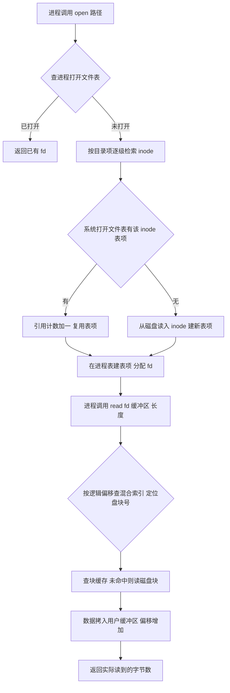

# 操作系统 · 文件管理

## 文件管理 [高频]

**考频统计**：考察次数 20 次；涉及年份：2010、2012、2014、2016、2018、2020、2022、2023、2024；分数占比约 16%；主要题型：选择题 + 综合应用题（文件物理结构、目录、磁盘空间）。

**核心讲解**：

文件管理把磁盘上的物理块抽象为按名访问的逻辑文件：文件逻辑结构分无结构流式（顺序文件）与有结构记录式（顺序、索引、索引顺序、散列），物理结构分连续、链接（隐式/显式 FAT）、索引（单级/多级/混合），其中 UNIX 混合索引的最大文件长度 = `D*a + I*a + I^2*a + I^3*a`，`D`、`I` 为直接与一级间接地址项个数，`a` 为盘块大小，逐项相加不得漏掉直接项。目录本质是文件名到 FCB 的映射表，采用索引结点（inode）后把文件名与除名字外的属性分离，目录项只留`文件名 + inode 号`，使检索时一个盘块能容纳更多目录项、显著减少 I/O 次数。文件共享靠硬链接（多个目录项指向同一 inode，`count` 计数，删除只减计数，为 0 才真正回收）与软链接（新建一个存放路径名的文件，删除原文件后软链接失效成为悬空链接）。

磁盘空间管理常用位示图、空闲链表、成组链接法；位示图的字号 `i`、位号 `j` 与块号换算按从 1 开始编号时为 `块号 = (i-1)*n + j`（`n` 为每字位数），从 0 开始编号时 `块号 = i*n + j`，两者必须与题设口径统一。进程访问文件先查进程打开文件表（含文件描述符、读写偏移、访问权限），表项指向系统打开文件表的全局表项（含 inode 指针、引用计数），再由 inode 逐级查目录与磁盘，最终由页/块缓存完成 `read`。

**关键结论速记**：

- `最大文件长度 = D*a + I*a + I^2*a + I^3*a` —— 直接、一级、二级、三级间接地址项逐项求和，`a` 为盘块大小，物理块号还需占用地址项宽度（如 4B）。
- `一级间接可指块数 = a / 地址项字节数` —— 索引块本身占一个盘块，能放的指针个数由此决定，再逐级平方或立方。
- `inode 把文件名与属性分离` —— 目录项只存`文件名 + inode 号`，检索路径名时目录占块少、命中率高，一个文件可被多个目录项共享。
- `硬链接 = 共享同一 inode + count++`；`软链接 = 新建文件存原路径` —— 删原文件后硬链接仍可访问数据，软链接变为悬空链接。
- `位示图 n 位/字` —— 从 1 开始编号 `块号 = (i-1)*n + j`；从 0 开始编号 `块号 = i*n + j`，`j` 为字内位号。
- `打开文件表两级` —— 进程表项（fd、读写位置、权限）唯一指向系统打开文件表项（inode 指针、引用计数），`read` 只改进程表项的偏移。

**示意图**：

```text
hybrid-index inode layout  (a = block size, w = address width, k = a / w)

 inode
 +-----------------+
 | file attributes |
 +-----------------+
 | direct  addr0   |----> data block
 | direct  addr1   |----> data block
 | ...             |
 | direct  addr9   |----> data block
 +-----------------+
 | 1-level ptr     |----> index block ---+--> data block
 +-----------------+                     +--> data block
 | 2-level ptr     |----> index -> index -> data block
 +-----------------+
 | 3-level ptr     |----> index -> index -> index -> data block
 +-----------------+

 k = a / w = 256 when a = 1024 B and w = 4 B

 level        index depth   data blocks reachable
 ---------    -----------   ---------------------
 direct       0             10
 1-level      1             256
 2-level      2             256 * 256
 3-level      3             256 * 256 * 256
```



**易错点**：

- 算最大文件长度时漏掉直接地址项或漏乘盘块大小：正确做法是`直接项数*a + 一级间接项数*a + k*a + k^2*a + k^3*a`，`k` 由盘块大小除以地址项字节数得到，每一项都要乘 `a`。
- 把软链接说成共享索引结点：软链接是新建的独立文件，自身有 inode，内容只是原文件路径名；只有硬链接才共享同一 inode 并靠引用计数决定回收时机。
- 位示图块号与字号位号换算搞错起始编号：题设从 1 开始时`块号 = (i-1)*n + j`，从 0 开始时`块号 = i*n + j`，且同一题内字号、位号、块号必须同口径。
- 混淆两级打开文件表：进程打开文件表存 fd、读写偏移与权限，系统打开文件表存 inode 指针与引用计数；`read` 改变的是进程表项的偏移，`fork` 后父子可共享该偏移。

**真题示例**：

**2010 年 408 第 46 题（综合应用题，8 分）**

某文件系统采用混合索引分配方式，inode 中有 10 个直接地址项、1 个一级间接地址项、1 个二级间接地址项、1 个三级间接地址项，每个地址项占 4B，磁盘块大小 4KB，则单个文件的最大长度是多少字节，约合多少 GB？

> 解析：每块可放指针数 `k = 4096 / 4 = 1024`。直接项可寻址 `10 * 4KB`；一级间接 `1024 * 4KB`；二级间接 `1024^2 * 4KB`；三级间接 `1024^3 * 4KB`。总和 = `(10 + 1024 + 1024^2 + 1024^3) * 4KB = (10 + 1024 + 1048576 + 1073741824) * 4096B ≈ 4.0001 * 10^12 B`，即约 `4TB`（若按 `1GB = 2^30 B` 计，约 `3725GB`；按 `10^9 B` 计约 `4000GB`）。结论：最大文件长度约 `4 * 10^12` 字节，数量级远大于按块号宽度直接相乘的粗算值，关键是三级间接项的高次幂且每项都乘盘块大小。

---
