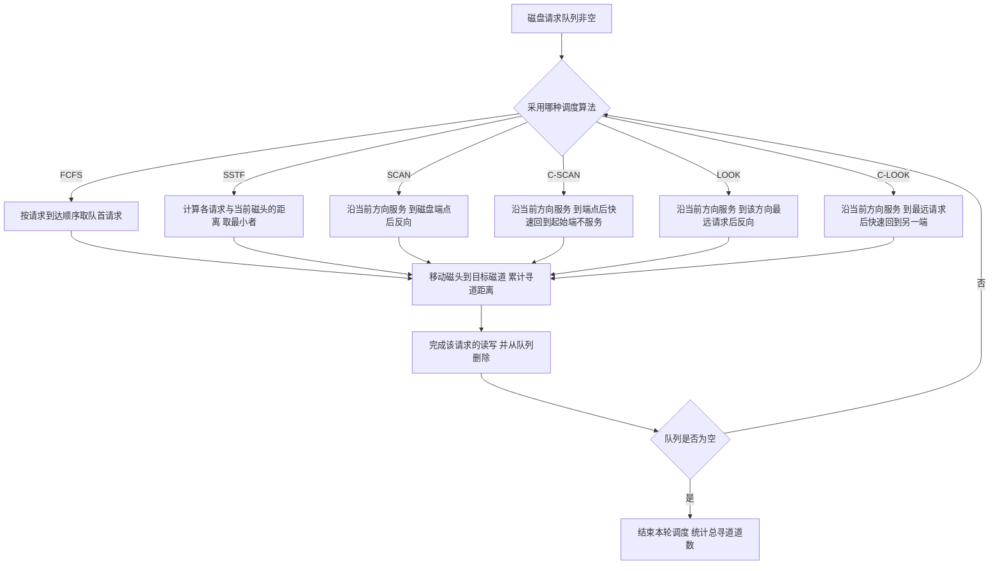

# 操作系统 · 输入输出管理

## 输入输出管理 [高频]

**考频统计**：考察次数 14 次；涉及年份：2011、2013、2015、2017、2019、2021、2023、2025；分数占比约 8%；主要题型：选择题为主（IO 控制方式、缓冲、假脱机、磁盘调度）。

**核心讲解**：

`I/O` 软件按层次自下而上分为四层：**中断处理程序**（处理设备中断、唤醒等待进程）、**设备驱动程序**（把上层抽象命令翻译为对设备寄存器的具体操作，与硬件密切相关）、**设备独立性软件**（又称设备无关软件，负责逻辑设备名到物理设备名的映射、缓冲、设备分配与保护、差错处理，向用户提供统一的系统调用接口）、**用户层 `I/O` 软件**（如库函数 `printf`、`scanf`）。这四层中，**设备独立性软件是"与设备无关"的部分，设备驱动程序是"与设备相关"的部分**，这是分层的判据。

**缓冲技术**的作用是缓和 `CPU` 与 `I/O` 设备的速度差异、减少中断次数、解决数据粒度不匹配问题。**单缓冲**下处理一块数据的时间为 `T = max(C, T_io) + M`（`C` 为 `CPU` 处理时间、`T_io` 为输入时间、`M` 为数据传送时间），**双缓冲**下为 `T = max(C + M, T_io)`，因此双缓冲比单缓冲显著提高并行度；

当 `T_io > C + M` 时双缓冲能把设备与 `CPU` 的并行发挥到最大。**设备分配**中引入**逻辑设备名**是为了实现设备无关性：用户程序使用逻辑设备名，系统查**逻辑设备表 `LUT`** 得到物理设备；设备分配的数据结构包括**设备控制表 `DCT`、控制器控制表 `COCT`、通道控制表 `CHCT` 与系统设备表 `SDT`**。**`SPOOLing`（假脱机）技术**用**输入井与输出井**（磁盘上的缓冲区）、**输入进程与输出进程**以及**井管理程序**，把独占设备（如打印机）改造成可被多个进程"共享"的设备：进程的打印请求被写成输出井中的文件并排队，由输出进程按序真正输出，因此进程不必等待打印机空闲。

**磁盘调度算法**决定多个磁盘请求的服务顺序，以**总寻道时间最短**为目标：**`FCFS`** 公平但平均寻道时间长；**`SSTF`（最短寻道时间优先）**每次选离当前磁头最近的请求，性能较好但可能导致远端请求**饥饿**；**`SCAN`（电梯算法）**沿一个方向服务到底再反向，避免饥饿且性能较好；**`C-SCAN`（循环扫描）**只在一个方向服务，返程直接快速回到起始端而不服务请求，使各磁道等待时间更均匀；**`LOOK` 与 `C-LOOK`** 是 `SCAN`、`C-SCAN` 的改进——到达该方向上**最远的请求**就折返，不必移动到磁盘末端。**磁盘管理**还包括低级格式化（划分扇区）、分区、逻辑格式化（建立文件系统）、引导块与坏块处理。

**关键结论速记**：

- `I/O 软件四层（底到顶）：中断处理程序 -> 设备驱动程序 -> 设备独立性软件 -> 用户层软件` —— 与设备相关的是驱动层。
- `单缓冲 T = max(C, T_io) + M，双缓冲 T = max(C + M, T_io)` —— 双缓冲的关键是 `C + M` 与 `T_io` 取较大者。
- `SPOOLing 用共享设备（磁盘）模拟独占设备` —— 输入井/输出井在磁盘上，靠排队与守护进程实现"虚拟设备"。
- `SSTF 可能饥饿，SCAN 不会，C-SCAN 使等待时间更均匀` —— 这是三种算法优劣的固定结论。
- `SCAN 服务到磁盘端点才折返；LOOK 到该方向最远请求就折返` —— 计算移臂道数时两者的折返点不同。
- `逻辑设备名 -> LUT -> 物理设备` —— 引入逻辑设备名的目的是实现设备无关性。

**示意图**：

**`I/O` 软件的层次结构与一次读请求的上下穿越**：请求自顶向下逐层转换，数据与中断自底向上逐层返回。

```text
I/O software layers and a read request path

  +---------------------------------------------------------------+
  | user-level I/O software        printf / scanf / write library  |
  +---------------------------------------------------------------+
                | system call interface (trap into kernel)
                v
  +---------------------------------------------------------------+
  | device-independent software    naming, protection, buffering,  |
  |                                allocation, error reporting,    |
  |                                logical -> physical device (LUT)|
  +---------------------------------------------------------------+
                | generic command (read block N)
                v
  +---------------------------------------------------------------+
  | device driver                  translates to device register   |
  |                                operations, sets up DMA        |
  +---------------------------------------------------------------+
                | writes device registers / starts controller
                v
  +---------------------------------------------------------------+
  | interrupt handler              handles completion, wakes up    |
  +---------------------------------------------------------------+
                ^
                | hardware interrupt on completion
  +---------------------------------------------------------------+
  | device controller + device     (hardware, not software)        |
  +---------------------------------------------------------------+
```

**磁盘调度算法的移臂过程对比**：磁头当前位置与请求队列给定后，不同算法的服务顺序与服务道数总和不同。

```text
request queue: 98, 183, 37, 122, 14, 124, 65, 67
head starts at 53, disk tracks 0 .. 199

(1) FCFS: serve in arrival order
    53 -> 98 -> 183 -> 37 -> 122 -> 14 -> 124 -> 65 -> 67
    travel = 45+85+146+85+108+110+59+2 = 640 tracks

(2) SSTF: always the nearest request from the current head
    53 -> 65 -> 67 -> 37 -> 14 -> 98 -> 122 -> 124 -> 183
    travel = 12+2+30+23+84+24+2+59 = 236 tracks
    risk: far requests (e.g. 183) may starve if new near ones keep coming

(3) SCAN (elevator), moving toward larger track numbers first
    53 -> 65 -> 67 -> 98 -> 122 -> 124 -> 183 -> 199(end) -> 37 -> 14
    travel = (199-53) + (199-14) = 146 + 185 = 331 tracks
    note: it goes all the way to the disk end at 199 even if nothing waits

(4) LOOK, moving toward larger tracks first, turns at last request
    53 -> 65 -> 67 -> 98 -> 122 -> 124 -> 183 -> 37 -> 14
    travel = (183-53) + (183-14) = 130 + 169 = 299 tracks
    difference from SCAN: turn at 183 instead of 199
```



**易错点**：

- 双缓冲时间公式写成求和：双缓冲处理一块数据的时间是 `max(C + M, T_io)`，而不是 `C + M + T_io`；用求和会把并行度算没，结果远大于正确值。
- 混淆 `SCAN` 与 `LOOK` 的折返点：`SCAN`（电梯算法）必须移动到**磁盘端点**（如 `0` 或 `199`）才折返，`LOOK` 到达**该方向上最远的请求**即折返；计算移臂道数时两者结果不同。
- 把 `SPOOLing` 的输入井与输出井位置搞错：输入井与输出井都在**磁盘**上（共享设备模拟独占设备），不是内存缓冲区；把 `SPOOLing` 说成"在内存中开辟缓冲区"是概念错误。
- 认为设备驱动程序与设备无关：**设备驱动程序与硬件密切相关**（要操作具体设备的寄存器、时序与命令格式），真正"与设备无关"的是其上层的设备独立性软件；分层归属写反是常见失分点。

**真题示例**：

**2019 年 408 第 30 题（单项选择题，2 分）**

某磁盘的磁头当前位于 `100` 号磁道，磁头正向磁道号增加的方向移动。现有如下磁盘请求序列：`55, 58, 39, 18, 90, 160, 150, 38, 184`。若采用 `SCAN`（电梯）调度算法且磁道号范围为 `0 ~ 199`，则磁头移动的总道数为（ ）。

> 解析：磁头当前在 `100` 且向磁道号增加方向移动，故先服务所有大于 `100` 的请求，按从小到大排序为 `150、160、184`，并继续移动到磁盘端点 `199` 才能折返（这是 `SCAN` 与 `LOOK` 的关键差别）。然后反向（磁道号减小方向）服务剩余请求，按从大到小为 `90、58、55、39、38、18`，最后停在 `18`（若题目未要求移动到 `0`，则不必到端点）。总移动道数 `= (199 - 100) + (199 - 18) = 99 + 181 = 280` 道。**判分点是 `SCAN` 必须先移动到端点 `199` 折返，以及反向服务时按从大到小排序；把它当成 `LOOK` 会算成 `(184 - 100) + (184 - 18) = 84 + 166 = 250` 道而选错。**

---
