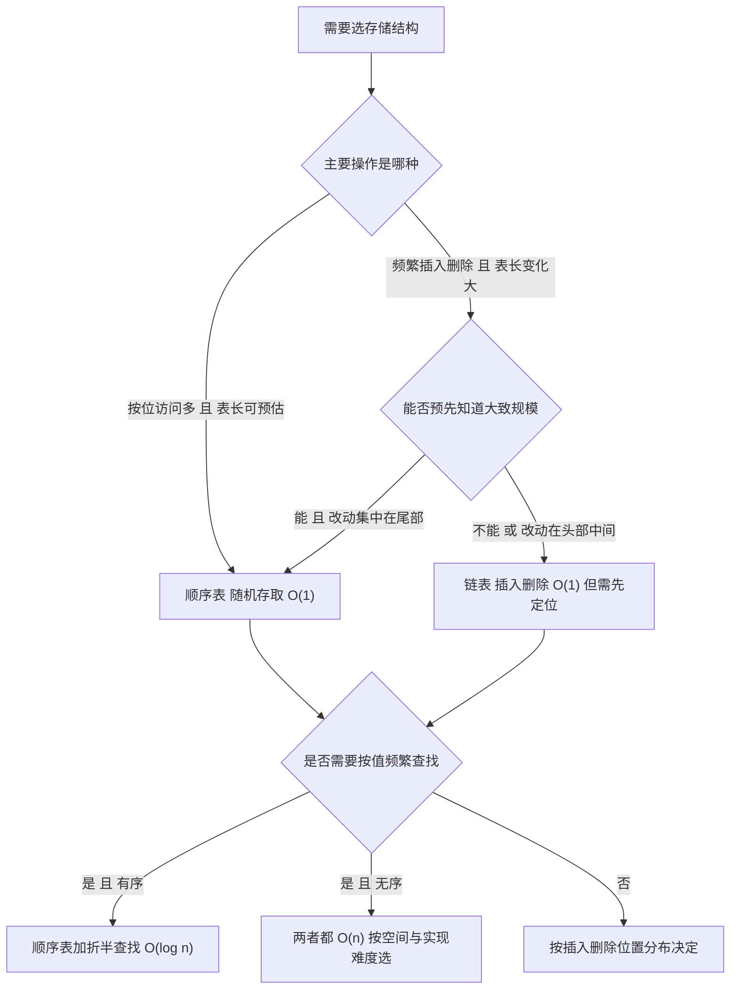
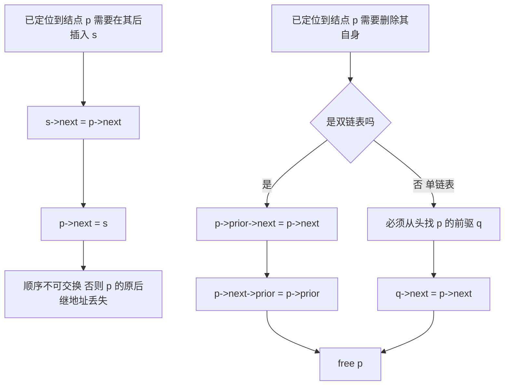
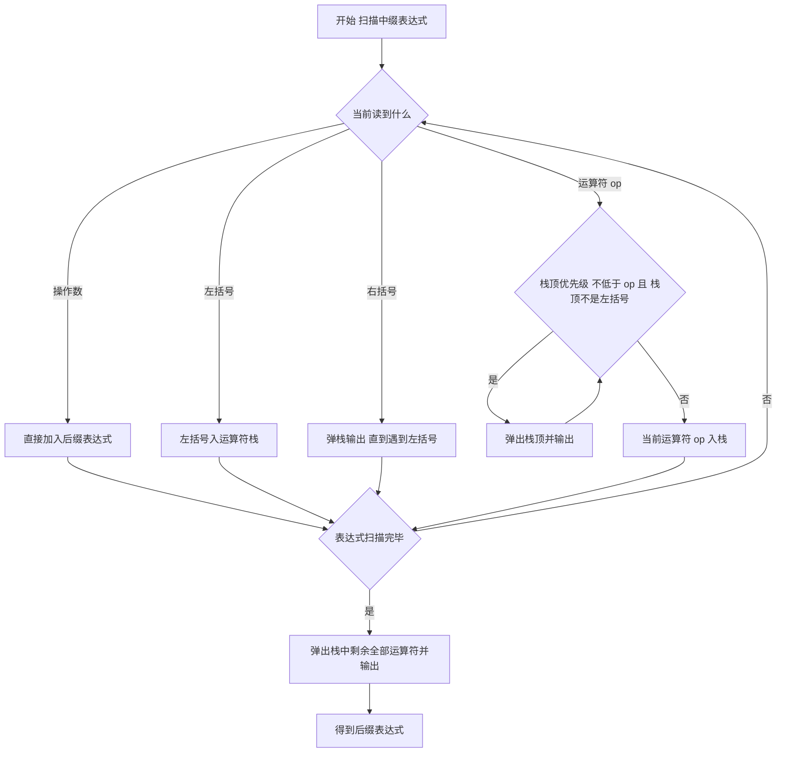
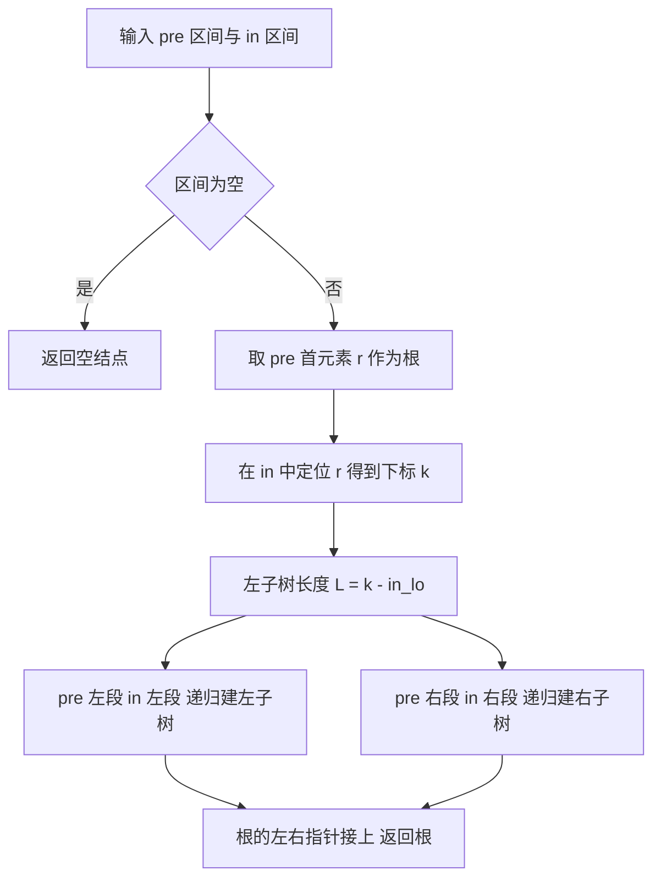
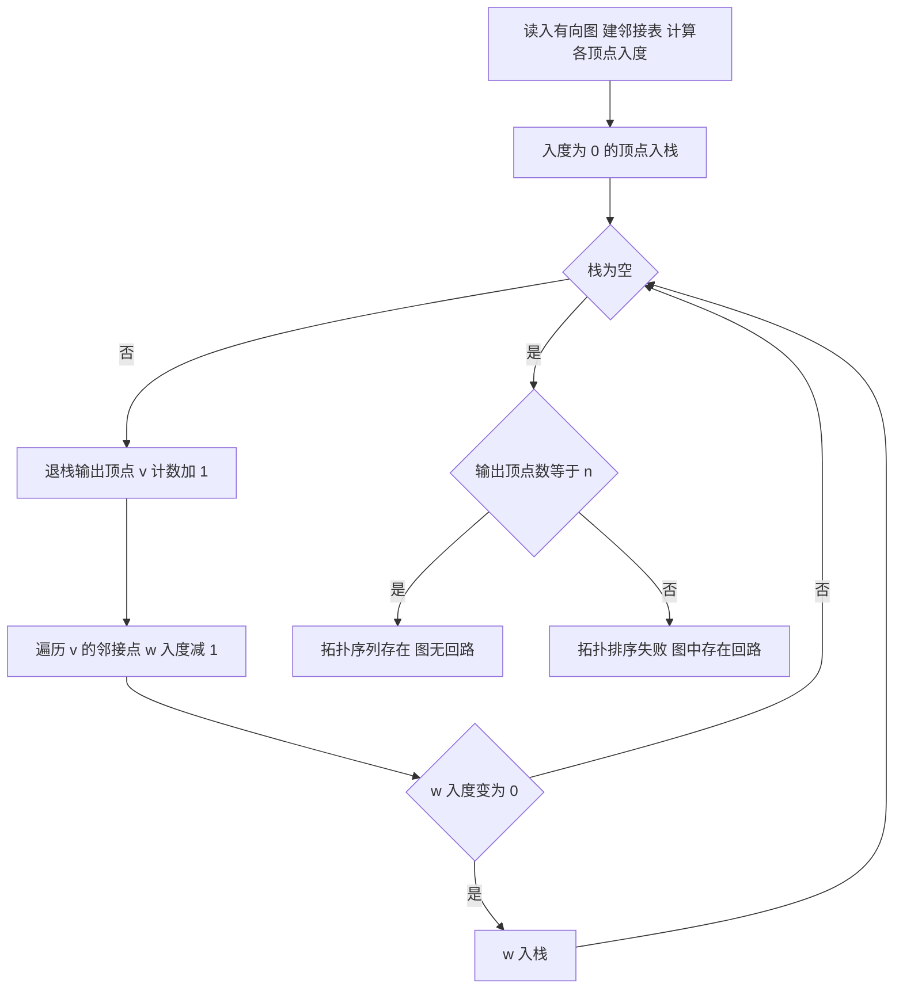
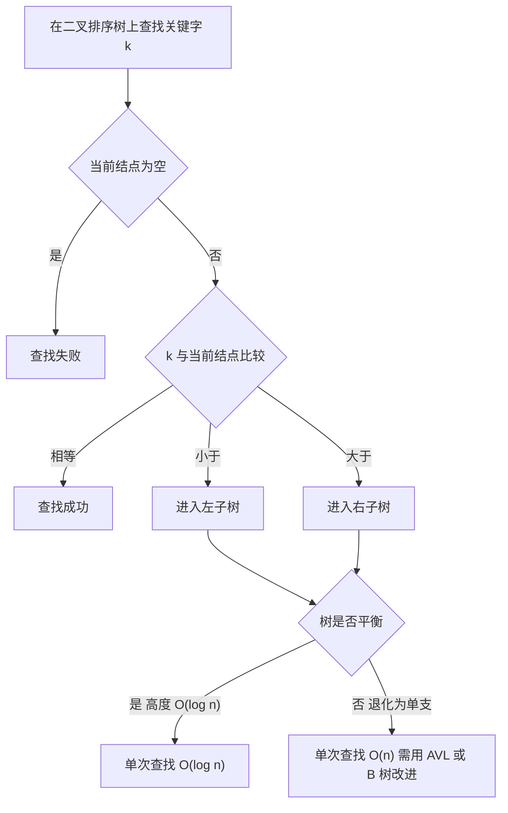
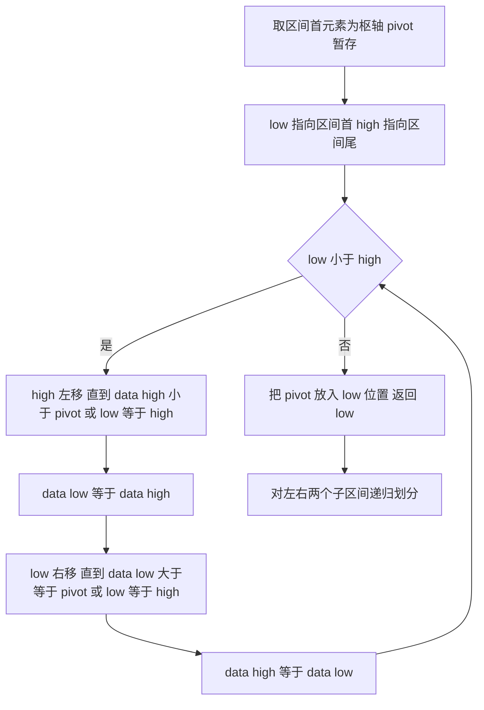

# 数据结构 · 408 速成复习资料

**科目分值**：45 分 / 150 分　|　**章节数**：7　|　**统计区间**：2009—2025 年 408 统考真题（17 套）

## 本科目章节索引

| # | 知识点 | 考察次数 | 分值占比 | 高频 |
| --- | --- | --- | --- | --- |
| 1 | [线性表](01-线性表.md) | 24 次 | 约 8% | **是** |
| 2 | [顺序表与链表](02-顺序表与链表.md) | 22 次 | 约 7% | **是** |
| 3 | [栈与队列](03-栈与队列.md) | 20 次 | 约 8% | **是** |
| 4 | [树与二叉树](04-树与二叉树.md) | 30 次 | 约 16% | **是** |
| 5 | [图](05-图.md) | 22 次 | 约 14% | **是** |
| 6 | [查找](06-查找.md) | 18 次 | 约 9% | **是** |
| 7 | [排序](07-排序.md) | 20 次 | 约 12% | **是** |

## 本科目在 408 中的位置

| 项目 | 内容 |
| --- | --- |
| 分值 | **45 分 / 150 分**（占 30%） |
| 单选题 | 第 1—10 题（单选，每题 2 分，共 20 分） |
| 综合应用题 | 第 41 题（约 10 分）、第 42 题（约 15 分），共 25 分 |
| 命题特点 | 选择题重"过程推演"（出栈序列、遍历序列、判定树）；大题重"算法设计 + 复杂度分析"，41 题常为树、42 题常为图 |

**复习优先级（按分值 × 稳定性排序）**：树与二叉树 → 图 → 排序 → 查找 → 栈与队列 → 线性表。
其中 **树、图两章合计约 30 分**，是本科目绝对核心；线性表独立命题少，但作为链表代码基础必须熟练。

## 使用说明（30 秒读完）

1. **先看 `[高频]` 标记**：每节标题带 `[高频]` 的是历年反复命题的考点，时间紧张时只看这些。
2. **每节固定六段式**：考频统计 → 核心讲解 → 关键结论速记 → 示意图 → 易错点 → 真题示例，可直接跳跃到你缺的那一段。
3. **图形约定**：`text` 代码块为 **ASCII 图**（用于结构布局、位域划分、地址格式）；`mermaid` 代码块为 **流程图/状态机**（用于算法流程、协议交互、状态转换）。
4. **考频口径**：统计区间 2009—2025 年共 17 套真题；"考察次数"按题次计，一道综合题串联多个考点时各自计 1 次。
5. **自检方式**：本资料由脚本生成，`python3 scripts/validate.py` 会校验模板完整性、考频数字一致性、ASCII 图对齐与真题年份合法性。

> 本资料为速成复习用途：**考频数据为基于 2009—2025 年真题的公开考频表统计整理，非官方发布**，
> 用于确定复习优先级，不作为命题预测。数据口径与来源见 `README.md`。

## 线性表 [高频]

**考频统计**：考察次数 24 次；涉及年份：2009—2025 年多次出现，其中 2010、2013、2016、2019、2021、2023 年为典型年份；分数占比约 8%；主要题型：选择题为主，偶见于综合应用题背景。

**核心讲解**：

线性表是 `n` 个数据元素的有限序列，元素之间是**一对一**的逻辑关系，除首尾外每个元素有且仅有一个直接前驱和一个直接后继。顺序存储把逻辑相邻的元素放在物理相邻的存储单元，因而支持**随机存取**：`LOC(a_i) = LOC(a_1) + (i-1) * L`，其中 `L` 是单个元素占用的字节数。设表长 `n`、数组容量 `MaxSize`，则**长度是实际元素个数、容量是数组能容纳的最大个数**，两者不可混用。插入的合法位置是 `1..n+1`，在第 `i` 个位置插入需把第 `i..n` 个元素整体后移，移动次数为 `n-i+1`；

等概率（`p_i = 1/(n+1)`）下平均移动次数为 `n/2`。删除的合法位置是 `1..n`，删除第 `i` 个元素需把第 `i+1..n` 个元素整体前移，移动次数为 `n-i`；等概率（`p_i = 1/n`）下平均移动次数为 `(n-1)/2`。因为插入删除都可能搬动近乎全部元素，顺序表插入与删除的时间复杂度均为 `O(n)`；而按位查找是 `O(1)`，按值查找在无序表中是 `O(n)`。

**关键结论速记**：

- `LOC(a_i) = LOC(a_1) + (i-1) * L` —— 顺序表随机存取的根据；位序 `i` 从 1 开始，数组下标从 0 开始，故下标为 `i-1`。
- `插入移动次数 = n - i + 1`（`1 <= i <= n+1`），等概率平均 `n/2` —— 插入位置越靠前移动越多。
- `删除移动次数 = n - i`（`1 <= i <= n`），等概率平均 `(n-1)/2` —— 删除位置越靠前移动越多。
- `顺序表按位查找 O(1)、按值查找 O(n)` —— "随机存取"只针对按位访问，不等于查找快。
- `表长 length 与容量 MaxSize 是两个量` —— 判空看 `length == 0`，判满看 `length == MaxSize`。

**示意图**：

顺序表在内存中是一段连续空间，`data[0..length-1]` 有效，尾部是未使用区；插入是"从后往前搬"，删除是"从前往后搬"。

```text
sequential list: data[0..MaxSize-1], length = 5, MaxSize = 8

   index    0     1     2     3     4     5     6     7
          +-----+-----+-----+-----+-----+-----+-----+-----+
   data   | a1  | a2  | a3  | a4  | a5  |     |     |     |
          +-----+-----+-----+-----+-----+-----+-----+-----+
          |<------- length = 5 ------->|<-- free space --->|
          ^
          LOC(a1) = base
          LOC(ai) = base + (i-1) * L

insert x at position 3 (n = 5): move a3,a4,a5 right, count = n-i+1 = 3

   before: | a1 | a2 | a3 | a4 | a5 |    |
   step1 : | a1 | a2 | a3 | a4 |    | a5 |
   step2 : | a1 | a2 | a3 |    | a4 | a5 |
   step3 : | a1 | a2 |    | a3 | a4 | a5 |
   write : | a1 | a2 | x  | a3 | a4 | a5 |   length = 6

delete position 3 (n = 5): move a4,a5 left, count = n-i = 2

   before: | a1 | a2 | a3 | a4 | a5 |
   step1 : | a1 | a2 | a4 | a4 | a5 |
   step2 : | a1 | a2 | a4 | a5 | a5 |
   write : | a1 | a2 | a4 | a5 |    |   length = 4
```

顺序表与链表的选择不是"哪个更好"，而是按操作分布决定；下图给出考场判断路径。



**易错点**：

- 位序与下标混用：题目说"第 `i` 个位置"时 `i` 从 1 开始，而代码里数组下标是 `i-1`；套公式时若直接代下标，移动次数会整体差 1，插入位置范围也会错写成 `0..n`。
- 把顺序表的插入删除说成 `O(1)`：只有当插入/删除固定发生在表尾时才是 `O(1)`；等概率一般位置的平均移动次数是 `n/2` 与 `(n-1)/2`，时间复杂度是 `O(n)`。
- 混淆"长度"与"容量"：`length` 是当前元素个数（决定合法位序范围与遍历边界），`MaxSize` 是数组容量（决定上溢条件）；判满条件是 `length == MaxSize`，不是 `length == MaxSize - 1`。
- 误认为"随机存取"等于"查找快"：随机存取指用一次地址计算就能定位第 `i` 个元素，因此**按位查找**是 `O(1)`；按值查找仍需从头比较，无序表为 `O(n)`。

**真题示例**：

**2013 年 408 第 41 题（综合应用题，15 分）**

一个长度为 `L`（`L >= 1`）的升序序列 `S`，处在第 `ceil(L/2)` 个位置的元素称为 `S` 的中位数。例如序列 `S1 = (11, 13, 15, 17, 19)` 的中位数是 15，两个序列的中位数是含它们所有元素的升序序列的中位数。现在有两个等长升序序列 `A` 和 `B`，设计一个在时间和空间两方面都尽可能高效的算法，找出两个序列 `A` 和 `B` 的中位数。要求：给出算法的基本设计思想；用 C 或 C++ 描述算法，关键之处给出注释；说明你所设计算法的时间复杂度与空间复杂度。

> 解析：取 `A`、`B` 各自的中位数 `a = A[midA]`、`b = B[midB]`（`mid` 为 `ceil` 意义上的中间位置）。若 `a == b`，该值即为所求，结束。若 `a < b`，则所求中位数只可能落在 `A` 的右半段与 `B` 的左半段（`A` 左半段与 `B` 右半段分别被排除，且两段被排除的元素个数相等，故中位数位置不变），于是令 `A` 的查找范围收缩为右半段、`B` 收缩为左半段；`a > b` 时对称处理。每轮两个序列的候选长度都减半，故时间复杂度 `O(log n)`；只用若干下标与临时变量，空间复杂度 `O(1)`。这就是本题的满分答案框架：**折半缩小两个有序序列的候选区间**。

---

## 顺序表与链表 [高频]

**考频统计**：考察次数 22 次；涉及年份：2010、2012、2015、2017、2019、2021、2022、2024；分数占比约 7%；主要题型：选择题 + 综合应用题（链表操作代码）。

**核心讲解**：

链表用指针把逻辑相邻的元素链接起来，**存储单元可以不连续**，因此不支持随机存取，只能从头指针出发顺序访问。单链表结点由数据域 `data` 与指针域 `next` 构成；双链表增加前驱指针 `prior`；循环链表把尾结点指针指回头结点（或首结点）而形成环；静态链表用数组下标（游标）模拟指针，`next == -1` 表示链尾。

**带头结点与不带头结点的差别只在第一个数据结点**：带头结点时头指针恒非空，空表条件是 `head->next == NULL`，插入删除的第一个数据结点与其余结点逻辑统一，不必特判；不带头结点时空表条件是 `head == NULL`，在表头插入或删除首元素必须修改头指针本身。链表的按位查找与按值查找都是 `O(n)`，因为必须从头走。**"插入删除是 `O(1)`"有前提**：在已知结点 `p` **之后**插入是 `O(1)`（`s->next = p->next; p->next = s;`），但**在 `p` 之前**插入或删除 `p` 本身，单链表必须从头找前驱，是 `O(n)`；双链表因为能直接取到前驱，这两种操作都是 `O(1)`。头插法建表得到与输入**相反**的序列，尾插法建表得到与输入**相同**的序列，这是判断建表方式的快速依据。

**关键结论速记**：

- `按位查找 / 按值查找 O(n)`、`已知前驱的插入删除 O(1)` —— 链表的代价集中在"找位置"，一旦定位完成，指针改接是常数时间。
- `头插法逆序、尾插法同序` —— 头插法每次把新结点插在头结点之后，故输出序列是输入序列的逆序。
- `双链表插入四步不能乱` —— 先接新结点的两个指针，再改原结点指针，否则会丢失后继地址而断链。
- `length 不存储在链表里` —— 求表长必须遍历，`O(n)`；若题目要求 `O(1)` 求长，需额外维护长度域。
- `尾指针循环单链表：表尾 O(1)、表头 O(1)` —— 因为 `rear->next` 就是头结点，取头取尾都只需常数次指针运算。

**示意图**：

三种链表的结点与指针形态如下；`^` 表示空指针，`H` 为头结点（不存数据），`rear` 为尾指针。

```text
singly linked list with dummy head (length 3)

  head
   |
   v
 +---+---+    +---+---+    +---+---+    +---+---+
 | H | o-|--> | a | o-|--> | b | o-|--> | c | ^ |
 +---+---+    +---+---+    +---+---+    +---+---+
   ^
   head->next == NULL  means  empty list

doubly linked list (length 2): each node has prior and next

        +--------+     +--------+     +--------+
        |        v     |        v     |        v
 +---+--+--+  +--+---+--+--+  +--+---+--+  +--+---+
 | H |  ^  |  | a |    |  |  | b |    |  |  | ^ |  |
 +---+-----+  +---+----+--+  +---+----+--+  +---+--+
        ^          |              |            ^
        +----------+              +------------+

circular singly linked list with rear pointer (length 3)

  rear
   |
   v
 +---+---+    +---+---+    +---+---+    +---+---+
 | c | o-|--> | H | o-|--> | a | o-|--> | b | o-|--+
 +---+---+    +---+---+    +---+---+    +---+---+  |
                                                      |
        +---------------------------------------------+
        |
        +--> back to node c (rear->next is head node H)

static linked list: array slots, cursor -1 means end

  index   0     1     2     3     4     5
        +-----+-----+-----+-----+-----+-----+
  data  |  H  |  a  |  b  |  c  |     |     |
  next  |  1  |  2  |  3  | -1  |     |     |
        +-----+-----+-----+-----+-----+-----+
  start = 0 (head node index), free list head stored separately
```

在"已知某结点"的前提下，插入与删除的指针改接顺序决定了是否会断链，下图给出必须遵守的次序。



**易错点**：

- 认为"链表插入删除一定是 `O(1)`"：只有在**已定位到前驱结点**（双链表是已定位到该结点）时才是 `O(1)`；若还要先按值或按位查找，整体是 `O(n)`。
- 指针修改顺序写反导致断链：在 `p` 之后插入必须**先** `s->next = p->next` **再** `p->next = s`；反过来会先覆盖 `p->next`，使原后继无法访问。
- 不带头结点时忘记特判表头：在第一个数据结点前插入、或删除首元素，都必须修改头指针 `head`；若函数形参只是 `LinkList L`（值传递），这些修改不会带回调用者，必须用引用或二级指针。
- 把静态链表的游标当成真实指针：`next` 存的是数组下标，`-1` 是链尾标志而非"空地址值的随意约定"；且它的"空间"由数组大小固定，属于顺序存储的模拟。

**真题示例**：

**2009 年 408 第 42 题（综合应用题，10 分）**

已知一个带有表头结点的单链表，结点结构为 `[data | link]`，假设该链表只给出了头指针 `list`。在不改变链表的前提下，请设计一个尽可能高效的算法，查找链表中倒数第 `k` 个位置上的结点（`k` 为正整数）。若查找成功，算法输出该结点的 `data` 域的值，并返回 1；否则，只返回 0。要求：描述算法的基本设计思想；描述算法的详细实现步骤；根据设计思想和实现步骤，采用 C 或 C++ 语言描述算法，关键之处给出注释。

> 解析：设计思想是**双指针同向平移**——一次遍历即可定位倒数第 `k` 个结点。实现步骤：令 `p` 与 `q` 都指向第一个数据结点，先让 `p` 沿 `link` 前进 `k` 个结点；若前进过程中 `p` 变为 `NULL`，说明表长小于 `k`，返回 0。此后让 `p`、`q` 同步前进，直到 `p == NULL`，此时 `q` 恰好指向倒数第 `k` 个结点，输出 `q->data` 并返回 1。时间复杂度 `O(n)`（只遍历一趟），空间复杂度 `O(1)`。**关键在于"两个指针间隔恒为 `k` 个结点"，用距离差代替了长度统计。**

---

## 栈与队列 [高频]

**考频统计**：考察次数 20 次；涉及年份：2010、2011、2013、2015、2018、2020、2022、2023、2025；分数占比约 8%；主要题型：选择题为主（表达式求值、出栈序列、循环队列）。

**核心讲解**：

栈是只允许在同一端（栈顶 `top`）进行插入和删除的线性表，队列是只允许在队尾 `rear` 插入、队头 `front` 删除的线性表，二者都是操作受限的线性表。顺序栈用 `top` 指向栈顶元素（或栈顶元素的下一个位置，两种约定不可混用），判空为 `top == -1`（或 `top == 0`），栈满为 `top == MaxSize - 1`，入栈 `++top; data[top] = x`。共享栈让两个栈共用一个数组、栈底分别设在两端、栈顶向中间生长，仅当两栈顶指针相邻（`top0 + 1 == top1`）时才上溢，空间利用率更高。

循环队列把顺序队列在逻辑上首尾相接，用 `front == rear` 判空时必须另设计数 `size`、标志 `tag` 或牺牲一个单元来区分队满，否则队空与队满无法区分。栈的典型应用有括号匹配、表达式求值（中缀转后缀再求值）、递归调用与函数调用栈；中缀转后缀时，运算符栈规则是遇操作数直接输出，遇运算符先弹出栈中优先级不低于它的运算符再入栈，遇 `(` 入栈、遇 `)` 弹出至 `(`，扫描完把栈中剩余运算符全部弹出。

**关键结论速记**：

- `n` 个不同元素依次入栈，合法出栈序列数为卡特兰数 `C(2n,n)/(n+1)` —— 出栈序列合法性判定用它计数，如 `n = 3` 时为 5 个，`n = 4` 时为 14 个。
- 循环队列判满三方案 —— 牺牲一个单元：队满 `(rear + 1) % MaxSize == front`；增设 `size`：队满 `size == MaxSize`、队空 `size == 0`；增设 `tag`：`front == rear` 时 `tag == 1` 为满、`tag == 0` 为空。
- 元素个数公式（`front` 指向队头元素）—— `count = (rear - front + MaxSize) % MaxSize`，出队后 `front` 后移，`rear` 始终指向下一个可插入位置。
- 中缀转后缀的运算符栈规则 —— 栈内运算符优先级高于或等于当前运算符就先弹出，`(` 在栈内优先级最低、在栈外最高，保证括号配对与左结合性。
- 后缀表达式求值 —— 遇操作数入栈，遇运算符连出两次栈，先出的是右操作数、后出的是左操作数，算完 `左 op 右` 再入栈，最终栈中唯一元素即答案。
- 共享栈判满 —— 两栈顶指针相邻即 `top0 + 1 == top1` 时整个数组才上溢，单个栈使用不会溢出。

**示意图**：

循环队列在 `MaxSize = 7`（下标 0 至 6）时的三种状态，空槽留白、`x` 表示已存元素、`f` 与 `r` 分别指向 `front` 与 `rear` 所在下标：

```text
state 1  empty : front == rear
 idx   0   1   2   3   4   5   6
     +---+---+---+---+---+---+---+
     |   |   |   |   |   |   |   |
     +---+---+---+---+---+---+---+
       ^
       |
       f
       r

state 2  count == 3
 idx   0   1   2   3   4   5   6
     +---+---+---+---+---+---+---+
     | x | x | x |   |   |   |   |
     +---+---+---+---+---+---+---+
       ^           ^
       |           |
       f           r

state 3  full : (rear + 1) % 7 == front
 idx   0   1   2   3   4   5   6
     +---+---+---+---+---+---+---+
     | x | x | x | x | x | x |   |
     +---+---+---+---+---+---+---+
       ^                       ^
       |                       |
       f                       r
```



**易错点**：

- 错在把 `front == rear` 直接当成队满。循环队列中它同时满足队空与队满条件，必须靠牺牲一个单元、`size` 计数或 `tag` 标志之一区分，选定的约定要与判空判满公式配套使用。
- 错在后缀表达式求值时把两个操作数的出栈顺序弄反。栈顶先弹出的是右操作数、后弹出的是左操作数，应计算 `左 op 右`；减法和除法一旦颠倒必然得到错误结果。
- 错在混用 `front` 的两种约定。`front` 指向队头元素时元素个数为 `(rear - front + MaxSize) % MaxSize`，指向队头元素的前一个位置时改为 `(rear - front + 1 + MaxSize) % MaxSize`，两套公式与判满条件不能互换。
- 错在只凭卡特兰数判定出栈序列合法。合法序列总数由 `C(2n,n)/(n+1)` 给出，但判定某个具体序列仍须模拟栈过程：出栈元素之后出现的、比它先入栈的小元素只能按逆序排列。

**真题示例**：

**2022 年真题改编（选择题，2 分）**

已知初始为空的栈，元素 `1, 2, 3, 4` 依次入栈，入栈过程中允许出栈，则下列出栈序列中不可能的是（　）。

A. `1, 2, 3, 4`　B. `4, 3, 2, 1`　C. `3, 1, 2, 4`　D. `2, 3, 4, 1`

> 解析：元素按 `1, 2, 3, 4` 次序入栈，逐项模拟。A 为边入边出：入 `1` 出 `1`，入 `2` 出 `2`，入 `3` 出 `3`，入 `4` 出 `4`，可行。B 为全部入栈后连续出栈，可行。D 先入 `1, 2` 出 `2`，再入 `3` 出 `3`，入 `4` 出 `4`，最后出 `1`，可行。C 中要先出 `3` 须先入 `1, 2, 3`，出 `3` 后栈内自底向顶为 `1, 2`，栈顶是 `2`，只能先出 `2` 后出 `1`，不可能得到 `1, 2`。故答案为 C。

**2021 年真题改编（选择题，2 分）**

设循环队列的存储空间为 `Q[0..MaxSize-1]`，采用牺牲一个单元的方式区分队空与队满，且 `front` 指向队头元素、`rear` 指向队尾元素的下一个位置。若 `MaxSize = 50`，经一系列入队出队后 `front = 15`、`rear = 40`，则当前队列中元素个数为（　）。

A. 24　B. 25　C. 26　D. 49

> 解析：第一步确认约定，`front` 指向队头元素，故元素个数公式为 `count = (rear - front + MaxSize) % MaxSize`。第二步代入数值，`count = (40 - 15 + 50) % 50 = 75 % 50 = 25`。第三步校验，牺牲一个单元时最多存 `MaxSize - 1 = 49` 个元素，队满条件 `(rear + 1) % 50 == front` 即 `41 == 15` 不成立，与 `25 < 49` 一致，结果合法。故答案为 B。

---

## 树与二叉树 [高频]

**考频统计**：考察次数 30 次；涉及年份：2009—2025 年几乎年年出现，2010、2014、2017、2019、2021、2022、2024 年为典型年份；分数占比约 16%；主要题型：选择题 + 综合应用题（41 题常考树/树的性质与算法）。

**核心讲解**：

二叉树是每个结点至多两棵子树、且子树有左右之分的树；**二叉树不是度为 2 的有序树**，它允许结点只有右孩子而没有左孩子，这种形态在有序树中不存在。核心性质：非空二叉树第 `i` 层至多有 `2^(i-1)` 个结点；高度为 `h` 的二叉树至多有 `2^h - 1` 个结点；对任何非空二叉树有 `n0 = n2 + 1`（叶子数 = 度为 2 的结点数 + 1），该式由"结点总数 = `n0 + n1 + n2`"与"边数 = `n - 1 = n1 + 2*n2`"联立得到。

**完全二叉树**是只有最下层可以不满、且结点集中在左侧的二叉树，它最适合顺序存储：编号为 `i` 的结点，左孩子是 `2i`、右孩子是 `2i+1`、双亲是 `floor(i/2)`（`i > 1`）。含 `n` 个结点的完全二叉树高度为 `h = floor(log2 n) + 1`，也等于 `ceil(log2(n+1))`，两式恒等。四种遍历中，**中序**最关键：中序遍历的访问次序是"左子树—根—右子树"，所以**已知中序 + 前序（或后序、或层序）可以唯一确定二叉树，而前序 + 后序不能唯一确定**。

中序线索二叉树中，结点的前驱是"左子树最右下结点"（无左孩子时指向其前驱），后继是"右子树最左下结点"，这正是把递归遍历改成非递归、并实现 `O(1)` 空间找前驱后继的依据。树转二叉树的口诀是**"左孩子右兄弟"**：每个结点左指针指向第一个孩子，右指针指向下一个兄弟，于是树的先根遍历对应二叉树的先序遍历，树的后根遍历对应二叉树的中序遍历。哈夫曼树是带权路径长度 `WPL = sum(w_i * l_i)` 最小的二叉树，构造法是反复取两个最小权值合并，其**不存在度为 1 的结点**，故 `n` 个叶子的哈夫曼树共有 `2n - 1` 个结点。

**关键结论速记**：

- `n0 = n2 + 1` —— 用于"已知叶子数求度为 2 的结点数"，也用于判断某序列能否构成二叉树。
- `完全二叉树高度 = floor(log2 n) + 1 = ceil(log2(n+1))` —— 两式等价，用来由结点数直接推高度。
- `顺序存储下标关系：左 2i、右 2i+1、双亲 floor(i/2)` —— 仅对完全二叉树（或把一般二叉树按完全二叉树补空）成立。
- `前序 + 中序 / 后序 + 中序 / 层序 + 中序 可唯一确定，前序 + 后序 不可` —— 中序提供左右子树的划分依据。
- `哈夫曼树无度为 1 的结点` —— `n` 个叶子必有 `n-1` 个度为 2 的结点，总结点数 `2n-1`；编码不唯一，但 `WPL` 唯一。
- `树转二叉树：左孩子右兄弟` —— 树的先根/后根遍历分别对应二叉树的先序/中序遍历。

**示意图**：

**二叉树与完全二叉树的顺序存储**：把结点按层、从左到右编号 1 开始，完全二叉树的编号连续无空洞，一般二叉树需补空占位。

```text
binary tree                        level-order numbering (1-based)
            A  --------- depth 1      index:  1   2   3   4   5   6   7
          /   \                            +---+---+---+---+---+---+---+
         B     C  ------ depth 2     data: | A | B | C | D | E | F | G |
        / \   / \                          +---+---+---+---+---+---+---+
       D   E F   G  ---- depth 3     parent(i) = floor(i/2)
                                     left(i)   = 2i
  n = 7  n0 = 4  n1 = 0  n2 = 3      right(i)  = 2i + 1
  check: n0 = n2 + 1  ->  4 = 3 + 1

four traversal orders of the same tree
  preorder   A B D E C F G      root first
  inorder    D B E A F C G      left root right
  postorder  D E B F G C A      root last
  level      A B C D E F G      queue based

inorder threaded binary tree (dashed = thread, points to predecessor/successor)

        D <··· B ···> E <··· A ···> F <··· C ···> G
              /   \             /   \
             D     E           F     G
  first node of inorder = D (leftmost), last = G (rightmost)
  node with no left child stores its predecessor in lchild
  node with no right child stores its successor in rchild
```

**由前序 + 中序唯一还原二叉树**的递归流程：前序首元素定根，中序中该元素的位置划分左右子树，两序列的左右段长度一一对应。



**易错点**：

- 把"二叉树"当成"度为 2 的有序树"：度为 2 的有序树要求每个结点要么没有孩子要么有两个孩子，而二叉树的结点可以有 1 个孩子且区分左右；`n0 = n2 + 1` 只对二叉树成立。
- 由遍历序列还原时用错组合：只有含**中序**的组合才能唯一确定；前序 + 后序无法区分"只有左孩子"与"只有右孩子"的结点，必须结合中序或层序。
- 完全二叉树高度公式记错：`h = floor(log2 n) + 1`；若误写成 `ceil(log2 n)`，在 `n = 8` 时会得到 3（正确是 4）。
- 混淆树与对应二叉树的遍历对应关系：树的**先根**遍历对应二叉树**先序**，树的后根遍历对应二叉树**中序**；把"后根对应后序"记成对应关系是最常见的失分点。

**真题示例**：

**2014 年 408 第 41 题（综合应用题，13 分）**

二叉树的带权路径长度（WPL）是二叉树中所有叶结点的带权路径长度之和。给定一棵二叉树 `T`，采用二叉链表存储，结点结构为 `[left | weight | right]`，请设计求 `T` 的 WPL 的算法。要求：给出算法的基本设计思想；使用 C 或 C++ 给出二叉树结点的数据类型定义；根据设计思想，采用 C 或 C++ 描述算法，关键之处给出注释。

> 解析：设计思想是**递归传递深度**——叶结点的带权路径长度是"权值 × 从根到该叶结点的边数（深度）"，因此递归时携带当前深度 `deep`，遇到叶子就累加 `weight * deep`，否则分别递归左右子树并把 `deep` 加 1。结点类型定义为 `typedef struct BiTNode { int weight; struct BiTNode *left, *right; } BiTNode, *BiTree;`。算法用引用型累加变量 `wpl`：若 `T` 为空返回；若 `T->left == NULL && T->right == NULL` 则 `wpl += T->weight * deep`；否则递归 `T->left` 与 `T->right`，深度参数传入 `deep + 1`。时间复杂度 `O(n)`（每个结点访问一次），空间复杂度 `O(h)`（递归栈深度为树高 `h`）。**判分要点是"深度由参数携带"而不是在结点里存层次，以及只对叶结点累加。**

---

## 图 [高频]

**考频统计**：考察次数 22 次；涉及年份：2010、2012、2014、2016、2018、2020、2021、2023、2025；分数占比约 14%；主要题型：选择题 + 综合应用题（42 题常考图的最短路径/拓扑/关键路径）。

**核心讲解**：

图 `G = (V, E)` 由顶点集 `V` 与边集 `E` 组成，无向图边数满足 `0 <= e <= n(n-1)/2`（完全图），有向图满足 `0 <= e <= n(n-1)`；含 `n` 个顶点的连通图至少 `n-1` 条边，生成树恰有 `n-1` 条边。存储上，邻接矩阵用 `n x n` 数组存边，空间 `O(n^2)`，判断任意两点是否相邻为 `O(1)`，适合稠密图；

邻接表存 `n` 个顶点表结点与 `2e`（无向）或 `e`（有向）个边表结点，空间 `O(n+e)`，找某顶点全部邻接点为 `O(deg)`，适合稀疏图，但求有向图入度需遍历全表（可加逆邻接表）。十字链表用于有向图，每个弧结点含 `tailvex/headvex/hlink/tlink`，同时支持出边与入边链，空间 `O(n+e)`；邻接多重表用于无向图，每个边结点含 `ivex/jvex/ilink/jlink`，一条边只存一个结点，便于删除边。

BFS 借助队列按层扩展，时间复杂度为邻接表 `O(n+e)`、邻接矩阵 `O(n^2)`，在无权图中按层序首次到达的层数即为单源最短路径长度，BFS 生成树（或森林）的树高最小。DFS 借助栈（递归）深入回溯，复杂度同上，可求连通分量、判定回路、生成 DFS 生成树；对有向无环图做 DFS，按顶点「退栈即输出」得到逆拓扑序，即顶点完成时间的降序就是拓扑序列。

最小生成树用 Prim（从顶点出发，每次选连接树内外的最小边，`O(n^2)`，适合稠密图）或 Kruskal（按边权递增选边，用并查集判环，`O(e log e)`，适合稀疏图）。单源最短路径用 Dijkstra（`O(n^2)`，仅适用非负权边）或 BFS（无权图）；每对顶点最短路径用 Floyd，`O(n^3)`，本质是动态规划 `A^k[i][j] = min(A^{k-1}[i][j], A^{k-1}[i][k] + A^{k-1}[k][j])`。AOE 网的关键路径是 `ve` 与 `vl` 相等（活动 `e = l`）的顶点、`e` 与 `l` 相等的活动（松弛时间为 `0`）构成的源点到汇点的最长路径。

**关键结论速记**：

- `O(n^2)` 与 `O(n+e)` —— 邻接矩阵空间固定为 `n^2`（适合稠密图），邻接表空间与边数线性相关（适合稀疏图），遍历复杂度分别为 `O(n^2)` 与 `O(n+e)`。
- `BFS 求无权图单源最短路径` —— 从源点出发按层扩展，顶点首次出队时其层数就是最短路径长度 `d[]`，每个顶点只入队一次，故复杂度 `O(n+e)`。
- `DFS 完成时间降序 = 逆拓扑序` —— 有向图无环时 DFS 退栈序反向即拓扑序列；若 DFS 中出现指向栈中顶点的回边，则图中存在回路，拓扑排序不存在。
- `Prim O(n^2) 适稠密 / Kruskal O(e log e) 适稀疏` —— Prim 每轮找最小跨边可只维护 `lowcost[]` 达 `O(n^2)`；Kruskal 靠排序加并查集，边少时占优。
- `Dijkstra 不能处理负权边` —— 其贪心前提是「已确定顶点的 `dist` 不会因后续松弛变小」，负权会破坏该前提；含负权边应用 Floyd 或 Bellman-Ford 类算法。
- `Floyd 循环顺序 k 必须在最外层` —— 依次以 `v_k` 为中间点更新 `A[i][j] = min(A[i][j], A[i][k] + A[k][j])`，最外层放 `i` 或 `j` 会使中间点被提前使用而结果错误。

**示意图**：

同一无向图（顶点 0 到 3，边 `0-1`、`0-2`、`1-3`、`2-3`）的邻接矩阵与邻接表如下，两种存储看到的是同一张图，区别只在空间与查询代价。

```text
adjacency matrix (n=4, row/col index 0..3)

      +---------------------------+
      |      0   1   2   3        |
      +---------------------------+
  v0  |      0   1   1   0        |
  v1  |      1   0   0   1        |
  v2  |      1   0   0   1        |
  v3  |      0   1   1   0        |
      +---------------------------+
  space = n*n = 16 slots

adjacency list (vertex node -> edge nodes)

  [0] --+--> [1|*] --> [2|^]
  [1] --+--> [0|*] --> [3|^]
  [2] --+--> [0|*] --> [3|^]
  [3] --+--> [1|*] --> [2|^]
  space = n + 2*e = 4 + 8 = 12 nodes
```



**易错点**：

- 认为 Dijkstra 可用于含负权边的图。错在贪心前提被破坏：负权边可能让已出堆顶点的 `dist` 再变小，而该顶点已不再被更新；含负权时应改用 Floyd 或逐次松弛类算法。
- 认为 BFS/DFS 遍历序列唯一。错在邻接表存储时边表次序由建表顺序决定，从同一源点出发可能得到不同序列；只有邻接矩阵且下标升序扫描时序列才唯一，而邻接矩阵扫描次序固定，序列唯一。
- 把「拓扑序列唯一」与「图中无环」混谈。错在二者不等价：无环只保证拓扑序列存在，序列往往有多个；序列唯一要求每一时刻入度为 `0` 的顶点恰有一个，即图存在一条贯穿全部顶点的有向哈密顿路径。
- 认为 Kruskal 必须判环或 Prim 必须排序全部边。错在判环职责不同：Kruskal 用并查集判断两端点是否已同集合，Prim 则维护 `lowcost[]` 每轮只取最小跨边，二者都选 `n-1` 条边，但权值相等的边可能导致生成树不唯一。

**真题示例**：

**2016 年 408 第 8 题（单项选择题，2 分）**

使用 Dijkstra 算法求下图中从顶点 1 到其余各顶点的最短路径，将当前找到的从顶点 1 到各顶点的最短路径长度填入表中。若图中存在权值为负的边，则下列叙述中正确的是（ ）。

A. Dijkstra 算法仍能得到正确的最短路径
B. Dijkstra 算法可能得不到正确的最短路径，但能判断出负权回路
C. Dijkstra 算法得不到正确的最短路径，且不能判断出负权回路
D. 只要负权边不与源点直接相连，Dijkstra 算法就正确

> 解析：第一步，明确 Dijkstra 的贪心不变式——每次从 `S` 外取 `dist` 最小的顶点 `u` 并入 `S`，并断言 `dist[u]` 已是最终最短路径长度。第二步，该断言依赖所有边权非负：若存在负权边，后加入的顶点可能通过负权边使 `u` 的路径变短，而 `u` 已出 `S` 不再更新，故结果可能错误。第三步，Dijkstra 全程不做「回路检测」判断，即使存在负权回路也无法报告。因此 B、D 错，A 错。答案为 **C**。

---

## 查找 [高频]

**考频统计**：考察次数 18 次；涉及年份：2009、2011、2013、2015、2017、2019、2022、2024；分数占比约 9%；主要题型：选择题为主（折半查找判定树、B 树、散列表）。

**核心讲解**：

**折半查找**要求表**顺序存储且按关键字有序**，每次用 `mid = floor((low+high)/2)` 与目标比较，把查找区间折半，故比较次数不超过判定树高度，时间复杂度 `O(log2 n)`。折半查找的**判定树**是由"取中点为根"递归生成的**平衡二叉树**（不是完全二叉树）：含 `n` 个结点的判定树高度 `h = floor(log2 n) + 1 = ceil(log2(n+1))`，等概率成功查找的平均查找长度 `ASL = ((n+1)/n) * log2(n+1) - 1`（当 `n = 2^h - 1` 时恰为 `ASL = h`，例如 `n = 11` 时 `ASL = 3`）。

**分块查找**（索引顺序查找）把表分成若干块，块间有序、块内无序，用"顺序查找索引 + 块内顺序查找"时平均查找长度约为 `sqrt(n) + 1`（块长取 `sqrt(n)` 最优）。**二叉排序树（BST）**的查找、插入、删除都是沿一条根到叶的路径进行，时间 `O(h)`；树高在随机情况下为 `O(log n)`，但按有序序列插入会退化成单支树而变成 `O(n)`，这正是引入**平衡二叉树（AVL）**的动机：任一结点左右子树高度差（平衡因子）绝对值不超过 1，插入后若失衡，按 `LL`（右单旋）、`RR`（左单旋）、`LR`（先左后右双旋）、`RL`（先右后左双旋）四种情形调整。

含 `n` 个关键字的 `m` 阶 **B 树**满足：每个结点至多 `m` 棵子树、`m-1` 个关键字；除根外每个结点至少 `ceil(m/2)` 棵子树；所有叶结点（失败结点）在同一层——这保证了树高为 `O(log n)`。**B+ 树**与 B 树的关键差别是：B+ 树所有关键字都出现在叶结点且叶结点按序链接，非叶结点只作索引。**散列表**用散列函数把关键字映射到地址，冲突处理常用开放定址（线性探测、平方探测）与拉链法；性能由装填因子 `alpha = n/m` 决定，线性探测的成功平均查找长度约为 `(1 + 1/(1-alpha)) / 2`，拉链法约为 `1 + alpha/2`。

**关键结论速记**：

- `折半查找判定树高度 = floor(log2 n) + 1`，等概率成功 `ASL = ((n+1)/n)*log2(n+1) - 1` —— 判定树是平衡二叉树而非完全二叉树。
- `分块查找 ASL 约 sqrt(n) + 1` —— 块长取 `sqrt(n)` 时"索引顺序查找 + 块内顺序查找"总代价最小。
- `BST 操作 O(h)`、最好 `O(log n)`、最坏单支 `O(n)` —— 退化原因是插入序列有序。
- `AVL 平衡因子 ∈ {-1, 0, 1}`、失衡调整只看**最小失衡子树** —— `LL/RR/LR/RL` 四种旋转的判定依据是新结点插入在失衡结点的哪一侧。
- `m 阶 B 树：结点子树数 ∈ [ceil(m/2), m]，关键字数 ∈ [ceil(m/2)-1, m-1]` —— 根结点子树数下限为 2。
- `散列表 ASL 只与装填因子 alpha 有关` —— 线性探测约 `(1+1/(1-alpha))/2`，拉链法约 `1+alpha/2`（哈希均匀假设下）。

**示意图**：

**含 11 个元素的有序表折半查找判定树**：下标 `1..11`，根是 `mid = 6`，左子树对应 `1..5`、右子树对应 `7..11`，逐层取中点；带圈数字是查找该元素的比较次数。

```text
ordered list keys:  k1  k2  k3  k4  k5  k6  k7  k8  k9 k10 k11
index:               1   2   3   4   5   6   7   8   9  10  11

decision tree (mid = floor((low+high)/2))

                        (6)               compare 1 time
                      /     \
                  (3)         (9)         compare 2 times
                 /   \       /   \
              (1)    (4)   (7)    (10)    compare 3 times
                 \      \     \      \
                 (2)    (5)   (8)    (11) compare 4 times

level 1: 1 node   -> 1 comparison
level 2: 2 nodes  -> 2 comparisons
level 3: 4 nodes  -> 3 comparisons
level 4: 4 nodes  -> 4 comparisons

ASL = (1*1 + 2*2 + 3*4 + 4*4) / 11 = 33 / 11 = 3
height = floor(log2 11) + 1 = 3 + 1 = 4   (matches the tree above)
```

**BST 与 AVL 的关系**：查找代价由树高决定，因此"是否平衡"直接决定复杂度量级。



**易错点**：

- 把折半查找判定树画成完全二叉树：判定树是**平衡二叉树**，第 4 层只有 4 个结点（对应 `n = 11`），若画成完全二叉树则会有 8 个结点、`ASL` 也会算错。
- B 树与 B+ 树的结点数据混用：`m` 阶 B 树中"结点有 `k` 个关键字就有 `k+1` 棵子树"，除根外关键字数不少于 `ceil(m/2)-1`；B+ 树则所有关键字都出现在叶结点，非叶结点只存索引，两者的上限下限公式不能互换。
- 线性探测删除元素时直接置空：被删除位置之后的元素是靠探测序列找回来的，置空会**截断探测链**导致后续查找失败；正确做法是打"删除标记"（墓碑），或在删除后做局部再散列。
- 认为散列表查找时间一定是 `O(1)`：理想情况下是 `O(1)`，但冲突严重（`alpha` 接近 1、线性探测堆积）时退化到 `O(n)`；`ASL` 是 `alpha` 的函数，不是常数。

**真题示例**：

**2015 年真题改编（综合应用题，10 分）**

已知含 8 个关键字的序列 `{19, 14, 23, 1, 68, 20, 84, 27}`，散列表表长 11，散列函数 `H(key) = key mod 11`，用**线性探测法**处理冲突。要求：画出所构造的散列表；分别计算等概率下查找成功与查找不成功的平均查找长度。

> 解析：按 `H(key)` 与线性探测依次落位。`19 mod 11 = 8` 存 8；`14 mod 11 = 3` 存 3；`23 mod 11 = 1` 存 1；`1 mod 11 = 1` 冲突，探测 2 空，存 2；`68 mod 11 = 2` 冲突，探测 3（被 14 占）、4 空，存 4；`20 mod 11 = 9` 存 9；`84 mod 11 = 7` 存 7；`27 mod 11 = 5` 存 5。最终散列表如下（`--` 表示空单元）。

```text
index    0    1    2    3    4    5    6    7    8    9   10
       +----+----+----+----+----+----+----+----+----+----+----+
key    | -- | 23 |  1 | 14 | 68 | 27 | -- | 84 | 19 | 20 | -- |
probes |    |  1 |  2 |  1 |  3 |  1 |    |  1 |  1 |  1 |    |
       +----+----+----+----+----+----+----+----+----+----+----+
```

> **查找成功**：各关键字的比较次数为 `23:1`、`1:2`、`14:1`、`68:3`、`27:1`、`84:1`、`19:1`、`20:1`，故 `ASL_success = (1+2+1+3+1+1+1+1) / 8 = 11/8 = 1.375`。**查找不成功**：要对 `H(key) = 0..10` 这 11 个入口分别沿探测序列数到第一个空单元（空单元的判定也计 1 次比较），次数为 `1, 6, 5, 4, 3, 2, 1, 4, 3, 2, 1`，合计 32，故 `ASL_unsuccess = 32/11 ≈ 2.91`。**判分点是落位次序、以及"不成功 ASL 必须对表长个入口逐一统计并与成功 ASL 分开计算"——后者最易遗漏。**

---

## 排序 [高频]

**考频统计**：考察次数 20 次；涉及年份：2009、2010、2012、2014、2016、2018、2020、2022、2024、2025；分数占比约 12%；主要题型：选择题 + 综合应用题（外部排序、堆、快排过程）。

**核心讲解**：

排序算法按思想分为五类：**插入类**（直接插入、折半插入、希尔）、**交换类**（冒泡、快速）、**选择类**（简单选择、堆）、**归并类**、**基数类**。直接插入排序把第 `i` 个元素插入前面已排好的子序列，最好情况（已有序）比较 `n-1` 次、移动 0 次即 `O(n)`，最坏与平均为 `O(n^2)`，稳定，且**比较次数与初始序列有关**。

希尔排序按增量分组做插入排序，增量逐次折半到 1，平均约 `O(n^1.3)`，**不稳定**，且时间与增量序列的选取有关。冒泡排序每趟把最大元素"冒"到末尾，最好 `O(n)`（设置交换标志）、最坏 `O(n^2)`，稳定。**快速排序**每趟以枢轴划分，平均 `O(n log n)`、最坏 `O(n^2)`（当序列**基本有序**或枢轴总取到最值时），平均与最好空间 `O(log n)`（递归栈）、最坏 `O(n)`，**不稳定**；

快排是所有内部排序中平均性能最优的，但退化时不如堆排序。**堆排序**先把数组建成大根堆（建堆时间 `O(n)`），再反复"取堆顶与末尾交换 + 向下调整"，每次调整 `O(log n)`，总时间 `O(n log n)`（最好、最坏、平均都一样），空间 `O(1)`，**不稳定**；堆是"完全二叉树的顺序存储"，`i` 的左右孩子是 `2i` 与 `2i+1`。**归并排序**自底向上或自顶向下合并有序段，时间恒为 `O(n log n)`、需要 `O(n)` 辅助空间、**稳定**。**基数排序**按位从低位到高位分配与收集，时间 `O(d(n+r))`、空间 `O(r)`、**稳定**。

**外部排序**受内存限制，核心是减少归并趟数 `S = ceil(log_k m)`（`m` 为初始归并段数、`k` 为归并路数）：用**置换-选择排序**生成更长的初始归并段以减少 `m`，用**败者树**把 `k` 路归并中每次选最小的比较次数从 `k-1` 降到 `ceil(log2 k)`，用**最佳归并树**（哈夫曼思想）为长度不等的归并段安排归并次序以最小化读写次数，并可通过增加虚段构造严格的 `k` 叉哈夫曼树。

**关键结论速记**：

- `不稳定的排序：快排、希尔、简单选择、堆` —— 口诀"快些选堆"；插入、冒泡、归并、基数排序稳定。
- `与初始序列有关的：插入、冒泡、快排、希尔` —— 堆排序、归并排序、基数排序的时间与初始序列无关。
- `快排最坏 O(n^2) 出现在基本有序时，空间最坏 O(n)` —— 枢轴选最值导致划分极不平衡。
- `堆排序建堆 O(n)、单次调整 O(log n)、总计 O(n log n)、空间 O(1)` —— 建堆不是 `O(n log n)`，这是常考细节。
- `归并 O(n log n) 稳定但需 O(n) 空间` —— 是"稳定 + 最坏也是 O(n log n)"的首选；基数排序 `O(d(n+r))` 稳定，但要求关键字可分解为有限位。
- `外部排序：S = ceil(log_k m)`、败者树使单次选最小的比较次数降为 ceil(log2 k)` —— 减少 `S` 的两条路是增大 `k` 或减少 `m`。

**示意图**：

**大根堆的数组表示与"筛选（向下调整）"过程**：堆在数组中按下标 `1..n` 存储，`i` 的孩子为 `2i`、`2i+1`；输出堆顶后把末尾元素放到根，再与较大的孩子交换，逐层下沉。

```text
array (1-based):  [ 87, 45, 78, 32, 17, 65, 53 ]
index:              1   2   3   4   5   6   7

tree view:
                  87(1)
                /       \
            45(2)       78(3)
            /    \      /    \
        32(4)  17(5) 65(6)  53(7)

after swapping root 87 with last element 53, then sift down

  step 0:      53          step 1:     78           step 2:     78
             /    \                  /    \                   /    \
           45      78              45      53               45      65
          /  \    /               /  \    /                /  \    /
        32   17  65              32   17 65               32   17  53
  (53 < 78, swap)          (53 < 65, swap)          heap restored

heapsort = build heap O(n) + n-1 times (swap + sift down) each O(log n)
```

**快速排序的一趟划分（Hoare 划分）**：枢轴暂存后，右指针左移找小于枢轴的元素填到左坑，左指针右移找大于枢轴的元素填到右坑，直到两指针相遇，把枢轴放入该位置。



**易错点**：

- 把堆排序说成稳定：堆排序在"堆顶与末尾交换"时会跨越多个元素，等值元素的相对次序被破坏，属于**不稳定**排序；稳定且 `O(n log n)` 的只有归并排序（基数排序对位数有限制）。
- 认为快排最坏情况与初始序列无关：快排最坏 `O(n^2)` 恰好发生在**初始序列基本有序**（或逆序）时，此时每次划分都极不平衡；而堆排序、归并排序的时间与初始序列无关。
- 混淆"建堆"与"排序"的复杂度：自底向上建堆只要 `O(n)`（从 `floor(n/2)` 号开始向前调整），但对每个元素做一次 `O(log n)` 的调整为 `O(n log n)`；若把建堆写成 `O(n log n)` 就会误判总复杂度。
- 外部排序归并趟数忘记向上取整：`S = ceil(log_k m)`，且为减少 `S` 可以**增大 k 或减少 m**；用败者树可让 `k` 路归并每次选最小的比较次数为 `ceil(log2 k)` 而不是 `k-1`。

**真题示例**：

**2016 年真题改编（综合应用题，15 分）**

已知由 `n`（`n >= 2`）个正整数构成的集合 `A = {a_k | 0 <= k < n}`，将其所有元素依次划分成两个子集 `A1` 和 `A2`，且 `A1` 中元素个数为 `n1`。设计一个尽可能高效的划分算法，满足 `|n1 - n2|` 最小且 `|sum(A1) - sum(A2)|` 最大，要求：给出算法的基本设计思想；根据设计思想，采用 C 或 C++ 描述算法，关键之处给出注释；说明你所设计算法的时间复杂度和空间复杂度。

> 解析：**先排序、再对半分**是最直接的满足两个条件的做法：排序后取前 `floor(n/2)` 个元素作为 `A1`、其余作为 `A2`，则两子集元素个数之差最小（`n` 为偶数时为 0，为奇数时为 1），且由于序列有序，"最小的一半之和"与"最大的一半之和"之差达到最大。用快速排序实现时平均时间复杂度 `O(n log n)`、空间复杂度 `O(log n)`。**更高分的做法是基于快排划分的"部分选择"**：只要求出中位数位置并保证其左侧元素都不大于右侧即可，只需一次递归的单侧划分，期望时间 `O(n)`（最坏 `O(n^2)`）、空间 `O(1)`；这体现了"不需要完全有序、只需第 `floor(n/2)` 位置就位"的优化思想，是本题的满分思路。

---
