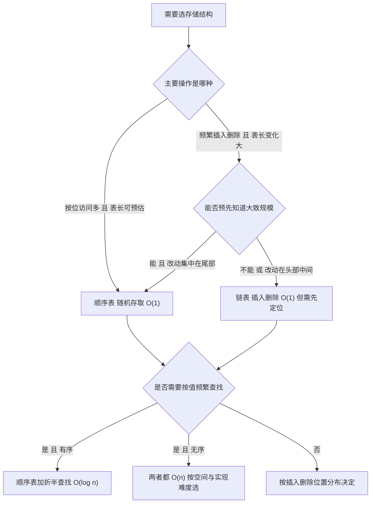

# 数据结构 · 线性表

## 线性表 [高频]

**考频统计**：考察次数 24 次；涉及年份：2009—2025 年多次出现，其中 2010、2013、2016、2019、2021、2023 年为典型年份；分数占比约 8%；主要题型：选择题为主，偶见于综合应用题背景。

**核心讲解**：

线性表是 `n` 个数据元素的有限序列，元素之间是**一对一**的逻辑关系，除首尾外每个元素有且仅有一个直接前驱和一个直接后继。顺序存储把逻辑相邻的元素放在物理相邻的存储单元，因而支持**随机存取**：`LOC(a_i) = LOC(a_1) + (i-1) * L`，其中 `L` 是单个元素占用的字节数。设表长 `n`、数组容量 `MaxSize`，则**长度是实际元素个数、容量是数组能容纳的最大个数**，两者不可混用。插入的合法位置是 `1..n+1`，在第 `i` 个位置插入需把第 `i..n` 个元素整体后移，移动次数为 `n-i+1`；

等概率（`p_i = 1/(n+1)`）下平均移动次数为 `n/2`。删除的合法位置是 `1..n`，删除第 `i` 个元素需把第 `i+1..n` 个元素整体前移，移动次数为 `n-i`；等概率（`p_i = 1/n`）下平均移动次数为 `(n-1)/2`。因为插入删除都可能搬动近乎全部元素，顺序表插入与删除的时间复杂度均为 `O(n)`；而按位查找是 `O(1)`，按值查找在无序表中是 `O(n)`。

**关键结论速记**：

- `LOC(a_i) = LOC(a_1) + (i-1) * L` —— 顺序表随机存取的根据；位序 `i` 从 1 开始，数组下标从 0 开始，故下标为 `i-1`。
- `插入移动次数 = n - i + 1`（`1 <= i <= n+1`），等概率平均 `n/2` —— 插入位置越靠前移动越多。
- `删除移动次数 = n - i`（`1 <= i <= n`），等概率平均 `(n-1)/2` —— 删除位置越靠前移动越多。
- `顺序表按位查找 O(1)、按值查找 O(n)` —— "随机存取"只针对按位访问，不等于查找快。
- `表长 length 与容量 MaxSize 是两个量` —— 判空看 `length == 0`，判满看 `length == MaxSize`。

**示意图**：

顺序表在内存中是一段连续空间，`data[0..length-1]` 有效，尾部是未使用区；插入是"从后往前搬"，删除是"从前往后搬"。

```text
sequential list: data[0..MaxSize-1], length = 5, MaxSize = 8

   index    0     1     2     3     4     5     6     7
          +-----+-----+-----+-----+-----+-----+-----+-----+
   data   | a1  | a2  | a3  | a4  | a5  |     |     |     |
          +-----+-----+-----+-----+-----+-----+-----+-----+
          |<------- length = 5 ------->|<-- free space --->|
          ^
          LOC(a1) = base
          LOC(ai) = base + (i-1) * L

insert x at position 3 (n = 5): move a3,a4,a5 right, count = n-i+1 = 3

   before: | a1 | a2 | a3 | a4 | a5 |    |
   step1 : | a1 | a2 | a3 | a4 |    | a5 |
   step2 : | a1 | a2 | a3 |    | a4 | a5 |
   step3 : | a1 | a2 |    | a3 | a4 | a5 |
   write : | a1 | a2 | x  | a3 | a4 | a5 |   length = 6

delete position 3 (n = 5): move a4,a5 left, count = n-i = 2

   before: | a1 | a2 | a3 | a4 | a5 |
   step1 : | a1 | a2 | a4 | a4 | a5 |
   step2 : | a1 | a2 | a4 | a5 | a5 |
   write : | a1 | a2 | a4 | a5 |    |   length = 4
```

顺序表与链表的选择不是"哪个更好"，而是按操作分布决定；下图给出考场判断路径。



**易错点**：

- 位序与下标混用：题目说"第 `i` 个位置"时 `i` 从 1 开始，而代码里数组下标是 `i-1`；套公式时若直接代下标，移动次数会整体差 1，插入位置范围也会错写成 `0..n`。
- 把顺序表的插入删除说成 `O(1)`：只有当插入/删除固定发生在表尾时才是 `O(1)`；等概率一般位置的平均移动次数是 `n/2` 与 `(n-1)/2`，时间复杂度是 `O(n)`。
- 混淆"长度"与"容量"：`length` 是当前元素个数（决定合法位序范围与遍历边界），`MaxSize` 是数组容量（决定上溢条件）；判满条件是 `length == MaxSize`，不是 `length == MaxSize - 1`。
- 误认为"随机存取"等于"查找快"：随机存取指用一次地址计算就能定位第 `i` 个元素，因此**按位查找**是 `O(1)`；按值查找仍需从头比较，无序表为 `O(n)`。

**真题示例**：

**2013 年 408 第 41 题（综合应用题，15 分）**

一个长度为 `L`（`L >= 1`）的升序序列 `S`，处在第 `ceil(L/2)` 个位置的元素称为 `S` 的中位数。例如序列 `S1 = (11, 13, 15, 17, 19)` 的中位数是 15，两个序列的中位数是含它们所有元素的升序序列的中位数。现在有两个等长升序序列 `A` 和 `B`，设计一个在时间和空间两方面都尽可能高效的算法，找出两个序列 `A` 和 `B` 的中位数。要求：给出算法的基本设计思想；用 C 或 C++ 描述算法，关键之处给出注释；说明你所设计算法的时间复杂度与空间复杂度。

> 解析：取 `A`、`B` 各自的中位数 `a = A[midA]`、`b = B[midB]`（`mid` 为 `ceil` 意义上的中间位置）。若 `a == b`，该值即为所求，结束。若 `a < b`，则所求中位数只可能落在 `A` 的右半段与 `B` 的左半段（`A` 左半段与 `B` 右半段分别被排除，且两段被排除的元素个数相等，故中位数位置不变），于是令 `A` 的查找范围收缩为右半段、`B` 收缩为左半段；`a > b` 时对称处理。每轮两个序列的候选长度都减半，故时间复杂度 `O(log n)`；只用若干下标与临时变量，空间复杂度 `O(1)`。这就是本题的满分答案框架：**折半缩小两个有序序列的候选区间**。

---
