# 数据结构 · 顺序表与链表

## 顺序表与链表 [高频]

**考频统计**：考察次数 22 次；涉及年份：2010、2012、2015、2017、2019、2021、2022、2024；分数占比约 7%；主要题型：选择题 + 综合应用题（链表操作代码）。

**核心讲解**：

链表用指针把逻辑相邻的元素链接起来，**存储单元可以不连续**，因此不支持随机存取，只能从头指针出发顺序访问。单链表结点由数据域 `data` 与指针域 `next` 构成；双链表增加前驱指针 `prior`；循环链表把尾结点指针指回头结点（或首结点）而形成环；静态链表用数组下标（游标）模拟指针，`next == -1` 表示链尾。

**带头结点与不带头结点的差别只在第一个数据结点**：带头结点时头指针恒非空，空表条件是 `head->next == NULL`，插入删除的第一个数据结点与其余结点逻辑统一，不必特判；不带头结点时空表条件是 `head == NULL`，在表头插入或删除首元素必须修改头指针本身。链表的按位查找与按值查找都是 `O(n)`，因为必须从头走。**"插入删除是 `O(1)`"有前提**：在已知结点 `p` **之后**插入是 `O(1)`（`s->next = p->next; p->next = s;`），但**在 `p` 之前**插入或删除 `p` 本身，单链表必须从头找前驱，是 `O(n)`；双链表因为能直接取到前驱，这两种操作都是 `O(1)`。头插法建表得到与输入**相反**的序列，尾插法建表得到与输入**相同**的序列，这是判断建表方式的快速依据。

**关键结论速记**：

- `按位查找 / 按值查找 O(n)`、`已知前驱的插入删除 O(1)` —— 链表的代价集中在"找位置"，一旦定位完成，指针改接是常数时间。
- `头插法逆序、尾插法同序` —— 头插法每次把新结点插在头结点之后，故输出序列是输入序列的逆序。
- `双链表插入四步不能乱` —— 先接新结点的两个指针，再改原结点指针，否则会丢失后继地址而断链。
- `length 不存储在链表里` —— 求表长必须遍历，`O(n)`；若题目要求 `O(1)` 求长，需额外维护长度域。
- `尾指针循环单链表：表尾 O(1)、表头 O(1)` —— 因为 `rear->next` 就是头结点，取头取尾都只需常数次指针运算。

**示意图**：

三种链表的结点与指针形态如下；`^` 表示空指针，`H` 为头结点（不存数据），`rear` 为尾指针。

```text
singly linked list with dummy head (length 3)

  head
   |
   v
 +---+---+    +---+---+    +---+---+    +---+---+
 | H | o-|--> | a | o-|--> | b | o-|--> | c | ^ |
 +---+---+    +---+---+    +---+---+    +---+---+
   ^
   head->next == NULL  means  empty list

doubly linked list (length 2): each node has prior and next

        +--------+     +--------+     +--------+
        |        v     |        v     |        v
 +---+--+--+  +--+---+--+--+  +--+---+--+  +--+---+
 | H |  ^  |  | a |    |  |  | b |    |  |  | ^ |  |
 +---+-----+  +---+----+--+  +---+----+--+  +---+--+
        ^          |              |            ^
        +----------+              +------------+

circular singly linked list with rear pointer (length 3)

  rear
   |
   v
 +---+---+    +---+---+    +---+---+    +---+---+
 | c | o-|--> | H | o-|--> | a | o-|--> | b | o-|--+
 +---+---+    +---+---+    +---+---+    +---+---+  |
                                                      |
        +---------------------------------------------+
        |
        +--> back to node c (rear->next is head node H)

static linked list: array slots, cursor -1 means end

  index   0     1     2     3     4     5
        +-----+-----+-----+-----+-----+-----+
  data  |  H  |  a  |  b  |  c  |     |     |
  next  |  1  |  2  |  3  | -1  |     |     |
        +-----+-----+-----+-----+-----+-----+
  start = 0 (head node index), free list head stored separately
```

在"已知某结点"的前提下，插入与删除的指针改接顺序决定了是否会断链，下图给出必须遵守的次序。

```mermaid
flowchart TD
    A0["已定位到结点 p 需要在其后插入 s"] --> A1["s->next = p->next"]
    A1 --> A2["p->next = s"]
    A2 --> A3["顺序不可交换 否则 p 的原后继地址丢失"]

    B0["已定位到结点 p 需要删除其自身"] --> B1{"是双链表吗"}
    B1 -->|是| B2["p->prior->next = p->next"]
    B2 --> B3["p->next->prior = p->prior"]
    B3 --> B4["free p"]
    B1 -->|否 单链表| B5["必须从头找 p 的前驱 q"]
    B5 --> B6["q->next = p->next"]
    B6 --> B4
```



**易错点**：

- 认为"链表插入删除一定是 `O(1)`"：只有在**已定位到前驱结点**（双链表是已定位到该结点）时才是 `O(1)`；若还要先按值或按位查找，整体是 `O(n)`。
- 指针修改顺序写反导致断链：在 `p` 之后插入必须**先** `s->next = p->next` **再** `p->next = s`；反过来会先覆盖 `p->next`，使原后继无法访问。
- 不带头结点时忘记特判表头：在第一个数据结点前插入、或删除首元素，都必须修改头指针 `head`；若函数形参只是 `LinkList L`（值传递），这些修改不会带回调用者，必须用引用或二级指针。
- 把静态链表的游标当成真实指针：`next` 存的是数组下标，`-1` 是链尾标志而非"空地址值的随意约定"；且它的"空间"由数组大小固定，属于顺序存储的模拟。

**真题示例**：

**2009 年 408 第 42 题（综合应用题，10 分）**

已知一个带有表头结点的单链表，结点结构为 `[data | link]`，假设该链表只给出了头指针 `list`。在不改变链表的前提下，请设计一个尽可能高效的算法，查找链表中倒数第 `k` 个位置上的结点（`k` 为正整数）。若查找成功，算法输出该结点的 `data` 域的值，并返回 1；否则，只返回 0。要求：描述算法的基本设计思想；描述算法的详细实现步骤；根据设计思想和实现步骤，采用 C 或 C++ 语言描述算法，关键之处给出注释。

> 解析：设计思想是**双指针同向平移**——一次遍历即可定位倒数第 `k` 个结点。实现步骤：令 `p` 与 `q` 都指向第一个数据结点，先让 `p` 沿 `link` 前进 `k` 个结点；若前进过程中 `p` 变为 `NULL`，说明表长小于 `k`，返回 0。此后让 `p`、`q` 同步前进，直到 `p == NULL`，此时 `q` 恰好指向倒数第 `k` 个结点，输出 `q->data` 并返回 1。时间复杂度 `O(n)`（只遍历一趟），空间复杂度 `O(1)`。**关键在于"两个指针间隔恒为 `k` 个结点"，用距离差代替了长度统计。**

---
