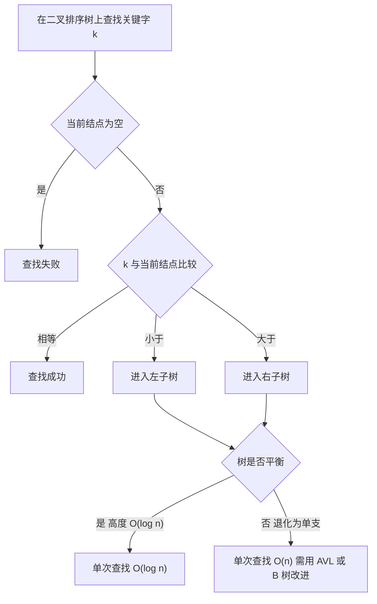

# 数据结构 · 查找

## 查找 [高频]

**考频统计**：考察次数 18 次；涉及年份：2009、2011、2013、2015、2017、2019、2022、2024；分数占比约 9%；主要题型：选择题为主（折半查找判定树、B 树、散列表）。

**核心讲解**：

**折半查找**要求表**顺序存储且按关键字有序**，每次用 `mid = floor((low+high)/2)` 与目标比较，把查找区间折半，故比较次数不超过判定树高度，时间复杂度 `O(log2 n)`。折半查找的**判定树**是由"取中点为根"递归生成的**平衡二叉树**（不是完全二叉树）：含 `n` 个结点的判定树高度 `h = floor(log2 n) + 1 = ceil(log2(n+1))`，等概率成功查找的平均查找长度 `ASL = ((n+1)/n) * log2(n+1) - 1`（当 `n = 2^h - 1` 时恰为 `ASL = h`，例如 `n = 11` 时 `ASL = 3`）。

**分块查找**（索引顺序查找）把表分成若干块，块间有序、块内无序，用"顺序查找索引 + 块内顺序查找"时平均查找长度约为 `sqrt(n) + 1`（块长取 `sqrt(n)` 最优）。**二叉排序树（BST）**的查找、插入、删除都是沿一条根到叶的路径进行，时间 `O(h)`；树高在随机情况下为 `O(log n)`，但按有序序列插入会退化成单支树而变成 `O(n)`，这正是引入**平衡二叉树（AVL）**的动机：任一结点左右子树高度差（平衡因子）绝对值不超过 1，插入后若失衡，按 `LL`（右单旋）、`RR`（左单旋）、`LR`（先左后右双旋）、`RL`（先右后左双旋）四种情形调整。

含 `n` 个关键字的 `m` 阶 **B 树**满足：每个结点至多 `m` 棵子树、`m-1` 个关键字；除根外每个结点至少 `ceil(m/2)` 棵子树；所有叶结点（失败结点）在同一层——这保证了树高为 `O(log n)`。**B+ 树**与 B 树的关键差别是：B+ 树所有关键字都出现在叶结点且叶结点按序链接，非叶结点只作索引。**散列表**用散列函数把关键字映射到地址，冲突处理常用开放定址（线性探测、平方探测）与拉链法；性能由装填因子 `alpha = n/m` 决定，线性探测的成功平均查找长度约为 `(1 + 1/(1-alpha)) / 2`，拉链法约为 `1 + alpha/2`。

**关键结论速记**：

- `折半查找判定树高度 = floor(log2 n) + 1`，等概率成功 `ASL = ((n+1)/n)*log2(n+1) - 1` —— 判定树是平衡二叉树而非完全二叉树。
- `分块查找 ASL 约 sqrt(n) + 1` —— 块长取 `sqrt(n)` 时"索引顺序查找 + 块内顺序查找"总代价最小。
- `BST 操作 O(h)`、最好 `O(log n)`、最坏单支 `O(n)` —— 退化原因是插入序列有序。
- `AVL 平衡因子 ∈ {-1, 0, 1}`、失衡调整只看**最小失衡子树** —— `LL/RR/LR/RL` 四种旋转的判定依据是新结点插入在失衡结点的哪一侧。
- `m 阶 B 树：结点子树数 ∈ [ceil(m/2), m]，关键字数 ∈ [ceil(m/2)-1, m-1]` —— 根结点子树数下限为 2。
- `散列表 ASL 只与装填因子 alpha 有关` —— 线性探测约 `(1+1/(1-alpha))/2`，拉链法约 `1+alpha/2`（哈希均匀假设下）。

**示意图**：

**含 11 个元素的有序表折半查找判定树**：下标 `1..11`，根是 `mid = 6`，左子树对应 `1..5`、右子树对应 `7..11`，逐层取中点；带圈数字是查找该元素的比较次数。

```text
ordered list keys:  k1  k2  k3  k4  k5  k6  k7  k8  k9 k10 k11
index:               1   2   3   4   5   6   7   8   9  10  11

decision tree (mid = floor((low+high)/2))

                        (6)               compare 1 time
                      /     \
                  (3)         (9)         compare 2 times
                 /   \       /   \
              (1)    (4)   (7)    (10)    compare 3 times
                 \      \     \      \
                 (2)    (5)   (8)    (11) compare 4 times

level 1: 1 node   -> 1 comparison
level 2: 2 nodes  -> 2 comparisons
level 3: 4 nodes  -> 3 comparisons
level 4: 4 nodes  -> 4 comparisons

ASL = (1*1 + 2*2 + 3*4 + 4*4) / 11 = 33 / 11 = 3
height = floor(log2 11) + 1 = 3 + 1 = 4   (matches the tree above)
```

**BST 与 AVL 的关系**：查找代价由树高决定，因此"是否平衡"直接决定复杂度量级。



**易错点**：

- 把折半查找判定树画成完全二叉树：判定树是**平衡二叉树**，第 4 层只有 4 个结点（对应 `n = 11`），若画成完全二叉树则会有 8 个结点、`ASL` 也会算错。
- B 树与 B+ 树的结点数据混用：`m` 阶 B 树中"结点有 `k` 个关键字就有 `k+1` 棵子树"，除根外关键字数不少于 `ceil(m/2)-1`；B+ 树则所有关键字都出现在叶结点，非叶结点只存索引，两者的上限下限公式不能互换。
- 线性探测删除元素时直接置空：被删除位置之后的元素是靠探测序列找回来的，置空会**截断探测链**导致后续查找失败；正确做法是打"删除标记"（墓碑），或在删除后做局部再散列。
- 认为散列表查找时间一定是 `O(1)`：理想情况下是 `O(1)`，但冲突严重（`alpha` 接近 1、线性探测堆积）时退化到 `O(n)`；`ASL` 是 `alpha` 的函数，不是常数。

**真题示例**：

**2015 年真题改编（综合应用题，10 分）**

已知含 8 个关键字的序列 `{19, 14, 23, 1, 68, 20, 84, 27}`，散列表表长 11，散列函数 `H(key) = key mod 11`，用**线性探测法**处理冲突。要求：画出所构造的散列表；分别计算等概率下查找成功与查找不成功的平均查找长度。

> 解析：按 `H(key)` 与线性探测依次落位。`19 mod 11 = 8` 存 8；`14 mod 11 = 3` 存 3；`23 mod 11 = 1` 存 1；`1 mod 11 = 1` 冲突，探测 2 空，存 2；`68 mod 11 = 2` 冲突，探测 3（被 14 占）、4 空，存 4；`20 mod 11 = 9` 存 9；`84 mod 11 = 7` 存 7；`27 mod 11 = 5` 存 5。最终散列表如下（`--` 表示空单元）。

```text
index    0    1    2    3    4    5    6    7    8    9   10
       +----+----+----+----+----+----+----+----+----+----+----+
key    | -- | 23 |  1 | 14 | 68 | 27 | -- | 84 | 19 | 20 | -- |
probes |    |  1 |  2 |  1 |  3 |  1 |    |  1 |  1 |  1 |    |
       +----+----+----+----+----+----+----+----+----+----+----+
```

> **查找成功**：各关键字的比较次数为 `23:1`、`1:2`、`14:1`、`68:3`、`27:1`、`84:1`、`19:1`、`20:1`，故 `ASL_success = (1+2+1+3+1+1+1+1) / 8 = 11/8 = 1.375`。**查找不成功**：要对 `H(key) = 0..10` 这 11 个入口分别沿探测序列数到第一个空单元（空单元的判定也计 1 次比较），次数为 `1, 6, 5, 4, 3, 2, 1, 4, 3, 2, 1`，合计 32，故 `ASL_unsuccess = 32/11 ≈ 2.91`。**判分点是落位次序、以及"不成功 ASL 必须对表长个入口逐一统计并与成功 ASL 分开计算"——后者最易遗漏。**

---
