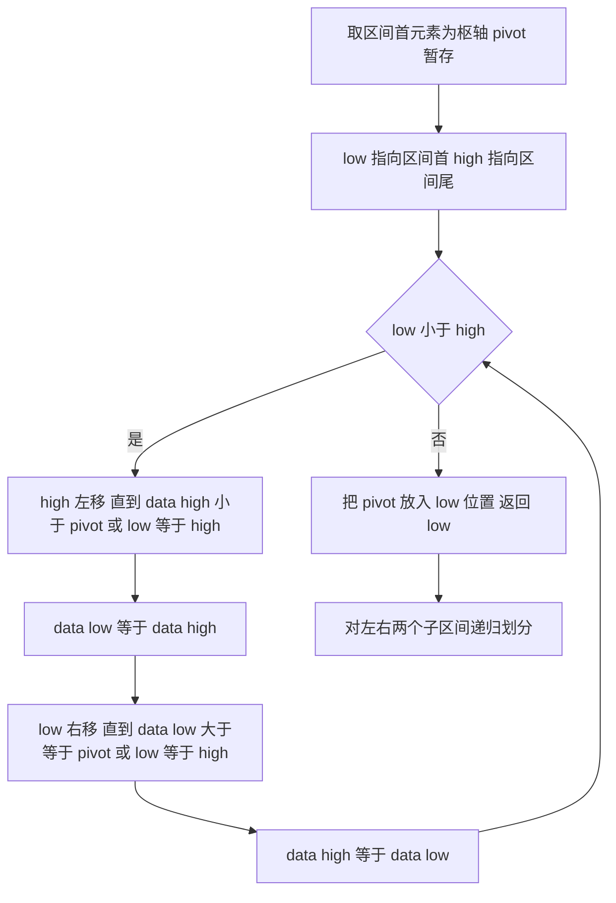

# 数据结构 · 排序

## 排序 [高频]

**考频统计**：考察次数 20 次；涉及年份：2009、2010、2012、2014、2016、2018、2020、2022、2024、2025；分数占比约 12%；主要题型：选择题 + 综合应用题（外部排序、堆、快排过程）。

**核心讲解**：

排序算法按思想分为五类：**插入类**（直接插入、折半插入、希尔）、**交换类**（冒泡、快速）、**选择类**（简单选择、堆）、**归并类**、**基数类**。直接插入排序把第 `i` 个元素插入前面已排好的子序列，最好情况（已有序）比较 `n-1` 次、移动 0 次即 `O(n)`，最坏与平均为 `O(n^2)`，稳定，且**比较次数与初始序列有关**。

希尔排序按增量分组做插入排序，增量逐次折半到 1，平均约 `O(n^1.3)`，**不稳定**，且时间与增量序列的选取有关。冒泡排序每趟把最大元素"冒"到末尾，最好 `O(n)`（设置交换标志）、最坏 `O(n^2)`，稳定。**快速排序**每趟以枢轴划分，平均 `O(n log n)`、最坏 `O(n^2)`（当序列**基本有序**或枢轴总取到最值时），平均与最好空间 `O(log n)`（递归栈）、最坏 `O(n)`，**不稳定**；

快排是所有内部排序中平均性能最优的，但退化时不如堆排序。**堆排序**先把数组建成大根堆（建堆时间 `O(n)`），再反复"取堆顶与末尾交换 + 向下调整"，每次调整 `O(log n)`，总时间 `O(n log n)`（最好、最坏、平均都一样），空间 `O(1)`，**不稳定**；堆是"完全二叉树的顺序存储"，`i` 的左右孩子是 `2i` 与 `2i+1`。**归并排序**自底向上或自顶向下合并有序段，时间恒为 `O(n log n)`、需要 `O(n)` 辅助空间、**稳定**。**基数排序**按位从低位到高位分配与收集，时间 `O(d(n+r))`、空间 `O(r)`、**稳定**。

**外部排序**受内存限制，核心是减少归并趟数 `S = ceil(log_k m)`（`m` 为初始归并段数、`k` 为归并路数）：用**置换-选择排序**生成更长的初始归并段以减少 `m`，用**败者树**把 `k` 路归并中每次选最小的比较次数从 `k-1` 降到 `ceil(log2 k)`，用**最佳归并树**（哈夫曼思想）为长度不等的归并段安排归并次序以最小化读写次数，并可通过增加虚段构造严格的 `k` 叉哈夫曼树。

**关键结论速记**：

- `不稳定的排序：快排、希尔、简单选择、堆` —— 口诀"快些选堆"；插入、冒泡、归并、基数排序稳定。
- `与初始序列有关的：插入、冒泡、快排、希尔` —— 堆排序、归并排序、基数排序的时间与初始序列无关。
- `快排最坏 O(n^2) 出现在基本有序时，空间最坏 O(n)` —— 枢轴选最值导致划分极不平衡。
- `堆排序建堆 O(n)、单次调整 O(log n)、总计 O(n log n)、空间 O(1)` —— 建堆不是 `O(n log n)`，这是常考细节。
- `归并 O(n log n) 稳定但需 O(n) 空间` —— 是"稳定 + 最坏也是 O(n log n)"的首选；基数排序 `O(d(n+r))` 稳定，但要求关键字可分解为有限位。
- `外部排序：S = ceil(log_k m)`、败者树使单次选最小的比较次数降为 ceil(log2 k)` —— 减少 `S` 的两条路是增大 `k` 或减少 `m`。

**示意图**：

**大根堆的数组表示与"筛选（向下调整）"过程**：堆在数组中按下标 `1..n` 存储，`i` 的孩子为 `2i`、`2i+1`；输出堆顶后把末尾元素放到根，再与较大的孩子交换，逐层下沉。

```text
array (1-based):  [ 87, 45, 78, 32, 17, 65, 53 ]
index:              1   2   3   4   5   6   7

tree view:
                  87(1)
                /       \
            45(2)       78(3)
            /    \      /    \
        32(4)  17(5) 65(6)  53(7)

after swapping root 87 with last element 53, then sift down

  step 0:      53          step 1:     78           step 2:     78
             /    \                  /    \                   /    \
           45      78              45      53               45      65
          /  \    /               /  \    /                /  \    /
        32   17  65              32   17 65               32   17  53
  (53 < 78, swap)          (53 < 65, swap)          heap restored

heapsort = build heap O(n) + n-1 times (swap + sift down) each O(log n)
```

**快速排序的一趟划分（Hoare 划分）**：枢轴暂存后，右指针左移找小于枢轴的元素填到左坑，左指针右移找大于枢轴的元素填到右坑，直到两指针相遇，把枢轴放入该位置。



**易错点**：

- 把堆排序说成稳定：堆排序在"堆顶与末尾交换"时会跨越多个元素，等值元素的相对次序被破坏，属于**不稳定**排序；稳定且 `O(n log n)` 的只有归并排序（基数排序对位数有限制）。
- 认为快排最坏情况与初始序列无关：快排最坏 `O(n^2)` 恰好发生在**初始序列基本有序**（或逆序）时，此时每次划分都极不平衡；而堆排序、归并排序的时间与初始序列无关。
- 混淆"建堆"与"排序"的复杂度：自底向上建堆只要 `O(n)`（从 `floor(n/2)` 号开始向前调整），但对每个元素做一次 `O(log n)` 的调整为 `O(n log n)`；若把建堆写成 `O(n log n)` 就会误判总复杂度。
- 外部排序归并趟数忘记向上取整：`S = ceil(log_k m)`，且为减少 `S` 可以**增大 k 或减少 m**；用败者树可让 `k` 路归并每次选最小的比较次数为 `ceil(log2 k)` 而不是 `k-1`。

**真题示例**：

**2016 年真题改编（综合应用题，15 分）**

已知由 `n`（`n >= 2`）个正整数构成的集合 `A = {a_k | 0 <= k < n}`，将其所有元素依次划分成两个子集 `A1` 和 `A2`，且 `A1` 中元素个数为 `n1`。设计一个尽可能高效的划分算法，满足 `|n1 - n2|` 最小且 `|sum(A1) - sum(A2)|` 最大，要求：给出算法的基本设计思想；根据设计思想，采用 C 或 C++ 描述算法，关键之处给出注释；说明你所设计算法的时间复杂度和空间复杂度。

> 解析：**先排序、再对半分**是最直接的满足两个条件的做法：排序后取前 `floor(n/2)` 个元素作为 `A1`、其余作为 `A2`，则两子集元素个数之差最小（`n` 为偶数时为 0，为奇数时为 1），且由于序列有序，"最小的一半之和"与"最大的一半之和"之差达到最大。用快速排序实现时平均时间复杂度 `O(n log n)`、空间复杂度 `O(log n)`。**更高分的做法是基于快排划分的"部分选择"**：只要求出中位数位置并保证其左侧元素都不大于右侧即可，只需一次递归的单侧划分，期望时间 `O(n)`（最坏 `O(n^2)`）、空间 `O(1)`；这体现了"不需要完全有序、只需第 `floor(n/2)` 位置就位"的优化思想，是本题的满分思路。

---
