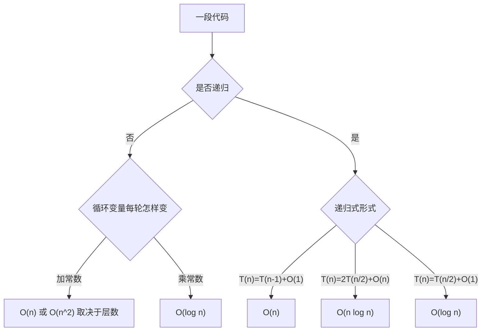

# 数据结构 · 绪论与算法分析

## 绪论与算法分析 [高频]

**考频统计**：考察次数 考频待补充；涉及年份：2026 大纲「一、基本概念」单列；历年多以复杂度分析小题或综合题背景出现；分数占比约 未统计；主要题型：选择题为主（复杂度分析），也可能作为综合题背景。

**核心讲解**：

数据结构研究的是数据元素之间的**逻辑结构**、它在计算机中的**存储结构**以及定义在结构上的**运算**三件事。逻辑结构分为线性结构、树形结构、图状结构与集合四类；存储结构分为顺序存储、链式存储、索引存储与散列存储，同一逻辑结构可以用不同存储结构实现，效率因此不同。算法是对特定问题求解步骤的描述，必须同时满足**有穷性、确定性、可行性、输入、输出**五个特性。评价算法除正确性、可读性、健壮性外，核心是效率：时间复杂度按基本操作执行次数 `T(n)` 的数量级计为 `O(f(n))`，只保留最高阶项并忽略常数系数。常见量级从小到大为 `O(1) < O(log n) < O(n) < O(n log n) < O(n^2) < O(n^3) < O(2^n) < O(n!)`。空间复杂度只统计**辅助空间**（不含输入数据本身），递归算法的调用栈深度必须计入。

**关键结论速记**：

- `逻辑结构 ≠ 存储结构` —— 逻辑结构描述元素之间的关系，存储结构描述它在内存中如何摆放；顺序表与链表是同一线性逻辑结构的两种存储实现。
- `算法五特性：有穷、确定、可行、输入、输出` —— 缺一不可；"有穷"指执行步骤有限，不是"程序运行时间短"。
- `O(f(n)) 只保留最高阶、忽略常数` —— `3n^2 + 5n + 7` 记作 `O(n^2)`；`n/2` 与 `n` 同阶。
- `量级排序：1 < log n < n < n log n < n^2 < n^3 < 2^n < n!` —— 比较两个函数时先化简再比阶。
- `循环看增长：i *= 2 是 log n，i++ 是 n；双层且内层上界为 i 是 n^2 量级` —— 如 `for(i=0;i<n;i++) for(j=0;j<i;j++)` 共执行 `n(n-1)/2` 次。
- `空间复杂度 = 辅助空间`，递归栈深 `O(n)` 要计入；原地算法指辅助空间 `O(1)`。

**示意图**：

数量级增长很快：同样的 `n`，`2^n` 与 `n!` 在 `n` 稍大时就不可计算，这是"指数级算法不可行"的直观来源。

```text
growth of common complexity classes (operations, order of magnitude)

   n        log2 n     n          n log2 n      n^2         2^n
   ----------------------------------------------------------------
   10       3          10         33            100         1024
   100      7          100        664           10000       1.3e30
   1000     10         1000       9966          1e6         huge

   order:   1  <  log n  <  n  <  n log n  <  n^2  <  n^3  <  2^n  <  n!

loop patterns and their counts

   for (i = 1; i <= n; i++)            -> n        times   O(n)
   for (i = 1; i <= n; i *= 2)         -> log2 n   times   O(log n)
   for (i = 0; i < n; i++)             -> n(n-1)/2 times   O(n^2)
       for (j = 0; j < i; j++)
   T(n) = 2T(n/2) + n                  -> O(n log n)   (merge sort)
```

判断一段代码的复杂度，先看循环变量怎样逼近边界，再看递归式怎样展开。



**易错点**：

- 把 `O(1)` 理解成"只执行一次"：`O(1)` 指执行次数与 `n` 无关的常数，`for(i=0;i<1000;i++)` 仍是 `O(1)`，只要上界是常数而不是 `n`。
- 忽略递归的栈空间：递归算法即使没有开数组，调用栈深度也占辅助空间，如递归求阶乘的空间复杂度是 `O(n)` 而不是 `O(1)`。
- 把平均复杂度当最坏复杂度：顺序查找成功平均 `O(n)`、最坏 `O(n)`，但折半查找最好 `O(1)`、最坏 `O(log n)`；题目问"最坏"时必须按最坏报。
- 化简时漏掉对数因子：`n log n` 与 `n` 不同阶，归并排序、堆排序都是 `O(n log n)`，不能写成 `O(n)`。

**真题示例**：

**2019 年真题改编（选择题，2 分）**

下列程序段的时间复杂度是：

```text
int i = 1, s = 0;
while (i <= n) {
    s += i;
    i *= 2;
}
```

A. `O(1)`　B. `O(log n)`　C. `O(n)`　D. `O(n log n)`

> 解析：循环变量 `i` 依次取 `1, 2, 4, ..., 2^k`，终止条件是 `2^k <= n`，故循环执行次数为 `floor(log2 n) + 1`，与 `n` 的对数同阶。基本操作 `s += i` 每次常数时间，因此 `T(n) = O(log n)`，选 B。若把 `i *= 2` 改成 `i++`，执行次数才退化为 `n`，即 `O(n)`。

---
