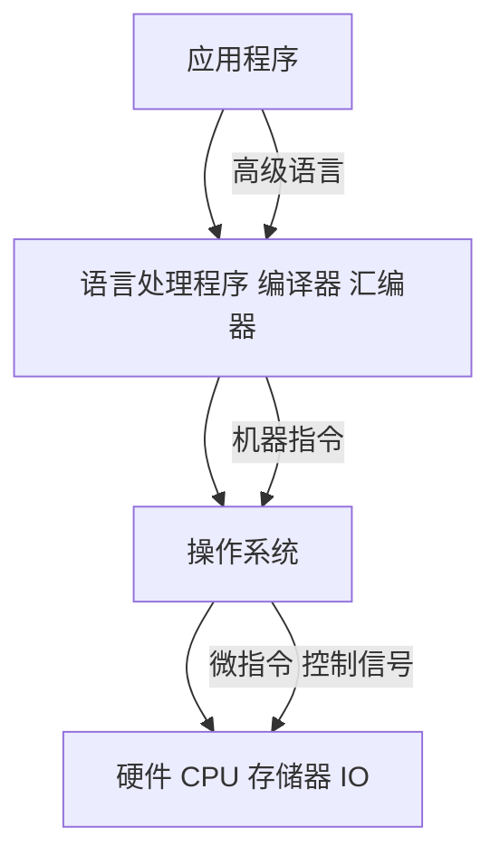
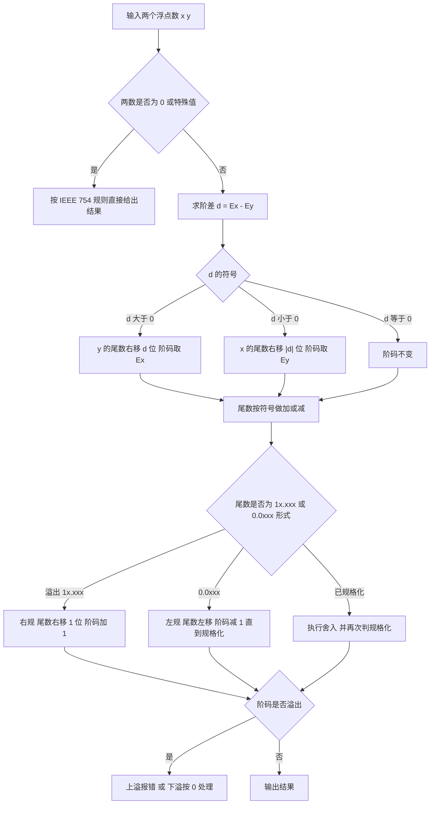
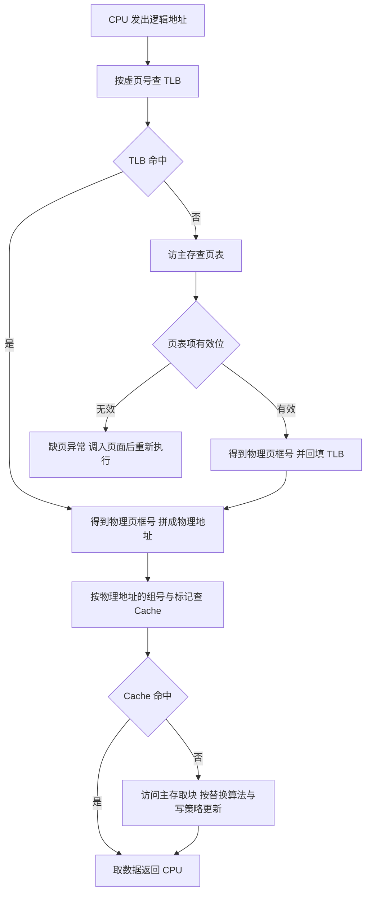
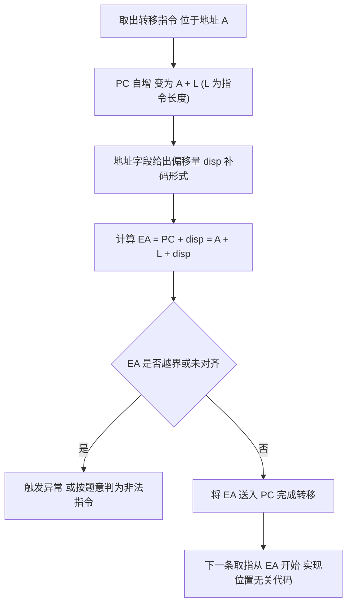
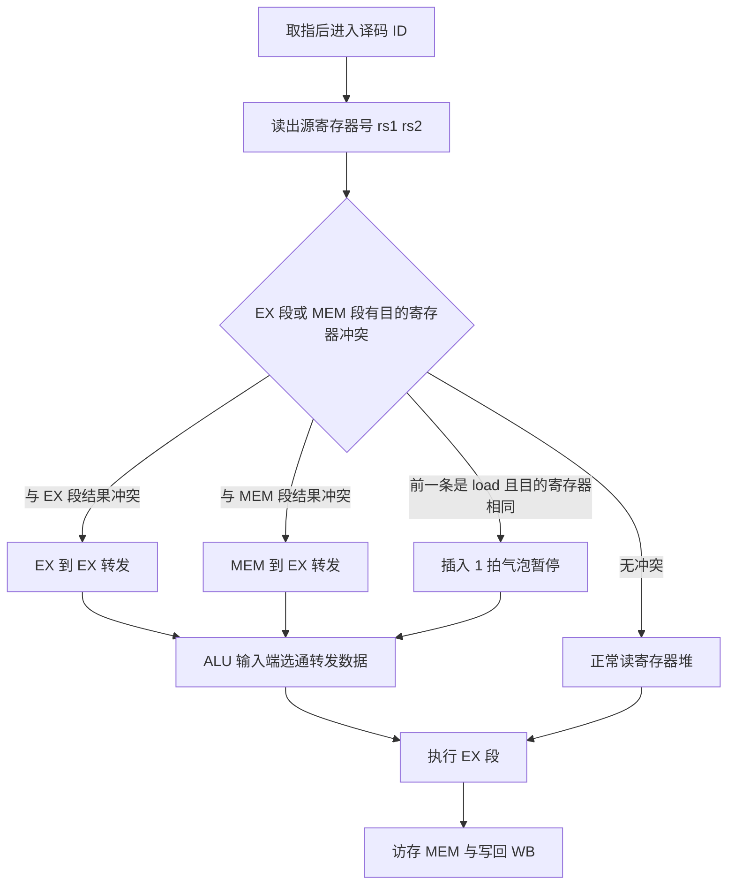
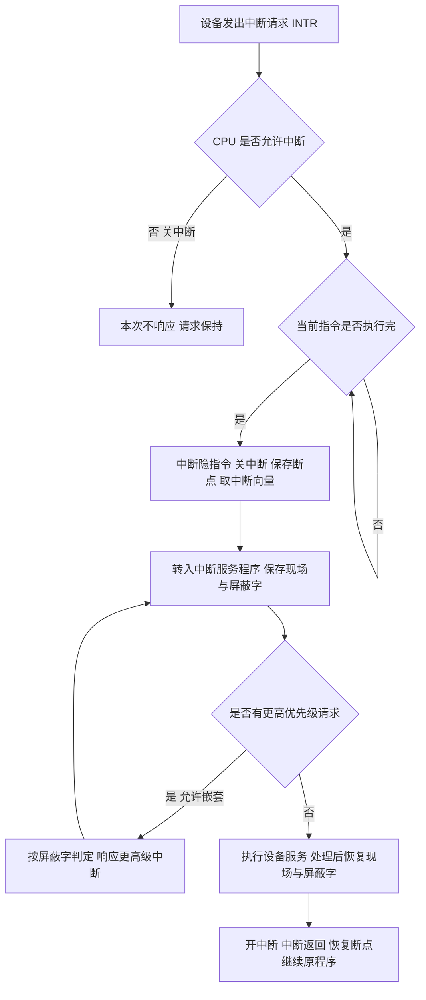
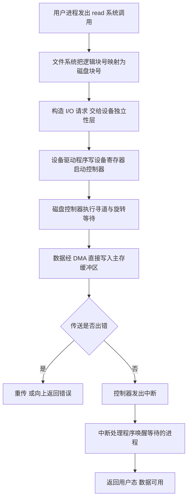

# 计算机组成原理 · 408 速成复习资料

**科目分值**：45 分 / 150 分　|　**章节数**：7　|　**统计区间**：2009—2025 年 408 统考真题（17 套）

## 本科目章节索引

| # | 知识点 | 考察次数 | 分值占比 | 高频 |
| --- | --- | --- | --- | --- |
| 1 | [计算机系统概述](07-计算机系统概述.md) | 考频待补充 | 未统计 | **是** |
| 2 | [数据表示与运算](01-数据表示与运算.md) | 26 次 | 约 12% | **是** |
| 3 | [存储系统](02-存储系统.md) | 32 次 | 约 22% | **是** |
| 4 | [指令系统](03-指令系统.md) | 24 次 | 约 12% | **是** |
| 5 | [中央处理器 CPU](04-中央处理器.md) | 28 次 | 约 18% | **是** |
| 6 | [总线](05-总线.md) | 14 次 | 约 6% | **是** |
| 7 | [输入输出系统](06-输入输出系统.md) | 20 次 | 约 10% | **是** |

## 本科目在 408 中的位置

| 项目 | 内容 |
| --- | --- |
| 分值 | **45 分 / 150 分**（占 30%） |
| 单选题 | 第 11—22 题（单选，每题 2 分，共 24 分） |
| 综合应用题 | 第 43 题（约 8 分）、第 44 题（约 13 分），共 21 分 |
| 命题特点 | 选择题重"位级/字节级计算"（补码、IEEE 754、Cache 标记、总线带宽）；大题重"地址划分 + 数据通路/流水线时空图" |

**复习优先级**：存储系统 → 中央处理器 → 数据表示与运算 → 指令系统 → 输入输出系统 → 总线。
**存储系统与 CPU 两章合计约 40 分**；总线章节分值最低但公式固定，属于"必拿分"。

## 使用说明（30 秒读完）

1. **先看 `[高频]` 标记**：每节标题带 `[高频]` 的是历年反复命题的考点，时间紧张时只看这些。
2. **每节固定六段式**：考频统计 → 核心讲解 → 关键结论速记 → 示意图 → 易错点 → 真题示例，可直接跳跃到你缺的那一段。
3. **图形约定**：`text` 代码块为 **ASCII 图**（用于结构布局、位域划分、地址格式）；`mermaid` 代码块为 **流程图/状态机**（用于算法流程、协议交互、状态转换）。
4. **考频口径**：统计区间 2009—2025 年共 17 套真题；"考察次数"按题次计，一道综合题串联多个考点时各自计 1 次。
5. **自检方式**：本资料由脚本生成，`python3 scripts/validate.py` 会校验模板完整性、考频数字一致性、ASCII 图对齐与真题年份合法性。

> 本资料为速成复习用途：**考频数据为基于 2009—2025 年真题的公开考频表统计整理，非官方发布**，
> 用于确定复习优先级，不作为命题预测。数据口径与来源见 `README.md`。

## 计算机系统概述 [高频]

**考频统计**：考察次数 考频待补充；涉及年份：2026 大纲「一、计算机系统概述」；常与存储、CPU 性能题合并考查；分数占比约 未统计；主要题型：选择题为主（性能指标计算）。

**核心讲解**：

计算机系统由**硬件**与**软件**组成，硬件五大部件是运算器、控制器、存储器、输入设备和输出设备，它们通过总线连接；冯·诺依曼结构以**存储器为中心**，程序和数据以二进制形式存放在同一存储器中，这就是"**存储程序**"工作方式。程序执行时，CPU 按 PC 给出的地址取指令、译码、执行，再写回结果，一条指令的执行可拆成取指、译码、执行、访存、写回几个阶段。系统呈层次结构：硬件之上是操作系统，再往上依次是语言处理程序与应用程序，上层通过下层提供的接口工作，因此"软件与硬件在逻辑上等价"。

衡量性能时，主频 `f` 与时钟周期 `T` 互为倒数（`T = 1/f`），`CPI` 是每条指令平均占用的时钟周期数，**CPU 执行时间 = 指令条数 × CPI × 时钟周期**。`MIPS = 主频 / (CPI × 10^6)` 表示每秒执行多少百万条指令，浮点性能用 `MFLOPS`/`GFLOPS` 等表示；吞吐量与响应时间则从系统整体角度衡量。注意 `CPI` 是**平均**值：不同指令的 CPI 不同，程序混合执行时要用各类指令的比例加权。

**关键结论速记**：

- `五大部件：运算器、控制器、存储器、输入、输出` —— 冯·诺依曼结构以存储器为中心，程序与数据统一编址存放。
- `存储程序 = 程序与数据预先存入存储器 + CPU 按地址自动取指执行` —— 这是"通用计算机"的基础。
- `CPU 执行时间 = 指令条数 IC × CPI × 时钟周期 T` —— 三条同时影响，主频高不一定更快。
- `MIPS = f / (CPI × 10^6)`（`f` 以 Hz 计） —— MIPS 只看指令条数，不区分指令的复杂程度。
- `T = 1/f`，`f = 2GHz` 时 `T = 0.5ns` —— 主频与时钟周期互为倒数，单位不要混（`GHz` 与 `ns`）。
- `吞吐量 vs 响应时间` —— 吞吐量是单位时间完成的任务数，响应时间是单个任务从提交到完成的延迟，二者优化方向可能相反。

**示意图**：

冯·诺依曼结构用一条系统总线把五大部件连起来，指令与数据都从存储器取出，经控制器译码后由运算器执行。

```text
von Neumann architecture (single bus)

   +-----------+        +----------------+        +-----------+
   |  input    |        |   memory       |        |  output   |
   |  device   |<------>|  (program +    |<------>|  device   |
   +-----------+        |   data)        |        +-----------+
                        +----------------+
                               ^  |
                               |  | address / data / control
                               v  |
                        +----------------+
                        |      CPU       |
                        |  +----------+  |
                        |  | control  |  |
                        |  |  unit    |  |
                        |  +----------+  |
                        |  |   ALU    |  |
                        |  +----------+  |
                        +----------------+

instruction execution:  fetch -> decode -> execute -> memory -> write back
                        PC -> IR       control    ALU/reg    mem     reg

timing example: f = 2 GHz, T = 0.5 ns, CPI = 4, IC = 1e6
   CPU time = 1e6 * 4 * 0.5 ns = 2e6 ns = 2 ms
   MIPS     = 2e9 / (4 * 1e6) = 500
```

层次结构说明"软硬件逻辑等价"：同一功能可以用硬件实现，也可以用软件模拟。



**易错点**：

- 认为主频越高程序一定越快：执行时间还取决于指令条数与 `CPI`，主频高但 `CPI` 大、指令多的机器可能更慢；比较性能要同时看三者。
- 把 `CPI` 当成某条指令的固定值：`CPI` 是程序或指令流平均每条指令的时钟周期数，不同指令类型要加权平均。
- 混淆 `MIPS` 与真实性能：`MIPS` 只反映指令吞吐，RISC 与 CISC 的指令复杂度不同，跨指令集比 `MIPS` 没有意义。
- 单位换算错误：`f` 用 `GHz` 时 `1 GHz = 10^9 Hz`，`T = 1/f` 得到的是秒，常改写为 `ns`（`1 ns = 10^-9 s`）；`MIPS` 公式里的 `10^6` 来自"百万条"。

**真题示例**：

**2020 年真题改编（选择题，2 分）**

某计算机主频为 `2 GHz`，程序共含 `10^6` 条指令，平均 `CPI = 4`。该程序在该机上的执行时间与 `MIPS` 分别为：

A. `1 ms`、`1000`　B. `2 ms`、`500`　C. `4 ms`、`250`　D. `2 ms`、`1000`

> 解析：时钟周期 `T = 1/f = 1/(2×10^9) = 0.5 ns`。执行时间 `= IC × CPI × T = 10^6 × 4 × 0.5 ns = 2×10^6 ns = 2 ms`。`MIPS = f/(CPI×10^6) = 2×10^9/(4×10^6) = 500`。故选 B。注意 `MIPS` 与执行时间互为倒数关系（`MIPS = IC/(执行时间×10^6)`），两者可互相校验。

---

## 数据表示与运算 [高频]

**考频统计**：考察次数 26 次；涉及年份：2009—2025 年高频，2010、2012、2015、2017、2019、2021、2023 年为典型年份；分数占比约 12%；主要题型：选择题 + 43/44 题计算。

**核心讲解**：

定点数的编码有四种：**原码**（最高位符号位，其余为绝对值）、**反码**（负数在原码基础上数值位取反）、**补码**（负数在反码基础上末位加 1）、**移码**（在补码基础上符号位取反，用于表示阶码）。`n` 位补码表示范围是 `-2^(n-1)` 到 `2^(n-1)-1`，比原码、反码多表示一个负数 `-2^(n-1)`，且 `0` 的表示唯一；`n` 位移码范围是 `-2^(n-1)` 到 `2^(n-1)-1`，其**无符号数值大小顺序与真值顺序一致**，所以移码适合做浮点数的阶码比较。

**补码运算的溢出判断**有两种等价方法：一是双符号位（变形补码）结果的两个符号位为 `01` 表示正溢出、`10` 表示负溢出；二是单符号位下判断"最高位进位 `C_n` 与次高位进位 `C_(n-1)` 是否异或为 1"。**IEEE 754 单精度**共 32 位，字段为 `1 位符号 + 8 位阶码 + 23 位尾数`，阶码用**偏移量 127 的移码**（`E = e + 127`），规格化数的尾数隐含最高位的 `1`（即 `1.M`），故真实有效位是 24 位。

特殊值约定：阶码全 0 且尾数全 0 表示 `±0`；阶码全 0 而尾数非 0 表示非规格化数（此时隐含位为 0，用于表示接近 0 的数）；阶码全 1 且尾数全 0 表示 `±inf`；阶码全 1 而尾数非 0 表示 `NaN`；**浮点数加减**的五个步骤是：对阶（小阶向大阶看齐，尾数右移，移出的位保留为保护位）、尾数加减、规格化（左规或右规，右规一次阶码加 1）、舍入（常用就近舍入即"0 舍 1 入"）、判溢出（阶码溢出才是真溢出，尾数溢出可用右规纠正）。C 语言中 `int` 到 `float` 的转换会因 float 只有 24 位有效位而丢失低位，`float` 转 `int` 是**向零截断**，这些都必须在位级上理解。

**乘除运算**按原码思路把符号位与数值部分分开处理：原码一位乘的符号位由两数符号异或得到，数值部分做 `n` 次移位相加——每次看乘数最低位为 `1` 就加 `|x|`、为 `0` 就加 `0`，再把部分积右移一位；原码一位除同样先定商符，可用恢复余数法（减后余数为负就加回除数恢复）或加减交替法（按余数符号直接决定下一步加还是减，省去恢复操作，又称不恢复余数法）。

**补码乘法**用 Booth 算法在补码上直接做：乘数末位加附加位 `y_(n+1) = 0`，按相邻两位 `y_i y_(i+1)` 决策并右移，符号位随数值一起参与运算，不必先取绝对值或单独确定符号，控制简单且结果直接为补码；**阵列乘法器**把部分积的产生与累加排成全加器阵列，各列并行相加、进位沿对角线逐级传递，以空间换时间，把 `n` 次串行的移位相加（`O(n^2)` 延迟）压缩到约 `O(n)`。

**关键结论速记**：

- `n 位补码范围 [-2^(n-1), 2^(n-1)-1]`、`原码/反码范围 [-(2^(n-1)-1), 2^(n-1)-1]` —— 补码比原码多一个负数，`0` 唯一。
- `补码取负 = 全部位取反加 1`；`-128 的 8 位补码是 1000 0000` —— 该值没有对应的原码与反码。
- `移码 = 补码的符号位取反`、`IEEE 754 阶码偏移量为 127（单精度）/ 1023（双精度）` —— 偏移量与"移码"的常数不要混淆。
- `IEEE 754 单精度：1 + 8 + 23，隐含 1.M，真实有效位 24 位` —— 精度由尾数位数决定，范围由阶码位数决定。
- `溢出判断：C_n 异或 C_(n-1)`，或双符号位 `01`/`10` —— 只有同号相加才可能溢出。
- `浮点加减顺序：对阶 → 尾数运算 → 规格化 → 舍入 → 判溢出` —— 对阶一定"小阶向大阶看齐"。
- `原码一位乘 = 符号异或 + n 次（加 |x| 或 0、部分积右移）` —— 数值位取绝对值相乘，符号单独决定。
- `Booth：y_i y_(i+1) = 01 加 [x]补、10 加 [-x]补、00/11 加 0，再右移` —— 符号位参与运算，结果直接为补码。

**示意图**：

**定点与浮点的位级字段划分**：定点数只有符号位与数值位，浮点数把数值拆成"阶码 + 尾数"两段以便同时表达范围与精度。

```text
8-bit fixed point encodings (examples: +13 = 0000 1101)

  sign  magnitude             value       code
  ----  ---------             -----       ----
   0    000 1101             +13       sign-magnitude   0000 1101
   0    000 1101             +13       ones-complement  0000 1101
   0    000 1101             +13       twos-complement  0000 1101

  -13
   1    000 1101             -13       sign-magnitude   1000 1101
   1    111 0010             -13       ones-complement  1111 0010
   1    111 0011             -13       twos-complement  1111 0011

  -128 has no sign-magnitude or ones-complement form
       twos-complement of -128 = 1000 0000
  -1   twos-complement (8-bit)  = 1111 1111
  note: 0 has two forms in sign-magnitude/ones-complement,
        but only one form in twos-complement

IEEE 754 single precision (32 bits), value = (-1)^S * 1.M * 2^(E-127)

 bit  31 | 30 ...... 23 | 22 ....................... 0
     +---+--------------+----------------------------+
     | S |   E (8 bit)  |        M (23 bit)          |
     +---+--------------+----------------------------+
       |        |                     |
       |        |                     +-- fraction, implicit leading 1
       |        +-- biased exponent, value E = e + 127
       +-- sign: 0 positive, 1 negative

 special cases
   E = 0,   M = 0        ->  +/- 0
   E = 0,   M != 0       ->  denormalized, implicit bit is 0
   E = 255, M = 0        ->  +/- infinity
   E = 255, M != 0       ->  NaN

worked example:  -12.5 = -1100.1B = -1.1001B * 2^3
   S = 1
   E = 3 + 127 = 130 = 1000 0010B
   M = 1001 0000 0000 0000 0000 000B
   code = 1 10000010 10010000000000000000000
```

**浮点数加减运算**的流程固定为五步，其中"对阶"和"规格化"是考查重点。



**易错点**：

- 混淆移码偏移量与 IEEE 754 偏移量：`n` 位纯移码是"补码符号位取反"（偏移 `2^(n-1)`），而 IEEE 754 单精度的阶码偏移量是 **127**（双精度 1023），两者不能互相代入。
- 认为补码与原码表示范围相同：`n` 位补码比原码、反码多一个负数 `-2^(n-1)`，且 `-2^(n-1)` 不存在对应的原码与反码形式；此外补码的 `0` 表示唯一，原码与反码有 `+0`、`-0` 两种表示。
- 把尾数溢出当成浮点溢出：尾数相加出现 `1x.xxx` 只是**尾数溢出**，可通过右规（尾数右移一位、阶码加 1）纠正；真正的溢出是**阶码**超出可表示范围，上溢才报错、下溢按机器零处理。
- 对阶时方向搞反：必须**小阶向大阶看齐**（阶码小的数尾数右移），若反过来会让阶码变大而尾数左移，导致高位丢失、结果错误。

**真题示例**：

**2011 年 408 第 13 题（单项选择题，2 分）**

`float` 型数据通常用 IEEE 754 单精度浮点格式表示。若编译器将 `float` 型变量 `x` 赋值为 `-12.5`，则该变量的机器数是（ ）。

A. `0xC1480000`　B. `0xC1480001`　C. `0xC1480002`　D. `0xC1480003`

> 解析：分三步。第一步，把 `-12.5` 化为二进制并规格化：`12.5 = 1100.1B = 1.1001B * 2^3`。第二步，填字段：符号位 `S = 1`（负数）；阶码 `E = 真值阶 3 + 偏移 127 = 130 = 10000010B`；尾数 `M = 1001` 后面补 0 到 23 位，即 `10010000000000000000000`。第三步，拼接并写成十六进制：`1 10000010 10010000000000000000000` 按 4 位分组为 `1100 0001 0100 1000 0000 0000 0000 0000`，即 `0xC1480000`。答案为 **A**。**关键是把 `-12.5` 正确写成 `1.1001B * 2^3`，并把偏移量 127 加到真值阶上。**

---

## 存储系统 [高频]

**考频统计**：考察次数 32 次；涉及年份：2009—2025 年几乎年年出现，2010、2013、2015、2018、2020、2022、2024、2025 年为典型年份；分数占比约 22%；主要题型：选择题 + 综合应用题（43 题常考 Cache/主存扩展与地址划分）。

**核心讲解**：

**存储层次**的依据是程序访问的局部性：越靠近 CPU 的层次越快、越小、越贵，`Cache` 与主存之间以**块（行）**为单位交换数据，主存与辅存之间以**页**为单位。**Cache 的地址划分**是本科目最高频的计算：把物理地址从低位到高位切成"块内地址（`log2 块大小` 位）→ 组号（`log2 组数` 位）→ 标记"三段；直接映射时"组"就是行，行号 `= 主存块号 mod Cache 行数`；`N` 路组相联时组数 `= Cache 容量 / (块大小 × N)`；全相联只有标记与块内地址两段。**平均访问时间**在"先查 Cache，未命中再访主存"的串行模型下为 `T = 命中率 * Tc + 缺失率 * Tm`；

若采用"并行/同时启动"或"流水"模型，公式中的 `Tm` 要改为"未命中时的额外开销"，必须按题意选择；**Cache 行**除数据外还需**有效位**，写回法还要**脏位**，替换算法用 LRU 时还要计数位或栈位，这些开销在做"Cache 总容量/总位数"题时必须计入。**DRAM** 需要定时刷新（一般取 `2 ms` 一个刷新周期），刷新按**行**进行、只需行地址，三种方式为集中刷新（有"死时间"）、分散刷新（无死区但存取周期变长）、异步刷新（折中，最常用）。

**主存扩展**分位扩展（数据线加宽，地址线共用）与字扩展（地址空间加大，需片选译码）；**虚拟存储**把逻辑地址翻译成物理地址：查 `TLB` → 查页表 → 若缺页则触发缺页异常；`TLB` 命中则不必访存取页表项，`Cache` 命中则不必访问主存，做时间计算时需按题意枚举四种命中组合。**外部存储器**：磁盘由盘面（记录面）、磁道、扇区组成，容量 `= 记录面数 × 每面磁道数 × 每道扇区数 × 扇区容量`，存取时间 `= 寻道时间 + 旋转延迟 + 传输时间`，其中平均旋转延迟为**旋转半圈**的时间 `60 / (2 × 转速)`；`SSD` 无机械部件、没有寻道与旋转延迟，按**块**擦除、以页为单位读写，并用**磨损均衡**把写入分散到各块以延长寿命。

**多模块存储器**分单体多字与多体并行两类：单体多字把 `m` 个字放在同一地址的同一存储单元中，一次访存并行读出 `m` 个连续的字送给 CPU，要求指令与数据连续存放；多体并行把 `m` 个模块独立编址，高位交叉用于**扩容**、**低位交叉**用于**提速**，低位交叉连续读 `m` 个字的时间为 `T + (m-1)τ`（`T` 为存取周期、`τ` 为总线传送周期），模块数满足 `m ≥ T/τ` 时流水线不断流、带宽可达 `m·W/T`（`W` 为每模块字长）。

**相联存储器**不按地址而按**内容**访问，所有存储单元（或各路的标记）同时比较、一次命中，速度快但成本高、容量小，典型用途是 `TLB` 按虚页号并行查找页表项、`Cache` 组相联时对 `N` 路标记的并行比较。

**关键结论速记**：

- `组数 = Cache 容量 / (块大小 × 路数)`，`块内地址位数 = log2(块大小)`、`组号位数 = log2(组数)`、`标记位数 = 地址位数 - 组号 - 块内` —— Cache 地址划分三步走。
- `Cache 行总位数 = 标记 + 1 有效位 + 脏位(写回时) + 替换计数位 + 数据位` —— 做"总容量"题必须加控制位。
- `串行模型 T = 命中率 × Tc + 缺失率 × Tm` —— 若题中说明"并行访问"则需换成额外开销口径，不能硬套。
- `DRAM 刷新按行、以 2 ms 为周期、只需行地址` —— 集中/分散/异步三种方式的差别在"是否有死时间"。
- `磁盘存取时间 = 寻道 + 旋转延迟 + 传输`，`平均旋转延迟 = 60 / (2 × 转速)` 秒 —— 转速单位 rpm 换算成秒要除以 60。
- `TLB 命中 → 无需访存查页表；Cache 命中 → 无需访主存` —— 计算有效访问时间时必须按题意枚举命中组合。
- `低位交叉连续读 m 字 = T + (m-1)τ`，`带宽 = m·W/T`（`m ≥ T/τ` 时不断流） —— 高位交叉扩容、低位交叉提速。
- `相联存储器按内容访问、并行比较` —— `TLB` 查页表项与 `Cache` 组相联的标记比较都靠它，速度快但成本高。

**示意图**：

**Cache 地址划分**：同一个 32 位物理地址，在直接映射与 `N` 路组相联下切成不同段数；组相联是"直接映射的组索引 + 组内全相联比较"的折中。

```text
Cache line structure (data block + tag + control bits)

  +----------------+---+-------+----------+
  |     data       | V | dirty |  tag     |
  +----------------+---+-------+----------+
    block size B     1     1    tag bits

direct mapping: line number = block number mod number of lines

 31                      tag                 index     offset
 +--------------------------+------------------+---------+
 |          tag             |    line index    | offset  |
 +--------------------------+------------------+---------+
                            |<-- log2(lines) -->|<log2 B >|

N-way set associative: number of sets = capacity / (B * N)

 31                      tag                 set       offset
 +--------------------------+------------------+---------+
 |          tag             |     set index    | offset  |
 +--------------------------+------------------+---------+
   compare tag with N ways in parallel (N comparators)

worked example (32-bit address, B = 64 B, 8-way, capacity = 512 KB)
   sets    = 512 KB / (64 B * 8) = 1024          -> index = 10 bit
   offset  = log2 64 = 6 bit
   tag     = 32 - 10 - 6 = 16 bit

 31            16 15         6 5        0
 +----------------+-----------+----------+
 |   tag (16)     | set (10)  | off (6)  |
 +----------------+-----------+----------+
```

**一次访存（load）的完整判定流程**：`TLB`、`Cache`、主存、页表四者的关系决定了有效访问时间的计算口径。



**易错点**：

- 缓存容量计算漏掉控制位：Cache 行除数据块外还有有效位（写回法还有脏位、LRU 还有计数位），题目问"Cache 总位数/标记阵列容量"时必须加上这些位，只算数据位会偏小。
- 把"组数"与"行数"混用：直接映射时组数等于行数，而 `N` 路组相联时 `行数 = 组数 × N`；若把组数直接当行数去算组号位数，地址划分会整体错位。
- 用错平均访问时间模型：`T = h·Tc + (1-h)·Tm` 只适用于"先查 Cache 再访主存"的串行模型；若题目说"Cache 与主存同时启动"或给出"未命中额外开销"，必须改用对应公式。
- 旋转延迟算成一圈：平均旋转延迟是**半圈**时间，即 `60 / (2 × 转速)` 秒（转速为 rpm）；算成一圈会使结果翻倍，磁盘存取时间题必错。

**真题示例**：

**2014 年 408 第 43 题（综合应用题，8 分）**

假设某计算机按字节编址，主存地址为 32 位，采用 8 路组相联映射的 Cache，Cache 数据区容量为 512 KB，每个主存块大小为 64 字节，Cache 采用写回法并含 LRU 替换所需的计数位。要求：给出物理地址中标记、组号与块内地址的位数；求 Cache 中每一行的总位数（含必要的控制位）。

> 解析：先求组数——`组数 = Cache 数据区容量 / (块大小 × 路数) = 512 KB / (64 B × 8) = 1024 = 2^10`。于是**块内地址 = `log2 64 = 6` 位、组号 = `log2 1024 = 10` 位、标记 = `32 - 10 - 6 = 16` 位**。再求行总位数——数据位 `64 × 8 = 512` 位，标记 `16` 位，有效位 1 位，写回法需脏位 1 位，8 路 LRU 需要能区分 8 种次序的计数位（3 位，或按题意用 `log2 8 = 3`）：合计 `512 + 16 + 1 + 1 + 3 = 533` 位/行。**判分点是"组数公式里要乘路数"与"控制位必须计入"，两处都是高频失分点。**

---

## 指令系统 [高频]

**考频统计**：考察次数 24 次；涉及年份：2010、2012、2014、2016、2018、2019、2021、2023、2025；分数占比约 12%；主要题型：选择题 + 综合应用题（指令格式、寻址方式、汇编阅读）。

**核心讲解**：

一条指令由**操作码字段**与**地址码字段**构成。定长指令字中操作码位数固定，可表示 `2^k` 条指令；**变长指令字**中常用**扩展操作码**技术：把操作码按长度分层，短操作码不能再作为长操作码的前缀，因此设计时必须保证"**短码不是任何长码的前缀**"。以 4 位为基础操作码、需要扩展到 8 位为例，若 4 位编码 0000—1110 分配给 15 条三地址指令，则剩下 1111 作为扩展标志可产生 16 个 8 位编码，用于二地址指令，依此类推。**寻址方式**决定操作数的来源与有效地址 `EA` 的计算：立即寻址的地址字段就是操作数本身；直接寻址 `EA = A`；间接寻址 `EA = (A)`（需访存两次取数，三次含取指）；

寄存器寻址的操作数在寄存器中，不访存；寄存器间接寻址 `EA = (R)`；**相对寻址 `EA = (PC) + A`**，其中 `PC` 已是**取下一条指令后的值**（即已自增）；基址寻址 `EA = (BR) + A`，基址寄存器由操作系统设定、面向整个程序，用于**程序重定位**；

变址寻址 `EA = (IX) + A`，变址寄存器由用户改变、面向数组，用于**数组元素的顺序访问**；堆栈寻址的操作数隐含在栈顶。`CISC` 与 `RISC` 的分野在于：`RISC` 采用**定长指令字、指令条数少且格式规整、只有 Load/Store 访存、通用寄存器多、采用硬布线控制与流水线**，而 `CISC` 指令变长、寻址方式多、以微程序控制为主。汇编层面必须能读懂"取数—运算—存数"的三段式，重点掌握 `mov`、`add/sub`、`cmp` 与条件转移 `jmp/jcc`、以及 `push/pop` 对栈指针的改变。

**大小端**指多字节数据的字节存放顺序：**大端**把最高有效字节放在低地址，`0x12345678` 依次存为 `12 34 56 78`；**小端**把最低有效字节放在低地址，同一数据存为 `78 56 34 12`，`x86` 用小端、网络字节序用大端。

**边界对齐**要求 `k` 字节数据的地址是 `k` 的整数倍、结构体总长度补齐到最大成员大小的整数倍，编译器因此在成员之间和结构体末尾插入填充字节，用空间换取"每次访存都落在存储字边界上"；对齐后字与半字不会跨存储字，取指与访存可按字边界一次完成，未对齐则要多访存一次并由硬件拼接。

**关键结论速记**：

- `扩展操作码约束：短码不得是长码的前缀` —— 否则译码时无法判断指令长度。
- `相对寻址 EA = (PC) + A，PC 已自增到下一条指令` —— 这是 408 反复考查的细节，忘记自增会整体偏移。
- `基址寻址面向程序重定位（基址寄存器由 OS 设定），变址寻址面向数组（变址寄存器由用户改变）` —— 两者形式相同、用途不同。
- `一次间接寻址取操作数需访存 2 次（含取指共 3 次）` —— 访存次数是间接寻址的标志性代价。
- `RISC：定长指令 + 只有 Load/Store 访存 + 多通用寄存器 + 硬布线 + 流水线` —— 与 CISC 的对比是固定选择题考点。
- `指令字长可以小于机器字长，也可以大于机器字长` —— 半字长、双字长指令都允许，按字节编址时需注意取指访存次数。
- `大端：高字节在低地址；小端：低字节在低地址` —— `0x12345678` 大端存 `12 34 56 78`、小端存 `78 56 34 12`。
- `边界对齐：k 字节数据的地址是 k 的倍数，结构体总长补齐到最大成员大小` —— 填充字节换来一次访存取完数据。

**示意图**：

**扩展操作码的编码树**：短操作码保留一个（或若干个）编码作为"扩展出口"，不把编码空间用尽；下图用 4 位基础码扩展一次到 8 位为例。

```text
opcode tree (4-bit base, extended once to 8-bit)

                    +-------- 4-bit opcode --------+
                    |                               |
        +-----------+-----------+        +----------+---------+
        |           |           |        |                    |
     0000        0001  ...   1110      1111  (extend flag)
    3-addr      3-addr       3-addr       |
                                        +-+----------------------+
                                        |                        |
                                 0000 ....             1111 (extend again)
                                 2-addr                 |
                                                   (8-bit space for 1-addr)

  rule: 1111 is NOT a prefix of any 4-bit code,
        it is reserved so that longer codes can be recognized

  count check
    4-bit codes usable as instructions : 1111 -> 15  (0000..1110)
    after extension                  : 15 + 16 = 31 instructions
    if extended twice                 : even more, but 1-addr codes shrink
```

**相对寻址与转移指令**：`EA` 以"当前指令地址 + 指令长度"为基准再加偏移量，因此同一条转移指令被搬到别处执行时，转移目标也随之平移（位置无关）。



**易错点**：

- 相对寻址忘记 `PC` 已自增：`EA = (PC) + A` 中的 `PC` 是"取下本条指令后已加一个指令长度"的值；若直接用本条指令地址去加偏移量，结果会整体偏差一条指令的长度。
- 基址与变址寻址的用途互换：基址寻址的基址寄存器内容由操作系统给出、程序执行中不变，用于**程序浮动/重定位**；变址寻址的变址值由用户改变，用于**数组或字符串的顺序访问**。
- 扩展操作码设计违反前缀约束：把 1111 同时用作一条 4 位指令又用作 8 位扩展标志，译码器无法判定指令长度；正确做法是把该编码**只留给扩展**。
- 认为指令字长必须等于机器字长：指令字长可以等于、小于或大于机器字长（半字长、双字长指令都常见），只要求是字节的整数倍（按字节编址时），取指所需访存次数由指令字长与存储字长共同决定。

**真题示例**：

**2019 年 408 第 16 题（单项选择题，2 分）**

某计算机采用定长指令字，指令字长 16 位，采用扩展操作码方式。若三地址指令有 12 条、二地址指令有 20 条，则一地址指令最多有（ ）条。

> 解析：设操作码基础长度为 4 位，三地址指令需要 12 个编码，占 `0000—1011`；剩余 `1100、1101、1110、1111` 共 4 个编码可作扩展标志。每个扩展标志可扩展出 4 位（地址字段让出 4 位），即每个标志下可得到 `2^4 = 16` 个 8 位编码，故二地址指令编码空间为 `4 × 16 = 64` 个。二地址指令实际用了 20 条，剩余 `64 - 20 = 44` 个 8 位编码可继续作扩展标志，每个再扩展 4 位得到 `2^4 = 16` 个 12 位编码，故一地址指令最多 `44 × 16 = 704` 条。**关键是逐层计算"剩余编码数 × 每级扩展倍数"，且绝不能把已用的编码再当扩展标志。**

---

## 中央处理器 CPU [高频]

**考频统计**：考察次数 28 次；涉及年份：2011、2013、2015、2017、2018、2020、2021、2022、2024；分数占比约 18%；主要题型：选择题 + 44 题综合应用题（数据通路、流水线）。

**核心讲解**：

CPU 由运算器（ALU、暂存寄存器、通用寄存器组、PSW）与控制器（PC、IR、ID、时序电路、微操作信号发生器）组成，其核心工作是按 `PC → IR` 取指、译码、执行、访存、写回的顺序，在数据通路中把一串微操作按时序节拍展开；取指周期的微操作序列固定为 `(PC) -> MAR`、`M(MAR) -> MDR`、`(MDR) -> IR`、`(PC) + 1 -> PC`，此后译码器根据 `IR` 中的操作码产生后续控制信号。数据通路按总线数目分为单总线与多总线结构：单总线结构每拍只能有一个数据流入/流出总线，完成一次 ALU 运算需 `取操作数1 → 暂存 → 取操作数2 → 运算 → 写回` 多拍；多总线（如双总线、三总线）可在一拍内同时传送两个操作数，微操作序列更短。控制器分硬布线与微程序两类：硬布线由组合逻辑直接产生微命令，速度快、不易修改，`RISC` 常用；

微程序把微命令编成微指令存于控制存储器 CM，一条机器指令对应一段微程序，`CM 容量 = 微指令条数 × 微指令字长`；微指令编码方式中，水平型微指令并行能力强、字长长、微程序短，垂直型微指令一次只能完成一个微操作、字长短、微程序长，字段直接编码法与字段间接编码法用于压缩互斥微命令。流水线把指令执行划分为 `k` 个阶段，理想情况下 `n` 条指令需 `k + n - 1` 个时钟周期，吞吐率 `TP = n / ((k + n - 1) * T)`，最大吞吐率 `TP_max = 1 / T`（`T` 为最长阶段耗时，即流水线周期）；流水线存在结构冒险（资源冲突）、数据冒险（RAW 为主）、控制冒险（转移指令）三类；数据冒险可用转发（旁路）解决，但 `load-use` 必须暂停一拍，控制冒险可用分支预测、延迟槽、提前形成转移地址解决，冒险会使实际加速比与效率低于理想值。

**异常（内中断）**由 CPU 执行当前指令引起、与指令**同步**，如除零、溢出、非法指令、缺页、断点；**中断（外中断）**由外部设备或时钟请求、与当前指令**异步**，如 `I/O` 完成、时钟中断；两者的检测时机不同——中断请求在每条指令执行结束时检测、响应也落在**指令边界**，异常由当前指令的执行本身引起、在该指令执行中或结束时被发现，但精确异常的断点同样落在指令边界。

响应过程由硬件自动完成：保存断点 `PC` 与 `PSW`、关中断、按中断类型号取中断向量并转入 `ISR`；**精确异常**指发生异常时断点之前的指令全部执行完、之后的指令尚未开始（机器状态未被破坏），处理完可精确恢复执行。

**多处理器**按指令流与数据流分为 `SISD`（单处理机顺序执行）、`SIMD`（一条指令同时处理多组数据，向量处理器与 GPU 属此类）与 `MIMD`（多个处理器各执行不同指令流，**多核**与 `SMP` 是典型：多个对等核共享同一主存与统一地址空间）。

**硬件多线程**用线程切换掩盖访存延迟，**细粒度**每拍都切换线程、**粗粒度**只在发生长延迟事件时才切换（切换开销更小）；**向量处理器**用一条向量指令对一组数据流水化运算，是 `SIMD` 的经典实现。

**关键结论速记**：

- `流水线周期 T = max(各阶段耗时)` —— 取最长阶段而非平均值，瓶颈段决定节拍。
- `TP = n / ((k + n - 1) * T)`，`TP_max = 1 / T` —— `k` 是流水段数，`n` 是指令条数，两者不可混用。
- `S = 串行时间 / 流水时间 = (n * k * T) / ((k + n - 1) * T) = n * k / (k + n - 1)` —— 理想加速比上限为 `k`。
- `E = S / k = n / (k + n - 1)` —— 效率等于各段设备的时空利用率，理想值为 1。
- `CM 容量 = 微指令条数 × 微指令字长` —— 微程序控制器容量计算，与机器指令条数无直接相等关系。
- `load-use 冒险必须暂停 1 拍` —— 转发只能解决 ALU 结果相关，无法把访存结果提前到上一拍。
- `异常：内部/同步（除零、缺页、非法指令）；中断：外部/异步（I/O 完成、时钟）` —— 由当前指令引起的是异常，由外部请求的是中断。
- `SISD / SIMD / MIMD`，`SMP = 多核共享主存`；`硬件多线程：细粒度每拍切换、粗粒度长延迟才切换` —— 向量处理器属 `SIMD`。

**示意图**：

**取指周期的固定微操作序列与数据通路**：任何数据通路题都从这四步开始，`MAR`、`MDR`、`IR`、`PC` 之间的传送方向必须记牢。

```text
fetch cycle micro-operations on a single-bus datapath

   PC --(1)--> MAR --(2)--> memory --> MDR --(3)--> IR
                                     |
                                     +--(4)--> PC + 1 -> PC

  step  timing   micro-operation        bus usage
  ----  ------   -------------------    ----------------------------
   1     T1      (PC) -> MAR            address bus carries instr addr
   2     T2      M(MAR) -> MDR, PC+1    data bus reads word into MDR
   3     T3      (MDR) -> IR            instruction enters IR
   4     T4      (PC) + 1 -> PC         fetch done, PC points to next

  single bus: one transfer per clock, so 4 clocks for fetch
  with separate instruction/data memory and a dedicated path
  MDR -> IR, the fetch can be shortened to fewer clocks

control unit comparison

  hardwired: control signals = combinational logic of opcode + flags
             fast, hard to modify, used by RISC
  microprogrammed: control store CM holds microinstructions
             CM size = number of microinstructions x microinstruction width
             flexible, slower, used by CISC
             horizontal microinstruction: wide, high parallelism
             vertical microinstruction: narrow, more microinstructions
```

5 段流水线时空图（`k = 5`，`n = 8`，`T` 为流水线周期，横轴为时钟周期，纵轴为流水段）：

```text
        T   T   T   T   T   T   T   T   T   T   T   T
        c1  c2  c3  c4  c5  c6  c7  c8  c9  c10 c11 c12
      +---+---+---+---+---+---+---+---+---+---+---+---+
 IF   | 1 | 2 | 3 | 4 | 5 | 6 | 7 | 8 |   |   |   |   |
      +---+---+---+---+---+---+---+---+---+---+---+---+
 ID   |   | 1 | 2 | 3 | 4 | 5 | 6 | 7 | 8 |   |   |   |
      +---+---+---+---+---+---+---+---+---+---+---+---+
 EX   |   |   | 1 | 2 | 3 | 4 | 5 | 6 | 7 | 8 |   |   |
      +---+---+---+---+---+---+---+---+---+---+---+---+
 MEM  |   |   |   | 1 | 2 | 3 | 4 | 5 | 6 | 7 | 8 |   |
      +---+---+---+---+---+---+---+---+---+---+---+---+
 WB   |   |   |   |   | 1 | 2 | 3 | 4 | 5 | 6 | 7 | 8 |
      +---+---+---+---+---+---+---+---+---+---+---+---+

 fill = k = 5 cycles, then 1 instruction leaves per cycle
 total cycles = k + n - 1 = 5 + 8 - 1 = 12
 TP = n / ((k + n - 1) * T) = 8 / (12 * T)
 S  = n * k / (k + n - 1) = 40 / 12 = 3.33
 E  = n / (k + n - 1) = 8 / 12 = 0.67
```

数据冒险检测与转发/暂停处理流程：



**易错点**：

- 流水线周期错取各阶段耗时的平均值。正确做法是取最长阶段耗时作为 `T`，其余阶段都要按 `T` 补齐，瓶颈段还可再细分以减小 `T`。
- 时空图与吞吐率公式中把阶段数 `k` 与指令数 `n` 混用。`k + n - 1` 中 `k` 是流水段数、`n` 是指令条数，代入反了会得到错误的总周期数与 `TP`。
- 把转发当成能解决一切数据冒险。转发只解决 ALU 运算结果相关，`load-use` 相关中数据在 MEM 段末才可用，必须暂停 1 拍后再转发。
- 认为流水线一定提高单条指令执行速度。流水线提高的是吞吐率而非单条指令延迟，且带来冒险开销与额外控制逻辑，`S` 恒小于理论值 `k`。

**真题示例**：

**2011 年 408 第 18 题（选择题，2 分）**

某 5 段流水线，各段执行时间均为 `T`，连续执行 `n` 条指令。下列关于该流水线吞吐率与加速比的叙述中，正确的是（　）。

A. 吞吐率 `TP = n / (k * T)`，与 `n` 无关
B. 理想情况下完成 `n` 条指令需 `k * n` 个时钟周期
C. 加速比 `S = n * k / (k + n - 1)`，当 `n` 趋于无穷时趋于 `k`
D. 效率 `E = S * k`，当 `n` 趋于无穷时趋于 1

> 解析：5 段流水线执行 `n` 条指令理想总周期数为 `k + n - 1 = 5 + n - 1`，非流水需 `k * n = 5n` 拍，故 B 错、A 中分母应为 `k + n - 1`。加速比 `S = 5n / (n + 4)`，`n → ∞` 时极限为 `k = 5`，C 正确。效率 `E = S / k = n / (k + n - 1)`，趋于 1，但 `E = S * k` 关系写反，D 错。结论：选 C。

**2021 年真题改编（综合应用题，10 分）**

某 CPU 采用 5 段流水线（IF、ID、EX、MEM、WB），各段耗时分别为 2 ns、2 ns、3 ns、2 ns、2 ns，流水线寄存器开销忽略。连续执行 100 条指令，其中 20 条为 `load` 指令，且每条 `load` 后紧跟一条使用其结果的指令（`load-use` 相关，需暂停 1 拍）。求：(1) 流水线周期 `T`；(2) 无冒险时的总执行时间；(3) 考虑 `load-use` 冒险后的实际总周期数与加速比。

> 解析：
> (1) `T = max(2, 2, 3, 2, 2) = 3 ns`，瓶颈在 EX 段。
> (2) 无冒险时总拍数 `= k + n - 1 = 5 + 100 - 1 = 104`，总时间 `= 104 * 3 ns = 312 ns`。
> (3) 每次 `load-use` 插入 1 个气泡，共加 20 拍，实际拍数 `= 104 + 20 = 124`，总时间 `= 124 * 3 ns = 372 ns`。
> 非流水串行时间 `= 100 * (2 + 2 + 3 + 2 + 2) = 1100 ns`，故 `S = 1100 / 372 ≈ 2.96`。
> 结论：`T = 3 ns`，无冒险 312 ns，实际 372 ns，`S ≈ 2.96`（低于理论上限 `k = 5`）。

---

## 总线 [高频]

**考频统计**：考察次数 14 次；涉及年份：2011、2013、2015、2017、2019、2021、2023、2024；分数占比约 6%；主要题型：选择题为主（总线带宽、总线周期、仲裁）。

**核心讲解**：

总线是连接多个部件的**共享传输介质**，按功能分为**数据总线**（双向，位数决定一次能传多少位）、**地址总线**（单向，由 CPU 指向主存/IO，位数决定寻址空间）、**控制总线**（双向/单向混合，传时序与命令）。按层次分为片内总线、系统总线（含数据/地址/控制三类）、通信总线。

**性能指标**中最常考的是带宽：`总线带宽 = 总线工作频率 × (总线宽度 / 8)` 字节/秒，若一个总线周期能传送多个数据字，则还要乘上每周期传送的次数；`总线传输周期 = 一个地址 + 一个数据字的传送时间`，含地址期与数据期，若题中给出"每个总线周期含 `k` 个时钟"，则带宽 `= 总线宽度 / (k × 时钟周期)`。**总线仲裁**解决多个主设备争用总线的问题，三种方式的特点必须分清：**链式查询**只需 3 根线（请求、允许、忙），结构简单、扩充容易，但**优先级固定且离控制器越近越高**，且某一环节故障会导致其后所有设备无法获得总线；

**计数器定时查询**用一组设备地址线代替允许线，优先级可通过计数初值改变、较为灵活，但增加 `log2 n` 根线；**独立请求**每个设备都有独立的请求线与允许线，响应最快、优先级最灵活，但线数最多（`2n` 根），控制逻辑最复杂。**总线定时**决定数据传送的时序：**同步定时**由统一时钟控制，速度快、协议简单，但各设备必须在同一时钟节拍内完成，适合速度相近的设备；**异步定时**用"请求—应答"握手，分为不互锁（请求方不等回答即撤销）、半互锁（请求方等回答，回答方不等请求撤销）、全互锁（双方都等对方撤销），可靠性高但速度慢；**半同步**在同步基础上加一条 `WAIT` 线以兼容慢速设备。

**关键结论速记**：

- `总线带宽 = 工作频率 × 总线宽度 / 8`（字节/秒） —— 宽度按**字节**折算，`位/秒` 则不必除以 8，单位不能混。
- `带宽也可写为 总线宽度 / 总线传输周期` —— 当题目给出"每个总线周期含 k 个时钟"时用此式更稳。
- `链式查询 3 根线、优先级固定；独立请求 2n 根线、优先级最灵活` —— 线数与灵活性的权衡是选择题核心。
- `同步定时靠统一时钟，异步定时靠握手（不互锁/半互锁/全互锁）` —— 异步更适合速度差异大的设备。
- `地址总线位数决定寻址空间：n 位可寻址 2^n 个单元` —— 与数据总线宽度决定的"一次传送位数"不要混淆。
- `总线复用：同一组线在不同时间段传地址与数据` —— 复用可减少引脚数，代价是速度下降。

**示意图**：

**三总线结构与一次总线传输的时序**：地址线单向送出地址，数据线双向传送数据，控制线给出读/写与握手信号。

```text
three-bus structure

        +--------+       address bus (one-way, n bits)   +----------+
        |        |-------------------------------------->|          |
        |  CPU   |<------------------------------------->|  memory  |
        |        |       data bus (two-way, m bits)      |          |
        |        |<------------------------------------->|          |
        |        |       control bus (R/W, INTR, HS)     |          |
        +--------+<------------------------------------->+----------+
             ^
             |  system bus
             v
        +----------------+   +----------------+   +----------------+
        |  I/O interface |   |  I/O interface |   |  I/O interface |
        +----------------+   +----------------+   +----------------+

one bus transfer cycle (synchronous timing)

  clock      T1        T2        T3        T4
          +--------+--------+--------+--------+
  addr    | addr   |        |        |        |
  data    |        |        | data   |        |
  ready   |        |        |        | sample |
          +--------+--------+--------+--------+
   total period = 4 clocks, so bandwidth = bus width / (4 * clock period)

arbitration comparison

  mode            lines needed        priority            fault behavior
  -------------   -----------------   -----------------   ---------------------
  chain query     3 (BR, BG, BS)      fixed, near = high  one fault blocks all
  counter poll    2 + log2(n)         settable by count   isolated
  independent     2 * n               fully flexible      isolated, best speed
```

**一次中断处理的完整流程**：从中断请求到返回，中间包含硬件自动完成的"中断隐指令"与软件的中断服务程序两段。



**易错点**：

- 总线带宽计算漏乘或单位错：`总线宽度`以位给出时要先除以 8 换算成字节，带宽结果单位是 `B/s`；若题目问 `b/s` 则不要除。另外当一个总线周期含 `k` 个时钟时，必须除以整个周期而不是单个时钟。
- 认为链式查询的优先级可以自由设置：链式查询的优先级由设备在链上的**物理位置**决定，离总线控制器越近优先级越高，无法通过软件随意改变；要改变优先级需用计数器定时查询方式。
- 把地址总线位数与数据总线位数的作用弄反：**地址总线位数决定可寻址的主存单元个数**（`n` 位对应 `2^n` 个单元），**数据总线位数决定一次能并行传送的位数**，两者互不相干。
- 混淆异步定时的三种互锁方式：不互锁是请求方不等应答就撤销请求（最快但最不可靠），半互锁是请求方等应答、应答方不等请求撤销，全互锁是双方互相等待（最可靠但最慢）；把半互锁与全互锁的等待关系写反是常见失分点。

**真题示例**：

**2015 年真题改编（单项选择题，2 分）**

某同步总线的时钟频率为 `100 MHz`，总线宽度为 `32` 位，地址/数据线复用，每传送一个地址或一个数据都占一个时钟周期。该总线支持突发传送方式，一次突发连续传送 `8` 个数据字（只需送出首地址一次）。则这次突发传送的数据传输率约为（ ）。

A. `356 MB/s`　B. `400 MB/s`　C. `800 MB/s`　D. `3200 MB/s`

> 解析：地址/数据线复用意味着一个总线周期至少要占"地址期 + 数据期"。突发传送只送一次首地址，随后连续送 `8` 个数据字，故一次突发共需 `1 + 8 = 9` 个时钟周期，传送数据量为 `8 × 32 位 = 32` 字节。时钟周期 `= 1 / 100 MHz = 10 ns`，9 个时钟耗时 `90 ns`，故数据传输率 `= 32 B / 90 ns ≈ 0.356 × 10^9 B/s ≈ 356 MB/s`，答案为 **A**。若忘记计入地址期（只算 8 个时钟）就会得到 `400 MB/s` 的干扰项 B——**"地址/数据线复用 + 突发传送"必须计入一次地址期开销，这是本题的判分点。**

---

## 输入输出系统 [高频]

**考频统计**：考察次数 20 次；涉及年份：2010、2012、2014、2016、2018、2020、2022、2023、2025；分数占比约 10%；主要题型：选择题 + 综合应用题（中断、DMA、磁盘时间计算）。

**核心讲解**：

`I/O` 接口（设备控制器）的作用是**数据缓冲、格式转换、状态与命令寄存、地址译码**，它把 CPU 的高速并行总线与设备的低速串行工作方式解耦。`I/O` 端口的编址有两种：**统一编址**（把端口当作主存单元，用普通访存指令访问，无需专门指令但占用主存地址空间）与**独立编址**（有独立的地址空间与专用 `IN/OUT` 指令，不占主存空间但指令类型增多）。`I/O` 控制方式的发展主线是**CPU 干预程度逐步降低**：**程序查询**方式下 CPU 不断读状态寄存器空转等待，CPU 与设备完全串行；

**程序中断**方式下 CPU 发出命令后继续执行原程序，设备就绪时用中断通知 CPU 在**一条指令执行结束后**响应，数据传送仍需 CPU 用指令搬入主存；**DMA** 方式由 DMA 控制器直接在主存与设备之间成块传送，数据**不经过 CPU 的寄存器**，每传送一个字（或一个数据块）占用一次总线（周期挪用/周期窃取），只有在传送前（初始化）与传送后（中断处理）才需要 CPU 参与；**通道**方式由通道处理器执行通道程序，进一步把 CPU 从 `I/O` 管理中解放出来。

**中断系统**要点：CPU 响应中断的条件是"有中断请求 + 中断允许触发器为 1 + 当前指令执行结束"；响应时由硬件自动执行**中断隐指令**完成三件事——**关中断、保存断点（`PC`）、取中断向量**；随后由中断服务程序保存现场并执行服务。

**中断向量表**位于主存固定区域，表项按**中断类型号**索引，每项存放对应 `ISR` 的入口地址（或入口地址的地址）；CPU 响应中断后，硬件先执行**中断隐指令**完成关中断、保存断点（`PC`、`PSW`），再按中断控制器送来的中断类型号查表、把取出的入口地址送入 `PC` 转入 `ISR`，此后保存现场、执行中断服务、恢复现场才由 `ISR`（软件）完成。

**多重中断**（中断嵌套）靠**中断屏蔽字**控制：屏蔽字中某位为 `1` 表示屏蔽（禁止）对应的中断源，因此优先级越高的中断源，其屏蔽字中"1"的位数越多。**磁盘**的性能指标是存取时间，`存取时间 = 寻道时间 + 旋转延迟 + 传输时间`，其中平均旋转延迟为旋转半圈的时间 `60 / (2 × 转速)`（转速单位 `rpm`）；数据传输率与位密度、转速（线速度）相关，`数据传输率 = 每条磁道的容量 / 旋转一圈的时间`。固态硬盘 `SSD` 基于闪存，无机械寻道与旋转延迟，随机访问快，但存在**写放大**、**擦除次数受限**（寿命）的问题。

**关键结论速记**：

- `四种 I/O 方式 CPU 干预程度：程序查询 > 程序中断 > DMA > 通道` —— 判据是"CPU 是否需要在传送过程中持续参与"。
- `DMA 数据不经过 CPU 寄存器，直接在主存与设备间传送` —— 这是 DMA 与程序中断方式的本质区别。
- `中断隐指令由硬件执行：关中断、保存断点、取中断向量` —— 它是"指令"但不是程序里的指令。
- `中断响应时机：一条指令执行结束后` —— 而不是任意时刻，也不是一个时钟周期后。
- `屏蔽字为 1 表示屏蔽，优先级越高屏蔽的位数越多` —— 多重中断靠它实现嵌套。
- `磁盘存取时间 = 寻道 + 旋转延迟 + 传输`，`平均旋转延迟 = 60 / (2 × 转速)` 秒 —— 旋转延迟取半圈。
- `中断向量表：表项按中断类型号索引，存放 ISR 入口地址（或入口地址的地址）` —— 响应时硬件用类型号查表，把入口地址送入 `PC`。
- `向量地址 = 表项地址（由类型号换算），表项内容才是 ISR 入口` —— 间接向量时内容是入口地址的地址，需再取一次。

**示意图**：

**四种 I/O 控制方式的数据通路与 CPU 参与程度**：从程序查询到通道，CPU 的角色从"全程搬运工"逐步退化为"发起与善后"。

```text
(1) programmed query (polling)
  CPU ---> status reg ---> busy? loop until ready ---> data reg ---> CPU reg ---> memory
      CPU spins in a busy-wait loop, device and CPU run serially

(2) interrupt driven
  CPU --command--> device ... device ready --INTR--> CPU suspends program
      ISR: data reg ---> CPU reg ---> memory
      transfer still done by CPU instructions, but CPU works while waiting

(3) DMA
  CPU --init--> DMAC (memory addr, device addr, count, direction)
      device <======data======> memory        does NOT pass CPU registers
      each word steals one bus cycle; DMAC raises an interrupt at the end

(4) channel
  CPU --start--> channel, channel runs a channel program
      channel <===> device <===> memory, CPU only starts and finishes

  comparison
  method        CPU intervention during transfer   data path
  -----------   --------------------------------   ---------------------
  polling       continuous busy wait                via CPU register
  interrupt     per word (instruction driven)       via CPU register
  DMA           none per word, only cycle steal     memory <-> device
  channel       none, channel runs channel program  memory <-> device
```

磁盘存取时间的构成如下（一次读盘由三段组成，寻道与旋转延迟是主要开销）。

```text
disk access time decomposition

  |<-- seek time -->|<-- rotational latency -->|<-- transfer -->|
  +-----------------+--------------------------+----------------+
   head moves to      wait for target sector    read/write the
   the target track   to rotate under the head  target sector

  average rotational latency = half a turn = 60 / (2 * rpm) seconds
  transfer time              = bytes to read / data transfer rate
  data transfer rate         = bytes per track / time per revolution
```



**易错点**：

- 认为 DMA 传送完全不需要 CPU 参与：DMA 只在**数据传送过程**中不需要 CPU 干预，传送前的初始化（设置主存地址、设备地址、传送长度、方向）与传送结束后的中断处理都必须由 CPU 完成。
- 把中断响应时机写成"任意时刻"或"一个时钟周期后"：可屏蔽中断只在**一条指令执行结束后**响应（这样断点才是一条指令的边界）；若在指令中间响应，断点无法正确保存。
- 混淆中断隐指令与中断服务程序：中断隐指令是**硬件自动执行**的（关中断、保存断点、取中断向量），而保存现场、执行设备服务、恢复现场是**中断服务程序**（软件）做的，两者不能混为一谈。
- 磁盘旋转延迟算成一圈：平均旋转延迟是**旋转半圈**的时间，即 `60 / (2 × 转速)` 秒；若按一圈计算，存取时间会偏大一倍。

**真题示例**：

**2012 年真题改编（单项选择题，2 分）**

某磁盘的转速为 `7200 rpm`，平均寻道时间为 `8 ms`，数据传输率为 `20 MB/s`。若读取一个 `4 KB` 的磁盘块，则平均存取时间约为（ ）。

A. `4.2 ms`　B. `8.2 ms`　C. `12.4 ms`　D. `16.5 ms`

> 解析：平均存取时间由三段相加。平均旋转延迟 `= 60 / (2 × 7200) s = 4.17 ms`（旋转**半圈**）；传输时间 `= 4 KB / 20 MB/s = 4096 B / (20 × 10^6 B/s) ≈ 0.205 ms`；再加上平均寻道时间 `8 ms`，得 `8 + 4.17 + 0.205 ≈ 12.37 ms`，最接近 **C**。干扰项 D（`16.5 ms`）正是把旋转延迟误算成**一整圈**（`8.33 ms`）的结果，B（`8.2 ms`）则是完全漏算旋转延迟的结果。**判分点是旋转延迟必须取半圈，以及单位换算（`rpm` 转秒要除以 60、`KB` 与 `MB` 统一为字节）。**

---
