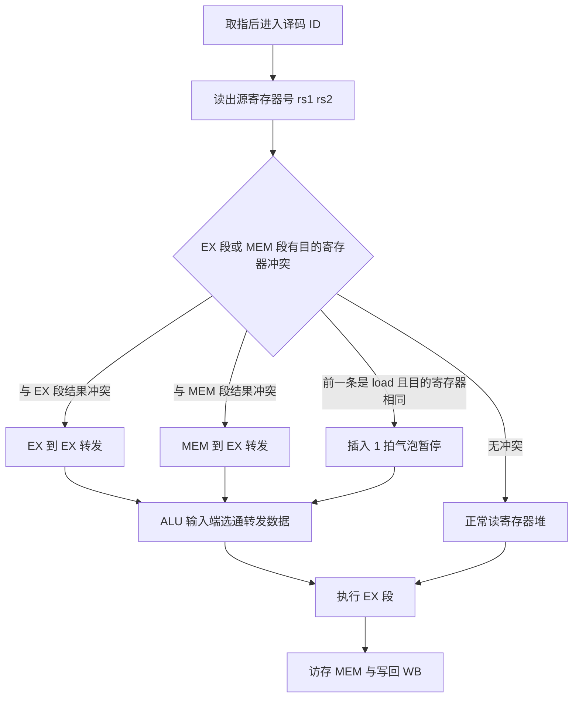

# 计算机组成原理 · 中央处理器 CPU

## 中央处理器 CPU [高频]

**考频统计**：考察次数 28 次；涉及年份：2011、2013、2015、2017、2018、2020、2021、2022、2024；分数占比约 18%；主要题型：选择题 + 44 题综合应用题（数据通路、流水线）。

**核心讲解**：

CPU 由运算器（ALU、暂存寄存器、通用寄存器组、PSW）与控制器（PC、IR、ID、时序电路、微操作信号发生器）组成，其核心工作是按 `PC → IR` 取指、译码、执行、访存、写回的顺序，在数据通路中把一串微操作按时序节拍展开；取指周期的微操作序列固定为 `(PC) -> MAR`、`M(MAR) -> MDR`、`(MDR) -> IR`、`(PC) + 1 -> PC`，此后译码器根据 `IR` 中的操作码产生后续控制信号。数据通路按总线数目分为单总线与多总线结构：单总线结构每拍只能有一个数据流入/流出总线，完成一次 ALU 运算需 `取操作数1 → 暂存 → 取操作数2 → 运算 → 写回` 多拍；多总线（如双总线、三总线）可在一拍内同时传送两个操作数，微操作序列更短。控制器分硬布线与微程序两类：硬布线由组合逻辑直接产生微命令，速度快、不易修改，`RISC` 常用；

微程序把微命令编成微指令存于控制存储器 CM，一条机器指令对应一段微程序，`CM 容量 = 微指令条数 × 微指令字长`；微指令编码方式中，水平型微指令并行能力强、字长长、微程序短，垂直型微指令一次只能完成一个微操作、字长短、微程序长，字段直接编码法与字段间接编码法用于压缩互斥微命令。流水线把指令执行划分为 `k` 个阶段，理想情况下 `n` 条指令需 `k + n - 1` 个时钟周期，吞吐率 `TP = n / ((k + n - 1) * T)`，最大吞吐率 `TP_max = 1 / T`（`T` 为最长阶段耗时，即流水线周期）；流水线存在结构冒险（资源冲突）、数据冒险（RAW 为主）、控制冒险（转移指令）三类；数据冒险可用转发（旁路）解决，但 `load-use` 必须暂停一拍，控制冒险可用分支预测、延迟槽、提前形成转移地址解决，冒险会使实际加速比与效率低于理想值。

**异常（内中断）**由 CPU 执行当前指令引起、与指令**同步**，如除零、溢出、非法指令、缺页、断点；**中断（外中断）**由外部设备或时钟请求、与当前指令**异步**，如 `I/O` 完成、时钟中断；两者的检测时机不同——中断请求在每条指令执行结束时检测、响应也落在**指令边界**，异常由当前指令的执行本身引起、在该指令执行中或结束时被发现，但精确异常的断点同样落在指令边界。

响应过程由硬件自动完成：保存断点 `PC` 与 `PSW`、关中断、按中断类型号取中断向量并转入 `ISR`；**精确异常**指发生异常时断点之前的指令全部执行完、之后的指令尚未开始（机器状态未被破坏），处理完可精确恢复执行。

**多处理器**按指令流与数据流分为 `SISD`（单处理机顺序执行）、`SIMD`（一条指令同时处理多组数据，向量处理器与 GPU 属此类）与 `MIMD`（多个处理器各执行不同指令流，**多核**与 `SMP` 是典型：多个对等核共享同一主存与统一地址空间）。

**硬件多线程**用线程切换掩盖访存延迟，**细粒度**每拍都切换线程、**粗粒度**只在发生长延迟事件时才切换（切换开销更小）；**向量处理器**用一条向量指令对一组数据流水化运算，是 `SIMD` 的经典实现。

**关键结论速记**：

- `流水线周期 T = max(各阶段耗时)` —— 取最长阶段而非平均值，瓶颈段决定节拍。
- `TP = n / ((k + n - 1) * T)`，`TP_max = 1 / T` —— `k` 是流水段数，`n` 是指令条数，两者不可混用。
- `S = 串行时间 / 流水时间 = (n * k * T) / ((k + n - 1) * T) = n * k / (k + n - 1)` —— 理想加速比上限为 `k`。
- `E = S / k = n / (k + n - 1)` —— 效率等于各段设备的时空利用率，理想值为 1。
- `CM 容量 = 微指令条数 × 微指令字长` —— 微程序控制器容量计算，与机器指令条数无直接相等关系。
- `load-use 冒险必须暂停 1 拍` —— 转发只能解决 ALU 结果相关，无法把访存结果提前到上一拍。
- `异常：内部/同步（除零、缺页、非法指令）；中断：外部/异步（I/O 完成、时钟）` —— 由当前指令引起的是异常，由外部请求的是中断。
- `SISD / SIMD / MIMD`，`SMP = 多核共享主存`；`硬件多线程：细粒度每拍切换、粗粒度长延迟才切换` —— 向量处理器属 `SIMD`。

**示意图**：

**取指周期的固定微操作序列与数据通路**：任何数据通路题都从这四步开始，`MAR`、`MDR`、`IR`、`PC` 之间的传送方向必须记牢。

```text
fetch cycle micro-operations on a single-bus datapath

   PC --(1)--> MAR --(2)--> memory --> MDR --(3)--> IR
                                     |
                                     +--(4)--> PC + 1 -> PC

  step  timing   micro-operation        bus usage
  ----  ------   -------------------    ----------------------------
   1     T1      (PC) -> MAR            address bus carries instr addr
   2     T2      M(MAR) -> MDR, PC+1    data bus reads word into MDR
   3     T3      (MDR) -> IR            instruction enters IR
   4     T4      (PC) + 1 -> PC         fetch done, PC points to next

  single bus: one transfer per clock, so 4 clocks for fetch
  with separate instruction/data memory and a dedicated path
  MDR -> IR, the fetch can be shortened to fewer clocks

control unit comparison

  hardwired: control signals = combinational logic of opcode + flags
             fast, hard to modify, used by RISC
  microprogrammed: control store CM holds microinstructions
             CM size = number of microinstructions x microinstruction width
             flexible, slower, used by CISC
             horizontal microinstruction: wide, high parallelism
             vertical microinstruction: narrow, more microinstructions
```

5 段流水线时空图（`k = 5`，`n = 8`，`T` 为流水线周期，横轴为时钟周期，纵轴为流水段）：

```text
        T   T   T   T   T   T   T   T   T   T   T   T
        c1  c2  c3  c4  c5  c6  c7  c8  c9  c10 c11 c12
      +---+---+---+---+---+---+---+---+---+---+---+---+
 IF   | 1 | 2 | 3 | 4 | 5 | 6 | 7 | 8 |   |   |   |   |
      +---+---+---+---+---+---+---+---+---+---+---+---+
 ID   |   | 1 | 2 | 3 | 4 | 5 | 6 | 7 | 8 |   |   |   |
      +---+---+---+---+---+---+---+---+---+---+---+---+
 EX   |   |   | 1 | 2 | 3 | 4 | 5 | 6 | 7 | 8 |   |   |
      +---+---+---+---+---+---+---+---+---+---+---+---+
 MEM  |   |   |   | 1 | 2 | 3 | 4 | 5 | 6 | 7 | 8 |   |
      +---+---+---+---+---+---+---+---+---+---+---+---+
 WB   |   |   |   |   | 1 | 2 | 3 | 4 | 5 | 6 | 7 | 8 |
      +---+---+---+---+---+---+---+---+---+---+---+---+

 fill = k = 5 cycles, then 1 instruction leaves per cycle
 total cycles = k + n - 1 = 5 + 8 - 1 = 12
 TP = n / ((k + n - 1) * T) = 8 / (12 * T)
 S  = n * k / (k + n - 1) = 40 / 12 = 3.33
 E  = n / (k + n - 1) = 8 / 12 = 0.67
```

数据冒险检测与转发/暂停处理流程：



**易错点**：

- 流水线周期错取各阶段耗时的平均值。正确做法是取最长阶段耗时作为 `T`，其余阶段都要按 `T` 补齐，瓶颈段还可再细分以减小 `T`。
- 时空图与吞吐率公式中把阶段数 `k` 与指令数 `n` 混用。`k + n - 1` 中 `k` 是流水段数、`n` 是指令条数，代入反了会得到错误的总周期数与 `TP`。
- 把转发当成能解决一切数据冒险。转发只解决 ALU 运算结果相关，`load-use` 相关中数据在 MEM 段末才可用，必须暂停 1 拍后再转发。
- 认为流水线一定提高单条指令执行速度。流水线提高的是吞吐率而非单条指令延迟，且带来冒险开销与额外控制逻辑，`S` 恒小于理论值 `k`。

**真题示例**：

**2011 年 408 第 18 题（选择题，2 分）**

某 5 段流水线，各段执行时间均为 `T`，连续执行 `n` 条指令。下列关于该流水线吞吐率与加速比的叙述中，正确的是（　）。

A. 吞吐率 `TP = n / (k * T)`，与 `n` 无关
B. 理想情况下完成 `n` 条指令需 `k * n` 个时钟周期
C. 加速比 `S = n * k / (k + n - 1)`，当 `n` 趋于无穷时趋于 `k`
D. 效率 `E = S * k`，当 `n` 趋于无穷时趋于 1

> 解析：5 段流水线执行 `n` 条指令理想总周期数为 `k + n - 1 = 5 + n - 1`，非流水需 `k * n = 5n` 拍，故 B 错、A 中分母应为 `k + n - 1`。加速比 `S = 5n / (n + 4)`，`n → ∞` 时极限为 `k = 5`，C 正确。效率 `E = S / k = n / (k + n - 1)`，趋于 1，但 `E = S * k` 关系写反，D 错。结论：选 C。

**2021 年真题改编（综合应用题，10 分）**

某 CPU 采用 5 段流水线（IF、ID、EX、MEM、WB），各段耗时分别为 2 ns、2 ns、3 ns、2 ns、2 ns，流水线寄存器开销忽略。连续执行 100 条指令，其中 20 条为 `load` 指令，且每条 `load` 后紧跟一条使用其结果的指令（`load-use` 相关，需暂停 1 拍）。求：(1) 流水线周期 `T`；(2) 无冒险时的总执行时间；(3) 考虑 `load-use` 冒险后的实际总周期数与加速比。

> 解析：
> (1) `T = max(2, 2, 3, 2, 2) = 3 ns`，瓶颈在 EX 段。
> (2) 无冒险时总拍数 `= k + n - 1 = 5 + 100 - 1 = 104`，总时间 `= 104 * 3 ns = 312 ns`。
> (3) 每次 `load-use` 插入 1 个气泡，共加 20 拍，实际拍数 `= 104 + 20 = 124`，总时间 `= 124 * 3 ns = 372 ns`。
> 非流水串行时间 `= 100 * (2 + 2 + 3 + 2 + 2) = 1100 ns`，故 `S = 1100 / 372 ≈ 2.96`。
> 结论：`T = 3 ns`，无冒险 312 ns，实际 372 ns，`S ≈ 2.96`（低于理论上限 `k = 5`）。

---
