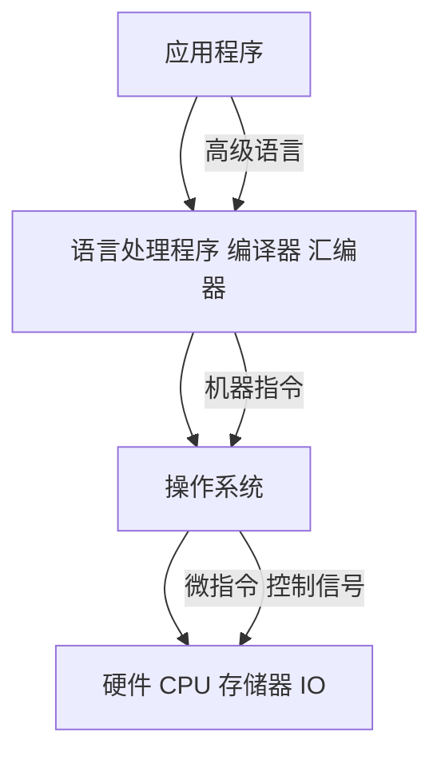

# 计算机组成原理 · 计算机系统概述

## 计算机系统概述 [高频]

**考频统计**：考察次数 考频待补充；涉及年份：2026 大纲「一、计算机系统概述」；常与存储、CPU 性能题合并考查；分数占比约 未统计；主要题型：选择题为主（性能指标计算）。

**核心讲解**：

计算机系统由**硬件**与**软件**组成，硬件五大部件是运算器、控制器、存储器、输入设备和输出设备，它们通过总线连接；冯·诺依曼结构以**存储器为中心**，程序和数据以二进制形式存放在同一存储器中，这就是"**存储程序**"工作方式。程序执行时，CPU 按 PC 给出的地址取指令、译码、执行，再写回结果，一条指令的执行可拆成取指、译码、执行、访存、写回几个阶段。系统呈层次结构：硬件之上是操作系统，再往上依次是语言处理程序与应用程序，上层通过下层提供的接口工作，因此"软件与硬件在逻辑上等价"。

衡量性能时，主频 `f` 与时钟周期 `T` 互为倒数（`T = 1/f`），`CPI` 是每条指令平均占用的时钟周期数，**CPU 执行时间 = 指令条数 × CPI × 时钟周期**。`MIPS = 主频 / (CPI × 10^6)` 表示每秒执行多少百万条指令，浮点性能用 `MFLOPS`/`GFLOPS` 等表示；吞吐量与响应时间则从系统整体角度衡量。注意 `CPI` 是**平均**值：不同指令的 CPI 不同，程序混合执行时要用各类指令的比例加权。

**关键结论速记**：

- `五大部件：运算器、控制器、存储器、输入、输出` —— 冯·诺依曼结构以存储器为中心，程序与数据统一编址存放。
- `存储程序 = 程序与数据预先存入存储器 + CPU 按地址自动取指执行` —— 这是"通用计算机"的基础。
- `CPU 执行时间 = 指令条数 IC × CPI × 时钟周期 T` —— 三条同时影响，主频高不一定更快。
- `MIPS = f / (CPI × 10^6)`（`f` 以 Hz 计） —— MIPS 只看指令条数，不区分指令的复杂程度。
- `T = 1/f`，`f = 2GHz` 时 `T = 0.5ns` —— 主频与时钟周期互为倒数，单位不要混（`GHz` 与 `ns`）。
- `吞吐量 vs 响应时间` —— 吞吐量是单位时间完成的任务数，响应时间是单个任务从提交到完成的延迟，二者优化方向可能相反。

**示意图**：

冯·诺依曼结构用一条系统总线把五大部件连起来，指令与数据都从存储器取出，经控制器译码后由运算器执行。

```text
von Neumann architecture (single bus)

   +-----------+        +----------------+        +-----------+
   |  input    |        |   memory       |        |  output   |
   |  device   |<------>|  (program +    |<------>|  device   |
   +-----------+        |   data)        |        +-----------+
                        +----------------+
                               ^  |
                               |  | address / data / control
                               v  |
                        +----------------+
                        |      CPU       |
                        |  +----------+  |
                        |  | control  |  |
                        |  |  unit    |  |
                        |  +----------+  |
                        |  |   ALU    |  |
                        |  +----------+  |
                        +----------------+

instruction execution:  fetch -> decode -> execute -> memory -> write back
                        PC -> IR       control    ALU/reg    mem     reg

timing example: f = 2 GHz, T = 0.5 ns, CPI = 4, IC = 1e6
   CPU time = 1e6 * 4 * 0.5 ns = 2e6 ns = 2 ms
   MIPS     = 2e9 / (4 * 1e6) = 500
```

层次结构说明"软硬件逻辑等价"：同一功能可以用硬件实现，也可以用软件模拟。



**易错点**：

- 认为主频越高程序一定越快：执行时间还取决于指令条数与 `CPI`，主频高但 `CPI` 大、指令多的机器可能更慢；比较性能要同时看三者。
- 把 `CPI` 当成某条指令的固定值：`CPI` 是程序或指令流平均每条指令的时钟周期数，不同指令类型要加权平均。
- 混淆 `MIPS` 与真实性能：`MIPS` 只反映指令吞吐，RISC 与 CISC 的指令复杂度不同，跨指令集比 `MIPS` 没有意义。
- 单位换算错误：`f` 用 `GHz` 时 `1 GHz = 10^9 Hz`，`T = 1/f` 得到的是秒，常改写为 `ns`（`1 ns = 10^-9 s`）；`MIPS` 公式里的 `10^6` 来自"百万条"。

**真题示例**：

**2020 年真题改编（选择题，2 分）**

某计算机主频为 `2 GHz`，程序共含 `10^6` 条指令，平均 `CPI = 4`。该程序在该机上的执行时间与 `MIPS` 分别为：

A. `1 ms`、`1000`　B. `2 ms`、`500`　C. `4 ms`、`250`　D. `2 ms`、`1000`

> 解析：时钟周期 `T = 1/f = 1/(2×10^9) = 0.5 ns`。执行时间 `= IC × CPI × T = 10^6 × 4 × 0.5 ns = 2×10^6 ns = 2 ms`。`MIPS = f/(CPI×10^6) = 2×10^9/(4×10^6) = 500`。故选 B。注意 `MIPS` 与执行时间互为倒数关系（`MIPS = IC/(执行时间×10^6)`），两者可互相校验。

---
