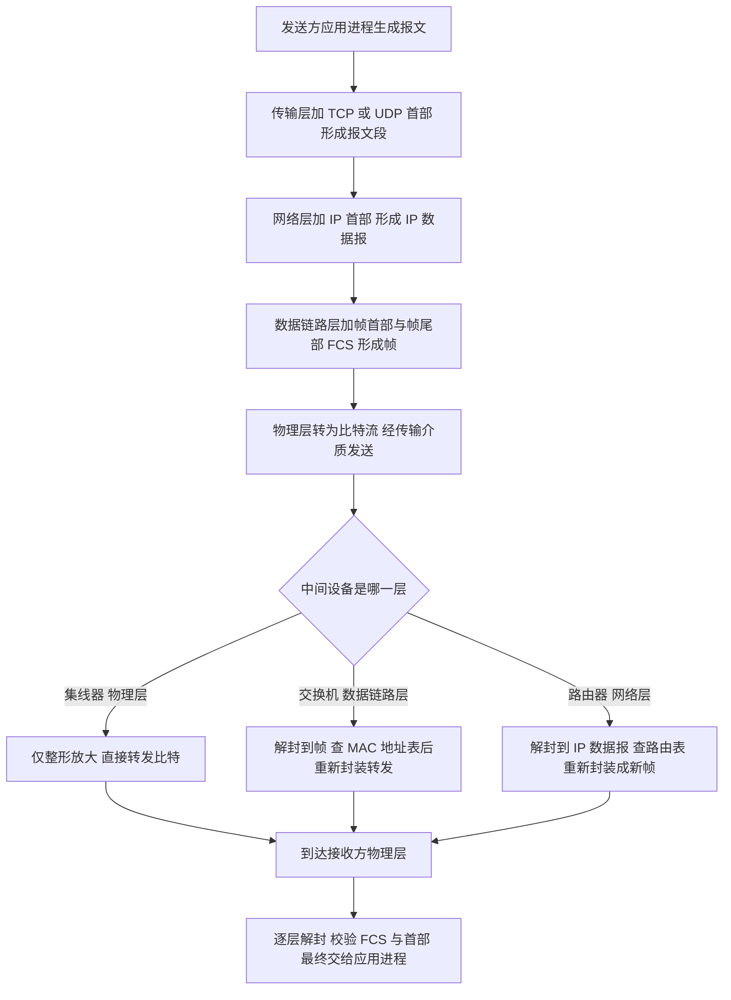
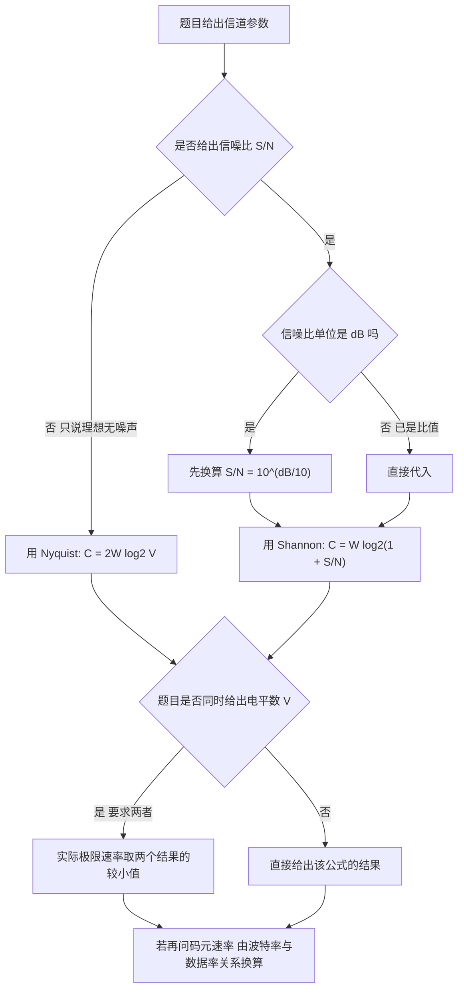
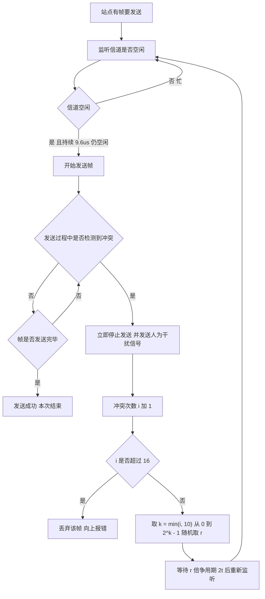
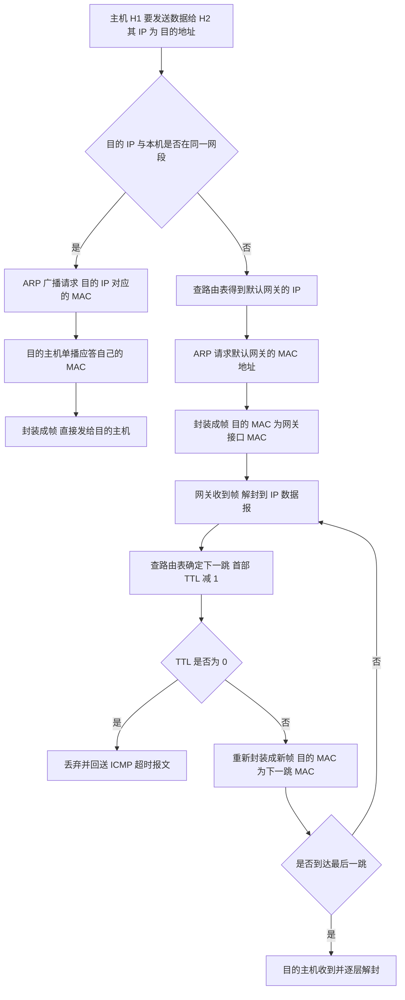
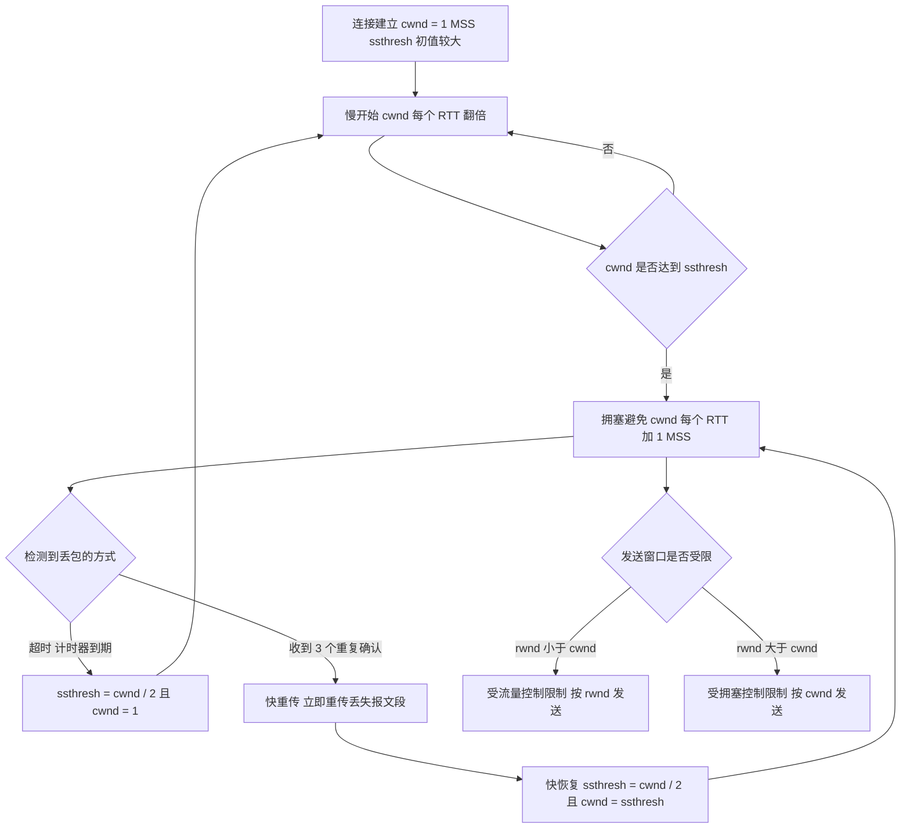
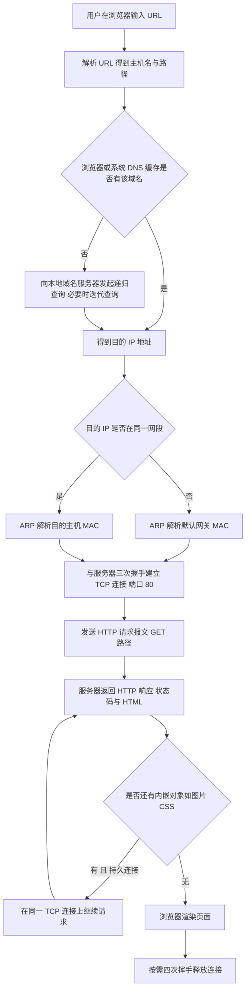

# 计算机网络 · 408 速成复习资料

**科目分值**：25 分 / 150 分　|　**章节数**：6　|　**统计区间**：2009—2025 年 408 统考真题（17 套）

## 本科目章节索引

| # | 知识点 | 考察次数 | 分值占比 | 高频 |
| --- | --- | --- | --- | --- |
| 1 | [计算机网络体系结构](01-计算机网络体系结构.md) | 14 次 | 约 8% | **是** |
| 2 | [物理层](02-物理层.md) | 14 次 | 约 8% | **是** |
| 3 | [数据链路层](03-数据链路层.md) | 22 次 | 约 20% | **是** |
| 4 | [网络层](04-网络层.md) | 30 次 | 约 32% | **是** |
| 5 | [传输层](05-传输层.md) | 24 次 | 约 20% | **是** |
| 6 | [应用层](06-应用层.md) | 18 次 | 约 12% | **是** |

## 本科目在 408 中的位置

| 项目 | 内容 |
| --- | --- |
| 分值 | **25 分 / 150 分**（占 16.7%），四科中最低但**性价比最高**（考点集中、公式固定） |
| 单选题 | 第 33—40 题（单选，每题 2 分，共 16 分） |
| 综合应用题 | 第 47 题（约 9 分），共 9 分 |
| 命题特点 | 47 题常为"IP 分片 / 子网划分与路由聚合 / TCP 拥塞窗口与吞吐量"计算；选择题重层次归属与协议细节 |

**复习优先级**：网络层 → 传输层 → 数据链路层 → 应用层 → 物理层 → 体系结构。
**网络层 + 传输层合计约 13 分**，且计算题模板化程度最高，是本资料中"投入产出比"最高的一章。

## 使用说明（30 秒读完）

1. **先看 `[高频]` 标记**：每节标题带 `[高频]` 的是历年反复命题的考点，时间紧张时只看这些。
2. **每节固定六段式**：考频统计 → 核心讲解 → 关键结论速记 → 示意图 → 易错点 → 真题示例，可直接跳跃到你缺的那一段。
3. **图形约定**：`text` 代码块为 **ASCII 图**（用于结构布局、位域划分、地址格式）；`mermaid` 代码块为 **流程图/状态机**（用于算法流程、协议交互、状态转换）。
4. **考频口径**：统计区间 2009—2025 年共 17 套真题；"考察次数"按题次计，一道综合题串联多个考点时各自计 1 次。
5. **自检方式**：本资料由脚本生成，`python3 scripts/validate.py` 会校验模板完整性、考频数字一致性、ASCII 图对齐与真题年份合法性。

> 本资料为速成复习用途：**考频数据为基于 2009—2025 年真题的公开考频表统计整理，非官方发布**，
> 用于确定复习优先级，不作为命题预测。数据口径与来源见 `README.md`。

## 计算机网络体系结构 [高频]

**考频统计**：考察次数 14 次；涉及年份：2009、2011、2013、2015、2017、2019、2021、2023、2024；分数占比约 8%；主要题型：选择题为主（分层模型、协议/服务、设备与层次对应）。

**核心讲解**：

计算机网络按覆盖范围分为广域网、城域网、局域网与个人区域网；按交换方式分为电路交换、报文交换与**分组交换**（`408` 的默认语境）。性能指标中必须分清两种时延：**发送时延（传输时延）`= 数据长度 / 发送速率`** 取决于数据量与链路速率，**传播时延 `= 距离 / 电磁波传播速率`** 只取决于物理距离与介质（约 `2 × 10^8 m/s` 在铜缆/光纤中）。因此"提高带宽"能减少发送时延，但**不能减少传播时延**；**时延带宽积 `= 传播时延 × 带宽`** 表示"链路上能容纳的比特数"，又称"以比特为单位的链路长度"；**往返时间 `RTT`** 是往返一次的时间。

总时延 `= 发送时延 + 传播时延 + 处理时延 + 排队时延`，其中处理与排队时延在题目给出时才能计入。`OSI` 参考模型自下而上为**物理层、数据链路层、网络层、传输层、会话层、表示层、应用层**，`TCP/IP` 模型为**网络接口层、网际层、传输层、应用层**，二者对应关系是"`TCP/IP` 的应用层 = `OSI` 的会话层 + 表示层 + 应用层"，"`TCP/IP` 的网络接口层 = `OSI` 的物理层 + 数据链路层"。**协议**是通信双方必须遵守的规则集合，三要素是**语法、语义、同步**；

**服务**是下层向上层提供的功能，是"垂直"的，而协议是"水平"的（同层对等实体之间）。**各层的数据单元**名称不同：物理层为比特、数据链路层为帧、网络层为分组（数据报）、传输层为报文段（`TCP`）或用户数据报（`UDP`）；**各层的典型设备**为：中继器与集线器在物理层、网桥与交换机在数据链路层、路由器在网络层、网关在应用层。

**关键结论速记**：

- `发送时延 = 数据长度 / 速率`，`传播时延 = 距离 / 传播速率` —— 提高带宽只减少发送时延，不影响传播时延。
- `时延带宽积 = 传播时延 × 带宽` —— 物理意义是"链路中能容纳的比特数"，又称链路长度（比特）。
- `OSI 七层 = 物理、数据链路、网络、传输、会话、表示、应用`；`TCP/IP 四层 = 网络接口、网际、传输、应用`。
- `TCP/IP 的应用层对应 OSI 的高三层，网络接口层对应 OSI 的低两层` —— 层间对应关系是必考细节。
- `协议三要素：语法、语义、同步`；协议是水平的、服务是垂直的。
- `设备与层次：集线器/中继器在物理层，交换机/网桥在数据链路层，路由器在网络层` —— 判断题的高频依据。

**示意图**：

**`OSI` 七层与 `TCP/IP` 四层的对应关系及数据单元封装**：每下一层都在上层数据前加上本层首部（必要时加尾部），形成该层的数据单元。

```text
OSI 7 layers                     TCP/IP 4 layers        PDU name
+---------------------+          +----------------+     ------------
| 7 application       |          |                |     message / data
+---------------------+          |   application  |
| 6 presentation      |          |                |
+---------------------+          |                |
| 5 session           |          |                |
+---------------------+          +----------------+
| 4 transport         |          |   transport    |     segment (TCP)
+---------------------+          |                |     datagram (UDP)
| 3 network           |          |   internet     |     packet / datagram
+---------------------+          +----------------+
| 2 data link         |          |                |     frame
+---------------------+          | network        |
| 1 physical          |          | interface      |     bit
+---------------------+          +----------------+

encapsulation when sending (top down)

  application data
        |
        v  + TCP header
  [ TCP hdr | data ]                       -> segment
        |
        v  + IP header
  [ IP hdr | TCP hdr | data ]              -> packet
        |
        v  + frame header and trailer
  [ frame hdr | IP hdr | TCP hdr | data | FCS ]  -> frame
        |
        v
  0101101011...                            -> bits on the medium

decapsulation at the receiver removes headers in reverse order.

devices and the layer they operate at
  physical layer        : repeater, hub            (do not isolate collision domain)
  data link layer       : bridge, switch           (isolate collision domain)
  network layer         : router                   (isolate broadcast domain)
  application layer     : gateway
```

**数据从发送方到接收方的封装与解封装流程**：中间设备只处理到它所处的层次，路由器解封到网络层再重新封装链路层。



**易错点**：

- 把发送时延与传播时延混为一谈：`发送时延 = 数据长度 / 速率`（与数据量和带宽有关），`传播时延 = 距离 / 传播速率`（只与距离和介质有关）；因此"增大带宽可以减小传播时延"是错误说法。
- `OSI` 与 `TCP/IP` 的层间对应关系写错：`TCP/IP` 的**网络接口层**对应 `OSI` 的物理层与数据链路层，**应用层**对应 `OSI` 的会话层、表示层与应用层；把"表示层"划到传输层或把"会话层"划到网络层都是错的。
- 认为集线器能隔离冲突域：集线器工作在物理层、只是多端口的信号放大转发，**所有端口属于同一个冲突域与同一个广播域**；能隔离冲突域的是交换机/网桥，能隔离广播域的是路由器。
- 把协议与服务混同：**协议是水平方向**（同层对等实体之间的规则），**服务是垂直方向**（下层通过服务访问点向上层提供的能力）；上层只能看见服务而看不见下层的协议实现。

**真题示例**：

**2014 年真题改编（单项选择题，2 分）**

下列关于 `OSI` 参考模型与 `TCP/IP` 模型各层功能的叙述中，正确的是（ ）。

A. 数据链路层负责为分组选择路由并实现拥塞控制
B. 传输层提供端到端（进程到进程）的可靠传输，并进行流量控制
C. 网络层负责在相邻结点之间进行差错控制与流量控制
D. 会话层负责数据格式转换与加密，属于 `TCP/IP` 模型的传输层

> 解析：逐项对应层次职责。**A 错**——"为分组选择路由"是**网络层**的功能，"拥塞控制"也主要由传输层与网络层承担，不是数据链路层的职责。**B 对**——**传输层**面向进程到进程（端到端）通信，`TCP` 在此层实现可靠传输、流量控制与拥塞控制，这是传输层的标准描述。**C 错**——"相邻结点之间"的差错控制与流量控制属于**数据链路层**，网络层做的是主机到主机的分组转发（不保证可靠）。**D 错**——数据格式转换与加密属于**表示层**，而在 `TCP/IP` 模型中它被并入**应用层**，不是传输层。答案选 **B**。**判分依据是"端到端 = 传输层、点到点 = 数据链路层"以及表示层在 `TCP/IP` 中并入应用层这两条对应关系。**

---

## 物理层 [高频]

**考频统计**：考察次数 14 次；涉及年份：2010、2012、2014、2016、2017、2019、2021、2023、2025；分数占比约 8%；主要题型：选择题为主（奈奎斯特/香农、编码、传输介质）。

**核心讲解**：

物理层的任务是**在传输介质上透明地传送比特流**，它定义机械、电气、功能、规程四个方面的特性。**`Nyquist`（奈奎斯特）准则**给出理想无噪声低通信道的极限速率：`C = 2 W log2 V`（`W` 为带宽 `Hz`、`V` 为码元的离散电平数），它与信噪比无关，只与带宽和电平数有关；**`Shannon` 定理**给出有噪声信道的极限速率：`C = W log2(1 + S/N)`，其中信噪比常用分贝表示，换算关系为 `SNR(dB) = 10 log10(S/N)`，因此 `30 dB` 对应 `S/N = 1000`。

两者常联合使用：先用 `Shannon` 算出信道容量上限，再用 `Nyquist` 反推"在此速率下每个码元最多需要几个电平"。**编码与调制**要区分：数字数据转数字信号用编码（`NRZ` 不归零、`NRZI`、**曼彻斯特编码**、**差分曼彻斯特编码**、`4B/5B`），数字数据转模拟信号用调制（`ASK`、`FSK`、`PSK`、`QAM`）。**曼彻斯特编码**在每个码元中间都有一次电平跳变，既传送数据又携带时钟，因此**具有自同步能力**，但**编码效率只有 50%**（波特率是数据率的 2 倍）；

差分曼彻斯特用"码元开始处有无跳变"表示 `0/1`，抗干扰能力更强。`4B/5B` 编码把 4 位数据映射为 5 位码字，保证足够的跳变以利于提取时钟，效率为 `80%`。**传输介质**中，双绞线（`UTP/STP`）便宜、易受干扰、距离短；同轴电缆抗干扰较好；**光纤**带宽极大、抗电磁干扰、衰减小、保密性好，分单模（纤芯细、传输距离远、用激光器）与多模（纤芯粗、距离近、用 `LED`）。**物理层设备**中，**中继器**对信号整形放大以延长传输距离，**集线器**是多端口中继器，二者都工作在物理层，**不隔离冲突域**。

**关键结论速记**：

- `Nyquist：C = 2 W log2 V`（无噪声、理想低通信道） —— 与信噪比无关，`V` 是码元可取的电平数。
- `Shannon：C = W log2(1 + S/N)`（有噪声信道） —— 与电平数无关，只与带宽和信噪比有关。
- `SNR(dB) = 10 log10(S/N)` —— `30 dB` 对应 `S/N = 1000`，代入 `Shannon` 前必须先换算成比值。
- `曼彻斯特编码：每位中间跳变、自同步、编码效率 50%` —— 波特率 = 2 × 数据率。
- `差分曼彻斯特：用码元开始处是否跳变表示 0/1` —— 抗干扰能力比曼彻斯特更强。
- `4B/5B 编码效率 80%` —— 用 5 位码字承载 4 位数据以保证时钟同步。
- `集线器与中继器在物理层，不隔离冲突域` —— 共享带宽，同一时刻只能有一个站点发送。

**示意图**：

**三种常用编码的波形对比**：数据序列 `1 0 1 1 0 0 1 0`（单极性表示，高电平为 `1`）。

```text
data bits:        1     0     1     1     0     0     1     0

(1) NRZ (non-return to zero): level holds for the whole bit

        ___         ___   ___
   high    |         |     |         ___
           |         |     |        |
   low  ___|         |_____|        |_____
        b0   b1   b2   b3   b4   b5   b6   b7
   problem: long runs of same level lose clock synchronisation

(2) Manchester: transition in the MIDDLE of every bit
    convention: high->low means 1, low->high means 0

        __    __          __    __
   high   |  |  |        |  |  |  |
          |  |  |        |  |  |  |
   low ___|  |__|        |__|  |__|
        b0   b1   b2   b3   b4   b5
        mid  mid  mid  mid  mid  mid   <- every bit has a mid transition
    self-clocking, but baud rate = 2 x data rate (efficiency 50%)

(3) Differential Manchester: transition at the START of a bit means 0,
    no transition at the start means 1 (mid transition always present)

   bit value   0        1        1        0
   start       jump     no jump  no jump  jump
   mid         always   always   always   always
    more robust to noise and polarity reversal than plain Manchester
```

**由带宽与信噪比确定极限速率的选择流程**：题目给"理想无噪声"用 `Nyquist`，给"信噪比"用 `Shannon`，两者都给则取较小值。



**易错点**：

- 混用 `Nyquist` 与 `Shannon`：`Nyquist` 用于**理想无噪声**信道且必须知道电平数 `V`，`Shannon` 用于**有噪声**信道且只需带宽与信噪比；题目给出信噪比时若仍用 `Nyquist` 就会算错。
- 把分贝值直接代入 `Shannon` 公式：`Shannon` 中的 `S/N` 是**比值**，题目给出 `dB` 时必须先按 `S/N = 10^(dB/10)` 换算（如 `20 dB` 对应 `100`、`30 dB` 对应 `1000`），直接代入会把信道容量算得极小。
- 认为曼彻斯特编码效率是 `100%`：曼彻斯特编码每个比特中间都有跳变，**波特率是数据率的 2 倍**，编码效率只有 `50%`；`4B/5B` 的效率是 `80%`，两者不要混淆。
- 认为集线器可以隔离冲突域：集线器工作在物理层，所有端口共享同一冲突域与带宽，同一时刻只能有一个站点发送；能隔离冲突域的是工作在数据链路层的交换机与网桥。

**真题示例**：

**2016 年 408 第 34 题（单项选择题，2 分）**

若某通信链路带宽为 `3000 Hz`，采用 `4` 种相位、每种相位有 `2` 种振幅的 `QAM` 调制，且信道无噪声，则该链路的极限数据传输速率约为（ ）。

A. `6000 b/s`　B. `12000 b/s`　C. `18000 b/s`　D. `24000 b/s`

> 解析：无噪声信道用 `Nyquist` 准则 `C = 2 W log2 V`。先求码元状态数 `V`：`4` 种相位 × 每种 `2` 种振幅 `= 8` 种不同的码元状态，故 `V = 8`、`log2 8 = 3` 位/码元。代入得 `C = 2 × 3000 × 3 = 18000 b/s`，答案为 **C**。若只按相位计算（漏乘振幅，取 `V = 4`）会得到 `12000 b/s`（干扰项 B）；若误把 `2W` 写成 `W` 又会得到 `9000 b/s`。**判分点是 `V` 必须把相位与振幅的组合数都算进去，以及 `Nyquist` 公式中的系数 `2` 不能丢。**

---

## 数据链路层 [高频]

**考频统计**：考察次数 22 次；涉及年份：2010—2025 年高频，2011、2013、2015、2017、2019、2020、2022、2024 年为典型年份；分数占比约 20%；主要题型：选择题 + 综合应用题（滑动窗口、CSMA/CD、以太网帧）。

**核心讲解**：

数据链路层的三个基本功能是**封装成帧（组帧）、差错控制、流量控制**；**组帧**常用**字符计数法**（计数字段出错即全盘失步）、**字符填充法**（用 `SOH`/`EOT` 定界，数据中出现的定界符前插转义字符 `ESC`，接收方再删除）、**零比特填充法**（`HDLC` 使用：标志字段为 `01111110`，数据中每出现 **5 个连续 `1` 就填入一个 `0`**，接收方每见 5 个连续 `1` 就删除其后的 `0`）与**违规编码法**（如曼彻斯特编码中的非法电平组合），后两者是"透明传输"的标准做法。

**差错控制**中，**奇偶校验**只能检出奇数个错误；**循环冗余校验 `CRC`** 用生成多项式做**模 2 除法**，把余数作为 `FCS`，能检出全部单比特错、全部奇数个错以及长度不超过生成多项式阶数的突发错；**海明码**由 `2^r >= k + r + 1`（`k` 为数据位数）确定校验位数 `r`，校验位放在第 1、2、4、8… 位，可**纠正一位错**（配合总校验位还可"纠一位、检两位"）。

**流量控制与可靠传输**的三种协议必须分清：**停止-等待**发送窗口为 `1`、每发一帧等一个确认，信道利用率 `= T_d / (T_d + RTT + T_a)`（`T_d` 为发送时延、`T_a` 为确认发送时延）；**后退 `N` 帧 `GBN`** 用累计确认、接收窗口恒为 `1`、发送窗口上限 `2^n - 1`；**选择重传 `SR`** 逐帧确认并缓存乱序帧、只重传出错帧，收发窗口上限均为 `2^(n-1)`，即窗口之和不超过 `2^n`。

**介质访问控制**分**信道划分**、**随机访问**与**轮询访问**三类：**频分 `FDM`** 把频带划成互不重叠的子频段，各站同时占用不同频段；**时分 `TDM`** 把时间划分成等长的 TDM 帧、帧内再分成时隙，每站固定占用一个时隙轮流发送，需严格的时间同步、本站无数据时时隙也被浪费；**波分 `WDM`** 在光纤中按波长划分，本质是光的频分；**码分 `CDM`** 给每站分配互不相同的**正交码片序列**，发 `1` 发码片本身、发 `0` 发其反码，各站同时同频发送，接收方用该站码片做规格化内积即可恢复数据。

**`CSMA/CD`** 的工作是"**先听后发、边听边发、冲突停发、随机重发**"：站点发送前先监听，发送中继续监听，检测到冲突立即停止并发送**人为干扰信号**，再按**截断二进制指数退避**等待重发（第 `i` 次冲突后从 `{0, 1, ..., 2^k - 1}` 中随机取 `r`，`k = min(i, 10)`，等待 `r` 倍争用期）。**最小帧长**的依据是"发送时延必须不小于往返传播时延（争用期 `2τ`）"，否则发送方在冲突信号返回前已发完帧而无法检测冲突：`最小帧长 = 2τ × 数据率`，以太网取 `2τ = 51.2 μs`、数据率 `10 Mb/s`，故最小帧长 `512 bit = 64 B`。

**IEEE 802.11 无线局域网**用 **`CSMA/CA`** 而不是 `CSMA/CD`：无线站点**不能边发边听**（发射时自身信号比收到的微弱信号强几个数量级、收发共用天线时无法同时接收，且存在隐藏站使冲突检测不可靠），只能"先听后发 + 随机退避 + 发送后等 `ACK`"地**避免冲突**，收到 `ACK` 才算成功、超时重传；可选的 **`RTS`/`CTS`** 由发送方先发 `RTS`、接收方回 `CTS`，其余听到的站点按其中通告的持续时间推迟发送（设置 `NAV`），以此缓解隐藏站问题，并用短控制帧的冲突代替长数据帧的冲突以降低代价。

**以太网帧**为"目的地址（6 `B`）+ 源地址（6 `B`）+ 类型（2 `B`）+ 数据（46—1500 `B`）+ `FCS`（4 `B`）"，故最小帧 `64 B`、最大帧 `1518 B`；**交换机**靠**自学习**建立"`MAC` 地址 → 端口"的转发表，能隔离冲突域但不隔离广播域；

广域网常用的 **`PPP`** 由三部分组成：**把 `IP` 数据报封装到串行链路的方法**、链路控制协议 **`LCP`**（建立、配置和测试数据链路）与网络控制协议 **`NCP`**（每个网络层协议一个，如 `IPCP` 协商 `IP` 地址），其帧格式为标志 `7E` + 地址 `FF` + 控制 `03` + **协议（2 `B`，如 `0x0021` 表示承载 `IP`）** + 信息（不超过 1500 `B`）+ `FCS`（2 `B`）+ 标志 `7E`，异步链路用字节填充、同步链路用零比特填充来保证透明；PPP 与以太网帧的关键差异是**没有源/目的 `MAC` 地址**（点对点链路只有两端）、用协议字段而非类型字段标识上层、`FCS` 只有 `2 B`，并且只检错不重传、不要求最小帧长。

**关键结论速记**：

- `零比特填充：发送方每出现 5 个连续 1 就插入一个 0，接收方每 5 个连续 1 删去其后的 0` —— 保证数据对标志字段 `01111110` 透明。
- `海明码 2^r >= k + r + 1 可纠一位；CRC 用模 2 除法求余数作 FCS` —— 校验位在第 1、2、4、8… 位，CRC 余数取生成多项式最高次 `r` 位且模 2 运算无进位。
- `GBN 发送窗口 <= 2^n - 1、接收窗口 = 1`；`SR 收发窗口均 <= 2^(n-1)` —— 序号位数 `n` 决定窗口上限。
- `CSMA/CD：先听后发、边听边发、冲突停发、随机重发`；`最小帧长 = 争用期 × 数据率` —— 以太网最小帧为 `64 B`。
- `以太网最小帧 64 B、最大帧 1518 B、数据字段 46—1500 B` —— 小于 46 `B` 需填充，交换机隔离冲突域但不隔离广播域。
- `信道划分：FDM 分频段、TDM 分时隙、WDM 分波长、CDM 分正交码片` —— 固定分配、各站无冲突，代价是低负载时浪费信道。
- `802.11 用 CSMA/CA：无线不能边发边听，靠 ACK 确认成功、RTS/CTS 预约信道并缓解隐藏站` —— 与 `CSMA/CD` 相反，不检测冲突。
- `PPP = 封装方法 + LCP（建链）+ NCP（网络层参数）`；帧无 `MAC` 地址、有 2 `B` 协议字段与 2 `B` FCS —— 面向字节、只检错不重传，区别于以太网帧。

**示意图**：

**最小帧长的推导与以太网争用期**：发送方必须在冲突信号返回之前仍在发送，否则无法检测到冲突。

```text
why a minimum frame size is needed (CSMA/CD)

  A                                    B
  |------ propagation delay t ------>  |     t = distance / v
  |                                    |
  |  A starts sending at time 0        |
  |                                    |  B starts sending at t - e
  |<---- collision happens near B ---->|
  |                                    |
  |  the collision signal needs t to come back to A
  |<------------- round trip = 2t ---->|

  requirement: A's transmission time >= 2t  (the contention period)
      T_send = frame_length / data_rate >= 2 * t
      => minimum frame length = 2 * t * data_rate

  classic Ethernet numbers
      data rate = 10 Mb/s, 2t = 51.2 us
      min frame = 51.2 us * 10 Mb/s = 512 bit = 64 byte
      max frame = 1518 byte (with 1500 byte data field)

ethernet frame format (DIX Ethernet V2)

  +---------+---------+-------+------------------+-------+
  | dest MA | src MAC |  type |  data (46-1500)  |  FCS  |
  +---------+---------+-------+------------------+-------+
     6 B       6 B      2 B         46 - 1500 B     4 B
  min frame = 6+6+2+46+4 = 64 B      max = 6+6+2+1500+4 = 1518 B
  a data field shorter than 46 B must be padded
```

**`CSMA/CD` 的发送与冲突退避流程**：检测到冲突后必须立即停止并发送干扰信号，再用截断二进制指数退避决定重发时刻。



**易错点**：

- `GBN` 与 `SR` 的窗口上限记反：`GBN` 的发送窗口上限是 `2^n - 1`（接收窗口恒为 `1`），`SR` 的发送与接收窗口上限都是 `2^(n-1)`；同理海明码公式是 `2^r >= k + r + 1`，右边要**加上校验位 `r` 本身**，漏掉会把校验位数算小。
- 最小帧长漏乘 `2`：`最小帧长 = 2τ × 数据率`，其中 `2τ` 是**往返**传播时延（争用期）；只乘单程传播时延会把最小帧长算小一半，进而误判"该帧能否被检测到冲突"。
- 把无线局域网的 `CSMA/CA` 当成 `CSMA/CD`：无线站点发射时无法同时接收，也检测不到隐藏站造成的冲突，故 802.11 用随机退避 + `ACK` 确认实现**冲突避免**，`RTS`/`CTS` 只是可选的抑制隐藏站手段；说"无线靠冲突检测退避"即错。
- 混淆交换机与路由器的隔离能力：交换机工作在数据链路层，能隔离**冲突域**但**不隔离广播域**（广播帧会被转发到所有端口）；隔离广播域必须用路由器或划分 `VLAN`。

**真题示例**：

**2016 年 408 第 36 题（单项选择题，2 分）**

若某以太网的传播时延为 `25.6 μs`，数据传输速率为 `10 Mb/s`，则其最小帧长应为（ ）。

A. `64 B`　B. `128 B`　C. `256 B`　D. `512 B`

> 解析：直接套用"最小帧长 = 争用期 × 数据率"。争用期是**往返**传播时延 `2τ = 2 × 25.6 μs = 51.2 μs`，故最小帧长 `= 51.2 μs × 10 Mb/s = 512 bit = 64 B`，答案为 **A**。若忘记乘 2（只取 `25.6 μs`）会得到 `256 bit = 32 B` 而不在选项中，从而暴露出错误来源。**判分点是争用期必须是往返传播时延，以及比特与字节的换算（`512 bit = 64 B`）。**

---

## 网络层 [高频]

**考频统计**：考察次数 30 次；涉及年份：2009—2025 年几乎年年出现，2011、2013、2015、2017、2019、2021、2022、2023、2024、2025 年为典型年份；分数占比约 32%；主要题型：选择题 + 47 题综合应用题（IP 分片、子网划分、路由聚合、路由协议）。

**核心讲解**：

网络层的核心是**逻辑寻址与路由转发**：`IPv4` 地址长 `32` 位，传统分类是 `A` 类（`0` 开头，网络号 `8` 位，可用网络数 `2^7 - 2`）、`B` 类（`10` 开头，网络号 `16` 位）、`C` 类（`110` 开头，网络号 `24` 位，可用主机数 `2^8 - 2 = 254`）、`D` 类（组播）与 `E` 类（保留），每类中**主机号全 `0` 表示网络地址、全 `1` 表示广播地址**。**子网划分**用子网掩码从主机号借位，可用主机数 `= 2^h - 2`（`h` 为主机号位数）；

**`CIDR`** 用"`IP/前缀长度`"表示，支持**路由聚合**，转发时按**最长前缀匹配**选取前缀最长（最具体）的匹配项；**默认路由 `0.0.0.0/0`** 的前缀长度为 `0`、与任何目的地址都匹配，因此**只有在没有更具体的匹配项时才命中默认路由**，把分组交给默认网关。

**`IP` 数据报首部**固定部分 `20 B`，关键字段有版本、首部长度（以 `4 B` 为单位）、总长度（以 `1 B` 为单位）、标识、标志（`DF` 不允许分片、`MF` 表示后面还有分片）、**片偏移（以 `8 B` 为单位）**、`TTL`（每经一个路由器减 `1`，为 `0` 则丢弃）、协议、首部校验和（只校验首部）；**分片**时每片的数据长度必须是 `8 B` 的整数倍、每片都带自己的 `20 B` 首部、片偏移等于"该片首字节在原始数据部分中的位置 ÷ 8"。

**地址解析 `ARP`** 在**同一网段内**用广播请求、单播应答把 `IP` 地址解析为 `MAC` 地址，若目的主机不在同一网段，解析的是**默认网关的 `MAC` 地址**，再由路由器逐跳转发；**动态主机配置 `DHCP`** 让主机自动获取 `IP` 地址，交互为 `DISCOVER → OFFER → REQUEST → ACK` 四步。

**`ICMP`** 用于差错报告（终点不可达、超时、参数问题等）与询问（回送请求/应答即 `ping`、时间戳请求），而 **`traceroute`** 靠逐跳递增 `TTL` 触发超时报文来发现路径。**路由协议**中，**`RIP`** 是基于距离向量、以**跳数**为度量（最大 `15` 跳，`16` 表示不可达）的内部网关协议，每 `30 s` 交换整个路由表，收敛慢且有"坏消息传得慢"的问题；**`OSPF`** 是基于链路状态、用 `Dijkstra` 算法计算最短路径的内部网关协议，洪泛链路状态、收敛快；**`BGP`** 是自治系统之间的路径向量协议；**`SDN`（软件定义网络）** 则把**控制平面与数据平面分离**，路由决策集中在控制器，由控制器通过 `OpenFlow` 等南向接口向交换机下发**流表**，交换机只按"匹配字段 + 动作"查流表转发。

**`NAT`** 让私有地址经路由器转换成公有地址访问因特网，`NAPT` 还用端口号区分不同内部主机，使多台主机共享一个公网地址；**`IPv6`** 地址长 `128` 位、首部固定 `40 B`，取消了首部校验和与分片字段（分片由源主机完成）。**移动 IP** 给移动结点分配一个固定的**家乡地址**，它漫游到外地网络后从**外地代理**取得**转交地址**、并登记到**家乡代理**；家乡代理截获发往家乡地址的分组，用**隧道**把原分组封装（外层目的地址为转交地址）转发给外地代理，再由外地代理交给移动结点，整个过程对上层透明。

**关键结论速记**：

- `可用主机数 = 2^h - 2`（`h` 为主机号位数） —— 减去网络地址（全 `0`）与广播地址（全 `1`）。
- `路由聚合取共同前缀；最长前缀匹配取最具体的一条；都不匹配才命中默认路由 0.0.0.0/0` —— `0.0.0.0/0` 前缀长度 `0`，与任何地址都匹配。
- `IP 首部固定 20 B；总长度以 1 B、片偏移以 8 B 为单位` —— 每片数据长度须为 `8 B` 整数倍，除末片外取满 `MTU - 20`。
- `ARP 同网段解析目的主机 MAC；跨网段解析默认网关 MAC`；`DHCP 四步 DISCOVER → OFFER → REQUEST → ACK`。
- `RIP 距离向量、最大 15 跳；OSPF 链路状态、用 Dijkstra；BGP 路径向量` —— 三种路由协议的类型与算法是必考对应关系。
- `TTL 每经一个路由器减 1，为 0 丢弃并发 ICMP 超时报文` —— 这是 `traceroute` 的原理。
- `SDN：控制平面与数据平面分离，控制器经 OpenFlow 下发流表，交换机只做匹配转发`。
- `移动 IP：家乡代理截获分组，隧道转发到外地代理/转交地址，再交给移动结点` —— 对上层透明。

**示意图**：

**`IP` 数据报首部格式与分片字段变化**：分片只改动与长度、标志、偏移相关的字段，标识字段在各片中保持相同。

```text
IPv4 header (fixed part, 20 bytes)

 0                   1                   2                   3
 0 1 2 3 4 5 6 7 8 9 0 1 2 3 4 5 6 7 8 9 0 1 2 3 4 5 6 7 8 9 0 1
+-------+-------+---------------+-------------------------------+
| ver 4 | hlen  |    TOS        |          total length         |
+-------+-------+---------------+-----+-------------------------+
|         identification        |flags|     fragment offset     |
+---------------+---------------+-----+-------------------------+
|     TTL       |   protocol    |       header checksum         |
+---------------+---------------+-------------------------------+
|                     source IP address                         |
+---------------------------------------------------------------+
|                  destination IP address                       |
+---------------------------------------------------------------+
|                    options (0 - 40 B)                         |
+---------------------------------------------------------------+
|                         data ...                              |
+---------------------------------------------------------------+

  hlen: header length in units of 4 B, min value 5 (= 20 B)
  total length: in units of 1 B, header + data
  flags: DF (do not fragment), MF (more fragments)
  fragment offset: in units of 8 B

fragmentation example: datagram total length 3800 B (20 header + 3780 data)
MTU = 1500 B, so max data per fragment = 1500 - 20 = 1480 B

  fragment  data bytes  offset field  MF   total length
  --------  ----------  ------------  ---  ------------
     1        1480         0            1      1500
     2        1480        185           1      1500
     3         820        370           0       840
  check: 1480+1480+820 = 3780 (equals the original data length)
  offset = position of this fragment's first data byte / 8
     frag1 offset =    0 / 8 =   0
     frag2 offset = 1480 / 8 = 185
     frag3 offset = 2960 / 8 = 370
  MF = 1 means "more fragments follow", so the last fragment has MF = 0,
  and its data length need not be a multiple of 8 (it carries the tail)
```

**跨网段发送时 `ARP` 与路由转发的关系**：源主机解析的是默认网关的 `MAC`，路由器再逐跳重新封装链路层帧。



**易错点**：

- 片偏移忘记除以 `8`：`片偏移`字段的单位是 `8 B`，因此偏移值 `= 该片首字节在原始数据部分中的位置 / 8`；直接填字节位置会使偏移量放大 8 倍，是最常见的大题失分点。
- 可用主机数忘记减 `2`：`2^h - 2` 中的 `2` 是网络地址（主机号全 `0`）与广播地址（主机号全 `1`）；只有在 `31` 位前缀的点对点链路等特殊场景才不减。
- 跨网段时 `ARP` 解析错对象：`ARP` 只能解析**同一网段内**的 `MAC` 地址，跨网段时源主机解析的是**默认网关**的 `MAC`，而不是远端目的主机的 `MAC`（源主机根本不知道远端的 `MAC`）。
- 三种路由协议的类型与算法张冠李戴：`RIP` 是**距离向量**（跳数，最大 `15` 跳）、`OSPF` 是**链路状态**（`Dijkstra`）、`BGP` 是**路径向量**（自治系统之间）；另注意默认路由 `0.0.0.0/0` 的前缀长度为 `0`，与任何目的地址都匹配，但只有没有更长前缀的匹配项时才命中，不能当成优先级最高的路由。

**真题示例**：

**2018 年真题改编（综合应用题，9 分）**

某网络中的路由器连接了两个网段，其中 `192.168.1.0/24` 网段内的主机 `A`（`192.168.1.10`）要向 `192.168.2.0/24` 网段内的主机 `B`（`192.168.2.20`）发送一个总长度为 `3800 B` 的 `IP` 数据报，途经链路的 `MTU` 为 `1500 B`（`IP` 首部固定 `20 B`）。要求：说明该数据报需要分成几片；给出各片的片偏移、`MF` 标志与总长度；并说明主机 `A` 发送时 `ARP` 解析的是哪个 `IP` 地址对应的 `MAC`。

> 解析：第一步算数据部分长度——`3800 - 20 = 3780 B`。第二步算每片能带的最大数据量——`MTU - 首部 = 1500 - 20 = 1480 B`，且 `1480 / 8 = 185` 恰好整除，满足"片数据长度必须是 `8 B` 整数倍"的要求。第三步分片——`3780 = 1480 + 1480 + 820`，故需要 **3 片**：第 1 片数据 `1480 B`、片偏移 `0/8 = 0`、`MF = 1`、总长度 `1500 B`；第 2 片数据 `1480 B`（该片数据在原始数据部分中的起始位置为 `1480`）、片偏移 `1480/8 = 185`、`MF = 1`、总长度 `1500 B`；第 3 片数据 `820 B`（起始位置 `2960`）、片偏移 `2960/8 = 370`、`MF = 0`、总长度 `840 B`。第四步判 `ARP` 对象——`A` 与 `B` 不在同一网段，故 `A` 必须把数据报发给默认网关，**`ARP` 解析的是默认网关（路由器接口）的 `IP` 地址所对应的 `MAC` 地址**，而不是 `192.168.2.20` 的 `MAC` 地址。**判分点是片偏移除以 `8`、`MF` 最后一片为 `0`、以及跨网段 `ARP` 解析网关这两处概念。**

---

## 传输层 [高频]

**考频统计**：考察次数 24 次；涉及年份：2010、2012、2014、2016、2018、2019、2021、2022、2023、2025；分数占比约 20%；主要题型：选择题 + 综合应用题（TCP 连接管理、拥塞控制、可靠传输）。

**核心讲解**：

传输层提供**进程到进程（端到端）**的通信，用**端口号**（`16` 位）标识进程：`0—1023` 为熟知端口、`1024—49151` 为登记端口、`49152—65535` 为客户端临时端口。**`UDP`** 是无连接、不可靠、面向报文的服务，首部仅 `8 B`（源端口、目的端口、长度、校验和），无拥塞控制、无流量控制，适合实时音视频与 `DNS` 等场景；**`TCP`** 是面向连接、可靠、面向字节流的服务，首部固定 `20 B`，关键字段有**序号 `seq`**（本报文段数据第一个字节的编号）、**确认号 `ack`**（期望收到的下一个字节编号，即已正确收到 `ack - 1` 及之前的全部字节）、**数据偏移**（以 `4 B` 为单位）、窗口（接收窗口 `rwnd`）、以及 `SYN`/`ACK`/`FIN`/`RST`/`PSH`/`URG` 六个标志位。

**连接管理**：**三次握手**为 `SYN(seq = x)` → `SYN + ACK(seq = y, ack = x + 1)` → `ACK(seq = x + 1, ack = y + 1)`，其根本目的是**双方都确认对方的收发能力正常并同步初始序号**；`SYN` 报文**不携带数据但要消耗一个序号**。**四次挥手**为 `FIN` → `ACK` → `FIN` → `ACK`，之所以不能合并为三次，是因为 `TCP` 是全双工的，一方关闭发送方向后另一方可能还有数据要发送，因此**被动关闭方的 `FIN` 必须单独发送**。

主动关闭方在发送最后一个 `ACK` 后进入 **`TIME_WAIT` 状态并等待 `2 MSL`**，其作用是：确保最后一个 `ACK` 能到达对方（若丢失可重传对方的 `FIN`），以及让本连接的旧报文段在网络中消失。**可靠传输**靠**序号 + 确认 + 重传 + 滑动窗口**实现：`TCP` 使用**累计确认**，超时重传时间 `RTO` 由加权平均往返时间 `RTTs` 与偏差 `RTTd` 动态计算（`RTO = RTTs + 4 × RTTd`），并采用 `Karn` 算法（重传时不更新 `RTTs`）。**流量控制**由接收方通过**接收窗口 `rwnd`** 通告可用缓冲空间实现，发送方实际发送窗口 `= min(rwnd, cwnd)`；

当 `rwnd` 为 `0` 时发送方启动**持续计时器**，超时后发送零窗口探测报文。**拥塞控制**包含四个算法：**慢开始**（`cwnd` 从 `1` 个 `MSS` 开始，每经过一个 `RTT` 翻倍，呈指数增长，直到达到慢开始门限 `ssthresh`）、**拥塞避免**（`cwnd` 每经过一个 `RTT` 只加 `1` 个 `MSS`，呈线性增长）、**快重传**（收到 `3` 个重复确认就立即重传丢失的报文段而不等超时）、**快恢复**（配合快重传，把 `ssthresh` 与 `cwnd` 都调整为当前 `cwnd` 的一半，然后进入拥塞避免）。**超时**时 `ssthresh = cwnd / 2`、`cwnd = 1` 并重新慢开始；**快重传**时 `ssthresh = cwnd / 2`、`cwnd = ssthresh` 并直接进入拥塞避免。

**关键结论速记**：

- `TCP 首部固定 20 B、UDP 首部 8 B`；`SYN 与 FIN 各消耗一个序号，纯 ACK 不消耗序号`。
- `确认号 = 期望收到的下一个字节序号`，即"`ack - 1` 及之前的字节已全部收到"（累计确认）。
- `三次握手的目的：确认双方收发能力 + 同步初始序号`；`四次挥手不可合并的原因：TCP 全双工，被动方可能仍有数据要发`。
- `TIME_WAIT 持续 2 MSL：保证最后 ACK 可达 + 让旧报文消散` —— 这是高频概念题。
- `发送窗口 = min(rwnd, cwnd)` —— 流量控制看 `rwnd`，拥塞控制看 `cwnd`，两者取小。
- `超时：ssthresh = cwnd/2，cwnd = 1（重新慢开始）`；`快重传+快恢复：ssthresh = cwnd/2，cwnd = ssthresh（直接拥塞避免）`。
- `快重传的触发条件是收到 3 个重复确认` —— 2 个不算，必须 3 个。

**示意图**：

**`TCP` 三次握手与四次挥手的状态与序号交换**：注意 `SYN` 与 `FIN` 各占一个序号，因此确认号分别为 `x + 1`、`y + 1`。

```text
three-way handshake

   client                                          server
     |                                                |
     |  CLOSED                            LISTEN      |
     |                                                |
     |------ SYN=1, seq = x  ---------------------->|  SYN_RCVD
     |                                                |
     |<----- SYN=1, ACK=1, seq = y, ack = x+1 -------|
     |                                                |
     |------ ACK=1, seq = x+1, ack = y+1 ---------->|  ESTABLISHED
     |  ESTABLISHED                                   |
     |                                                |
   note: SYN consumes one sequence number, so the third
         segment's seq is x+1 and its ack is y+1

four-way handshake (connection release)

   client                                          server
     |  ESTABLISHED                                   |  ESTABLISHED
     |------ FIN=1, seq = u ------------------------>|  CLOSE_WAIT
     |<----- ACK=1, seq = v, ack = u+1 --------------|
     |  FIN_WAIT_2                                    | (server may still
     |                                                |  send data here)
     |<----- FIN=1, ACK=1, seq = w, ack = u+1 -------|  LAST_ACK
     |------ ACK=1, seq = u+1, ack = w+1 ----------->|  CLOSED
     |  TIME_WAIT (wait 2 MSL)                        |
     |  CLOSED                                        |

   why not three? TCP is full duplex: after the client stops sending,
   the server may still have data to deliver, so its FIN must be a
   separate segment. Merging would cut off the server's data.

   why TIME_WAIT = 2 MSL?
     (1) if the final ACK is lost, the server retransmits FIN and the
         client must still be around to resend the ACK
     (2) let old duplicate segments of this connection die out so they
         cannot be mistaken for a new connection with the same ports
```

**拥塞控制的状态转换**：以 `ssthresh` 为界在"指数增长"与"线性增长"之间切换，两种丢包信号导致不同的 `cwnd` 重置方式。



**易错点**：

- 认为四次挥手可以合并为三次：`TCP` 是全双工，客户端发出 `FIN` 只表示"我没有数据要发了"，此时服务器可能仍有数据待发送，因此服务器的 `ACK` 与 `FIN` 必须分开发送；只有在服务器恰好也无数据可发时才可能合并。
- 忽略 `SYN` 与 `FIN` 消耗序号：`SYN` 与 `FIN` 各占一个序号，因此三次握手中第三个报文段的 `seq = x + 1`、`ack = y + 1`；把它们的序号忽略会导致后续所有序号计算整体偏移。
- 混淆超时与快重传后的 `cwnd` 取值：**超时**时 `cwnd = 1` 并回到慢开始，**快重传**时 `cwnd = ssthresh = cwnd / 2` 并直接进入拥塞避免；把两者都写成"减半"或都写成"置 1"是典型错误。
- 把发送窗口只按 `cwnd` 或只按 `rwnd` 计算：实际发送窗口是 `min(rwnd, cwnd)`，二者共同限制；只取其中一个会得到偏大的窗口与偏高的吞吐量。

**真题示例**：

**2017 年真题改编（综合应用题，9 分）**

甲、乙双方通过 `TCP` 传送数据，`MSS = 1000 B`。甲首先向乙发送一个 `SYN` 报文段（序号为 `1000`），乙回应 `SYN + ACK`（序号为 `2000`），甲再发送确认。此后甲连续向乙发送数据，当甲收到乙发来的连续 `3` 个重复确认（确认号均为 `5000`）时，甲的拥塞窗口 `cwnd` 为 `8000 B`、慢开始门限 `ssthresh` 为 `16000 B`。要求：写出三次握手中第三个报文段的序号与确认号；说明甲收到 3 个重复确认后应执行什么操作，并给出操作后的 `ssthresh` 与 `cwnd`。

> 解析：第一步算握手序号——`SYN` 消耗一个序号，故甲发出的第三个报文段（纯 `ACK`）的**序号为 `1000 + 1 = 1001`、确认号为 `2000 + 1 = 2001`**（确认号表示期望收到乙的下一个字节）。第二步判断丢包类型——收到**连续 3 个重复确认**触发的是**快重传**而不是超时重传，甲应立即**重传确认号为 `5000` 的那个报文段**（即丢失的报文段），而不必等超时计时器到期。第三步按快恢复调整——`ssthresh = cwnd / 2 = 8000 / 2 = 4000 B`，随后 `cwnd = ssthresh = 4000 B`，并**直接进入拥塞避免阶段**（而不是回到慢开始）。**判分点是"3 个重复确认 = 快重传"、"快恢复后 cwnd 等于 ssthresh 而非 1"，以及握手报文中 SYN 占用序号导致的 `+1`。**

---

## 应用层 [高频]

**考频统计**：考察次数 18 次；涉及年份：2009、2011、2013、2015、2017、2018、2020、2022、2024；分数占比约 12%；主要题型：选择题为主（DNS、HTTP、电子邮件、DHCP）。

**核心讲解**：

应用层的两种体系结构是**客户/服务器（`C/S`）**与**对等（`P2P`）**：`C/S` 中客户主动请求、服务器被动等待且必须一直运行，可扩展性受服务器性能限制；`P2P` 中每个结点既是客户又是服务器，可扩展性好但管理困难。**域名系统 `DNS`** 把域名解析为 `IP` 地址，采用**分布式层次数据库**（根域名服务器、顶级域名服务器、权限域名服务器、本地域名服务器）；查询时**主机向本地域名服务器的查询通常采用递归查询**（本地域名服务器代替主机继续查询并把最终结果返回），**本地域名服务器向根/顶级/权限域名服务器的查询通常采用迭代查询**（被查询的服务器只返回"下一步该问谁"的地址，由本地域名服务器继续追问）。

`DNS` 主要使用 `UDP` 的 `53` 号端口；域名解析需要**缓存**以减轻根服务器负担。**文件传输协议 `FTP`** 使用**两条 `TCP` 连接**：**控制连接**（服务器 `21` 端口，整个会话期间保持，传送命令与应答）与**数据连接**（服务器 `20` 端口，主动模式下由服务器发起，传送文件内容），故 `FTP` 的控制信息是**带外传送**的。

**电子邮件**的发送使用 **`SMTP`**（`TCP` `25` 端口），读取使用 **`POP3`**（`110` 端口，下载后通常删除、不保留状态）或 **`IMAP`**（`143` 端口，在服务器上管理邮件、支持多设备同步）；

**`MIME`** 不是邮件传送协议，而是在 `SMTP` 之上扩展邮件**内容格式与编码**的标准，它把非 ASCII 文本与图像、音频、附件等二进制内容编码成 7 位 ASCII 才能在 `SMTP` 通道中传送，编码方式有 **base64**（把每 `3` 字节二进制编成 `4` 个字符，适合任意二进制，体积约增三分之一）与 **quoted-printable**（可打印 ASCII 原样保留，非 ASCII 字符写成 `=XX`，适合以文本为主、只含少量非 ASCII 字符的内容），并由 `MIME-Version`、`Content-Type`、`Content-Transfer-Encoding` 等首部说明类型与编码；`POP3`/`IMAP` 只负责把报文取回客户端，解码由客户端按 MIME 首部完成。

**万维网 `WWW`** 以**统一资源定位符 `URL`** 标识资源，用**超文本传输协议 `HTTP`** 传送；`HTTP` 使用 `TCP` 的 `80` 端口，本身是**无状态**的（靠 `Cookie` 维持状态）。`HTTP/1.0` 使用**非持久连接**（每个对象需要建立一次 `TCP` 连接，即每个对象 `2` 个 `RTT`：一次建连、一次请求响应），`HTTP/1.1` 默认使用**持久连接**（`keep-alive`），又分为**非流水线**（每个对象依次请求，每个对象 `1` 个 `RTT`）与**流水线**（连续发出所有请求，所有对象共约 `1` 个 `RTT`）。

`HTTP` 常用方法有 `GET`、`POST`、`HEAD`、`PUT`、`DELETE`，状态码 `200` 表示成功、`301` 表示永久移动、`404` 表示未找到、`500` 表示服务器内部错误。

**关键结论速记**：

- `DNS：主机到本地域名服务器用递归查询，本地到根/顶级/权限用迭代查询` —— 递归与迭代的主体不能互换。
- `DNS 用 UDP 53、SMTP 用 TCP 25、POP3 用 TCP 110、IMAP 用 TCP 143、HTTP 用 TCP 80、FTP 控制 21 数据 20`。
- `FTP 用两条连接：控制连接保持、数据连接传文件` —— 控制信息带外传送。
- `HTTP 无状态；非持久连接每个对象 2 个 RTT，持久非流水线每个对象 1 个 RTT，持久流水线约 1 个 RTT 全部`。
- `状态码：200 成功、301 永久移动、404 未找到、500 服务器内部错误`。
- `POP3 下载后通常删除（无状态），IMAP 在服务器端管理（有状态、多端同步）`。
- `MIME 在 SMTP 之上扩展非 ASCII 与多媒体内容` —— 只定义内容格式与编码，不替代 `SMTP`/`POP3`/`IMAP` 的传送与读取。
- `base64 把 3 字节编成 4 个字符、适合任意二进制；quoted-printable 只转义少量非 ASCII、适合文本` —— 由 `Content-Transfer-Encoding` 首部指明。

**示意图**：

**`DNS` 递归查询与迭代查询的路径对比**：递归是"你替我查到底"，迭代是"告诉我下一步问谁"。

```text
recursive query (host -> local DNS server)

   host  --------------------------------> local DNS server
         "please resolve www.example.com"      |
         <---------------------------------    | the local server does all
                  final answer                    the remaining work and
                                                  returns the final IP

iterative query (local DNS server -> other servers)

   local DNS server ---> root server          "who handles .com?"
                    <--- "ask the .com TLD server at 1.2.3.4"
   local DNS server ---> .com TLD server      "who handles example.com?"
                    <--- "ask the authoritative server at 5.6.7.8"
   local DNS server ---> authoritative server "what is www.example.com?"
                    <--- "93.184.216.34"
   local DNS server ---> host                 final answer

   summary table
   query type   who does the work          typical user
   ----------   -----------------------    ----------------------------
   recursive    the queried server         host -> local DNS server
   iterative    the querying server        local -> root/TLD/authoritative
```

**一次 `HTTP` 请求从 `URL` 解析到页面渲染的完整流程**：`DNS`、`ARP`、`TCP` 握手、`HTTP` 请求响应按序发生。



**易错点**：

- 把 `DNS` 的递归与迭代主体弄反：**主机到本地域名服务器**通常是**递归**查询（本地服务器代为查完并返回最终结果），**本地域名服务器到根/顶级/权限服务器**通常是**迭代**查询（对方只返回下一个该问的服务器地址）；说成"根服务器替本地服务器递归查询"即为错误。
- 非持久连接下 `RTT` 次数算错：非持久连接中**每个对象都要新建一次 `TCP` 连接**，故每个对象需 `2` 个 `RTT`（`1` 个用于建连、`1` 个用于请求并收到响应）；若题目含 `N` 个内嵌对象，总 `RTT` 为 `2 × (N + 1)`。
- 认为 `FTP` 的数据连接由客户端发起：`FTP` 有**主动模式**（服务器从 `20` 端口主动连接客户端的指定端口）与**被动模式**（客户端连接服务器提供的临时端口）两种，端口 `20` 是主动模式下服务器发起数据连接所用的端口，不能一概而论。
- 混淆 `POP3` 与 `IMAP` 的行为：`POP3` 把邮件下载到本地、默认不在服务器保留（因此多设备不同步），`IMAP` 在服务器上维护邮箱与状态、支持多设备一致视图；也常把 `MIME` 当成邮件传送协议，其实 `MIME` 只是 `SMTP` 之上的内容格式与编码扩展，取信仍靠 `POP3`/`IMAP`。

**真题示例**：

**2011 年 408 第 40 题（单项选择题，2 分）**

某浏览器使用 `HTTP/1.1` 的**非持久连接**方式访问一个包含 `5` 个内嵌对象（每个对象均与主页面位于同一服务器）的 `Web` 页面。若忽略报文传输时间与处理时间，则从用户输入 `URL` 到页面全部加载完成所需的最少 `RTT` 数为（ ）。

A. `4`　B. `8`　C. `10`　D. `12`

> 解析：非持久连接意味着**每个对象都要单独建立一次 `TCP` 连接**，而每次建连需要 `1` 个 `RTT`（三次握手的前两次完成连接建立）、随后请求并收到响应又需要 `1` 个 `RTT`，故每个对象共需 `2` 个 `RTT`。需要传输的对象为 **`1` 个主页面 `+ 5` 个内嵌对象 `= 6` 个**，故最少 `RTT = 6 × 2 = 12`，答案为 **D**。注意题目问的是"从输入 `URL` 到全部加载完成"，域名解析的 `RTT` 已被忽略；若漏算主页面（只算 5 个内嵌对象）会得到 `10` 而误选 `C`——**判分点是"主页面本身也要一次连接"与"每个对象 2 个 `RTT`"。**

---
