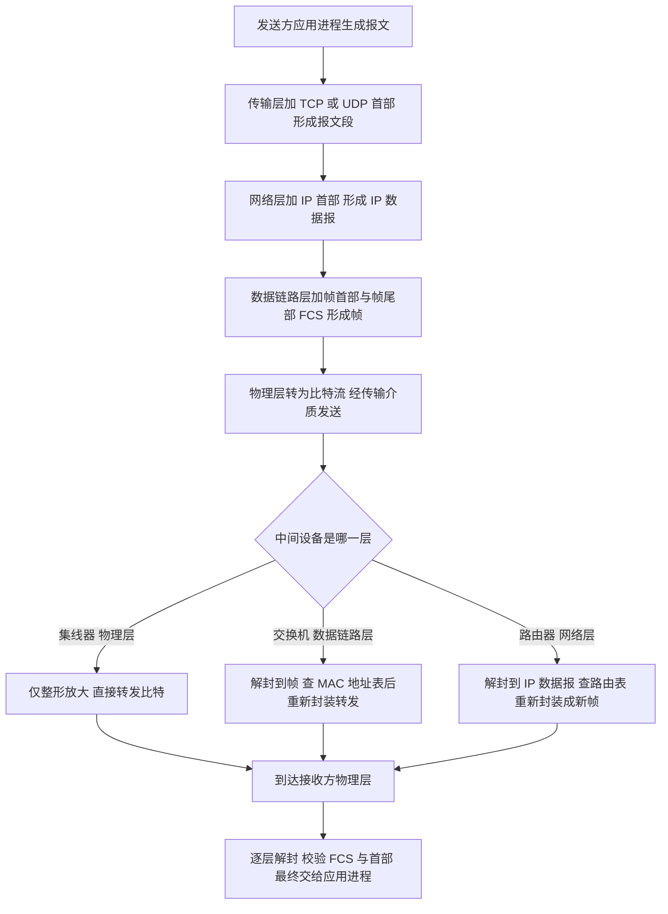

# 计算机网络 · 计算机网络体系结构

## 计算机网络体系结构 [高频]

**考频统计**：考察次数 14 次；涉及年份：2009、2011、2013、2015、2017、2019、2021、2023、2024；分数占比约 8%；主要题型：选择题为主（分层模型、协议/服务、设备与层次对应）。

**核心讲解**：

计算机网络按覆盖范围分为广域网、城域网、局域网与个人区域网；按交换方式分为电路交换、报文交换与**分组交换**（`408` 的默认语境）。性能指标中必须分清两种时延：**发送时延（传输时延）`= 数据长度 / 发送速率`** 取决于数据量与链路速率，**传播时延 `= 距离 / 电磁波传播速率`** 只取决于物理距离与介质（约 `2 × 10^8 m/s` 在铜缆/光纤中）。因此"提高带宽"能减少发送时延，但**不能减少传播时延**；**时延带宽积 `= 传播时延 × 带宽`** 表示"链路上能容纳的比特数"，又称"以比特为单位的链路长度"；**往返时间 `RTT`** 是往返一次的时间。

总时延 `= 发送时延 + 传播时延 + 处理时延 + 排队时延`，其中处理与排队时延在题目给出时才能计入。`OSI` 参考模型自下而上为**物理层、数据链路层、网络层、传输层、会话层、表示层、应用层**，`TCP/IP` 模型为**网络接口层、网际层、传输层、应用层**，二者对应关系是"`TCP/IP` 的应用层 = `OSI` 的会话层 + 表示层 + 应用层"，"`TCP/IP` 的网络接口层 = `OSI` 的物理层 + 数据链路层"。**协议**是通信双方必须遵守的规则集合，三要素是**语法、语义、同步**；

**服务**是下层向上层提供的功能，是"垂直"的，而协议是"水平"的（同层对等实体之间）。**各层的数据单元**名称不同：物理层为比特、数据链路层为帧、网络层为分组（数据报）、传输层为报文段（`TCP`）或用户数据报（`UDP`）；**各层的典型设备**为：中继器与集线器在物理层、网桥与交换机在数据链路层、路由器在网络层、网关在应用层。

**关键结论速记**：

- `发送时延 = 数据长度 / 速率`，`传播时延 = 距离 / 传播速率` —— 提高带宽只减少发送时延，不影响传播时延。
- `时延带宽积 = 传播时延 × 带宽` —— 物理意义是"链路中能容纳的比特数"，又称链路长度（比特）。
- `OSI 七层 = 物理、数据链路、网络、传输、会话、表示、应用`；`TCP/IP 四层 = 网络接口、网际、传输、应用`。
- `TCP/IP 的应用层对应 OSI 的高三层，网络接口层对应 OSI 的低两层` —— 层间对应关系是必考细节。
- `协议三要素：语法、语义、同步`；协议是水平的、服务是垂直的。
- `设备与层次：集线器/中继器在物理层，交换机/网桥在数据链路层，路由器在网络层` —— 判断题的高频依据。

**示意图**：

**`OSI` 七层与 `TCP/IP` 四层的对应关系及数据单元封装**：每下一层都在上层数据前加上本层首部（必要时加尾部），形成该层的数据单元。

```text
OSI 7 layers                     TCP/IP 4 layers        PDU name
+---------------------+          +----------------+     ------------
| 7 application       |          |                |     message / data
+---------------------+          |   application  |
| 6 presentation      |          |                |
+---------------------+          |                |
| 5 session           |          |                |
+---------------------+          +----------------+
| 4 transport         |          |   transport    |     segment (TCP)
+---------------------+          |                |     datagram (UDP)
| 3 network           |          |   internet     |     packet / datagram
+---------------------+          +----------------+
| 2 data link         |          |                |     frame
+---------------------+          | network        |
| 1 physical          |          | interface      |     bit
+---------------------+          +----------------+

encapsulation when sending (top down)

  application data
        |
        v  + TCP header
  [ TCP hdr | data ]                       -> segment
        |
        v  + IP header
  [ IP hdr | TCP hdr | data ]              -> packet
        |
        v  + frame header and trailer
  [ frame hdr | IP hdr | TCP hdr | data | FCS ]  -> frame
        |
        v
  0101101011...                            -> bits on the medium

decapsulation at the receiver removes headers in reverse order.

devices and the layer they operate at
  physical layer        : repeater, hub            (do not isolate collision domain)
  data link layer       : bridge, switch           (isolate collision domain)
  network layer         : router                   (isolate broadcast domain)
  application layer     : gateway
```

**数据从发送方到接收方的封装与解封装流程**：中间设备只处理到它所处的层次，路由器解封到网络层再重新封装链路层。



**易错点**：

- 把发送时延与传播时延混为一谈：`发送时延 = 数据长度 / 速率`（与数据量和带宽有关），`传播时延 = 距离 / 传播速率`（只与距离和介质有关）；因此"增大带宽可以减小传播时延"是错误说法。
- `OSI` 与 `TCP/IP` 的层间对应关系写错：`TCP/IP` 的**网络接口层**对应 `OSI` 的物理层与数据链路层，**应用层**对应 `OSI` 的会话层、表示层与应用层；把"表示层"划到传输层或把"会话层"划到网络层都是错的。
- 认为集线器能隔离冲突域：集线器工作在物理层、只是多端口的信号放大转发，**所有端口属于同一个冲突域与同一个广播域**；能隔离冲突域的是交换机/网桥，能隔离广播域的是路由器。
- 把协议与服务混同：**协议是水平方向**（同层对等实体之间的规则），**服务是垂直方向**（下层通过服务访问点向上层提供的能力）；上层只能看见服务而看不见下层的协议实现。

**真题示例**：

**2014 年真题改编（单项选择题，2 分）**

下列关于 `OSI` 参考模型与 `TCP/IP` 模型各层功能的叙述中，正确的是（ ）。

A. 数据链路层负责为分组选择路由并实现拥塞控制
B. 传输层提供端到端（进程到进程）的可靠传输，并进行流量控制
C. 网络层负责在相邻结点之间进行差错控制与流量控制
D. 会话层负责数据格式转换与加密，属于 `TCP/IP` 模型的传输层

> 解析：逐项对应层次职责。**A 错**——"为分组选择路由"是**网络层**的功能，"拥塞控制"也主要由传输层与网络层承担，不是数据链路层的职责。**B 对**——**传输层**面向进程到进程（端到端）通信，`TCP` 在此层实现可靠传输、流量控制与拥塞控制，这是传输层的标准描述。**C 错**——"相邻结点之间"的差错控制与流量控制属于**数据链路层**，网络层做的是主机到主机的分组转发（不保证可靠）。**D 错**——数据格式转换与加密属于**表示层**，而在 `TCP/IP` 模型中它被并入**应用层**，不是传输层。答案选 **B**。**判分依据是"端到端 = 传输层、点到点 = 数据链路层"以及表示层在 `TCP/IP` 中并入应用层这两条对应关系。**

---
