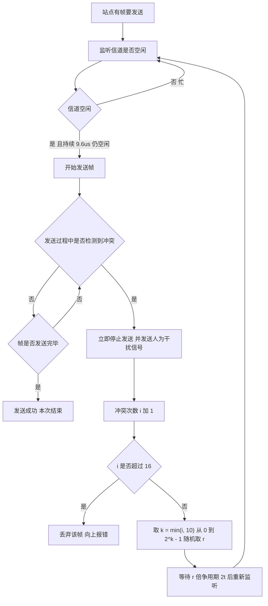

# 计算机网络 · 数据链路层

## 数据链路层 [高频]

**考频统计**：考察次数 22 次；涉及年份：2010—2025 年高频，2011、2013、2015、2017、2019、2020、2022、2024 年为典型年份；分数占比约 20%；主要题型：选择题 + 综合应用题（滑动窗口、CSMA/CD、以太网帧）。

**核心讲解**：

数据链路层的三个基本功能是**封装成帧（组帧）、差错控制、流量控制**。**组帧**常用四种方法：字符计数法（用计数字段标明帧长，一旦计数出错就全盘失步）、**字符填充法**（用 `SOH`/`EOT` 定界，数据中出现的 `SOH`/`EOT` 前插入转义字符 `ESC`，接收方删除转义）、**零比特填充法**（`HDLC` 使用：在标志字段 `01111110` 之外的数据中，每出现 **5 个连续 `1` 就填入一个 `0`**，接收方每见 5 个连续 `1` 就删除其后的 `0`）、**违规编码法**（如曼彻斯特编码中的非法电平组合），后两种是"透明传输"的标准做法。**差错控制**中，**奇偶校验**只能检出奇数个错误；

**循环冗余校验 `CRC`** 用生成多项式做**模 2 除法**求余数作为 `FCS`，能检出所有单比特错、所有奇数个错以及长度不超过生成多项式阶数的突发错；**海明码**通过 `2^r >= k + r + 1` 确定所需的**校验位数 `r`**（`k` 为数据位数），校验位放在 `2^i` 位置（第 1、2、4、8… 位），可实现**一位纠错**（配合总校验位可做到"纠一位、检两位"）。**流量控制与可靠传输**三种协议必须分清：**停止-等待**发送窗口为 `1`、每发一帧等一个确认，信道利用率 `= T_d / (T_d + RTT + T_a)`（`T_d` 为发送时延、`T_a` 为确认发送时延）；

**后退 `N` 帧 `GBN`** 用累计确认，接收窗口为 `1`，出错后重传从出错帧开始的全部帧，**发送窗口上限为 `2^n - 1`**（`n` 为序号位数）；**选择重传 `SR`** 逐帧确认、接收方缓存乱序帧，只重传出错帧，**发送窗口与接收窗口上限均为 `2^(n-1)`**，即窗口之和不超过 `2^n`。**介质访问控制**分三类：**信道划分**（频分 `FDM`、时分 `TDM`、码分 `CDM`，各站点固定分配、无冲突）、**随机访问**（`ALOHA`、`CSMA`、`CSMA/CD`、`CSMA/CA`）、**轮询访问**（令牌传递）。

**`CSMA/CD`** 的工作是"**先听后发、边听边发、冲突停发、随机重发**"：站点发送前先监听信道，发送中继续监听，一旦检测到冲突就立即停止并发送**人为干扰信号**，然后按**截断二进制指数退避**算法等待重发（第 `i` 次冲突后从 `{0, 1, ..., 2^k - 1}` 中随机取 `r`，`k = min(i, 10)`，等待 `r` 倍争用期）。**最小帧长**的依据是"发送时延必须不小于往返传播时延（争用期 `2τ`）"，否则发送方在冲突信号返回前已发完帧而无法检测冲突：`最小帧长 = 2 × 传播时延 × 数据率 = 争用期 × 数据率`，以太网取 `2τ = 51.2 μs`、`10 Mb/s`，故最小帧长 `512 bit = 64 B`。

**以太网帧**的 `MAC` 地址为 `48` 位，帧格式为"目的地址（6 `B`）+ 源地址（6 `B`）+ 类型（2 `B`）+ 数据（46—1500 `B`）+ `FCS`（4 `B`）"，故最小帧 `64 B`、最大帧 `1518 B`。**交换机**工作在数据链路层，通过**自学习**建立"`MAC` 地址 → 端口"的转发表，能隔离冲突域但不能隔离广播域。

**关键结论速记**：

- `零比特填充：发送方每 5 个连续 1 后插 0，接收方每 5 个连续 1 后删 0` —— 保证数据对标志字段 `01111110` 透明。
- `海明码校验位数：2^r >= k + r + 1`（`k` 数据位、`r` 校验位） —— 校验位位于第 1、2、4、8… 位。
- `CRC 用模 2 除法求余数作为 FCS` —— 生成多项式最高次为 `r` 则余数取 `r` 位，且模 2 运算不产生进位。
- `GBN 发送窗口 <= 2^n - 1，接收窗口 = 1`；`SR 收发窗口均 <= 2^(n-1)` —— 序号位数 `n` 决定窗口上限。
- `CSMA/CD：先听后发、边听边发、冲突停发、随机重发`；`最小帧长 = 争用期 × 数据率`。
- `以太网最小帧 64 B、最大帧 1518 B、数据字段 46—1500 B` —— 小于 46 `B` 需填充。
- `交换机隔离冲突域但不隔离广播域` —— 隔离广播域要靠路由器或 `VLAN`。

**示意图**：

**最小帧长的推导与以太网争用期**：发送方必须在冲突信号返回之前仍在发送，否则无法检测到冲突。

```text
why a minimum frame size is needed (CSMA/CD)

  A                                    B
  |------ propagation delay t ------>  |     t = distance / v
  |                                    |
  |  A starts sending at time 0        |
  |                                    |  B starts sending at t - e
  |<---- collision happens near B ---->|
  |                                    |
  |  the collision signal needs t to come back to A
  |<------------- round trip = 2t ---->|

  requirement: A's transmission time >= 2t  (the contention period)
      T_send = frame_length / data_rate >= 2 * t
      => minimum frame length = 2 * t * data_rate

  classic Ethernet numbers
      data rate = 10 Mb/s, 2t = 51.2 us
      min frame = 51.2 us * 10 Mb/s = 512 bit = 64 byte
      max frame = 1518 byte (with 1500 byte data field)

ethernet frame format (DIX Ethernet V2)

  +---------+---------+-------+------------------+-------+
  | dest MA | src MAC |  type |  data (46-1500)  |  FCS  |
  +---------+---------+-------+------------------+-------+
     6 B       6 B      2 B         46 - 1500 B     4 B
  min frame = 6+6+2+46+4 = 64 B      max = 6+6+2+1500+4 = 1518 B
  a data field shorter than 46 B must be padded
```

**`CSMA/CD` 的发送与冲突退避流程**：检测到冲突后必须立即停止并发送干扰信号，再用截断二进制指数退避决定重发时刻。



**易错点**：

- `GBN` 与 `SR` 的窗口上限记反：`GBN` 的发送窗口上限是 `2^n - 1`（接收窗口恒为 `1`），`SR` 的发送与接收窗口上限都是 `2^(n-1)`；把两者对调或用 `2^n` 做上限都会导致序号歧义。
- 最小帧长漏乘 `2`：`最小帧长 = 2τ × 数据率`，其中 `2τ` 是**往返**传播时延（争用期）；只乘单程传播时延会把最小帧长算小一半，进而误判"该帧能否被检测到冲突"。
- 海明码校验位数公式记错：正确式子是 `2^r >= k + r + 1`（`k` 为数据位数），注意不等号右边要**加上 `r` 本身**（表示"校验位也要被校验"）；漏掉 `r` 会得到偏小的校验位数。
- 混淆交换机与路由器的隔离能力：交换机工作在数据链路层，能隔离**冲突域**但**不隔离广播域**（广播帧会被转发到所有端口）；隔离广播域必须用路由器或划分 `VLAN`。

**真题示例**：

**2016 年 408 第 36 题（单项选择题，2 分）**

若某以太网的传播时延为 `25.6 μs`，数据传输速率为 `10 Mb/s`，则其最小帧长应为（ ）。

A. `64 B`　B. `128 B`　C. `256 B`　D. `512 B`

> 解析：直接套用"最小帧长 = 争用期 × 数据率"。争用期是**往返**传播时延 `2τ = 2 × 25.6 μs = 51.2 μs`，故最小帧长 `= 51.2 μs × 10 Mb/s = 512 bit = 64 B`，答案为 **A**。若忘记乘 2（只取 `25.6 μs`）会得到 `256 bit = 32 B` 而不在选项中，从而暴露出错误来源。**判分点是争用期必须是往返传播时延，以及比特与字节的换算（`512 bit = 64 B`）。**

---
