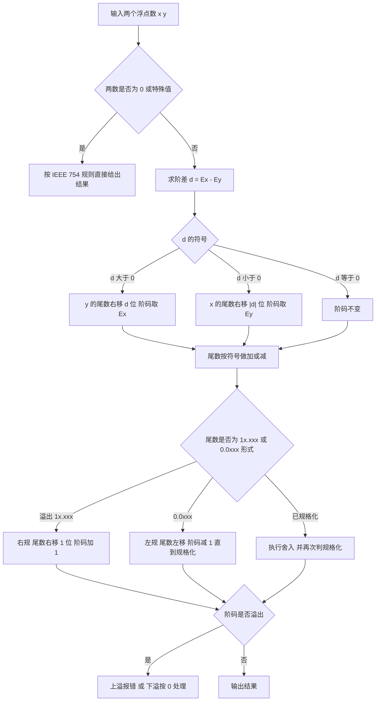

# 核心讲解

定点数的编码有四种：**原码**（最高位符号位，其余为绝对值）、**反码**（负数在原码基础上数值位取反）、**补码**（负数在反码基础上末位加 1）、**移码**（在补码基础上符号位取反，用于表示阶码）。`n` 位补码表示范围是 `-2^(n-1)` 到 `2^(n-1)-1`，比原码、反码多表示一个负数 `-2^(n-1)`，且 `0` 的表示唯一；`n` 位移码范围是 `-2^(n-1)` 到 `2^(n-1)-1`，其**无符号数值大小顺序与真值顺序一致**，所以移码适合做浮点数的阶码比较。

**补码运算的溢出判断**有两种等价方法：一是双符号位（变形补码）结果的两个符号位为 `01` 表示正溢出、`10` 表示负溢出；二是单符号位下判断"最高位进位 `C_n` 与次高位进位 `C_(n-1)` 是否异或为 1"。**IEEE 754 单精度**共 32 位，字段为 `1 位符号 + 8 位阶码 + 23 位尾数`，阶码用**偏移量 127 的移码**（`E = e + 127`），规格化数的尾数隐含最高位的 `1`（即 `1.M`），故真实有效位是 24 位。

特殊值约定：阶码全 0 且尾数全 0 表示 `±0`；阶码全 0 而尾数非 0 表示非规格化数（此时隐含位为 0，用于表示接近 0 的数）；阶码全 1 且尾数全 0 表示 `±inf`；阶码全 1 而尾数非 0 表示 `NaN`；**浮点数加减**的五个步骤是：对阶（小阶向大阶看齐，尾数右移，移出的位保留为保护位）、尾数加减、规格化（左规或右规，右规一次阶码加 1）、舍入（常用就近舍入即"0 舍 1 入"）、判溢出（阶码溢出才是真溢出，尾数溢出可用右规纠正）。C 语言中 `int` 到 `float` 的转换会因 float 只有 24 位有效位而丢失低位，`float` 转 `int` 是**向零截断**，这些都必须在位级上理解。

**乘除运算**按原码思路把符号位与数值部分分开处理：原码一位乘的符号位由两数符号异或得到，数值部分做 `n` 次移位相加——每次看乘数最低位为 `1` 就加 `|x|`、为 `0` 就加 `0`，再把部分积右移一位；原码一位除同样先定商符，可用恢复余数法（减后余数为负就加回除数恢复）或加减交替法（按余数符号直接决定下一步加还是减，省去恢复操作，又称不恢复余数法）。

**补码乘法**用 Booth 算法在补码上直接做：乘数末位加附加位 `y_(n+1) = 0`，按相邻两位 `y_i y_(i+1)` 决策并右移，符号位随数值一起参与运算，不必先取绝对值或单独确定符号，控制简单且结果直接为补码；**阵列乘法器**把部分积的产生与累加排成全加器阵列，各列并行相加、进位沿对角线逐级传递，以空间换时间，把 `n` 次串行的移位相加（`O(n^2)` 延迟）压缩到约 `O(n)`。

# 关键结论速记

- `n 位补码范围 [-2^(n-1), 2^(n-1)-1]`、`原码/反码范围 [-(2^(n-1)-1), 2^(n-1)-1]` —— 补码比原码多一个负数，`0` 唯一。
- `补码取负 = 全部位取反加 1`；`-128 的 8 位补码是 1000 0000` —— 该值没有对应的原码与反码。
- `移码 = 补码的符号位取反`、`IEEE 754 阶码偏移量为 127（单精度）/ 1023（双精度）` —— 偏移量与"移码"的常数不要混淆。
- `IEEE 754 单精度：1 + 8 + 23，隐含 1.M，真实有效位 24 位` —— 精度由尾数位数决定，范围由阶码位数决定。
- `溢出判断：C_n 异或 C_(n-1)`，或双符号位 `01`/`10` —— 只有同号相加才可能溢出。
- `浮点加减顺序：对阶 → 尾数运算 → 规格化 → 舍入 → 判溢出` —— 对阶一定"小阶向大阶看齐"。
- `原码一位乘 = 符号异或 + n 次（加 |x| 或 0、部分积右移）` —— 数值位取绝对值相乘，符号单独决定。
- `Booth：y_i y_(i+1) = 01 加 [x]补、10 加 [-x]补、00/11 加 0，再右移` —— 符号位参与运算，结果直接为补码。

# 示意图

**定点与浮点的位级字段划分**：定点数只有符号位与数值位，浮点数把数值拆成"阶码 + 尾数"两段以便同时表达范围与精度。

```text
8-bit fixed point encodings (examples: +13 = 0000 1101)

  sign  magnitude             value       code
  ----  ---------             -----       ----
   0    000 1101             +13       sign-magnitude   0000 1101
   0    000 1101             +13       ones-complement  0000 1101
   0    000 1101             +13       twos-complement  0000 1101

  -13
   1    000 1101             -13       sign-magnitude   1000 1101
   1    111 0010             -13       ones-complement  1111 0010
   1    111 0011             -13       twos-complement  1111 0011

  -128 has no sign-magnitude or ones-complement form
       twos-complement of -128 = 1000 0000
  -1   twos-complement (8-bit)  = 1111 1111
  note: 0 has two forms in sign-magnitude/ones-complement,
        but only one form in twos-complement

IEEE 754 single precision (32 bits), value = (-1)^S * 1.M * 2^(E-127)

 bit  31 | 30 ...... 23 | 22 ....................... 0
     +---+--------------+----------------------------+
     | S |   E (8 bit)  |        M (23 bit)          |
     +---+--------------+----------------------------+
       |        |                     |
       |        |                     +-- fraction, implicit leading 1
       |        +-- biased exponent, value E = e + 127
       +-- sign: 0 positive, 1 negative

 special cases
   E = 0,   M = 0        ->  +/- 0
   E = 0,   M != 0       ->  denormalized, implicit bit is 0
   E = 255, M = 0        ->  +/- infinity
   E = 255, M != 0       ->  NaN

worked example:  -12.5 = -1100.1B = -1.1001B * 2^3
   S = 1
   E = 3 + 127 = 130 = 1000 0010B
   M = 1001 0000 0000 0000 0000 000B
   code = 1 10000010 10010000000000000000000
```

**浮点数加减运算**的流程固定为五步，其中"对阶"和"规格化"是考查重点。



# 易错点

- 混淆移码偏移量与 IEEE 754 偏移量：`n` 位纯移码是"补码符号位取反"（偏移 `2^(n-1)`），而 IEEE 754 单精度的阶码偏移量是 **127**（双精度 1023），两者不能互相代入。
- 认为补码与原码表示范围相同：`n` 位补码比原码、反码多一个负数 `-2^(n-1)`，且 `-2^(n-1)` 不存在对应的原码与反码形式；此外补码的 `0` 表示唯一，原码与反码有 `+0`、`-0` 两种表示。
- 把尾数溢出当成浮点溢出：尾数相加出现 `1x.xxx` 只是**尾数溢出**，可通过右规（尾数右移一位、阶码加 1）纠正；真正的溢出是**阶码**超出可表示范围，上溢才报错、下溢按机器零处理。
- 对阶时方向搞反：必须**小阶向大阶看齐**（阶码小的数尾数右移），若反过来会让阶码变大而尾数左移，导致高位丢失、结果错误。

# 真题示例

**2011 年 408 第 13 题（单项选择题，2 分）**

`float` 型数据通常用 IEEE 754 单精度浮点格式表示。若编译器将 `float` 型变量 `x` 赋值为 `-12.5`，则该变量的机器数是（ ）。

A. `0xC1480000`　B. `0xC1480001`　C. `0xC1480002`　D. `0xC1480003`

> 解析：分三步。第一步，把 `-12.5` 化为二进制并规格化：`12.5 = 1100.1B = 1.1001B * 2^3`。第二步，填字段：符号位 `S = 1`（负数）；阶码 `E = 真值阶 3 + 偏移 127 = 130 = 10000010B`；尾数 `M = 1001` 后面补 0 到 23 位，即 `10010000000000000000000`。第三步，拼接并写成十六进制：`1 10000010 10010000000000000000000` 按 4 位分组为 `1100 0001 0100 1000 0000 0000 0000 0000`，即 `0xC1480000`。答案为 **A**。**关键是把 `-12.5` 正确写成 `1.1001B * 2^3`，并把偏移量 127 加到真值阶上。**
