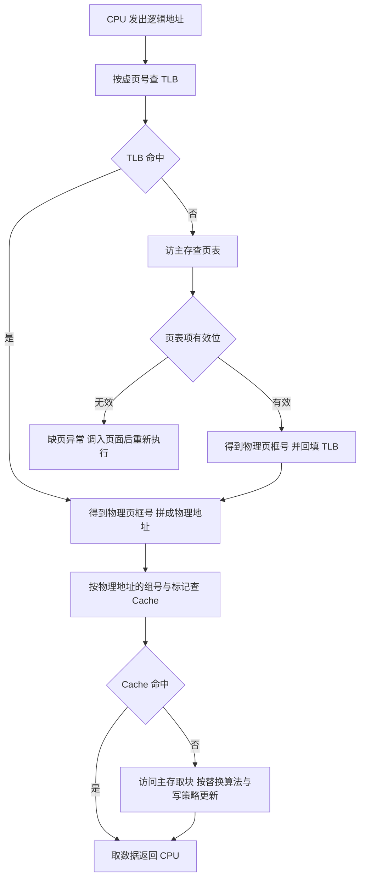

# 核心讲解

**存储层次**的依据是程序访问的局部性：越靠近 CPU 的层次越快、越小、越贵，`Cache` 与主存之间以**块（行）**为单位交换数据，主存与辅存之间以**页**为单位。**Cache 的地址划分**是本科目最高频的计算：把物理地址从低位到高位切成"块内地址（`log2 块大小` 位）→ 组号（`log2 组数` 位）→ 标记"三段。直接映射时"组"就是行，行号 `= 主存块号 mod Cache 行数`；`N` 路组相联时组数 `= Cache 容量 / (块大小 × N)`；全相联只有标记与块内地址两段。**平均访问时间**在"先查 Cache，未命中再访主存"的串行模型下为 `T = 命中率 * Tc + 缺失率 * Tm`；

若采用"并行/同时启动"或"流水"模型，公式中的 `Tm` 要改为"未命中时的额外开销"，必须按题意选择。**Cache 行**除数据外还需**有效位**，写回法还要**脏位**，替换算法用 LRU 时还要计数位或栈位，这些开销在做"Cache 总容量/总位数"题时必须计入。**DRAM** 需要定时刷新（一般取 `2 ms` 一个刷新周期），刷新按**行**进行、只需行地址，三种方式为集中刷新（有"死时间"）、分散刷新（无死区但存取周期变长）、异步刷新（折中，最常用）。

**主存扩展**分位扩展（数据线加宽，地址线共用）与字扩展（地址空间加大，需片选译码）。**虚拟存储**把逻辑地址翻译成物理地址：查 `TLB` → 查页表 → 若缺页则触发缺页异常；`TLB` 命中则不必访存取页表项，`Cache` 命中则不必访问主存，做时间计算时需按题意枚举四种命中组合。**磁盘**的存取时间 `= 寻道时间 + 旋转延迟 + 传输时间`，其中平均旋转延迟为**旋转半圈**的时间：`60 / 转速 / 2`。

# 关键结论速记

- `组数 = Cache 容量 / (块大小 × 路数)`，`块内地址位数 = log2(块大小)`、`组号位数 = log2(组数)`、`标记位数 = 地址位数 - 组号 - 块内` —— Cache 地址划分三步走。
- `Cache 行总位数 = 标记 + 1 有效位 + 脏位(写回时) + 替换计数位 + 数据位` —— 做"总容量"题必须加控制位。
- `串行模型 T = 命中率 × Tc + 缺失率 × Tm` —— 若题中说明"并行访问"则需换成额外开销口径，不能硬套。
- `DRAM 刷新按行、以 2 ms 为周期、只需行地址` —— 集中/分散/异步三种方式的差别在"是否有死时间"。
- `磁盘存取时间 = 寻道 + 旋转延迟 + 传输`，`平均旋转延迟 = 60 / (2 × 转速)` 秒 —— 转速单位 rpm 换算成秒要除以 60。
- `TLB 命中 → 无需访存查页表；Cache 命中 → 无需访主存` —— 计算有效访问时间时必须按题意枚举命中组合。

# 示意图

**Cache 地址划分**：同一个 32 位物理地址，在直接映射与 `N` 路组相联下切成不同段数；组相联是"直接映射的组索引 + 组内全相联比较"的折中。

```text
Cache line structure (data block + tag + control bits)

  +----------------+---+-------+----------+
  |     data       | V | dirty |  tag     |
  +----------------+---+-------+----------+
    block size B     1     1    tag bits

direct mapping: line number = block number mod number of lines

 31                      tag                 index     offset
 +--------------------------+------------------+---------+
 |          tag             |    line index    | offset  |
 +--------------------------+------------------+---------+
                            |<-- log2(lines) -->|<log2 B >|

N-way set associative: number of sets = capacity / (B * N)

 31                      tag                 set       offset
 +--------------------------+------------------+---------+
 |          tag             |     set index    | offset  |
 +--------------------------+------------------+---------+
   compare tag with N ways in parallel (N comparators)

worked example (32-bit address, B = 64 B, 8-way, capacity = 512 KB)
   sets    = 512 KB / (64 B * 8) = 1024          -> index = 10 bit
   offset  = log2 64 = 6 bit
   tag     = 32 - 10 - 6 = 16 bit

 31            16 15         6 5        0
 +----------------+-----------+----------+
 |   tag (16)     | set (10)  | off (6)  |
 +----------------+-----------+----------+
```

**一次访存（load）的完整判定流程**：`TLB`、`Cache`、主存、页表四者的关系决定了有效访问时间的计算口径。



# 易错点

- 缓存容量计算漏掉控制位：Cache 行除数据块外还有有效位（写回法还有脏位、LRU 还有计数位），题目问"Cache 总位数/标记阵列容量"时必须加上这些位，只算数据位会偏小。
- 把"组数"与"行数"混用：直接映射时组数等于行数，而 `N` 路组相联时 `行数 = 组数 × N`；若把组数直接当行数去算组号位数，地址划分会整体错位。
- 用错平均访问时间模型：`T = h·Tc + (1-h)·Tm` 只适用于"先查 Cache 再访主存"的串行模型；若题目说"Cache 与主存同时启动"或给出"未命中额外开销"，必须改用对应公式。
- 旋转延迟算成一圈：平均旋转延迟是**半圈**时间，即 `60 / (2 × 转速)` 秒（转速为 rpm）；算成一圈会使结果翻倍，磁盘存取时间题必错。

# 真题示例

**2014 年 408 第 43 题（综合应用题，8 分）**

假设某计算机按字节编址，主存地址为 32 位，采用 8 路组相联映射的 Cache，Cache 数据区容量为 512 KB，每个主存块大小为 64 字节，Cache 采用写回法并含 LRU 替换所需的计数位。要求：给出物理地址中标记、组号与块内地址的位数；求 Cache 中每一行的总位数（含必要的控制位）。

> 解析：先求组数——`组数 = Cache 数据区容量 / (块大小 × 路数) = 512 KB / (64 B × 8) = 1024 = 2^10`。于是**块内地址 = `log2 64 = 6` 位、组号 = `log2 1024 = 10` 位、标记 = `32 - 10 - 6 = 16` 位**。再求行总位数——数据位 `64 × 8 = 512` 位，标记 `16` 位，有效位 1 位，写回法需脏位 1 位，8 路 LRU 需要能区分 8 种次序的计数位（3 位，或按题意用 `log2 8 = 3`）：合计 `512 + 16 + 1 + 1 + 3 = 533` 位/行。**判分点是"组数公式里要乘路数"与"控制位必须计入"，两处都是高频失分点。**
