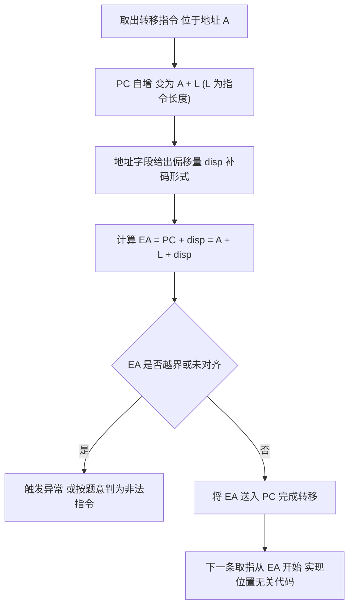

# 核心讲解

一条指令由**操作码字段**与**地址码字段**构成。定长指令字中操作码位数固定，可表示 `2^k` 条指令；**变长指令字**中常用**扩展操作码**技术：把操作码按长度分层，短操作码不能再作为长操作码的前缀，因此设计时必须保证"**短码不是任何长码的前缀**"。以 4 位为基础操作码、需要扩展到 8 位为例，若 4 位编码 0000—1110 分配给 15 条三地址指令，则剩下 1111 作为扩展标志可产生 16 个 8 位编码，用于二地址指令，依此类推。**寻址方式**决定操作数的来源与有效地址 `EA` 的计算：立即寻址的地址字段就是操作数本身；直接寻址 `EA = A`；间接寻址 `EA = (A)`（需访存两次取数，三次含取指）；

寄存器寻址的操作数在寄存器中，不访存；寄存器间接寻址 `EA = (R)`；**相对寻址 `EA = (PC) + A`**，其中 `PC` 已是**取下一条指令后的值**（即已自增）；基址寻址 `EA = (BR) + A`，基址寄存器由操作系统设定、面向整个程序，用于**程序重定位**；

变址寻址 `EA = (IX) + A`，变址寄存器由用户改变、面向数组，用于**数组元素的顺序访问**；堆栈寻址的操作数隐含在栈顶。`CISC` 与 `RISC` 的分野在于：`RISC` 采用**定长指令字、指令条数少且格式规整、只有 Load/Store 访存、通用寄存器多、采用硬布线控制与流水线**，而 `CISC` 指令变长、寻址方式多、以微程序控制为主。汇编层面必须能读懂"取数—运算—存数"的三段式，重点掌握 `mov`、`add/sub`、`cmp` 与条件转移 `jmp/jcc`、以及 `push/pop` 对栈指针的改变。

# 关键结论速记

- `扩展操作码约束：短码不得是长码的前缀` —— 否则译码时无法判断指令长度。
- `相对寻址 EA = (PC) + A，PC 已自增到下一条指令` —— 这是 408 反复考查的细节，忘记自增会整体偏移。
- `基址寻址面向程序重定位（基址寄存器由 OS 设定），变址寻址面向数组（变址寄存器由用户改变）` —— 两者形式相同、用途不同。
- `一次间接寻址取操作数需访存 2 次（含取指共 3 次）` —— 访存次数是间接寻址的标志性代价。
- `RISC：定长指令 + 只有 Load/Store 访存 + 多通用寄存器 + 硬布线 + 流水线` —— 与 CISC 的对比是固定选择题考点。
- `指令字长可以小于机器字长，也可以大于机器字长` —— 半字长、双字长指令都允许，按字节编址时需注意取指访存次数。

# 示意图

**扩展操作码的编码树**：短操作码保留一个（或若干个）编码作为"扩展出口"，不把编码空间用尽；下图用 4 位基础码扩展一次到 8 位为例。

```text
opcode tree (4-bit base, extended once to 8-bit)

                    +-------- 4-bit opcode --------+
                    |                               |
        +-----------+-----------+        +----------+---------+
        |           |           |        |                    |
     0000        0001  ...   1110      1111  (extend flag)
    3-addr      3-addr       3-addr       |
                                        +-+----------------------+
                                        |                        |
                                 0000 ....             1111 (extend again)
                                 2-addr                 |
                                                   (8-bit space for 1-addr)

  rule: 1111 is NOT a prefix of any 4-bit code,
        it is reserved so that longer codes can be recognized

  count check
    4-bit codes usable as instructions : 1111 -> 15  (0000..1110)
    after extension                  : 15 + 16 = 31 instructions
    if extended twice                 : even more, but 1-addr codes shrink
```

**相对寻址与转移指令**：`EA` 以"当前指令地址 + 指令长度"为基准再加偏移量，因此同一条转移指令被搬到别处执行时，转移目标也随之平移（位置无关）。



# 易错点

- 相对寻址忘记 `PC` 已自增：`EA = (PC) + A` 中的 `PC` 是"取下本条指令后已加一个指令长度"的值；若直接用本条指令地址去加偏移量，结果会整体偏差一条指令的长度。
- 基址与变址寻址的用途互换：基址寻址的基址寄存器内容由操作系统给出、程序执行中不变，用于**程序浮动/重定位**；变址寻址的变址值由用户改变，用于**数组或字符串的顺序访问**。
- 扩展操作码设计违反前缀约束：把 1111 同时用作一条 4 位指令又用作 8 位扩展标志，译码器无法判定指令长度；正确做法是把该编码**只留给扩展**。
- 认为指令字长必须等于机器字长：指令字长可以等于、小于或大于机器字长（半字长、双字长指令都常见），只要求是字节的整数倍（按字节编址时），取指所需访存次数由指令字长与存储字长共同决定。

# 真题示例

**2019 年 408 第 16 题（单项选择题，2 分）**

某计算机采用定长指令字，指令字长 16 位，采用扩展操作码方式。若三地址指令有 12 条、二地址指令有 20 条，则一地址指令最多有（ ）条。

> 解析：设操作码基础长度为 4 位，三地址指令需要 12 个编码，占 `0000—1011`；剩余 `1100、1101、1110、1111` 共 4 个编码可作扩展标志。每个扩展标志可扩展出 4 位（地址字段让出 4 位），即每个标志下可得到 `2^4 = 16` 个 8 位编码，故二地址指令编码空间为 `4 × 16 = 64` 个。二地址指令实际用了 20 条，剩余 `64 - 20 = 44` 个 8 位编码可继续作扩展标志，每个再扩展 4 位得到 `2^4 = 16` 个 12 位编码，故一地址指令最多 `44 × 16 = 704` 条。**关键是逐层计算"剩余编码数 × 每级扩展倍数"，且绝不能把已用的编码再当扩展标志。**
