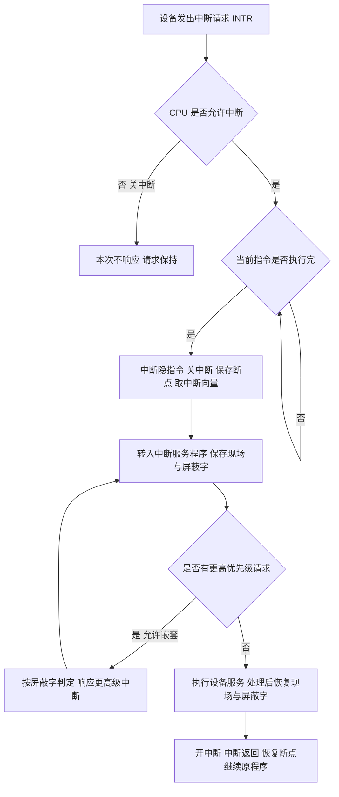

# 核心讲解

总线是连接多个部件的**共享传输介质**，按功能分为**数据总线**（双向，位数决定一次能传多少位）、**地址总线**（单向，由 CPU 指向主存/IO，位数决定寻址空间）、**控制总线**（双向/单向混合，传时序与命令）。按层次分为片内总线、系统总线（含数据/地址/控制三类）、通信总线。

**性能指标**中最常考的是带宽：`总线带宽 = 总线工作频率 × (总线宽度 / 8)` 字节/秒，若一个总线周期能传送多个数据字，则还要乘上每周期传送的次数；`总线传输周期 = 一个地址 + 一个数据字的传送时间`，含地址期与数据期，若题中给出"每个总线周期含 `k` 个时钟"，则带宽 `= 总线宽度 / (k × 时钟周期)`。**总线仲裁**解决多个主设备争用总线的问题，三种方式的特点必须分清：**链式查询**只需 3 根线（请求、允许、忙），结构简单、扩充容易，但**优先级固定且离控制器越近越高**，且某一环节故障会导致其后所有设备无法获得总线；

**计数器定时查询**用一组设备地址线代替允许线，优先级可通过计数初值改变、较为灵活，但增加 `log2 n` 根线；**独立请求**每个设备都有独立的请求线与允许线，响应最快、优先级最灵活，但线数最多（`2n` 根），控制逻辑最复杂。**总线定时**决定数据传送的时序：**同步定时**由统一时钟控制，速度快、协议简单，但各设备必须在同一时钟节拍内完成，适合速度相近的设备；**异步定时**用"请求—应答"握手，分为不互锁（请求方不等回答即撤销）、半互锁（请求方等回答，回答方不等请求撤销）、全互锁（双方都等对方撤销），可靠性高但速度慢；**半同步**在同步基础上加一条 `WAIT` 线以兼容慢速设备。

# 关键结论速记

- `总线带宽 = 工作频率 × 总线宽度 / 8`（字节/秒） —— 宽度按**字节**折算，`位/秒` 则不必除以 8，单位不能混。
- `带宽也可写为 总线宽度 / 总线传输周期` —— 当题目给出"每个总线周期含 k 个时钟"时用此式更稳。
- `链式查询 3 根线、优先级固定；独立请求 2n 根线、优先级最灵活` —— 线数与灵活性的权衡是选择题核心。
- `同步定时靠统一时钟，异步定时靠握手（不互锁/半互锁/全互锁）` —— 异步更适合速度差异大的设备。
- `地址总线位数决定寻址空间：n 位可寻址 2^n 个单元` —— 与数据总线宽度决定的"一次传送位数"不要混淆。
- `总线复用：同一组线在不同时间段传地址与数据` —— 复用可减少引脚数，代价是速度下降。

# 示意图

**三总线结构与一次总线传输的时序**：地址线单向送出地址，数据线双向传送数据，控制线给出读/写与握手信号。

```text
three-bus structure

        +--------+       address bus (one-way, n bits)   +----------+
        |        |-------------------------------------->|          |
        |  CPU   |<------------------------------------->|  memory  |
        |        |       data bus (two-way, m bits)      |          |
        |        |<------------------------------------->|          |
        |        |       control bus (R/W, INTR, HS)     |          |
        +--------+<------------------------------------->+----------+
             ^
             |  system bus
             v
        +----------------+   +----------------+   +----------------+
        |  I/O interface |   |  I/O interface |   |  I/O interface |
        +----------------+   +----------------+   +----------------+

one bus transfer cycle (synchronous timing)

  clock      T1        T2        T3        T4
          +--------+--------+--------+--------+
  addr    | addr   |        |        |        |
  data    |        |        | data   |        |
  ready   |        |        |        | sample |
          +--------+--------+--------+--------+
   total period = 4 clocks, so bandwidth = bus width / (4 * clock period)

arbitration comparison

  mode            lines needed        priority            fault behavior
  -------------   -----------------   -----------------   ---------------------
  chain query     3 (BR, BG, BS)      fixed, near = high  one fault blocks all
  counter poll    2 + log2(n)         settable by count   isolated
  independent     2 * n               fully flexible      isolated, best speed
```

**一次中断处理的完整流程**：从中断请求到返回，中间包含硬件自动完成的"中断隐指令"与软件的中断服务程序两段。



# 易错点

- 总线带宽计算漏乘或单位错：`总线宽度`以位给出时要先除以 8 换算成字节，带宽结果单位是 `B/s`；若题目问 `b/s` 则不要除。另外当一个总线周期含 `k` 个时钟时，必须除以整个周期而不是单个时钟。
- 认为链式查询的优先级可以自由设置：链式查询的优先级由设备在链上的**物理位置**决定，离总线控制器越近优先级越高，无法通过软件随意改变；要改变优先级需用计数器定时查询方式。
- 把地址总线位数与数据总线位数的作用弄反：**地址总线位数决定可寻址的主存单元个数**（`n` 位对应 `2^n` 个单元），**数据总线位数决定一次能并行传送的位数**，两者互不相干。
- 混淆异步定时的三种互锁方式：不互锁是请求方不等应答就撤销请求（最快但最不可靠），半互锁是请求方等应答、应答方不等请求撤销，全互锁是双方互相等待（最可靠但最慢）；把半互锁与全互锁的等待关系写反是常见失分点。

# 真题示例

**2015 年真题改编（单项选择题，2 分）**

某同步总线的时钟频率为 `100 MHz`，总线宽度为 `32` 位，地址/数据线复用，每传送一个地址或一个数据都占一个时钟周期。该总线支持突发传送方式，一次突发连续传送 `8` 个数据字（只需送出首地址一次）。则这次突发传送的数据传输率约为（ ）。

A. `356 MB/s`　B. `400 MB/s`　C. `800 MB/s`　D. `3200 MB/s`

> 解析：地址/数据线复用意味着一个总线周期至少要占"地址期 + 数据期"。突发传送只送一次首地址，随后连续送 `8` 个数据字，故一次突发共需 `1 + 8 = 9` 个时钟周期，传送数据量为 `8 × 32 位 = 32` 字节。时钟周期 `= 1 / 100 MHz = 10 ns`，9 个时钟耗时 `90 ns`，故数据传输率 `= 32 B / 90 ns ≈ 0.356 × 10^9 B/s ≈ 356 MB/s`，答案为 **A**。若忘记计入地址期（只算 8 个时钟）就会得到 `400 MB/s` 的干扰项 B——**"地址/数据线复用 + 突发传送"必须计入一次地址期开销，这是本题的判分点。**
