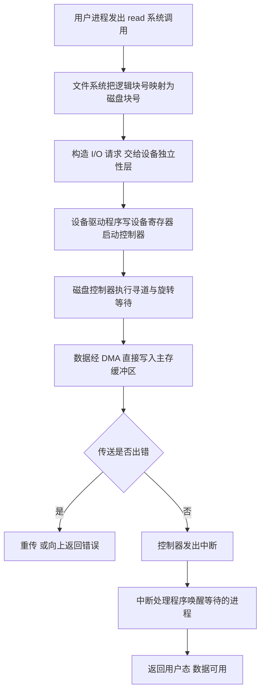

# 核心讲解

`I/O` 接口（设备控制器）的作用是**数据缓冲、格式转换、状态与命令寄存、地址译码**，它把 CPU 的高速并行总线与设备的低速串行工作方式解耦。`I/O` 端口的编址有两种：**统一编址**（把端口当作主存单元，用普通访存指令访问，无需专门指令但占用主存地址空间）与**独立编址**（有独立的地址空间与专用 `IN/OUT` 指令，不占主存空间但指令类型增多）。`I/O` 控制方式的发展主线是**CPU 干预程度逐步降低**：**程序查询**方式下 CPU 不断读状态寄存器空转等待，CPU 与设备完全串行；

**程序中断**方式下 CPU 发出命令后继续执行原程序，设备就绪时用中断通知 CPU 在**一条指令执行结束后**响应，数据传送仍需 CPU 用指令搬入主存；**DMA** 方式由 DMA 控制器直接在主存与设备之间成块传送，数据**不经过 CPU 的寄存器**，每传送一个字（或一个数据块）占用一次总线（周期挪用/周期窃取），只有在传送前（初始化）与传送后（中断处理）才需要 CPU 参与；**通道**方式由通道处理器执行通道程序，进一步把 CPU 从 `I/O` 管理中解放出来。

**中断系统**要点：CPU 响应中断的条件是"有中断请求 + 中断允许触发器为 1 + 当前指令执行结束"；响应时由硬件自动执行**中断隐指令**完成三件事——**关中断、保存断点（`PC`）、取中断向量**；随后由中断服务程序保存现场并执行服务。

**中断向量表**位于主存固定区域，表项按**中断类型号**索引，每项存放对应 `ISR` 的入口地址（或入口地址的地址）；CPU 响应中断后，硬件先执行**中断隐指令**完成关中断、保存断点（`PC`、`PSW`），再按中断控制器送来的中断类型号查表、把取出的入口地址送入 `PC` 转入 `ISR`，此后保存现场、执行中断服务、恢复现场才由 `ISR`（软件）完成。

**多重中断**（中断嵌套）靠**中断屏蔽字**控制：屏蔽字中某位为 `1` 表示屏蔽（禁止）对应的中断源，因此优先级越高的中断源，其屏蔽字中"1"的位数越多。**磁盘**的性能指标是存取时间，`存取时间 = 寻道时间 + 旋转延迟 + 传输时间`，其中平均旋转延迟为旋转半圈的时间 `60 / (2 × 转速)`（转速单位 `rpm`）；数据传输率与位密度、转速（线速度）相关，`数据传输率 = 每条磁道的容量 / 旋转一圈的时间`。固态硬盘 `SSD` 基于闪存，无机械寻道与旋转延迟，随机访问快，但存在**写放大**、**擦除次数受限**（寿命）的问题。

# 关键结论速记

- `四种 I/O 方式 CPU 干预程度：程序查询 > 程序中断 > DMA > 通道` —— 判据是"CPU 是否需要在传送过程中持续参与"。
- `DMA 数据不经过 CPU 寄存器，直接在主存与设备间传送` —— 这是 DMA 与程序中断方式的本质区别。
- `中断隐指令由硬件执行：关中断、保存断点、取中断向量` —— 它是"指令"但不是程序里的指令。
- `中断响应时机：一条指令执行结束后` —— 而不是任意时刻，也不是一个时钟周期后。
- `屏蔽字为 1 表示屏蔽，优先级越高屏蔽的位数越多` —— 多重中断靠它实现嵌套。
- `磁盘存取时间 = 寻道 + 旋转延迟 + 传输`，`平均旋转延迟 = 60 / (2 × 转速)` 秒 —— 旋转延迟取半圈。
- `中断向量表：表项按中断类型号索引，存放 ISR 入口地址（或入口地址的地址）` —— 响应时硬件用类型号查表，把入口地址送入 `PC`。
- `向量地址 = 表项地址（由类型号换算），表项内容才是 ISR 入口` —— 间接向量时内容是入口地址的地址，需再取一次。

# 示意图

**四种 I/O 控制方式的数据通路与 CPU 参与程度**：从程序查询到通道，CPU 的角色从"全程搬运工"逐步退化为"发起与善后"。

```text
(1) programmed query (polling)
  CPU ---> status reg ---> busy? loop until ready ---> data reg ---> CPU reg ---> memory
      CPU spins in a busy-wait loop, device and CPU run serially

(2) interrupt driven
  CPU --command--> device ... device ready --INTR--> CPU suspends program
      ISR: data reg ---> CPU reg ---> memory
      transfer still done by CPU instructions, but CPU works while waiting

(3) DMA
  CPU --init--> DMAC (memory addr, device addr, count, direction)
      device <======data======> memory        does NOT pass CPU registers
      each word steals one bus cycle; DMAC raises an interrupt at the end

(4) channel
  CPU --start--> channel, channel runs a channel program
      channel <===> device <===> memory, CPU only starts and finishes

  comparison
  method        CPU intervention during transfer   data path
  -----------   --------------------------------   ---------------------
  polling       continuous busy wait                via CPU register
  interrupt     per word (instruction driven)       via CPU register
  DMA           none per word, only cycle steal     memory <-> device
  channel       none, channel runs channel program  memory <-> device
```

磁盘存取时间的构成如下（一次读盘由三段组成，寻道与旋转延迟是主要开销）。

```text
disk access time decomposition

  |<-- seek time -->|<-- rotational latency -->|<-- transfer -->|
  +-----------------+--------------------------+----------------+
   head moves to      wait for target sector    read/write the
   the target track   to rotate under the head  target sector

  average rotational latency = half a turn = 60 / (2 * rpm) seconds
  transfer time              = bytes to read / data transfer rate
  data transfer rate         = bytes per track / time per revolution
```



# 易错点

- 认为 DMA 传送完全不需要 CPU 参与：DMA 只在**数据传送过程**中不需要 CPU 干预，传送前的初始化（设置主存地址、设备地址、传送长度、方向）与传送结束后的中断处理都必须由 CPU 完成。
- 把中断响应时机写成"任意时刻"或"一个时钟周期后"：可屏蔽中断只在**一条指令执行结束后**响应（这样断点才是一条指令的边界）；若在指令中间响应，断点无法正确保存。
- 混淆中断隐指令与中断服务程序：中断隐指令是**硬件自动执行**的（关中断、保存断点、取中断向量），而保存现场、执行设备服务、恢复现场是**中断服务程序**（软件）做的，两者不能混为一谈。
- 磁盘旋转延迟算成一圈：平均旋转延迟是**旋转半圈**的时间，即 `60 / (2 × 转速)` 秒；若按一圈计算，存取时间会偏大一倍。

# 真题示例

**2012 年真题改编（单项选择题，2 分）**

某磁盘的转速为 `7200 rpm`，平均寻道时间为 `8 ms`，数据传输率为 `20 MB/s`。若读取一个 `4 KB` 的磁盘块，则平均存取时间约为（ ）。

A. `4.2 ms`　B. `8.2 ms`　C. `12.4 ms`　D. `16.5 ms`

> 解析：平均存取时间由三段相加。平均旋转延迟 `= 60 / (2 × 7200) s = 4.17 ms`（旋转**半圈**）；传输时间 `= 4 KB / 20 MB/s = 4096 B / (20 × 10^6 B/s) ≈ 0.205 ms`；再加上平均寻道时间 `8 ms`，得 `8 + 4.17 + 0.205 ≈ 12.37 ms`，最接近 **C**。干扰项 D（`16.5 ms`）正是把旋转延迟误算成**一整圈**（`8.33 ms`）的结果，B（`8.2 ms`）则是完全漏算旋转延迟的结果。**判分点是旋转延迟必须取半圈，以及单位换算（`rpm` 转秒要除以 60、`KB` 与 `MB` 统一为字节）。**
