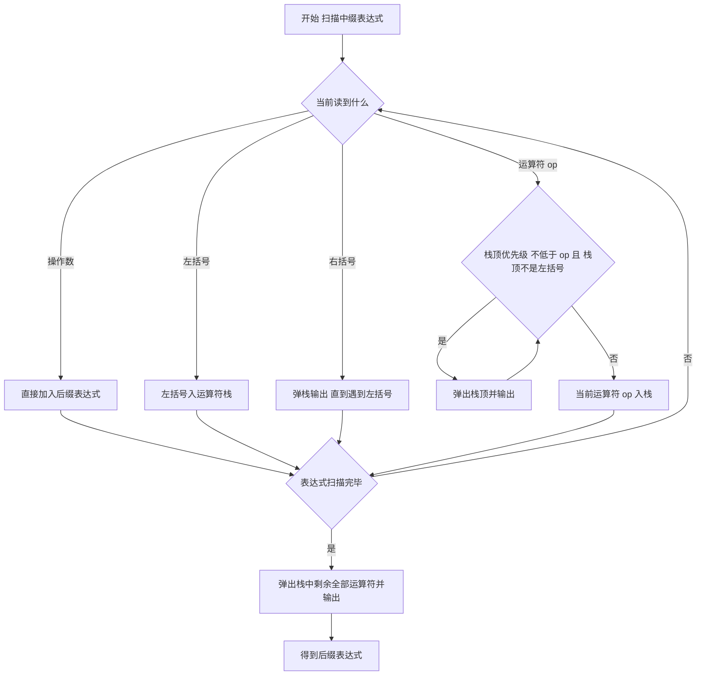

# 核心讲解

栈是只允许在同一端（栈顶 `top`）进行插入和删除的线性表，队列是只允许在队尾 `rear` 插入、队头 `front` 删除的线性表，二者都是操作受限的线性表。顺序栈用 `top` 指向栈顶元素（或栈顶元素的下一个位置，两种约定不可混用），判空为 `top == -1`（或 `top == 0`），栈满为 `top == MaxSize - 1`，入栈 `++top; data[top] = x`。共享栈让两个栈共用一个数组、栈底分别设在两端、栈顶向中间生长，仅当两栈顶指针相邻（`top0 + 1 == top1`）时才上溢，空间利用率更高。

循环队列把顺序队列在逻辑上首尾相接，用 `front == rear` 判空时必须另设计数 `size`、标志 `tag` 或牺牲一个单元来区分队满，否则队空与队满无法区分。栈的典型应用有括号匹配、表达式求值（中缀转后缀再求值）、递归调用与函数调用栈；中缀转后缀时，运算符栈规则是遇操作数直接输出，遇运算符先弹出栈中优先级不低于它的运算符再入栈，遇 `(` 入栈、遇 `)` 弹出至 `(`，扫描完把栈中剩余运算符全部弹出。

# 关键结论速记

- `n` 个不同元素依次入栈，合法出栈序列数为卡特兰数 `C(2n,n)/(n+1)` —— 出栈序列合法性判定用它计数，如 `n = 3` 时为 5 个，`n = 4` 时为 14 个。
- 循环队列判满三方案 —— 牺牲一个单元：队满 `(rear + 1) % MaxSize == front`；增设 `size`：队满 `size == MaxSize`、队空 `size == 0`；增设 `tag`：`front == rear` 时 `tag == 1` 为满、`tag == 0` 为空。
- 元素个数公式（`front` 指向队头元素）—— `count = (rear - front + MaxSize) % MaxSize`，出队后 `front` 后移，`rear` 始终指向下一个可插入位置。
- 中缀转后缀的运算符栈规则 —— 栈内运算符优先级高于或等于当前运算符就先弹出，`(` 在栈内优先级最低、在栈外最高，保证括号配对与左结合性。
- 后缀表达式求值 —— 遇操作数入栈，遇运算符连出两次栈，先出的是右操作数、后出的是左操作数，算完 `左 op 右` 再入栈，最终栈中唯一元素即答案。
- 共享栈判满 —— 两栈顶指针相邻即 `top0 + 1 == top1` 时整个数组才上溢，单个栈使用不会溢出。

# 示意图

循环队列在 `MaxSize = 7`（下标 0 至 6）时的三种状态，空槽留白、`x` 表示已存元素、`f` 与 `r` 分别指向 `front` 与 `rear` 所在下标：

```text
state 1  empty : front == rear
 idx   0   1   2   3   4   5   6
     +---+---+---+---+---+---+---+
     |   |   |   |   |   |   |   |
     +---+---+---+---+---+---+---+
       ^
       |
       f
       r

state 2  count == 3
 idx   0   1   2   3   4   5   6
     +---+---+---+---+---+---+---+
     | x | x | x |   |   |   |   |
     +---+---+---+---+---+---+---+
       ^           ^
       |           |
       f           r

state 3  full : (rear + 1) % 7 == front
 idx   0   1   2   3   4   5   6
     +---+---+---+---+---+---+---+
     | x | x | x | x | x | x |   |
     +---+---+---+---+---+---+---+
       ^                       ^
       |                       |
       f                       r
```



# 易错点

- 错在把 `front == rear` 直接当成队满。循环队列中它同时满足队空与队满条件，必须靠牺牲一个单元、`size` 计数或 `tag` 标志之一区分，选定的约定要与判空判满公式配套使用。
- 错在后缀表达式求值时把两个操作数的出栈顺序弄反。栈顶先弹出的是右操作数、后弹出的是左操作数，应计算 `左 op 右`；减法和除法一旦颠倒必然得到错误结果。
- 错在混用 `front` 的两种约定。`front` 指向队头元素时元素个数为 `(rear - front + MaxSize) % MaxSize`，指向队头元素的前一个位置时改为 `(rear - front + 1 + MaxSize) % MaxSize`，两套公式与判满条件不能互换。
- 错在只凭卡特兰数判定出栈序列合法。合法序列总数由 `C(2n,n)/(n+1)` 给出，但判定某个具体序列仍须模拟栈过程：出栈元素之后出现的、比它先入栈的小元素只能按逆序排列。

# 真题示例

**2022 年真题改编（选择题，2 分）**

已知初始为空的栈，元素 `1, 2, 3, 4` 依次入栈，入栈过程中允许出栈，则下列出栈序列中不可能的是（　）。

A. `1, 2, 3, 4`　B. `4, 3, 2, 1`　C. `3, 1, 2, 4`　D. `2, 3, 4, 1`

> 解析：元素按 `1, 2, 3, 4` 次序入栈，逐项模拟。A 为边入边出：入 `1` 出 `1`，入 `2` 出 `2`，入 `3` 出 `3`，入 `4` 出 `4`，可行。B 为全部入栈后连续出栈，可行。D 先入 `1, 2` 出 `2`，再入 `3` 出 `3`，入 `4` 出 `4`，最后出 `1`，可行。C 中要先出 `3` 须先入 `1, 2, 3`，出 `3` 后栈内自底向顶为 `1, 2`，栈顶是 `2`，只能先出 `2` 后出 `1`，不可能得到 `1, 2`。故答案为 C。

**2021 年真题改编（选择题，2 分）**

设循环队列的存储空间为 `Q[0..MaxSize-1]`，采用牺牲一个单元的方式区分队空与队满，且 `front` 指向队头元素、`rear` 指向队尾元素的下一个位置。若 `MaxSize = 50`，经一系列入队出队后 `front = 15`、`rear = 40`，则当前队列中元素个数为（　）。

A. 24　B. 25　C. 26　D. 49

> 解析：第一步确认约定，`front` 指向队头元素，故元素个数公式为 `count = (rear - front + MaxSize) % MaxSize`。第二步代入数值，`count = (40 - 15 + 50) % 50 = 75 % 50 = 25`。第三步校验，牺牲一个单元时最多存 `MaxSize - 1 = 49` 个元素，队满条件 `(rear + 1) % 50 == front` 即 `41 == 15` 不成立，与 `25 < 49` 一致，结果合法。故答案为 B。
