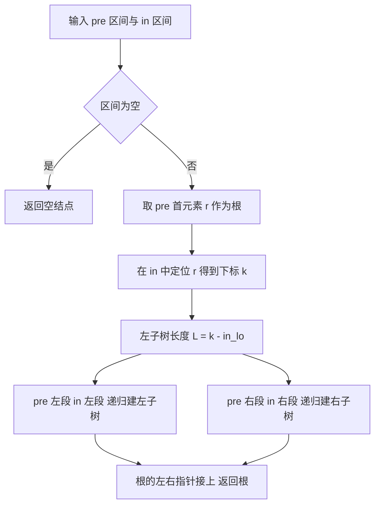

# 核心讲解

二叉树是每个结点至多两棵子树、且子树有左右之分的树；**二叉树不是度为 2 的有序树**，它允许结点只有右孩子而没有左孩子，这种形态在有序树中不存在。核心性质：非空二叉树第 `i` 层至多有 `2^(i-1)` 个结点；高度为 `h` 的二叉树至多有 `2^h - 1` 个结点；对任何非空二叉树有 `n0 = n2 + 1`（叶子数 = 度为 2 的结点数 + 1），该式由"结点总数 = `n0 + n1 + n2`"与"边数 = `n - 1 = n1 + 2*n2`"联立得到。

**完全二叉树**是只有最下层可以不满、且结点集中在左侧的二叉树，它最适合顺序存储：编号为 `i` 的结点，左孩子是 `2i`、右孩子是 `2i+1`、双亲是 `floor(i/2)`（`i > 1`）。含 `n` 个结点的完全二叉树高度为 `h = floor(log2 n) + 1`，也等于 `ceil(log2(n+1))`，两式恒等。四种遍历中，**中序**最关键：中序遍历的访问次序是"左子树—根—右子树"，所以**已知中序 + 前序（或后序、或层序）可以唯一确定二叉树，而前序 + 后序不能唯一确定**。

中序线索二叉树中，结点的前驱是"左子树最右下结点"（无左孩子时指向其前驱），后继是"右子树最左下结点"，这正是把递归遍历改成非递归、并实现 `O(1)` 空间找前驱后继的依据。树转二叉树的口诀是"左孩子右兄弟"：每个结点左指针指向第一个孩子，右指针指向下一个兄弟，于是树的先根遍历对应二叉树的先序遍历，树的后根遍历对应二叉树的中序遍历。哈夫曼树是带权路径长度 `WPL = sum(w_i * l_i)` 最小的二叉树，构造法是反复取两个最小权值合并，其**不存在度为 1 的结点**，故 `n` 个叶子的哈夫曼树共有 `2n - 1` 个结点。

# 关键结论速记

- `n0 = n2 + 1` —— 用于"已知叶子数求度为 2 的结点数"，也用于判断某序列能否构成二叉树。
- `完全二叉树高度 = floor(log2 n) + 1 = ceil(log2(n+1))` —— 两式等价，用来由结点数直接推高度。
- `顺序存储下标关系：左 2i、右 2i+1、双亲 floor(i/2)` —— 仅对完全二叉树（或把一般二叉树按完全二叉树补空）成立。
- `前序 + 中序 / 后序 + 中序 / 层序 + 中序 可唯一确定，前序 + 后序 不可` —— 中序提供左右子树的划分依据。
- `哈夫曼树无度为 1 的结点` —— `n` 个叶子必有 `n-1` 个度为 2 的结点，总结点数 `2n-1`；编码不唯一，但 `WPL` 唯一。
- `树转二叉树：左孩子右兄弟` —— 树的先根/后根遍历分别对应二叉树的先序/中序遍历。

# 示意图

**二叉树与完全二叉树的顺序存储**：把结点按层、从左到右编号 1 开始，完全二叉树的编号连续无空洞，一般二叉树需补空占位。

```text
binary tree                        level-order numbering (1-based)
            A  --------- depth 1      index:  1   2   3   4   5   6   7
          /   \                            +---+---+---+---+---+---+---+
         B     C  ------ depth 2     data: | A | B | C | D | E | F | G |
        / \   / \                          +---+---+---+---+---+---+---+
       D   E F   G  ---- depth 3     parent(i) = floor(i/2)
                                     left(i)   = 2i
  n = 7  n0 = 4  n1 = 0  n2 = 3      right(i)  = 2i + 1
  check: n0 = n2 + 1  ->  4 = 3 + 1

four traversal orders of the same tree
  preorder   A B D E C F G      root first
  inorder    D B E A F C G      left root right
  postorder  D E B F G C A      root last
  level      A B C D E F G      queue based

inorder threaded binary tree (dashed = thread, points to predecessor/successor)

        D <··· B ···> E <··· A ···> F <··· C ···> G
              /   \             /   \
             D     E           F     G
  first node of inorder = D (leftmost), last = G (rightmost)
  node with no left child stores its predecessor in lchild
  node with no right child stores its successor in rchild
```

**由前序 + 中序唯一还原二叉树**的递归流程：前序首元素定根，中序中该元素的位置划分左右子树，两序列的左右段长度一一对应。



# 易错点

- 把"二叉树"当成"度为 2 的有序树"：度为 2 的有序树要求每个结点要么没有孩子要么有两个孩子，而二叉树的结点可以有 1 个孩子且区分左右；`n0 = n2 + 1` 只对二叉树成立。
- 由遍历序列还原时用错组合：只有含**中序**的组合才能唯一确定；前序 + 后序无法区分"只有左孩子"与"只有右孩子"的结点，必须结合中序或层序。
- 完全二叉树高度公式记错：`h = floor(log2 n) + 1`；若误写成 `ceil(log2 n)`，在 `n = 8` 时会得到 3（正确是 4）。
- 混淆树与对应二叉树的遍历对应关系：树的**先根**遍历对应二叉树**先序**，树的后根遍历对应二叉树**中序**；把"后根对应后序"记成对应关系是最常见的失分点。

# 真题示例

**2014 年 408 第 41 题（综合应用题，13 分）**

二叉树的带权路径长度（WPL）是二叉树中所有叶结点的带权路径长度之和。给定一棵二叉树 `T`，采用二叉链表存储，结点结构为 `[left | weight | right]`，请设计求 `T` 的 WPL 的算法。要求：给出算法的基本设计思想；使用 C 或 C++ 给出二叉树结点的数据类型定义；根据设计思想，采用 C 或 C++ 描述算法，关键之处给出注释。

> 解析：设计思想是**递归传递深度**——叶结点的带权路径长度是"权值 × 从根到该叶结点的边数（深度）"，因此递归时携带当前深度 `deep`，遇到叶子就累加 `weight * deep`，否则分别递归左右子树并把 `deep` 加 1。结点类型定义为 `typedef struct BiTNode { int weight; struct BiTNode *left, *right; } BiTNode, *BiTree;`。算法用引用型累加变量 `wpl`：若 `T` 为空返回；若 `T->left == NULL && T->right == NULL` 则 `wpl += T->weight * deep`；否则递归 `T->left` 与 `T->right`，深度参数传入 `deep + 1`。时间复杂度 `O(n)`（每个结点访问一次），空间复杂度 `O(h)`（递归栈深度为树高 `h`）。**判分要点是"深度由参数携带"而不是在结点里存层次，以及只对叶结点累加。**
