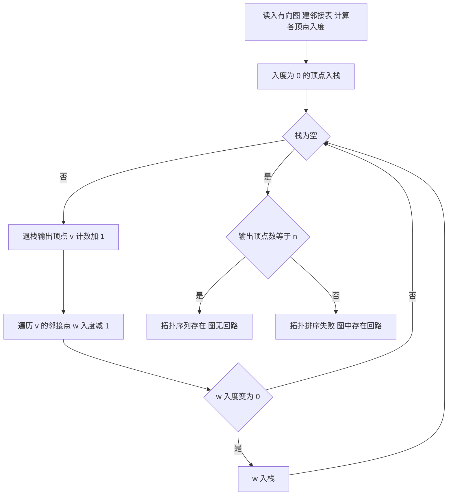

# 核心讲解

图 `G = (V, E)` 由顶点集 `V` 与边集 `E` 组成，无向图边数满足 `0 <= e <= n(n-1)/2`（完全图），有向图满足 `0 <= e <= n(n-1)`；含 `n` 个顶点的连通图至少 `n-1` 条边，生成树恰有 `n-1` 条边。存储上，邻接矩阵用 `n x n` 数组存边，空间 `O(n^2)`，判断任意两点是否相邻为 `O(1)`，适合稠密图；

邻接表存 `n` 个顶点表结点与 `2e`（无向）或 `e`（有向）个边表结点，空间 `O(n+e)`，找某顶点全部邻接点为 `O(deg)`，适合稀疏图，但求有向图入度需遍历全表（可加逆邻接表）。十字链表用于有向图，每个弧结点含 `tailvex/headvex/hlink/tlink`，同时支持出边与入边链，空间 `O(n+e)`；邻接多重表用于无向图，每个边结点含 `ivex/jvex/ilink/jlink`，一条边只存一个结点，便于删除边。

BFS 借助队列按层扩展，时间复杂度为邻接表 `O(n+e)`、邻接矩阵 `O(n^2)`，在无权图中按层序首次到达的层数即为单源最短路径长度，BFS 生成树（或森林）的树高最小。DFS 借助栈（递归）深入回溯，复杂度同上，可求连通分量、判定回路、生成 DFS 生成树；对有向无环图做 DFS，按顶点「退栈即输出」得到逆拓扑序，即顶点完成时间的降序就是拓扑序列。

最小生成树用 Prim（从顶点出发，每次选连接树内外的最小边，`O(n^2)`，适合稠密图）或 Kruskal（按边权递增选边，用并查集判环，`O(e log e)`，适合稀疏图）。单源最短路径用 Dijkstra（`O(n^2)`，仅适用非负权边）或 BFS（无权图）；每对顶点最短路径用 Floyd，`O(n^3)`，本质是动态规划 `A^k[i][j] = min(A^{k-1}[i][j], A^{k-1}[i][k] + A^{k-1}[k][j])`。AOE 网的关键路径是 `ve` 与 `vl` 相等（活动 `e = l`）的顶点、`e` 与 `l` 相等的活动（松弛时间为 `0`）构成的源点到汇点的最长路径。

# 关键结论速记

- `O(n^2)` 与 `O(n+e)` —— 邻接矩阵空间固定为 `n^2`（适合稠密图），邻接表空间与边数线性相关（适合稀疏图），遍历复杂度分别为 `O(n^2)` 与 `O(n+e)`。
- `BFS 求无权图单源最短路径` —— 从源点出发按层扩展，顶点首次出队时其层数就是最短路径长度 `d[]`，每个顶点只入队一次，故复杂度 `O(n+e)`。
- `DFS 完成时间降序 = 逆拓扑序` —— 有向图无环时 DFS 退栈序反向即拓扑序列；若 DFS 中出现指向栈中顶点的回边，则图中存在回路，拓扑排序不存在。
- `Prim O(n^2) 适稠密 / Kruskal O(e log e) 适稀疏` —— Prim 每轮找最小跨边可只维护 `lowcost[]` 达 `O(n^2)`；Kruskal 靠排序加并查集，边少时占优。
- `Dijkstra 不能处理负权边` —— 其贪心前提是「已确定顶点的 `dist` 不会因后续松弛变小」，负权会破坏该前提；含负权边应用 Floyd 或 Bellman-Ford 类算法。
- `Floyd 循环顺序 k 必须在最外层` —— 依次以 `v_k` 为中间点更新 `A[i][j] = min(A[i][j], A[i][k] + A[k][j])`，最外层放 `i` 或 `j` 会使中间点被提前使用而结果错误。

# 示意图

同一无向图（顶点 0 到 3，边 `0-1`、`0-2`、`1-3`、`2-3`）的邻接矩阵与邻接表如下，两种存储看到的是同一张图，区别只在空间与查询代价。

```text
adjacency matrix (n=4, row/col index 0..3)

      +---------------------------+
      |      0   1   2   3        |
      +---------------------------+
  v0  |      0   1   1   0        |
  v1  |      1   0   0   1        |
  v2  |      1   0   0   1        |
  v3  |      0   1   1   0        |
      +---------------------------+
  space = n*n = 16 slots

adjacency list (vertex node -> edge nodes)

  [0] --+--> [1|*] --> [2|^]
  [1] --+--> [0|*] --> [3|^]
  [2] --+--> [0|*] --> [3|^]
  [3] --+--> [1|*] --> [2|^]
  space = n + 2*e = 4 + 8 = 12 nodes
```



# 易错点

- 认为 Dijkstra 可用于含负权边的图。错在贪心前提被破坏：负权边可能让已出堆顶点的 `dist` 再变小，而该顶点已不再被更新；含负权时应改用 Floyd 或逐次松弛类算法。
- 认为 BFS/DFS 遍历序列唯一。错在邻接表存储时边表次序由建表顺序决定，从同一源点出发可能得到不同序列；只有邻接矩阵且下标升序扫描时序列才唯一，而邻接矩阵扫描次序固定，序列唯一。
- 把「拓扑序列唯一」与「图中无环」混谈。错在二者不等价：无环只保证拓扑序列存在，序列往往有多个；序列唯一要求每一时刻入度为 `0` 的顶点恰有一个，即图存在一条贯穿全部顶点的有向哈密顿路径。
- 认为 Kruskal 必须判环或 Prim 必须排序全部边。错在判环职责不同：Kruskal 用并查集判断两端点是否已同集合，Prim 则维护 `lowcost[]` 每轮只取最小跨边，二者都选 `n-1` 条边，但权值相等的边可能导致生成树不唯一。

# 真题示例

**2016 年 408 第 8 题（单项选择题，2 分）**

使用 Dijkstra 算法求下图中从顶点 1 到其余各顶点的最短路径，将当前找到的从顶点 1 到各顶点的最短路径长度填入表中。若图中存在权值为负的边，则下列叙述中正确的是（ ）。

A. Dijkstra 算法仍能得到正确的最短路径
B. Dijkstra 算法可能得不到正确的最短路径，但能判断出负权回路
C. Dijkstra 算法得不到正确的最短路径，且不能判断出负权回路
D. 只要负权边不与源点直接相连，Dijkstra 算法就正确

> 解析：第一步，明确 Dijkstra 的贪心不变式——每次从 `S` 外取 `dist` 最小的顶点 `u` 并入 `S`，并断言 `dist[u]` 已是最终最短路径长度。第二步，该断言依赖所有边权非负：若存在负权边，后加入的顶点可能通过负权边使 `u` 的路径变短，而 `u` 已出 `S` 不再更新，故结果可能错误。第三步，Dijkstra 全程不做「回路检测」判断，即使存在负权回路也无法报告。因此 B、D 错，A 错。答案为 **C**。
