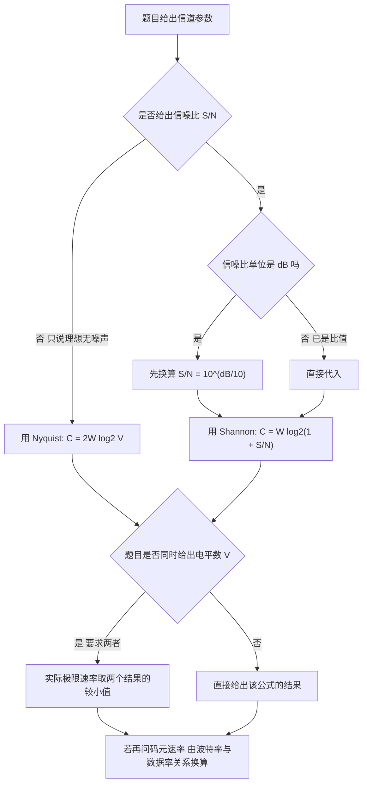

# 核心讲解

物理层的任务是**在传输介质上透明地传送比特流**，它定义机械、电气、功能、规程四个方面的特性。**`Nyquist`（奈奎斯特）准则**给出理想无噪声低通信道的极限速率：`C = 2 W log2 V`（`W` 为带宽 `Hz`、`V` 为码元的离散电平数），它与信噪比无关，只与带宽和电平数有关；**`Shannon` 定理**给出有噪声信道的极限速率：`C = W log2(1 + S/N)`，其中信噪比常用分贝表示，换算关系为 `SNR(dB) = 10 log10(S/N)`，因此 `30 dB` 对应 `S/N = 1000`。

两者常联合使用：先用 `Shannon` 算出信道容量上限，再用 `Nyquist` 反推"在此速率下每个码元最多需要几个电平"。**编码与调制**要区分：数字数据转数字信号用编码（`NRZ` 不归零、`NRZI`、**曼彻斯特编码**、**差分曼彻斯特编码**、`4B/5B`），数字数据转模拟信号用调制（`ASK`、`FSK`、`PSK`、`QAM`）。**曼彻斯特编码**在每个码元中间都有一次电平跳变，既传送数据又携带时钟，因此**具有自同步能力**，但**编码效率只有 50%**（波特率是数据率的 2 倍）；

差分曼彻斯特用"码元开始处有无跳变"表示 `0/1`，抗干扰能力更强。`4B/5B` 编码把 4 位数据映射为 5 位码字，保证足够的跳变以利于提取时钟，效率为 `80%`。**传输介质**中，双绞线（`UTP/STP`）便宜、易受干扰、距离短；同轴电缆抗干扰较好；**光纤**带宽极大、抗电磁干扰、衰减小、保密性好，分单模（纤芯细、传输距离远、用激光器）与多模（纤芯粗、距离近、用 `LED`）。**物理层设备**中，**中继器**对信号整形放大以延长传输距离，**集线器**是多端口中继器，二者都工作在物理层，**不隔离冲突域**。

# 关键结论速记

- `Nyquist：C = 2 W log2 V`（无噪声、理想低通信道） —— 与信噪比无关，`V` 是码元可取的电平数。
- `Shannon：C = W log2(1 + S/N)`（有噪声信道） —— 与电平数无关，只与带宽和信噪比有关。
- `SNR(dB) = 10 log10(S/N)` —— `30 dB` 对应 `S/N = 1000`，代入 `Shannon` 前必须先换算成比值。
- `曼彻斯特编码：每位中间跳变、自同步、编码效率 50%` —— 波特率 = 2 × 数据率。
- `差分曼彻斯特：用码元开始处是否跳变表示 0/1` —— 抗干扰能力比曼彻斯特更强。
- `4B/5B 编码效率 80%` —— 用 5 位码字承载 4 位数据以保证时钟同步。
- `集线器与中继器在物理层，不隔离冲突域` —— 共享带宽，同一时刻只能有一个站点发送。

# 示意图

**三种常用编码的波形对比**：数据序列 `1 0 1 1 0 0 1 0`（单极性表示，高电平为 `1`）。

```text
data bits:        1     0     1     1     0     0     1     0

(1) NRZ (non-return to zero): level holds for the whole bit

        ___         ___   ___
   high    |         |     |         ___
           |         |     |        |
   low  ___|         |_____|        |_____
        b0   b1   b2   b3   b4   b5   b6   b7
   problem: long runs of same level lose clock synchronisation

(2) Manchester: transition in the MIDDLE of every bit
    convention: high->low means 1, low->high means 0

        __    __          __    __
   high   |  |  |        |  |  |  |
          |  |  |        |  |  |  |
   low ___|  |__|        |__|  |__|
        b0   b1   b2   b3   b4   b5
        mid  mid  mid  mid  mid  mid   <- every bit has a mid transition
    self-clocking, but baud rate = 2 x data rate (efficiency 50%)

(3) Differential Manchester: transition at the START of a bit means 0,
    no transition at the start means 1 (mid transition always present)

   bit value   0        1        1        0
   start       jump     no jump  no jump  jump
   mid         always   always   always   always
    more robust to noise and polarity reversal than plain Manchester
```

**由带宽与信噪比确定极限速率的选择流程**：题目给"理想无噪声"用 `Nyquist`，给"信噪比"用 `Shannon`，两者都给则取较小值。



# 易错点

- 混用 `Nyquist` 与 `Shannon`：`Nyquist` 用于**理想无噪声**信道且必须知道电平数 `V`，`Shannon` 用于**有噪声**信道且只需带宽与信噪比；题目给出信噪比时若仍用 `Nyquist` 就会算错。
- 把分贝值直接代入 `Shannon` 公式：`Shannon` 中的 `S/N` 是**比值**，题目给出 `dB` 时必须先按 `S/N = 10^(dB/10)` 换算（如 `20 dB` 对应 `100`、`30 dB` 对应 `1000`），直接代入会把信道容量算得极小。
- 认为曼彻斯特编码效率是 `100%`：曼彻斯特编码每个比特中间都有跳变，**波特率是数据率的 2 倍**，编码效率只有 `50%`；`4B/5B` 的效率是 `80%`，两者不要混淆。
- 认为集线器可以隔离冲突域：集线器工作在物理层，所有端口共享同一冲突域与带宽，同一时刻只能有一个站点发送；能隔离冲突域的是工作在数据链路层的交换机与网桥。

# 真题示例

**2016 年 408 第 34 题（单项选择题，2 分）**

若某通信链路带宽为 `3000 Hz`，采用 `4` 种相位、每种相位有 `2` 种振幅的 `QAM` 调制，且信道无噪声，则该链路的极限数据传输速率约为（ ）。

A. `6000 b/s`　B. `12000 b/s`　C. `18000 b/s`　D. `24000 b/s`

> 解析：无噪声信道用 `Nyquist` 准则 `C = 2 W log2 V`。先求码元状态数 `V`：`4` 种相位 × 每种 `2` 种振幅 `= 8` 种不同的码元状态，故 `V = 8`、`log2 8 = 3` 位/码元。代入得 `C = 2 × 3000 × 3 = 18000 b/s`，答案为 **C**。若只按相位计算（漏乘振幅，取 `V = 4`）会得到 `12000 b/s`（干扰项 B）；若误把 `2W` 写成 `W` 又会得到 `9000 b/s`。**判分点是 `V` 必须把相位与振幅的组合数都算进去，以及 `Nyquist` 公式中的系数 `2` 不能丢。**
