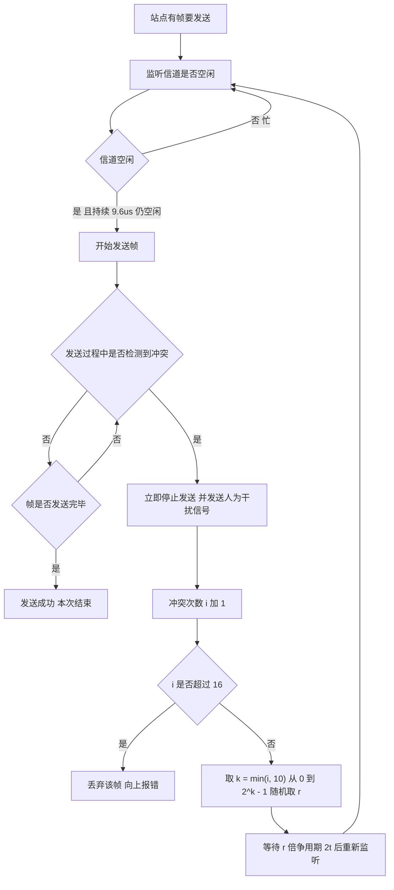

# 核心讲解

数据链路层的三个基本功能是**封装成帧（组帧）、差错控制、流量控制**；**组帧**常用**字符计数法**（计数字段出错即全盘失步）、**字符填充法**（用 `SOH`/`EOT` 定界，数据中出现的定界符前插转义字符 `ESC`，接收方再删除）、**零比特填充法**（`HDLC` 使用：标志字段为 `01111110`，数据中每出现 **5 个连续 `1` 就填入一个 `0`**，接收方每见 5 个连续 `1` 就删除其后的 `0`）与**违规编码法**（如曼彻斯特编码中的非法电平组合），后两者是"透明传输"的标准做法。

**差错控制**中，**奇偶校验**只能检出奇数个错误；**循环冗余校验 `CRC`** 用生成多项式做**模 2 除法**，把余数作为 `FCS`，能检出全部单比特错、全部奇数个错以及长度不超过生成多项式阶数的突发错；**海明码**由 `2^r >= k + r + 1`（`k` 为数据位数）确定校验位数 `r`，校验位放在第 1、2、4、8… 位，可**纠正一位错**（配合总校验位还可"纠一位、检两位"）。

**流量控制与可靠传输**的三种协议必须分清：**停止-等待**发送窗口为 `1`、每发一帧等一个确认，信道利用率 `= T_d / (T_d + RTT + T_a)`（`T_d` 为发送时延、`T_a` 为确认发送时延）；**后退 `N` 帧 `GBN`** 用累计确认、接收窗口恒为 `1`、发送窗口上限 `2^n - 1`；**选择重传 `SR`** 逐帧确认并缓存乱序帧、只重传出错帧，收发窗口上限均为 `2^(n-1)`，即窗口之和不超过 `2^n`。

**介质访问控制**分**信道划分**、**随机访问**与**轮询访问**三类：**频分 `FDM`** 把频带划成互不重叠的子频段，各站同时占用不同频段；**时分 `TDM`** 把时间划分成等长的 TDM 帧、帧内再分成时隙，每站固定占用一个时隙轮流发送，需严格的时间同步、本站无数据时时隙也被浪费；**波分 `WDM`** 在光纤中按波长划分，本质是光的频分；**码分 `CDM`** 给每站分配互不相同的**正交码片序列**，发 `1` 发码片本身、发 `0` 发其反码，各站同时同频发送，接收方用该站码片做规格化内积即可恢复数据。

**`CSMA/CD`** 的工作是"**先听后发、边听边发、冲突停发、随机重发**"：站点发送前先监听，发送中继续监听，检测到冲突立即停止并发送**人为干扰信号**，再按**截断二进制指数退避**等待重发（第 `i` 次冲突后从 `{0, 1, ..., 2^k - 1}` 中随机取 `r`，`k = min(i, 10)`，等待 `r` 倍争用期）。**最小帧长**的依据是"发送时延必须不小于往返传播时延（争用期 `2τ`）"，否则发送方在冲突信号返回前已发完帧而无法检测冲突：`最小帧长 = 2τ × 数据率`，以太网取 `2τ = 51.2 μs`、数据率 `10 Mb/s`，故最小帧长 `512 bit = 64 B`。

**IEEE 802.11 无线局域网**用 **`CSMA/CA`** 而不是 `CSMA/CD`：无线站点**不能边发边听**（发射时自身信号比收到的微弱信号强几个数量级、收发共用天线时无法同时接收，且存在隐藏站使冲突检测不可靠），只能"先听后发 + 随机退避 + 发送后等 `ACK`"地**避免冲突**，收到 `ACK` 才算成功、超时重传；可选的 **`RTS`/`CTS`** 由发送方先发 `RTS`、接收方回 `CTS`，其余听到的站点按其中通告的持续时间推迟发送（设置 `NAV`），以此缓解隐藏站问题，并用短控制帧的冲突代替长数据帧的冲突以降低代价。

**以太网帧**为"目的地址（6 `B`）+ 源地址（6 `B`）+ 类型（2 `B`）+ 数据（46—1500 `B`）+ `FCS`（4 `B`）"，故最小帧 `64 B`、最大帧 `1518 B`；**交换机**靠**自学习**建立"`MAC` 地址 → 端口"的转发表，能隔离冲突域但不隔离广播域；

广域网常用的 **`PPP`** 由三部分组成：**把 `IP` 数据报封装到串行链路的方法**、链路控制协议 **`LCP`**（建立、配置和测试数据链路）与网络控制协议 **`NCP`**（每个网络层协议一个，如 `IPCP` 协商 `IP` 地址），其帧格式为标志 `7E` + 地址 `FF` + 控制 `03` + **协议（2 `B`，如 `0x0021` 表示承载 `IP`）** + 信息（不超过 1500 `B`）+ `FCS`（2 `B`）+ 标志 `7E`，异步链路用字节填充、同步链路用零比特填充来保证透明；PPP 与以太网帧的关键差异是**没有源/目的 `MAC` 地址**（点对点链路只有两端）、用协议字段而非类型字段标识上层、`FCS` 只有 `2 B`，并且只检错不重传、不要求最小帧长。

# 关键结论速记

- `零比特填充：发送方每出现 5 个连续 1 就插入一个 0，接收方每 5 个连续 1 删去其后的 0` —— 保证数据对标志字段 `01111110` 透明。
- `海明码 2^r >= k + r + 1 可纠一位；CRC 用模 2 除法求余数作 FCS` —— 校验位在第 1、2、4、8… 位，CRC 余数取生成多项式最高次 `r` 位且模 2 运算无进位。
- `GBN 发送窗口 <= 2^n - 1、接收窗口 = 1`；`SR 收发窗口均 <= 2^(n-1)` —— 序号位数 `n` 决定窗口上限。
- `CSMA/CD：先听后发、边听边发、冲突停发、随机重发`；`最小帧长 = 争用期 × 数据率` —— 以太网最小帧为 `64 B`。
- `以太网最小帧 64 B、最大帧 1518 B、数据字段 46—1500 B` —— 小于 46 `B` 需填充，交换机隔离冲突域但不隔离广播域。
- `信道划分：FDM 分频段、TDM 分时隙、WDM 分波长、CDM 分正交码片` —— 固定分配、各站无冲突，代价是低负载时浪费信道。
- `802.11 用 CSMA/CA：无线不能边发边听，靠 ACK 确认成功、RTS/CTS 预约信道并缓解隐藏站` —— 与 `CSMA/CD` 相反，不检测冲突。
- `PPP = 封装方法 + LCP（建链）+ NCP（网络层参数）`；帧无 `MAC` 地址、有 2 `B` 协议字段与 2 `B` FCS —— 面向字节、只检错不重传，区别于以太网帧。

# 示意图

**最小帧长的推导与以太网争用期**：发送方必须在冲突信号返回之前仍在发送，否则无法检测到冲突。

```text
why a minimum frame size is needed (CSMA/CD)

  A                                    B
  |------ propagation delay t ------>  |     t = distance / v
  |                                    |
  |  A starts sending at time 0        |
  |                                    |  B starts sending at t - e
  |<---- collision happens near B ---->|
  |                                    |
  |  the collision signal needs t to come back to A
  |<------------- round trip = 2t ---->|

  requirement: A's transmission time >= 2t  (the contention period)
      T_send = frame_length / data_rate >= 2 * t
      => minimum frame length = 2 * t * data_rate

  classic Ethernet numbers
      data rate = 10 Mb/s, 2t = 51.2 us
      min frame = 51.2 us * 10 Mb/s = 512 bit = 64 byte
      max frame = 1518 byte (with 1500 byte data field)

ethernet frame format (DIX Ethernet V2)

  +---------+---------+-------+------------------+-------+
  | dest MA | src MAC |  type |  data (46-1500)  |  FCS  |
  +---------+---------+-------+------------------+-------+
     6 B       6 B      2 B         46 - 1500 B     4 B
  min frame = 6+6+2+46+4 = 64 B      max = 6+6+2+1500+4 = 1518 B
  a data field shorter than 46 B must be padded
```

**`CSMA/CD` 的发送与冲突退避流程**：检测到冲突后必须立即停止并发送干扰信号，再用截断二进制指数退避决定重发时刻。



# 易错点

- `GBN` 与 `SR` 的窗口上限记反：`GBN` 的发送窗口上限是 `2^n - 1`（接收窗口恒为 `1`），`SR` 的发送与接收窗口上限都是 `2^(n-1)`；同理海明码公式是 `2^r >= k + r + 1`，右边要**加上校验位 `r` 本身**，漏掉会把校验位数算小。
- 最小帧长漏乘 `2`：`最小帧长 = 2τ × 数据率`，其中 `2τ` 是**往返**传播时延（争用期）；只乘单程传播时延会把最小帧长算小一半，进而误判"该帧能否被检测到冲突"。
- 把无线局域网的 `CSMA/CA` 当成 `CSMA/CD`：无线站点发射时无法同时接收，也检测不到隐藏站造成的冲突，故 802.11 用随机退避 + `ACK` 确认实现**冲突避免**，`RTS`/`CTS` 只是可选的抑制隐藏站手段；说"无线靠冲突检测退避"即错。
- 混淆交换机与路由器的隔离能力：交换机工作在数据链路层，能隔离**冲突域**但**不隔离广播域**（广播帧会被转发到所有端口）；隔离广播域必须用路由器或划分 `VLAN`。

# 真题示例

**2016 年 408 第 36 题（单项选择题，2 分）**

若某以太网的传播时延为 `25.6 μs`，数据传输速率为 `10 Mb/s`，则其最小帧长应为（ ）。

A. `64 B`　B. `128 B`　C. `256 B`　D. `512 B`

> 解析：直接套用"最小帧长 = 争用期 × 数据率"。争用期是**往返**传播时延 `2τ = 2 × 25.6 μs = 51.2 μs`，故最小帧长 `= 51.2 μs × 10 Mb/s = 512 bit = 64 B`，答案为 **A**。若忘记乘 2（只取 `25.6 μs`）会得到 `256 bit = 32 B` 而不在选项中，从而暴露出错误来源。**判分点是争用期必须是往返传播时延，以及比特与字节的换算（`512 bit = 64 B`）。**
