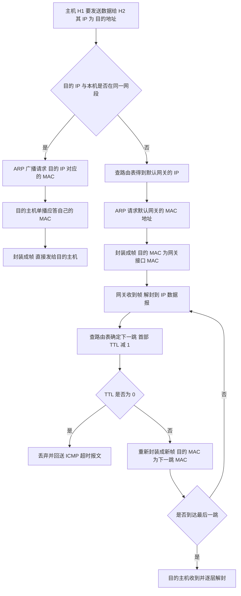

# 核心讲解

网络层的核心是**逻辑寻址与路由转发**。`IPv4` 地址长 `32` 位，传统分类地址为 `A` 类（`0` 开头，网络号 `8` 位，可用网络数 `2^7 - 2`）、`B` 类（`10` 开头，网络号 `16` 位）、`C` 类（`110` 开头，网络号 `24` 位）、`D` 类（组播）与 `E` 类（保留）；每类中**主机号全 `0` 表示网络地址、全 `1` 表示广播地址**，故 `C` 类网络可用主机数为 `2^8 - 2 = 254`。**子网划分**用子网掩码从主机号中借位，可用主机数 `= 2^h - 2`（`h` 为主机号位数）；**`CIDR`（无分类编址）**用"`IP/前缀长度`"表示，支持**路由聚合**（把若干连续网络合并为一条路由）与**最长前缀匹配**（转发时选前缀最长即最具体的路由）。

**`IP` 数据报首部**固定部分 `20 B`，关键字段有：版本、首部长度（以 `4 B` 为单位）、总长度（以 `1 B` 为单位）、标识、标志（`DF` 不允许分片、`MF` 后面还有分片）、**片偏移（以 `8 B` 为单位）**、生存时间 `TTL`（每经过一个路由器减 `1`，为 `0` 则丢弃）、协议、首部校验和（只校验首部）。**分片计算**的三条规则：每片的数据部分长度必须是 `8 B` 的整数倍、每片都带自己的 `IP` 首部、片偏移等于"该片数据在原始数据报数据部分中的位置 ÷ 8"。

**地址解析 `ARP`** 在**同一网段内**用广播请求、单播应答把 `IP` 地址解析为 `MAC` 地址；若目的主机不在同一网段，主机解析的是**默认网关的 `MAC` 地址**，由路由器逐跳转发。**动态主机配置 `DHCP`** 让主机自动获取 `IP` 地址，交互为 `DISCOVER → OFFER → REQUEST → ACK` 四步；

**网际控制报文协议 `ICMP`** 用于差错报告（终点不可达、超时、参数问题等）与询问（回送请求/应答即 `ping`、时间戳请求），而 **`traceroute`** 利用逐跳递增 `TTL` 触发超时报文来发现路径。**路由协议**中，**`RIP`** 是基于距离向量、以**跳数**为度量（最大 `15` 跳，`16` 表示不可达）的内部网关协议，每 `30 s` 与相邻路由器交换**整个路由表**，收敛慢且存在"坏消息传得慢"的问题；**`OSPF`** 是基于链路状态、用 `Dijkstra` 算法计算最短路径的内部网关协议，用洪泛法向**全网**发送链路状态，收敛快、支持多路径与区域划分；

**`BGP`** 是外部网关协议，基于**路径向量**，在自治系统之间交换可达性信息，力求选择"较好的"而非"最优的"路由。**`NAT`** 让私有地址通过路由器转换成公有地址访问因特网，`NAPT` 还用端口号区分不同内部主机，从而让多台主机共享一个公网地址；**`IPv6`** 地址长 `128` 位，首部固定 `40 B`，取消了首部校验和与分片字段（分片由源主机完成）。

# 关键结论速记

- `可用主机数 = 2^h - 2`（`h` 为主机号位数） —— 减去网络地址（全 `0`）与广播地址（全 `1`）。
- `路由聚合：把若干网络写成二进制取共同前缀`；转发时用**最长前缀匹配**。
- `IP 首部固定 20 B、片偏移以 8 B 为单位、总长度以 1 B 为单位` —— 分片计算的三条单位陷阱。
- `分片时每片数据长度必须是 8 B 的整数倍`，除最后一片外都应尽量取满 `MTU - 20`。
- `ARP 只在同一网段内解析目的主机 MAC；跨网段解析默认网关的 MAC`。
- `RIP 距离向量、最大 15 跳；OSPF 链路状态、用 Dijkstra；BGP 路径向量` —— 三种路由协议的类型与算法是必考对应关系。
- `TTL 每经一个路由器减 1，为 0 丢弃并发 ICMP 超时报文` —— 这是 `traceroute` 的原理。

# 示意图

**`IP` 数据报首部格式与分片字段变化**：分片只改动与长度、标志、偏移相关的字段，标识字段在各片中保持相同。

```text
IPv4 header (fixed part, 20 bytes)

 0                   1                   2                   3
 0 1 2 3 4 5 6 7 8 9 0 1 2 3 4 5 6 7 8 9 0 1 2 3 4 5 6 7 8 9 0 1
+-------+-------+---------------+-------------------------------+
| ver 4 | hlen  |    TOS        |          total length         |
+-------+-------+---------------+-----+-------------------------+
|         identification        |flags|     fragment offset     |
+---------------+---------------+-----+-------------------------+
|     TTL       |   protocol    |       header checksum         |
+---------------+---------------+-------------------------------+
|                     source IP address                         |
+---------------------------------------------------------------+
|                  destination IP address                       |
+---------------------------------------------------------------+
|                    options (0 - 40 B)                         |
+---------------------------------------------------------------+
|                         data ...                              |
+---------------------------------------------------------------+

  hlen: header length in units of 4 B, min value 5 (= 20 B)
  total length: in units of 1 B, header + data
  flags: DF (do not fragment), MF (more fragments)
  fragment offset: in units of 8 B

fragmentation example: datagram total length 3800 B (20 header + 3780 data)
MTU = 1500 B, so max data per fragment = 1500 - 20 = 1480 B

  fragment  data bytes  offset field  MF   total length
  --------  ----------  ------------  ---  ------------
     1        1480         0            1      1500
     2        1480        185           1      1500
     3         820        370           0       840
  check: 1480+1480+820 = 3780 (equals the original data length)
  offset = position of this fragment's first data byte / 8
     frag1 offset =    0 / 8 =   0
     frag2 offset = 1480 / 8 = 185
     frag3 offset = 2960 / 8 = 370
  MF = 1 means "more fragments follow", so the last fragment has MF = 0,
  and its data length need not be a multiple of 8 (it carries the tail)
```

**跨网段发送时 `ARP` 与路由转发的关系**：源主机解析的是默认网关的 `MAC`，路由器再逐跳重新封装链路层帧。



# 易错点

- 片偏移忘记除以 `8`：`片偏移`字段的单位是 `8 B`，因此偏移值 `= 该片首字节在原始数据部分中的位置 / 8`；直接填字节位置会使偏移量放大 8 倍，是最常见的大题失分点。
- 可用主机数忘记减 `2`：`2^h - 2` 中的 `2` 是网络地址（主机号全 `0`）与广播地址（主机号全 `1`）；只有在 `31` 位前缀的点对点链路等特殊场景才不减。
- 跨网段时 `ARP` 解析错对象：`ARP` 只能解析**同一网段内**的 `MAC` 地址，跨网段时源主机解析的是**默认网关**的 `MAC`，而不是远端目的主机的 `MAC`（源主机根本不知道远端的 `MAC`）。
- 三种路由协议的类型与算法张冠李戴：`RIP` 是**距离向量**（度量是跳数，最大 `15` 跳，`16` 为不可达），`OSPF` 是**链路状态**（用 `Dijkstra` 最短路径算法），`BGP` 是**路径向量**（用于自治系统之间）；把 `OSPF` 说成距离向量或把 `RIP` 的度量说成带宽都是错的。

# 真题示例

**2018 年真题改编（综合应用题，9 分）**

某网络中的路由器连接了两个网段，其中 `192.168.1.0/24` 网段内的主机 `A`（`192.168.1.10`）要向 `192.168.2.0/24` 网段内的主机 `B`（`192.168.2.20`）发送一个总长度为 `3800 B` 的 `IP` 数据报，途经链路的 `MTU` 为 `1500 B`（`IP` 首部固定 `20 B`）。要求：说明该数据报需要分成几片；给出各片的片偏移、`MF` 标志与总长度；并说明主机 `A` 发送时 `ARP` 解析的是哪个 `IP` 地址对应的 `MAC`。

> 解析：第一步算数据部分长度——`3800 - 20 = 3780 B`。第二步算每片能带的最大数据量——`MTU - 首部 = 1500 - 20 = 1480 B`，且 `1480 / 8 = 185` 恰好整除，满足"片数据长度必须是 `8 B` 整数倍"的要求。第三步分片——`3780 = 1480 + 1480 + 820`，故需要 **3 片**：第 1 片数据 `1480 B`、片偏移 `0/8 = 0`、`MF = 1`、总长度 `1500 B`；第 2 片数据 `1480 B`（该片数据在原始数据部分中的起始位置为 `1480`）、片偏移 `1480/8 = 185`、`MF = 1`、总长度 `1500 B`；第 3 片数据 `820 B`（起始位置 `2960`）、片偏移 `2960/8 = 370`、`MF = 0`、总长度 `840 B`。第四步判 `ARP` 对象——`A` 与 `B` 不在同一网段，故 `A` 必须把数据报发给默认网关，**`ARP` 解析的是默认网关（路由器接口）的 `IP` 地址所对应的 `MAC` 地址**，而不是 `192.168.2.20` 的 `MAC` 地址。**判分点是片偏移除以 `8`、`MF` 最后一片为 `0`、以及跨网段 `ARP` 解析网关这两处概念。**
