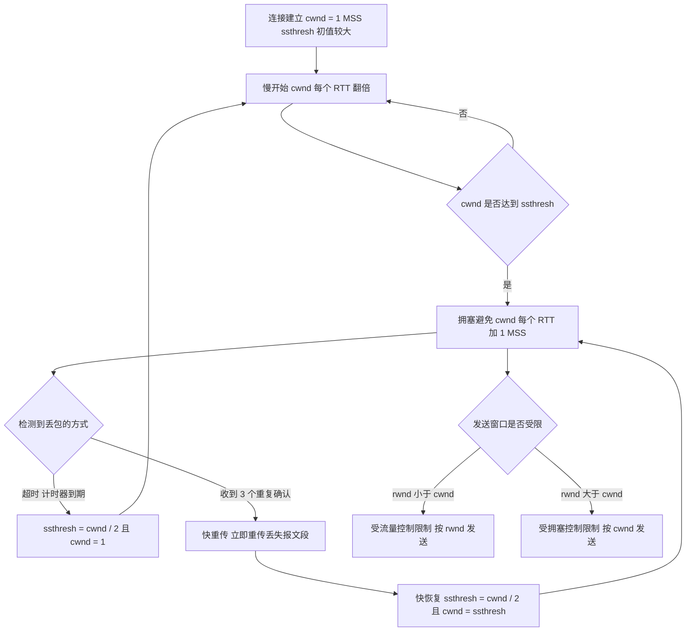

# 核心讲解

传输层提供**进程到进程（端到端）**的通信，用**端口号**（`16` 位）标识进程：`0—1023` 为熟知端口、`1024—49151` 为登记端口、`49152—65535` 为客户端临时端口。**`UDP`** 是无连接、不可靠、面向报文的服务，首部仅 `8 B`（源端口、目的端口、长度、校验和），无拥塞控制、无流量控制，适合实时音视频与 `DNS` 等场景；**`TCP`** 是面向连接、可靠、面向字节流的服务，首部固定 `20 B`，关键字段有**序号 `seq`**（本报文段数据第一个字节的编号）、**确认号 `ack`**（期望收到的下一个字节编号，即已正确收到 `ack - 1` 及之前的全部字节）、**数据偏移**（以 `4 B` 为单位）、窗口（接收窗口 `rwnd`）、以及 `SYN`/`ACK`/`FIN`/`RST`/`PSH`/`URG` 六个标志位。

**连接管理**：**三次握手**为 `SYN(seq = x)` → `SYN + ACK(seq = y, ack = x + 1)` → `ACK(seq = x + 1, ack = y + 1)`，其根本目的是**双方都确认对方的收发能力正常并同步初始序号**；`SYN` 报文**不携带数据但要消耗一个序号**。**四次挥手**为 `FIN` → `ACK` → `FIN` → `ACK`，之所以不能合并为三次，是因为 `TCP` 是全双工的，一方关闭发送方向后另一方可能还有数据要发送，因此**被动关闭方的 `FIN` 必须单独发送**。

主动关闭方在发送最后一个 `ACK` 后进入 **`TIME_WAIT` 状态并等待 `2 MSL`**，其作用是：确保最后一个 `ACK` 能到达对方（若丢失可重传对方的 `FIN`），以及让本连接的旧报文段在网络中消失。**可靠传输**靠**序号 + 确认 + 重传 + 滑动窗口**实现：`TCP` 使用**累计确认**，超时重传时间 `RTO` 由加权平均往返时间 `RTTs` 与偏差 `RTTd` 动态计算（`RTO = RTTs + 4 × RTTd`），并采用 `Karn` 算法（重传时不更新 `RTTs`）。**流量控制**由接收方通过**接收窗口 `rwnd`** 通告可用缓冲空间实现，发送方实际发送窗口 `= min(rwnd, cwnd)`；

当 `rwnd` 为 `0` 时发送方启动**持续计时器**，超时后发送零窗口探测报文。**拥塞控制**包含四个算法：**慢开始**（`cwnd` 从 `1` 个 `MSS` 开始，每经过一个 `RTT` 翻倍，呈指数增长，直到达到慢开始门限 `ssthresh`）、**拥塞避免**（`cwnd` 每经过一个 `RTT` 只加 `1` 个 `MSS`，呈线性增长）、**快重传**（收到 `3` 个重复确认就立即重传丢失的报文段而不等超时）、**快恢复**（配合快重传，把 `ssthresh` 与 `cwnd` 都调整为当前 `cwnd` 的一半，然后进入拥塞避免）。**超时**时 `ssthresh = cwnd / 2`、`cwnd = 1` 并重新慢开始；**快重传**时 `ssthresh = cwnd / 2`、`cwnd = ssthresh` 并直接进入拥塞避免。

# 关键结论速记

- `TCP 首部固定 20 B、UDP 首部 8 B`；`SYN 与 FIN 各消耗一个序号，纯 ACK 不消耗序号`。
- `确认号 = 期望收到的下一个字节序号`，即"`ack - 1` 及之前的字节已全部收到"（累计确认）。
- `三次握手的目的：确认双方收发能力 + 同步初始序号`；`四次挥手不可合并的原因：TCP 全双工，被动方可能仍有数据要发`。
- `TIME_WAIT 持续 2 MSL：保证最后 ACK 可达 + 让旧报文消散` —— 这是高频概念题。
- `发送窗口 = min(rwnd, cwnd)` —— 流量控制看 `rwnd`，拥塞控制看 `cwnd`，两者取小。
- `超时：ssthresh = cwnd/2，cwnd = 1（重新慢开始）`；`快重传+快恢复：ssthresh = cwnd/2，cwnd = ssthresh（直接拥塞避免）`。
- `快重传的触发条件是收到 3 个重复确认` —— 2 个不算，必须 3 个。

# 示意图

**`TCP` 三次握手与四次挥手的状态与序号交换**：注意 `SYN` 与 `FIN` 各占一个序号，因此确认号分别为 `x + 1`、`y + 1`。

```text
three-way handshake

   client                                          server
     |                                                |
     |  CLOSED                            LISTEN      |
     |                                                |
     |------ SYN=1, seq = x  ---------------------->|  SYN_RCVD
     |                                                |
     |<----- SYN=1, ACK=1, seq = y, ack = x+1 -------|
     |                                                |
     |------ ACK=1, seq = x+1, ack = y+1 ---------->|  ESTABLISHED
     |  ESTABLISHED                                   |
     |                                                |
   note: SYN consumes one sequence number, so the third
         segment's seq is x+1 and its ack is y+1

four-way handshake (connection release)

   client                                          server
     |  ESTABLISHED                                   |  ESTABLISHED
     |------ FIN=1, seq = u ------------------------>|  CLOSE_WAIT
     |<----- ACK=1, seq = v, ack = u+1 --------------|
     |  FIN_WAIT_2                                    | (server may still
     |                                                |  send data here)
     |<----- FIN=1, ACK=1, seq = w, ack = u+1 -------|  LAST_ACK
     |------ ACK=1, seq = u+1, ack = w+1 ----------->|  CLOSED
     |  TIME_WAIT (wait 2 MSL)                        |
     |  CLOSED                                        |

   why not three? TCP is full duplex: after the client stops sending,
   the server may still have data to deliver, so its FIN must be a
   separate segment. Merging would cut off the server's data.

   why TIME_WAIT = 2 MSL?
     (1) if the final ACK is lost, the server retransmits FIN and the
         client must still be around to resend the ACK
     (2) let old duplicate segments of this connection die out so they
         cannot be mistaken for a new connection with the same ports
```

**拥塞控制的状态转换**：以 `ssthresh` 为界在"指数增长"与"线性增长"之间切换，两种丢包信号导致不同的 `cwnd` 重置方式。



# 易错点

- 认为四次挥手可以合并为三次：`TCP` 是全双工，客户端发出 `FIN` 只表示"我没有数据要发了"，此时服务器可能仍有数据待发送，因此服务器的 `ACK` 与 `FIN` 必须分开发送；只有在服务器恰好也无数据可发时才可能合并。
- 忽略 `SYN` 与 `FIN` 消耗序号：`SYN` 与 `FIN` 各占一个序号，因此三次握手中第三个报文段的 `seq = x + 1`、`ack = y + 1`；把它们的序号忽略会导致后续所有序号计算整体偏移。
- 混淆超时与快重传后的 `cwnd` 取值：**超时**时 `cwnd = 1` 并回到慢开始，**快重传**时 `cwnd = ssthresh = cwnd / 2` 并直接进入拥塞避免；把两者都写成"减半"或都写成"置 1"是典型错误。
- 把发送窗口只按 `cwnd` 或只按 `rwnd` 计算：实际发送窗口是 `min(rwnd, cwnd)`，二者共同限制；只取其中一个会得到偏大的窗口与偏高的吞吐量。

# 真题示例

**2017 年真题改编（综合应用题，9 分）**

甲、乙双方通过 `TCP` 传送数据，`MSS = 1000 B`。甲首先向乙发送一个 `SYN` 报文段（序号为 `1000`），乙回应 `SYN + ACK`（序号为 `2000`），甲再发送确认。此后甲连续向乙发送数据，当甲收到乙发来的连续 `3` 个重复确认（确认号均为 `5000`）时，甲的拥塞窗口 `cwnd` 为 `8000 B`、慢开始门限 `ssthresh` 为 `16000 B`。要求：写出三次握手中第三个报文段的序号与确认号；说明甲收到 3 个重复确认后应执行什么操作，并给出操作后的 `ssthresh` 与 `cwnd`。

> 解析：第一步算握手序号——`SYN` 消耗一个序号，故甲发出的第三个报文段（纯 `ACK`）的**序号为 `1000 + 1 = 1001`、确认号为 `2000 + 1 = 2001`**（确认号表示期望收到乙的下一个字节）。第二步判断丢包类型——收到**连续 3 个重复确认**触发的是**快重传**而不是超时重传，甲应立即**重传确认号为 `5000` 的那个报文段**（即丢失的报文段），而不必等超时计时器到期。第三步按快恢复调整——`ssthresh = cwnd / 2 = 8000 / 2 = 4000 B`，随后 `cwnd = ssthresh = 4000 B`，并**直接进入拥塞避免阶段**（而不是回到慢开始）。**判分点是"3 个重复确认 = 快重传"、"快恢复后 cwnd 等于 ssthresh 而非 1"，以及握手报文中 SYN 占用序号导致的 `+1`。**
