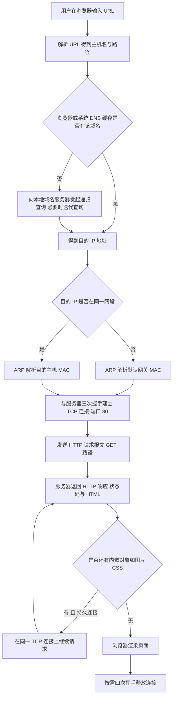

# 核心讲解

应用层的两种体系结构是**客户/服务器（`C/S`）**与**对等（`P2P`）**：`C/S` 中客户主动请求、服务器被动等待且必须一直运行，可扩展性受服务器性能限制；`P2P` 中每个结点既是客户又是服务器，可扩展性好但管理困难。**域名系统 `DNS`** 把域名解析为 `IP` 地址，采用**分布式层次数据库**（根域名服务器、顶级域名服务器、权限域名服务器、本地域名服务器）；查询时**主机向本地域名服务器的查询通常采用递归查询**（本地域名服务器代替主机继续查询并把最终结果返回），**本地域名服务器向根/顶级/权限域名服务器的查询通常采用迭代查询**（被查询的服务器只返回"下一步该问谁"的地址，由本地域名服务器继续追问）。

`DNS` 主要使用 `UDP` 的 `53` 号端口；域名解析需要**缓存**以减轻根服务器负担。**文件传输协议 `FTP`** 使用**两条 `TCP` 连接**：**控制连接**（服务器 `21` 端口，整个会话期间保持，传送命令与应答）与**数据连接**（服务器 `20` 端口，主动模式下由服务器发起，传送文件内容），故 `FTP` 的控制信息是**带外传送**的。

**电子邮件**的发送使用 **`SMTP`**（`TCP` `25` 端口），读取使用 **`POP3`**（`110` 端口，下载后通常删除、不保留状态）或 **`IMAP`**（`143` 端口，在服务器上管理邮件、支持多设备同步）；

**`MIME`** 不是邮件传送协议，而是在 `SMTP` 之上扩展邮件**内容格式与编码**的标准，它把非 ASCII 文本与图像、音频、附件等二进制内容编码成 7 位 ASCII 才能在 `SMTP` 通道中传送，编码方式有 **base64**（把每 `3` 字节二进制编成 `4` 个字符，适合任意二进制，体积约增三分之一）与 **quoted-printable**（可打印 ASCII 原样保留，非 ASCII 字符写成 `=XX`，适合以文本为主、只含少量非 ASCII 字符的内容），并由 `MIME-Version`、`Content-Type`、`Content-Transfer-Encoding` 等首部说明类型与编码；`POP3`/`IMAP` 只负责把报文取回客户端，解码由客户端按 MIME 首部完成。

**万维网 `WWW`** 以**统一资源定位符 `URL`** 标识资源，用**超文本传输协议 `HTTP`** 传送；`HTTP` 使用 `TCP` 的 `80` 端口，本身是**无状态**的（靠 `Cookie` 维持状态）。`HTTP/1.0` 使用**非持久连接**（每个对象需要建立一次 `TCP` 连接，即每个对象 `2` 个 `RTT`：一次建连、一次请求响应），`HTTP/1.1` 默认使用**持久连接**（`keep-alive`），又分为**非流水线**（每个对象依次请求，每个对象 `1` 个 `RTT`）与**流水线**（连续发出所有请求，所有对象共约 `1` 个 `RTT`）。

`HTTP` 常用方法有 `GET`、`POST`、`HEAD`、`PUT`、`DELETE`，状态码 `200` 表示成功、`301` 表示永久移动、`404` 表示未找到、`500` 表示服务器内部错误。

# 关键结论速记

- `DNS：主机到本地域名服务器用递归查询，本地到根/顶级/权限用迭代查询` —— 递归与迭代的主体不能互换。
- `DNS 用 UDP 53、SMTP 用 TCP 25、POP3 用 TCP 110、IMAP 用 TCP 143、HTTP 用 TCP 80、FTP 控制 21 数据 20`。
- `FTP 用两条连接：控制连接保持、数据连接传文件` —— 控制信息带外传送。
- `HTTP 无状态；非持久连接每个对象 2 个 RTT，持久非流水线每个对象 1 个 RTT，持久流水线约 1 个 RTT 全部`。
- `状态码：200 成功、301 永久移动、404 未找到、500 服务器内部错误`。
- `POP3 下载后通常删除（无状态），IMAP 在服务器端管理（有状态、多端同步）`。
- `MIME 在 SMTP 之上扩展非 ASCII 与多媒体内容` —— 只定义内容格式与编码，不替代 `SMTP`/`POP3`/`IMAP` 的传送与读取。
- `base64 把 3 字节编成 4 个字符、适合任意二进制；quoted-printable 只转义少量非 ASCII、适合文本` —— 由 `Content-Transfer-Encoding` 首部指明。

# 示意图

**`DNS` 递归查询与迭代查询的路径对比**：递归是"你替我查到底"，迭代是"告诉我下一步问谁"。

```text
recursive query (host -> local DNS server)

   host  --------------------------------> local DNS server
         "please resolve www.example.com"      |
         <---------------------------------    | the local server does all
                  final answer                    the remaining work and
                                                  returns the final IP

iterative query (local DNS server -> other servers)

   local DNS server ---> root server          "who handles .com?"
                    <--- "ask the .com TLD server at 1.2.3.4"
   local DNS server ---> .com TLD server      "who handles example.com?"
                    <--- "ask the authoritative server at 5.6.7.8"
   local DNS server ---> authoritative server "what is www.example.com?"
                    <--- "93.184.216.34"
   local DNS server ---> host                 final answer

   summary table
   query type   who does the work          typical user
   ----------   -----------------------    ----------------------------
   recursive    the queried server         host -> local DNS server
   iterative    the querying server        local -> root/TLD/authoritative
```

**一次 `HTTP` 请求从 `URL` 解析到页面渲染的完整流程**：`DNS`、`ARP`、`TCP` 握手、`HTTP` 请求响应按序发生。



# 易错点

- 把 `DNS` 的递归与迭代主体弄反：**主机到本地域名服务器**通常是**递归**查询（本地服务器代为查完并返回最终结果），**本地域名服务器到根/顶级/权限服务器**通常是**迭代**查询（对方只返回下一个该问的服务器地址）；说成"根服务器替本地服务器递归查询"即为错误。
- 非持久连接下 `RTT` 次数算错：非持久连接中**每个对象都要新建一次 `TCP` 连接**，故每个对象需 `2` 个 `RTT`（`1` 个用于建连、`1` 个用于请求并收到响应）；若题目含 `N` 个内嵌对象，总 `RTT` 为 `2 × (N + 1)`。
- 认为 `FTP` 的数据连接由客户端发起：`FTP` 有**主动模式**（服务器从 `20` 端口主动连接客户端的指定端口）与**被动模式**（客户端连接服务器提供的临时端口）两种，端口 `20` 是主动模式下服务器发起数据连接所用的端口，不能一概而论。
- 混淆 `POP3` 与 `IMAP` 的行为：`POP3` 把邮件下载到本地、默认不在服务器保留（因此多设备不同步），`IMAP` 在服务器上维护邮箱与状态、支持多设备一致视图；也常把 `MIME` 当成邮件传送协议，其实 `MIME` 只是 `SMTP` 之上的内容格式与编码扩展，取信仍靠 `POP3`/`IMAP`。

# 真题示例

**2011 年 408 第 40 题（单项选择题，2 分）**

某浏览器使用 `HTTP/1.1` 的**非持久连接**方式访问一个包含 `5` 个内嵌对象（每个对象均与主页面位于同一服务器）的 `Web` 页面。若忽略报文传输时间与处理时间，则从用户输入 `URL` 到页面全部加载完成所需的最少 `RTT` 数为（ ）。

A. `4`　B. `8`　C. `10`　D. `12`

> 解析：非持久连接意味着**每个对象都要单独建立一次 `TCP` 连接**，而每次建连需要 `1` 个 `RTT`（三次握手的前两次完成连接建立）、随后请求并收到响应又需要 `1` 个 `RTT`，故每个对象共需 `2` 个 `RTT`。需要传输的对象为 **`1` 个主页面 `+ 5` 个内嵌对象 `= 6` 个**，故最少 `RTT = 6 × 2 = 12`，答案为 **D**。注意题目问的是"从输入 `URL` 到全部加载完成"，域名解析的 `RTT` 已被忽略；若漏算主页面（只算 5 个内嵌对象）会得到 `10` 而误选 `C`——**判分点是"主页面本身也要一次连接"与"每个对象 2 个 `RTT`"。**
