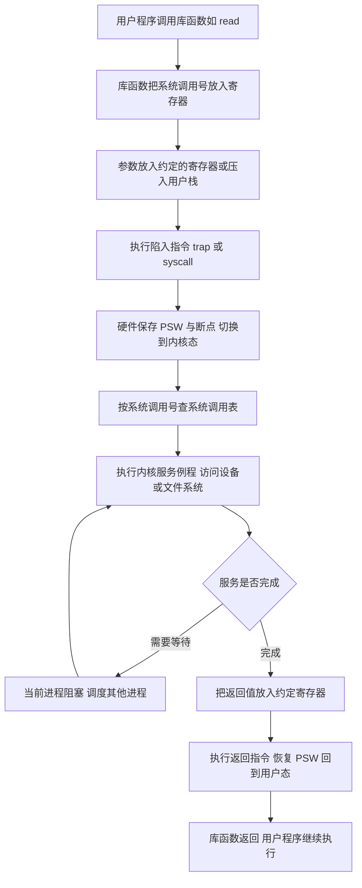

# 核心讲解

操作系统是管理计算机硬件的系统软件，其四个基本特征是**并发、共享、虚拟、异步**，其中**并发与共享互为存在条件**（没有并发就无需共享，没有共享则并发程序无法推进）；虚拟建立在离散分配与多次性之上，异步是"程序走走停停、以不可预知的速度推进"。CPU 的执行状态分为**内核态（管态）**与**用户态（目态）**：只有内核态才能执行**特权指令**（如开关中断、设置时钟、清主存、修改 `PSW`、`I/O` 指令）并访问全部寄存器与存储空间；用户态只能执行非特权指令。**`PSW` 中的状态位**标识当前处于哪一态，而**由用户态进入内核态的唯一途径是中断或异常**（系统调用本质上是通过**陷入指令 `trap`** 触发的一次特殊异常）。

注意 `trap` 指令本身**不是特权指令**——它需要在用户态执行才能完成"进入内核态"的动作。**中断（外中断）**来自 CPU 外部的事件（时钟中断、`I/O` 完成中断、控制台中断），**异常（内中断）**由当前执行的指令引起，分为故障 `fault`（如缺页、除零，可能被修复后重新执行该指令）、自陷 `trap`（如系统调用、断点，处理后返回到下一条指令）、终止 `abort`（如硬件故障，不返回）。**系统调用**的过程是：用户程序传递参数 → 执行陷入指令（`trap`/`syscall`，硬件将 `PSW` 改为内核态并转入内核入口）→ 内核按系统调用号查表执行服务例程 → 返回用户态。

操作系统内核通常包含**时钟管理、中断处理、原语、进程管理、存储管理、设备管理**等功能，**原语**是"执行期间不可中断"的原子操作，靠**关中断**实现。体系结构上，**宏内核**把所有功能放在内核态、效率高但可靠性差；**微内核**只把最基本的功能（进程调度、中断处理、消息传递）留在内核，其余移出为用户态服务进程，可靠性高但频繁的消息传递带来开销。

# 关键结论速记

- `四个特征：并发、共享、虚拟、异步` —— 并发与共享互为存在条件，是最常考的相互关系。
- `特权指令只能在核心态执行；trap 指令是唯一能在用户态执行并进入核心态的指令` —— 把 `trap` 说成特权指令即为错误。
- `中断（外中断）来自 CPU 外部，异常（内中断）由当前指令引起` —— 时钟、`I/O` 完成属中断；缺页、除零、系统调用属异常。
- `fault 返回当前指令重新执行，trap 返回下一条指令，abort 不返回` —— 异常三分类的返回行为必须区分。
- `系统调用 = 传参 + 陷入指令 + 内核服务例程 + 返回用户态` —— 库函数不一定发生系统调用，系统调用一定进内核。
- `原语的原子性靠关中断保证` —— 关中断/开中断是特权指令，故原语只能在核心态运行。

# 示意图

**用户态与内核态的地址空间与切换路径**：用户程序只能通过中断/异常这道"门"进入内核，内核通过修改 `PSW` 回到用户态。

```text
process address space and the user/kernel boundary

   high address
   +-----------------------------------+
   |          kernel space             |   only in kernel mode
   |  (kernel code, kernel stack,      |   privileged instructions allowed
   |   page tables, device drivers)    |   can access all memory
   +-----------------------------------+
   |     <-- boundary is enforced by hardware mode bit in PSW -->
   +-----------------------------------+
   |          user space               |   only in user mode
   |  stack  (grows downward)          |   non-privileged instructions
   |  ...                              |   cannot touch kernel space
   |  heap   (grows upward)            |
   |  data / bss                       |
   |  code (text)                      |
   +-----------------------------------+
   low address

mode switch paths

   user mode  --(1) system call via trap-->  kernel mode
   user mode  --(2) external interrupt   -->  kernel mode
   user mode  --(3) exception (page fault, divide by zero) --> kernel mode
   kernel mode --(4) return from trap/interrupt: restore PSW --> user mode
                 (returning to user mode is NOT a privileged-only act;
                  the OS does it by executing the return-from-trap instruction)
```

**一次系统调用的完整流转**：参数通过寄存器或栈传递，`trap` 指令切换状态并跳转到内核固定的入口地址。



# 易错点

- 把 `trap`（陷入）指令当成特权指令：`trap` 必须**在用户态执行**才能完成"请求进入内核"的功能，因此它是非特权指令；真正只能在核心态执行的是开关中断、`I/O`、修改 `PSW` 等特权指令。
- 混淆中断与异常的分类归属：时钟中断、`I/O` 完成中断来自 CPU 外部，属**中断**；而缺页、除零、系统调用、断点由当前指令引起，属**异常**；把缺页说成"中断"是最常见的概念错误。
- 认为系统调用与库函数等价：库函数可能只是用户态的一段代码（如 `printf` 的格式化部分），只有其中真正需要内核服务的环节才触发系统调用，二者不是一一对应。
- 把"用户态到内核态"的途径扩大化：除中断与异常外，用户程序**没有任何其他合法途径**进入内核态；也不能通过跳转指令直接跳进内核代码（硬件会因特权级检查而拒绝）。

# 真题示例

**2011 年 408 第 23 题（单项选择题，2 分）**

下列选项中，在用户态执行的是（ ）。

A. 命令解释程序　B. 缺页处理程序　C. 进程调度程序　D. 时钟中断处理程序

> 解析：逐项判定所处的运行状态。**缺页处理程序**属于内存管理的内核功能，需访问页表与磁盘，必须在核心态（B 错）。**进程调度程序**要操作就绪队列与 `PCB`、修改 `PSW`，属内核功能，必须在核心态（C 错）。**时钟中断处理程序**是中断服务程序，由硬件中断触发、运行在核心态（D 错）。**命令解释程序**（`shell`）只是接收用户命令并创建子进程去执行，其自身运行在用户态，因此用户态可以执行（A 对）。答案选 **A**。**判分依据是"该程序是否需要访问内核数据结构或执行特权指令"，不需要即可在用户态运行。**
