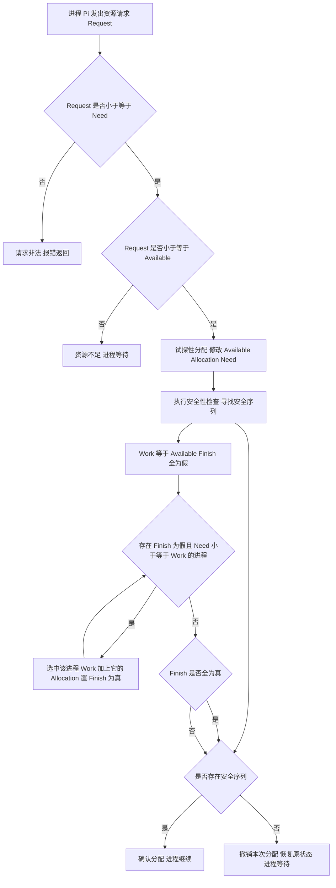

# 核心讲解

**处理机调度**分三级：**高级调度**（作业调度）决定哪些作业从外存进入内存并建立进程，**中级调度**（内存调度）决定挂起的进程何时重新调入内存（对应"就绪挂起 → 就绪"），**低级调度**（进程调度）从就绪队列中选一个进程分配 `CPU`，是频率最高、必须高效的一级；若系统有**中级调度**就说明采用了**虚拟内存**。评价指标中，**周转时间 = 完成时间 - 到达时间**，**带权周转时间 = 周转时间 / 服务时间**（`>= 1`，越接近 1 越好），**等待时间**是进程在就绪队列中排队的时间之和（不含执行与 `I/O` 时间），**响应时间**是从提交请求到首次响应的时间。

**`FCFS`**（先来先服务）按到达顺序调度，非抢占、对长作业有利而对短作业不利，且对 `I/O` 繁忙型作业不利；**`SJF`/`SPF`**（短作业优先）平均周转时间与平均带权周转时间最短，但必须预知运行时间，且对长作业可能造成**饥饿**；**`HRRN`**（高响应比优先）用 `响应比 = (等待时间 + 服务时间) / 服务时间`，兼顾等待时间与服务时间，是非抢占式的折中方案。

**时间片轮转 `RR`** 只用于进程调度、按 `FCFS` 排队并轮流执行一个时间片：时间片过大会退化为 `FCFS`，过小则切换开销过大，它对**响应时间**有利但不保证周转时间；**优先级调度**分抢占式与非抢占式，就绪队列可用**静态/动态优先级**；**多级反馈队列**设置多个优先级递减、时间片递增的队列，新进程进最高级队列、用完时间片未完成则降级，只有高优先级队列为空才调度低优先级队列，因而能较好的满足各类进程需要，是通用性最强的算法。

**死锁**是多个进程因竞争资源而互相等待、无外力干预都无法推进的局面，产生死锁的**四个必要条件**是**互斥、不可剥夺、请求并保持、循环等待**，四者同时成立才可能死锁；**死锁预防**通过破坏某个必要条件实现；**死锁避免**在分配前用**银行家算法**判断系统是否处于**安全状态**（存在一个安全序列使所有进程都能完成）；**死锁检测与解除**允许死锁发生，用资源分配图化简（可完全化简则无死锁）检测，再用资源剥夺、撤销进程或进程回退来解除。

**多处理机调度**中**负载共享**是最简单的策略：所有就绪进程放在公共就绪队列里，任一空闲处理机都可以取一个来执行，负载自动均衡，但进程可能在不同处理机之间迁移、缺乏亲和性，`Cache` 与 `TLB` 的命中率会下降。

**成组调度**（gang scheduling）把同一并行程序的一组相关进程或线程**同时**分配到多个处理机上一起运行、一起暂停，使它们能同步推进，避免组内个别成员未获处理机而空等甚至死锁，代价是一次要预留多个处理机、调度粒度较粗。

**上下文切换**是处理机从一个进程切换到另一个进程的过程：先把当前进程的处理机现场（`PC`、通用寄存器、`PSW`、栈指针）保存到它的 `PCB`，再从被选中进程的 `PCB` 恢复现场；开销来自**保存/恢复寄存器组**、**切换页表并刷新 `TLB`** 以及新进程的数据不在 `Cache` 中造成的失效，因此切换本身是纯开销；它与**模式切换**不同：模式切换只是用户态与核心态之间的转换（由陷入或中断引起），中断处理完返回原进程时只发生模式切换、**不更换进程**，只有真正换进程才需要上下文切换。

# 关键结论速记

- `周转时间 = 完成 - 到达`，`带权周转时间 = 周转 / 服务时间` —— 带权周转时间必须除以服务时间，忘除是最常见错误。
- `SJF 平均周转时间最短，但需预知运行时间且长作业可能饥饿` —— 这是"理论最优但工程上受限"的经典结论。
- `RR 的时间片过大退化为 FCFS，过小则上下文切换开销剧增` —— 时间片选择是 RR 的核心权衡。
- `多级反馈队列：优先级递减 + 时间片递增 + 只有高优先级队列空才调度低优先级` —— 综合性能最好。
- `死锁四个必要条件：互斥、不可剥夺、请求并保持、循环等待` —— 缺一不可，破坏任一即可预防。
- `银行家算法：Need = Max - Allocation，找 Need <= Available 的进程并回收其资源` —— 找得到完整序列则处于安全状态。
- `多处理机：负载共享（公共就绪队列）与成组调度（同组线程同时上机）` —— 负载共享简单但亲和性差，成组调度避免并行程序互相空等。
- `上下文切换 = 保存现场到 PCB + 恢复另一进程的现场` —— 开销来自寄存器、页表/`TLB`、`Cache` 失效；模式切换不等于上下文切换。

# 示意图

**三种调度算法的甘特图对比**：同一组作业（到达时间与服务时间相同）在不同算法下的完成顺序与平均周转时间不同。

```text
jobs:  A(arrive 0, service 7)  B(arrive 2, service 4)
       C(arrive 4, service 1)  D(arrive 5, service 4)

FCFS (non-preemptive, by arrival order)

   time  0    2         7   9  10  11        15
         +----+---------+---+---+---+---------+
         |    A          | B | C |     D       |
         +----+---------+---+---+---+---------+
   finish: A=7  B=11  C=12  D=16
   turnaround: A=7  B=9   C=8   D=11   average = 8.75

SJF (non-preemptive, shortest service first among arrived)

   time  0         7   8   9        13        20
         +---------+---+---+---------+---------+
         |    A    | C | B |    D    |  (idle) |
         +---------+---+---+---------+---------+
   at time 7 arrived: B(4), C(1), D(4) -> pick C, then tie B/D by arrival
   finish: A=7  C=8  B=12  D=16
   turnaround: A=7  C=4  B=10  D=11   average = 8.0

RR (time slice q = 4)

   time  0    4    8   9   12        16
         +----+----+---+---+---------+
         | A  | B  | C | A |    D    |
         +----+----+---+---+---------+
   order: A(0-4) B(4-8) C(8-9) A(9-12) D(12-16)
   finish: B=8  C=9  A=12  D=16
   turnaround: A=12  B=6  C=5  D=11   average = 8.5
   note: RR improves response time (C finished at 9 instead of 12)
         but its average turnaround may be worse than SJF
```

**上下文切换与模式切换的差别**：切换进程要保存并恢复现场、还要换页表，只做中断处理则只是同一进程在用户态与核心态之间往返一次。

```text
context switch vs mode switch

   P1 user mode | P1 kernel mode | P2 user mode
   -------------+----------------+-----------------
      running   | save P1 ctx    |    running
                | pick P2        |
                | restore P2 ctx |
                | switch page    |
                | table, flush   |
                | TLB            |
                v                v

   context switch:  save PC, GPRs, PSW, SP -> P1.PCB
                    load PC, GPRs, PSW, SP <- P2.PCB
                    switch page table + flush TLB  <-- the real cost

   mode only:  user --trap or interrupt--> kernel --return--> same P1
               no PCB change, no address-space change
```

**银行家算法的安全性检查流程**：每次试探性分配后都要重新判断是否存在安全序列，不存在则撤销本次分配。



# 易错点

- 带权周转时间忘记除以服务时间：`带权周转时间 = 周转时间 / 服务时间`，量纲是"倍数"且必然 `>= 1`；只算周转时间就答题会整题失分。
- 认为 `SJF` 一定优于其他算法：`SJF` 的"平均周转时间最短"是在**所有作业同时到达**的前提下证明的；若到达时间不同，抢占式 `SRTN` 才更优，且 `SJF` 会造成长作业**饥饿**。
- 把死锁预防、避免与检测解除混为一谈，或把银行家算法的判据写反：预防是静态破坏四个必要条件之一，避免是每次分配前用银行家算法判断安全性（`Need = Max - Allocation`，判据是 `Need <= Available`），检测与解除则是允许死锁发生后再处理。
- 把上下文切换与模式切换混为一谈：模式切换只是用户态与核心态之间的转换，中断处理完返回原进程并不换进程；上下文切换要保存/恢复 `PC`、寄存器与 `PSW` 到 `PCB`，还要切换页表、刷新 `TLB`，开销大得多。

# 真题示例

**2016 年 408 第 45 题（综合应用题，7 分）**

某系统中有 5 个进程 `P0 ~ P4`，3 类资源 `A、B、C`，当前时刻的资源分配情况为 `Available = (3, 3, 2)`，各进程的 `Max` 与 `Allocation` 如下表（`Need = Max - Allocation`）：`P0: Max(7,5,3) Alloc(0,1,0)`、`P1: Max(3,2,2) Alloc(2,0,0)`、`P2: Max(9,0,2) Alloc(3,0,2)`、`P3: Max(2,2,2) Alloc(2,1,1)`、`P4: Max(4,3,3) Alloc(0,0,2)`。要求：计算各进程的 `Need`；判断当前系统是否处于安全状态，若是则给出一个安全序列。

> 解析：第一步求 `Need = Max - Allocation`：`P0 = (7,4,3)`、`P1 = (1,2,2)`、`P2 = (6,0,0)`、`P3 = (0,1,1)`、`P4 = (4,3,1)`。第二步令 `Work = Available = (3,3,2)` 并逐个尝试：`P1` 的 `Need (1,2,2) <= (3,3,2)` 成立，分配后 `P1` 完成并释放，`Work = (3,3,2) + (2,0,0) = (5,3,2)`；`P3` 的 `Need (0,1,1) <= (5,3,2)` 成立，`Work = (5,3,2) + (2,1,1) = (7,4,3)`；`P4` 的 `Need (4,3,1) <= (7,4,3)` 成立，`Work = (7,4,3) + (0,0,2) = (7,4,5)`；`P0` 的 `Need (7,4,3) <= (7,4,5)` 成立，`Work = (7,4,5) + (0,1,0) = (7,5,5)`；`P2` 的 `Need (6,0,0) <= (7,5,5)` 成立，`Work = (7,5,5) + (3,0,2) = (10,5,7)`。全部进程都能完成，故系统**处于安全状态**，一个安全序列为 **`P1 → P3 → P4 → P0 → P2`**（安全序列不唯一）。**判分点是 `Need` 表算对、每次回收后 `Work` 的更新正确、并明确给出"存在安全序列故安全"的结论。**
