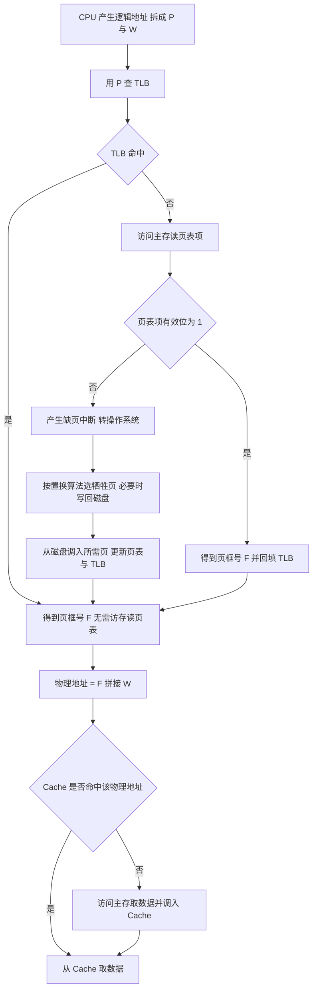

# 核心讲解

**内存管理**要解决四个问题：内存空间的分配与回收、地址转换、扩充、保护。程序的装入有三种方式：**绝对装入**（编译时确定物理地址，只适合单道）、**静态重定位**（装入时一次性修改所有地址，运行期间不能再移动）、**动态重定位**（运行时由**重定位寄存器**加逻辑地址得到物理地址，允许程序在内存中移动）。

**连续分配**中的**动态分区分配**有四种算法：**首次适应**（按地址递增查找第一个满足的空闲分区，性能通常最好、但低地址区被反复分割）、**最佳适应**（按容量递增，选最小满足的分区，会留下大量难以利用的外部碎片）、**最坏适应**（选最大分区，容易把大分区耗尽）、**邻近适应**（从上次结束处继续查找，使高地址大分区也被分割）。**分页存储管理**把逻辑地址空间分成大小相等的**页**、内存分成同样大小的**页框（物理块）**，逻辑地址结构为 `页号 P + 页内偏移 W`；

页表存放"页号 → 页框号"的映射，**页表项大小与页框大小、页表项数目共同决定页表长度**，做题时要注意页表项是否按字节取整。**两级页表**把页号再拆成"一级页号 + 二级页号"，使页表本身也可以离散存放、不必连续占用大块内存；其地址结构位数拆分的依据是"每页能放多少个页表项"。**分段存储管理**按程序的逻辑单位（主程序段、子程序段、数据段）划分，逻辑地址为 `段号 S + 段内偏移 W`，段表项含段长与基址；

**段是逻辑单位、对用户可见，页是物理单位、对用户透明**，因此分页是一维的（只需一个地址），分段是二维的（必须给出段名与段内地址）。**段页式**先分段再分页，地址为 `段号 + 页号 + 页内偏移`，需要访问三次主存（段表、页表、数据），可用快表减少。**虚拟内存**的三个前提是**多次性、对换性、离散分配**；**请求分页**在访问的页不在内存时产生**缺页中断（属异常/内中断）**，由操作系统调页。

**页面置换算法**：**最佳置换 `OPT`**（置换未来最久不用的页，不可实现，作为性能上界）、**先进先出 `FIFO`**（实现简单，但可能出现 **`Belady` 异常**——分配的页框越多缺页次数反而增加）、**最近最久未使用 `LRU`**（性能接近 `OPT`，但需硬件支持、开销大）、**时钟 `CLOCK`（简单时钟）**（用访问位循环扫描，访问位为 1 则清 0 继续，为 0 则置换）、**改进型 `CLOCK`**（同时考虑访问位 `A` 与修改位 `M`，优先淘汰 `A = 0 且 M = 0`，其次 `A = 0 且 M = 1`，从而减少写回磁盘的开销）。**有效访问时间**必须按题意枚举命中组合，若 `TLB` 未命中要额外访问一次主存读页表项，若缺页还要加上缺页处理时间。

# 关键结论速记

- `逻辑地址 = 页号 P + 页内偏移 W`；`页号位数 = log2(页数)`、`页内偏移位数 = log2(页大小)`。
- `两级页表的位数拆分依据"每页可放 2^(页内偏移位数) / 页表项大小 个页表项"` —— 页表项大小要向上取整到字节。
- `分页一维、对用户透明；分段二维、对用户可见`；分段便于共享与保护，分页便于内存分配。
- `缺页中断属内中断（异常），在指令执行期间产生，处理后可重新执行该指令`。
- `FIFO 可能出现 Belady 异常；LRU 与 OPT 不会（属堆栈类算法）` —— 这是判断缺页次数随页框数变化的依据。
- `改进型 CLOCK 的优先淘汰次序：A=0,M=0 > A=0,M=1 > A=1,M=0 > A=1,M=1` —— `M=0` 优先是为了避免写回。

# 示意图

**三种离散分配方式的地址结构与内存布局对比**：分页的页框大小固定、页可离散存放；分段的段长可变、按逻辑划分；段页式是二者结合。

```text
(1) paging: logical address = page number P | offset W

     logical:  +-----------+------------+
               |     P     |     W      |
               +-----------+------------+
                              |
                              v
     page table (indexed by P)
       +--------+--------+
       | page P | frame  |
       +--------+--------+
       |   0    |   5    |
       |   1    |   2    |
       |   2    |   9    |
       +--------+--------+
     physical = frame * page_size + W

     physical memory    +------+------+------+------+------+
                        | fr 0 | fr 1 | fr 2 | ...  | fr 9 |
                        +------+------+------+------+------+
     pages of a process may be scattered: fr5, fr2, fr9 ...
     internal fragmentation on the LAST page only

(2) segmentation: logical address = segment S | offset W

     logical:  +-----------+------------+
               |     S     |     W      |
               +-----------+------------+
     segment table
       +--------+---------+--------+
       | seg S  |  base   | length |
       +--------+---------+--------+
       |   0    |  1000   |  400   |   code
       |   1    |  2400   |  800   |   data
       +--------+---------+--------+
     check W < length first, then physical = base + W
     external fragmentation; segments are visible to the user

(3) segment + paging: S | P | W  -> needs segment table then page table
     three memory accesses without TLB: seg table, page table, data
```

**一次访存的地址翻译流程（含 `TLB` 与缺页）**：`TLB` 命中可省去读页表项的一次访存，缺页则要进入操作系统调页。



# 易错点

- 页表项大小与页表占用页数计算错误：页表项大小要**向上取整到字节**（如 `20` 位需占 `3` 字节而不是 `2.5` 字节），页表本身占用页数 `= 页表总字节数 / 页大小` 需向上取整；忽略这两处取整会得到偏小的答案。
- 有效访问时间漏算 `TLB` 未命中时的访存：`TLB` 命中时只需一次访存取数据，未命中时要**先访问主存读页表项、再访问主存取数据**共两次；若还缺页则需再加缺页处理时间，必须按题意逐项列出。
- 认为 `FIFO` 一定不会出现 `Belady` 异常：`FIFO` 是**唯一**会出现 `Belady` 异常的常用算法（页框增多而缺页次数反而增加）；`LRU` 与 `OPT` 属堆栈类算法，不会出现该异常。
- 改进型 `CLOCK` 的淘汰次序写反：优先淘汰 `A = 0 且 M = 0`（既没被访问也没被修改，淘汰代价最小），最后才考虑 `A = 1 且 M = 1`；把"优先淘汰被修改过的页"当成规则会与减少磁盘写回的设计目标相悖。

# 真题示例

**2016 年 408 第 46 题（综合应用题，8 分）**

某 32 位系统采用二级页表的分页存储管理，按字节编址，页大小为 `4 KB`，页表项大小为 `4 B`。要求：给出一级页号、二级页号与页内偏移各占多少位；若某进程的代码段大小为 `8 MB` 且从逻辑地址 `0` 开始连续存放，求该代码段需要多少个二级页表。

> 解析：第一步确定位数。页大小 `4 KB = 2^12 B`，故**页内偏移 `W = 12` 位**。每个页面能容纳的页表项数 `= 4 KB / 4 B = 1024 = 2^10`，故**二级页号占 `10` 位**（一个二级页表恰好占一页）；剩下的位数给一级页号：`32 - 12 - 10 = 10` 位，即**一级页号占 `10` 位**。第二步算二级页表个数。代码段大小 `8 MB = 2^23 B`，需要的页数 `= 2^23 / 2^12 = 2^11 = 2048` 页；每个二级页表覆盖 `2^10 = 1024` 个页，故需要 `2048 / 1024 = 2` 个二级页表。**判分点是"页表项数由页大小除以页表项大小决定"这一拆分依据，以及页数向上取整的处理（本题恰好整除）。**
